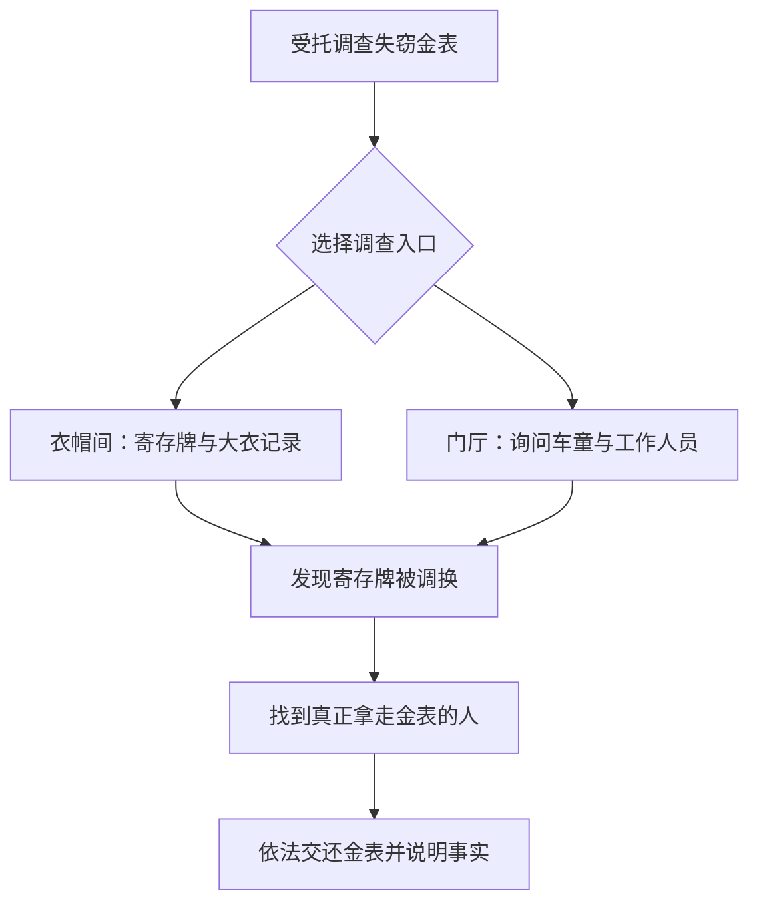

# 汤米

> 当前人物与故事方向，2026-11-01 依据《从门外到包厢里》整理，取代旧版接待贵客／讨债事件方向。本文不是运行时实现清单。事件衔接见[汤米命运草图](../../experiments/人物命运草图/汤米.html)。

**文档类型：** 人物线与事件设计初稿  
**覆盖范围：** 第一章五幕；日常事件、短 Encounter、对话中的立场表达与尾声  
**状态：** 故事方向已形成，具体对白与数值有待试玩修订

## 人物

### 核心与愿望

汤米是个机灵、爱吹牛、虚荣，又有点讨人喜欢的年轻跑腿。他最想做的事不是发财本身，而是**从门外走进包厢，成为一个别人必须认真对待的人**。

他记得谁欠谁的钱，谁讨厌谁，谁在某个人面前说得上话。他很少掌握真正的权力，却总能嗅到一点靠近权力的机会。他的上升不是假的：他逐渐学会经营人情、处理麻烦、判断形势，最后得到一份有地位的工作。

但他也逐渐学会了另一件事：在他所向往的世界里，忠诚、体面与朋友的利益，都可以拿来交换位置。

**这条线不是“野心导致报应”，也不是“现实教会尼尔成熟”。** 汤米可以得到想要的成功；尼尔（玩家）也可以充分理解这种成功的逻辑，却依然认为某些做法不对。两个人可以继续认识、互相尊重，甚至互相帮助，而不必拥有相同的立场。

人物关系的关键不是「尼尔有没有把汤米劝回正道」，而是：

> **汤米有权选择自己的道路；玩家也有权不赞成、不参与，乃至与他分道扬镳。双方的选择都应被当真。**

### 表现意象

**门。** 从被赶出后门，到第一次获准进入，再到终于拥有自己的包厢。

**鞋。** 从磨破的旧鞋，到擦得发亮的新皮鞋。汤米总希望别人看见自己过得更好了。

**座位。** 从站在别人身后等差事，到替别人排座位，再到自己坐在主位。但主位之上依然有更大的老板。

三种意象都适合以极少动画、场景摆放和简短对白来呈现。无需给它们建立系统数值。

### 尼尔的态度由玩家决定

从相识到尾声，玩家始终可以选择怎样与汤米说话、持有什么立场：欣赏、支持、质疑、反对、取笑、沉默或保持距离。玩家也可以随着具体事情改变看法，不用一次表态决定此后全部态度。

第四幕揭示背叛后是一次重要的对话机会，不是唯一的立场选择，也不设置固定的五类态度路线。后文尼尔的对白均为可选回应示例，不是玩家必须说的话；未选中的判断不能被后续当成既成事实。沉默不自动解释成失望、赞同或原谅。

暂时不因态度大幅改变汤米的命运：得到赏识、跟随贝恩斯、背叛旧老板、成为夜间管事仍是他的主要故事走向。差异主要落在当场回应、共同记忆、亲疏与接触方式。关系疏远可以真正拒绝聚会，不强制和好；也不因反对他而封锁主线必需的信息。讨薪的局部结果由调查与行动决定，不与是否认可汤米绑定。

## 事件

### 五幕发展顺序

| 幕 | 汤米的位置 | 关键事件 | 玩家看见的变化 |
|---|---|---|---|
| 第一幕 | 门外等差事的小跑腿 | 酒馆与夜总会后门的跑腿、吹嘘、零星情报 | 想被大人物看见；还没人把他当回事 |
| 第二幕 | 夜总会的临时助手 | **《老板的金表》**：尼尔受雇调查失窃金表，汤米借机证明自己会找对的人 | 第一次得到老板赏识，被介绍给贝恩斯 |
| 第三幕 | 贝恩斯手下的正式办事人 | **《新皮鞋》**：安排宴会座次、处理文书和人情 | 开始掌握小范围的权力，也开始模仿曾使唤自己的人 |
| 第四幕 | 面临旧势力失势的选择 | **《换老板》**：将旧老板托付的内部账册信息交给新势力，换取上升机会 | 他真正背叛了曾经提携自己的人；玩家获得明确表达立场的机会 |
| 第五幕 | 新经营者手下的夜间管事 | **《包厢里的人》**：汤米终于坐进那个房间 | 获得地位；仍然要听命于更大的老板；与尼尔的关系取决于玩家此前的态度 |

整条线是**汤米自己的命运轨迹**。玩家是否参加某项委托，不应决定汤米能否继续生活、是否最终升职。参与带来的是亲历、额外报酬、具体记忆与关系上的差异。

---

### 第一幕｜你认识我是谁吗？

#### 场景与人物状态

汤米穿着不太合身的西装，皮鞋已经磨破。他在酒馆、码头和夜总会后门跑腿，收一点介绍费、卖一点消息。他自称认识楼上的先生们，却经常被门卫挡在外面。

**短场景：夜总会后门**

> 汤米：我替楼上的先生办事。  
> 门卫：那你就在楼下等着。  
> （尼尔从旁边经过。汤米把帽子拉低，假装没看见。）  
> 汤米：总有一天，他们会求着让我进去。  
> 尼尔：到时候记得先把鞋擦干净。

这里不需要正式 Contract。汤米提供少量有用、也可能有偏差的街头消息；玩家偶尔可以帮他完成合法的递送或寻人小事。他的可爱之处在于嘴比本事大，却并非完全没有本事。

**本幕作用：** 建立“门外”意象，使后续的第一次进门、第一次安排别人、最终坐上椅子都能被玩家感受到。

### 第二幕｜老板的金表

#### 故事

一家高级夜总会举办私人宴会。来的有货运股东、拳赛经纪人、地下生意的经营者，以及几个平时绝不愿意同桌的人。汤米负责挂大衣、送酒、安排客人。

老板珍爱的金怀表不见了。表盖内刻着父亲的名字。老板没有公开发火，只是吩咐把宴会出口暂时看住，要求尽快找回失物。

所有人都在笑，没人真觉得好笑。

怀疑很快落到衣帽间的一名年轻侍者身上。汤米担心事情闹大，想起自己认识尼尔。他请求夜总会经理正式聘请尼尔调查失窃，由经理给予必要的查看记录和询问权限。**尼尔始终做的是合法的私人调查，不替帮派威胁、囚禁或殴打任何人。**

#### Encounter：一只不见的金表

**规模：** 约 2–3 Cycle 的短 Encounter；所有进度参数均为待测草案。

| 要素 | 设计 |
|---|---|
| 目的 | 找回金表，查明失窃经过 |
| 行动 | 核对衣帽牌、检查获授权的登记、询问证人、确认去向 |
| 决策核心 | 在有限时间内选择调查路径；要不要额外花行动补强证据，避免无辜侍者被草率指控 |
| 压力 | 宴会将结束，老板的手下逐渐失去耐心，但不额外设计一整套黑帮暴力系统 |
| 结果 | 金表找回；尼尔取得报酬；汤米因知道何时该找谁来办事而被注意到 |

**真相：** 老板的侄子欠了赌债，打算偷偷把金表拿去抵押，之后赎回。他调换了大衣寄存牌，准备把嫌疑推给侍者。此时金表仍在俱乐部内，故可以通过合法调查与交还解决，不必让尼尔潜入典当行或实施强制搜身。

> 尼尔：你偷了自己叔叔的表？  
> 侄子：借的。  
> 尼尔：那为什么不问他？  
> 侄子：你见过我叔叔吗？  
> 尼尔：刚见过。  
> 侄子：那你应该明白了。

汤米不是因为玩家替他完成“好感度进度”，才突然被提拔。老板认可的是他这次找到一名可信的调查者，让一件难看的家务事在客人面前得体地收场。

**短场景：第一次进门**

> 老板：侦探是你找来的？  
> 汤米：是，先生。  
> 老板：我有的是能跑腿的人。有时候我需要一个知道找谁的人。  
> （他递出一张名片。）  
> 老板：明天去见贝恩斯。

完成后，汤米第一次真正走进楼上的包厢。

如果玩家错过该 Encounter，调查可由俱乐部聘请的其他人完成；汤米仍因及时安排帮助而被看见。玩家失去的是这次共同经历与报酬，不是整条人物线。

---

### 第三幕｜新皮鞋

汤米再次出现时换了新皮鞋，鞋面擦得发亮。他如今跟着贝恩斯处理夜总会的日常经营文书、客人安排与合法商务跑腿，有资格出入以前进不去的地方。

#### 场景：谁坐在哪里

尼尔来找汤米时，他正对着一张座位图，为当晚的私人宴会安排席位。

一个商人不愿靠门坐；两个经纪人不能坐在一起；某个客人不算最有钱，却必须坐在老板右手边。

> 尼尔：这比破案还麻烦。  
> 汤米：破案找到一个人就行。排座位得让十个人都以为自己最重要。  
> 尼尔：那你呢？你坐哪里？  
> 汤米：我还没坐下。快了。

这可以是一次简短的城市互动，不必强制做成 Contract。若设计轻量玩法，适合“安排座位时同时满足少量公开条件”的一次性小场景，而不必增加陌生的长期系统。

#### 变化：他开始说过去讨厌听的话

一个年轻侍者站在旁边发呆。汤米随口说：“别站着，去干活。”

他说完可能也意识到这句话耳熟，但很快继续安排事情。

**本幕作用：** 让玩家在汤米背叛发生之前，已经同时看见他的能力、成功与性格变化。新皮鞋和安排座位都是具体证据，不通过旁白宣布“汤米变得世故”。

---

### 第四幕｜换老板

#### 1. 背叛必须是真实的行为

旧老板的夜总会与部分生意正在失势。贝恩斯提前与新的经营者接洽，试图将场子和客人关系转移过去。

汤米的旧老板曾给他机会，也确实信任过他。老板把部分内部账册、固定客户名单与往来记录交给汤米整理，要求他帮忙保存、转交给指定的人。这不是一笔无关紧要的差事，而是一次明确的托付。

汤米利用这次托付，私下复制了关键名单和账目，将它们交给贝恩斯一方，换取自己在新经营结构中的位置。新势力因而更容易掌握旧老板的客户与业务，旧老板失去谈判筹码，被迫退出。

**这才称得上背叛：** 他不是单纯辞职、换一份更好的工作；他利用他人赋予的信任，帮助另一方取得利益，并为自己换来地位。

旧老板并不清白。他经营地下生意，对员工苛刻，也曾为了维护自家侄子让下面的人背锅。他可能根本不会在自身危难时保护汤米。

但这一切也不能自动证明汤米做的是对的。汤米本可以选择离开，而不是交出受托保管的资料。他是**主动选择了对自己最有利、同时伤害他人信任的方式**。

#### 2. 玩家如何发现

夜总会突然换了招牌；楼上照片撤下，门卫也换了人。旧老板不见了，贝恩斯仍在，新公司的文件正在堆上桌。

几名旧员工在等最后一笔工资，结算双方互相推诿。尼尔受员工委托，合法核查劳动及付款记录，帮助他们向应负责的一方追讨薪水。

尼尔发现汤米现在替新经营者工作，而且在交接中担任了重要角色。随着调查，他得知汤米交出了原老板托付的内部资料。这段信息应当有可信的证据或由汤米亲口承认，**不能只因他升职就推断他背叛**。

汤米并不装作自己什么都没做。他承认，他知道自己交出去的东西会伤害旧老板，也知道新势力会利用那些资料。

> 尼尔：他信过你。  
> 汤米：他也信过不少人。你看他们最后怎么样了。  
> 尼尔：所以你就卖了他？  
> 汤米：我给自己换了一个位置。  
> 尼尔：这两件事有区别吗？  
> 汤米：对我来说，有。

这一段不要立即进入系统化的“道德抉择界面”。先让汤米把自己的理由讲明白，再把回应权交给玩家。

#### 3. 汤米相信的世界法则

汤米的逻辑应当具体、鲜明，足以让玩家理解，却不被剧本宣布为真理。

> 汤米：你以为那个房间里有谁是靠老老实实等来的？  
> 汤米：老板也好，贝恩斯也好，谁都不是。他们抓得住机会，才坐得进去。  
> 汤米：我从前站在门外，连倒酒的人都能叫我滚。现在有人会听我说话。  
> 汤米：你要说我不够忠心，我认。可如果我替他守着那些账，等他倒了，谁会替我留一张椅子？

这里最好不要让尼尔用一段优美的说教“驳倒”汤米。汤米的处境确实有现实性，玩家可以自己判断他的辩护是否站得住脚。

**汤米的关键区分：** 他可以说“这是我选择的活法”，却不应说“你也必须如此，否则就是傻子”。他可能觉得尼尔过于理想化，却仍然相信尼尔的诚实和判断力。

#### 4. 对话中的立场表达

下表是本次对话的可选表达范围，不是互斥的长期人物路线。玩家在此前与之后也能选择不同态度；本次回应不决定汤米是否升职，也不强迫玩家认可他。

| 玩家态度 | 可选回应示例 | 即时表现 | 长期关系 |
|---|---|---|---|
| **愤怒地反对** | “你知道自己在做什么。别拿这座城当借口。” | 汤米反驳，但认真听完；两人争执 | 仍可接触，话语更尖锐；汤米知道尼尔不会为此背书 |
| **划清界限** | “以后别来找我办你们的事。” | 尼尔离开或拒绝握手；汤米没有追上去求和 | 私人聚会与亲昵互动减少；必要信息仍可通过中立方式提供 |
| **保留友谊，不认同做法** | “我知道你为什么这么做。但我不会这样做。” | 汤米回应“我也没叫你这么做” | 仍能喝酒、互助，但明确知道彼此走的是不同道路 |
| **沉默，不予回应** | 尼尔看着他，没有接话，转身离开 | 汤米面对未获回应的停顿，不替玩家解释沉默意味着什么 | 后续允许再次表达态度；不默认沉默等于赞同 |
| **理解甚至支持** | “我不喜欢这手段，但这次你抓住了机会。” | 汤米较为放松，仍可谈员工受到的代价 | 关系较亲近；不自动让尼尔参加违法工作 |

建议通过**情境式对话与离开动作**实现，而非一个“善恶值”或“友谊值”选项。

玩家可以非常明确地做出自己的判断，也可以一句话不说；两者都应当是受尊重的回应，而不是被设计成缺少内容的次优选择。

#### 5. 汤米并不因为遭到反对就变成敌人

无论玩家选择哪种立场，汤米都不必突然憎恨尼尔。

他们已经认识很久。尼尔曾经帮助汤米，汤米也知道尼尔是个怎样的人。更重要的是，**汤米尊重的恰恰是尼尔确实有一套自己的原则，而不是看谁有权就跟谁走**。

可以出现这样一段收束：

> 汤米：我知道你看不起这事。  
> 尼尔：我不认同。  
> 汤米：行。你有你的规矩，我有我的。  
> （他把一张纸条放在桌上。）  
> 汤米：你要找的付款记录在这个地址。我查过了，能帮那些伙计把账说清。  
> 汤米：别误会，我不是想让你原谅我。

玩家已明确拒绝私人接触时，不要强迫两人面对面和好。可以由酒馆服务员代交纸条，或者让尼尔从公开账务渠道获得同样的信息。**功能性帮助仍可能存在，情感距离却是真实的。**

同样，汤米的帮助应有合理限度：他可以提供合法可用的线索、提醒或引荐，但不会无条件为了尼尔牺牲自己刚刚得到的位置。这样，双方的分歧才有重量。

#### 6. 员工讨薪：让立场有行动，而不只是台词

尼尔受员工委托，帮他们取得劳动记录、明确欠薪数额并追讨款项。这项工作可以是一段轻量城市调查或短 Encounter。

汤米现在掌握部分交接信息。他可以在合适条件下协助提供可用于核实的材料，却可能因顾虑新老板而犹豫。

玩家可以继续为员工办事，不必答应汤米的人情交换，也不必因此成为地下势力的执行者。员工的工资能否追回，应主要取决于尼尔的调查、证据和行动，而不是玩家是否原谅汤米。

这是玩家“保持清醒”的实际空间：**他不仅能在言语上反对汤米，也能通过自己的工作方式，坚持另一套行事原则。**

#### 7. 本幕结论

汤米依然跟随贝恩斯进入新公司。他并不因尼尔批评而改变人生方向。

尼尔也不会因为汤米的成功，而被故事要求承认“他终究是对的”。

这不是一场需要判出谁输谁赢的辩论。两个角色从此在同一座城市里走着不同的路。

---

### 第五幕｜包厢里的人

夜总会已经由新经营者接手。汤米成了负责夜间事务的管事。现在轮到别人向他报告工作、替他送酒、等他放下电话。

尼尔某天再次来到夜总会。门卫朝楼上指了指：“汤米先生在里面。”

这里依据实际共同经历、已表达的意见与当前选择，产生轻量的对话及接触差异。第四幕一次回应不锁死第五幕态度：

- **关系仍近：** 汤米热情邀请尼尔坐下，给他点一杯酒，照旧吹嘘自己如今认识的人。
- **保持分歧：** 汤米仍邀请尼尔坐下，但不会再拿背叛的事情开玩笑；两人很自然地避开那场争论。
- **明确疏远：** 尼尔可以不进包厢。汤米得知他来了，托人传一句问候，或留下一条实际有用的消息；不安排强制和解。
- **此前沉默：** 允许玩家在这里选择保持距离、正常寒暄，或第一次明确说出自己的判断。

不论玩家态度如何，汤米都真正取得了地位。这一结果不因尼尔是否赞成而被取消。

**共同的收束场景：**

> 汤米：现在没人敢让我在门口等着了。  
> （电话响起。汤米看了一眼，连忙站起来整理领带。）  
> 汤米：抱歉。老板找我。  
> （他拿起电话，声音立刻变得恭敬。）

他终于坐进包厢，却仍然生活在有更大老板的世界里。

这一幕不必替他安排死亡、入狱或后悔。也不必安排尼尔赢得道德辩论。**汤米得到的成功是真的，他的局限也是真的。**

---

## 开发边界

### 事件清单

| ID（建议） | 幕 | 形式 | 触发与作用 |
|---|---|---|---|
| `tommy_intro` | 一 | 城市偶遇 | 介绍跑腿、后门、吹牛与破鞋 |
| `tommy_gold_watch` | 二 | 短 Encounter | 合法失物调查；汤米第一次获得老板赏识 |
| `tommy_new_shoes` | 三 | 人物事件，可附轻量互动 | 展示座次、权力规则与性格变化 |
| `tommy_new_management` | 四 | 剧情事件 | 旧老板失势；揭示汤米交出受托资料的事实 |
| `tommy_confrontation` | 四 | 重要对话 | 玩家可表达态度；其他相处同样保留回应权 |
| `tommy_unpaid_wages` | 四 | 城市调查／短 Encounter | 尼尔可为员工追回工资，落实自己的原则 |
| `tommy_final_booth` | 五 | 人物尾声 | 汤米取得地位；按玩家立场变化对话与接触方式 |

### 状态与实现范围

本稿不确定具体存档键，不采用一次性 `tommy_stance` 五选一分类。若后续接入，实际参与、知道的事实、已经说过的话与具体接触边界按需要纳入现有存档系统；不新增好感、善恶或固定态度路线。

原则分歧、彼此信任与愿意帮忙不能合为一个数值。支持汤米不自动代表替他做非法差事，反对也不自动抹去过去的信任。玩家可以在下一次对话重新选择态度。

金表 Encounter、座位互动和讨薪调查均为内容设计候选，具体行动、数值、日期与规模仍待确定。本次只更新文档和草图，不接入游戏内容或新系统。

### 关键实施约束

1. **揭示后再选择。** 玩家必须先知道汤米实际交出了什么、伤害了谁、换到了什么，再发表判断。不要用带有预设倾向的选项诱导玩家。
2. **不替玩家发言。** 选“沉默”，就不要在后续对白里自动写成尼尔已经原谅或已经绝交。
3. **疏远必须可执行。** 后续场景允许拒绝邀约、离开、通过第三方交流；不能只有“不赞成”的台词，马上又被剧情拉去把酒言欢。
4. **汤米不受玩家改造。** 他不因好感度高便放弃机会，也不因玩家愤怒就变成仇敌。他拥有自己的利益判断和人生路线。
5. **玩家不被罚为道德立场付出无关代价。** 不认同汤米不应永久封锁主线必需的调查信息；不同态度主要改变互动、支线机会及双方关系的质感。
6. **尼尔的工作保持合法。** 金表事件是受委托的调查；讨薪事件是证据核查与合法追索。汤米可能接触非法生意，但不要求尼尔为他藏匿账簿、威胁证人或转交秘密资料。
7. **不要过度绑死旧港主线。** 地下势力变迁可以受到城市商业利益的影响，但汤米不必成为剧院经理阴谋的执行者。保留这座城市多条独立生活线的感觉。

## 故事的落点

我希望玩家记得汤米，是因为他真的有魅力：一个又聪明又虚荣、偶尔很滑稽的人，凭着对人情世故的敏锐感觉，一点点爬进自己向往的世界。

我也希望玩家在第四幕可以清楚地说：

> **“我知道你为什么这么做。我仍然认为你不该这样做。”**

而汤米能够回答：

> **“那就别这么做。我不会替你选你的路。”**

即使后来汤米仍会帮忙，他们也不必因此变成同一种人。

这条线最终讲的不是“在乱世里怎样做才是对的”，而是两个人可以对同一个世界形成不同的判断，并各自承担自己选择的后果。

**汤米走进了包厢；尼尔可以决定自己要不要跟着走进去。**
