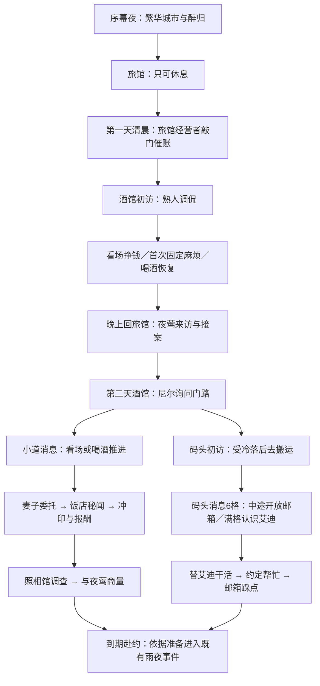

# 第一节：开场与筹备流程初稿

状态：供作者修订，尚未定稿、未接入游戏。本文包含对白初稿、演出意图与美术需求，不代表已批准制作或替换资产。旧录音不因本文修改自动失效；定稿后逐句核对再处理。

## 1. 整体意图与范围

先让玩家经历尼尔维持生计的一天，再让夜莺的委托打破日常。第二天回到同一个酒馆，对话和行动目的发生变化：昨天挣钱交住宿费，今天除了谋生，还要找办法处理勒索。

所有内容服务于三个感受：尼尔失意但仍有职业自尊；熟人会调侃他，也会给有限的帮助；城市不会因为他自称侦探就主动提供答案。

序幕夜不派任务。第一天只开放廉价旅馆与酒馆，工作、处理一个小麻烦、喝酒、休息。夜莺在第一天结束时来访。第二天酒馆引出码头和小道消息，两条路线可交替推进。诊所在首次受伤后开放。

“第一天”指醉归后睡醒的第一个可工作日，不等于当前代码的世界日1。勒索期限暂沿用现有四天，不在本稿改动。

## 2. 人物形象与关系

### 尼尔：沿用现有形象

意图：他缺的是生意，不是判断力。醉酒时允许抱怨、失态；清醒后的对话简短，偶尔反击调侃。不要每场都用长独白解释他有多潦倒，也不要把他写成只会被别人取笑的人。

素材：沿用基础、醉行、抱臂、伸手等已有立绘；具体姿势能复用则复用。不开新一组人物图。

### 旅馆经营者：建议给一张专属基础形象

身份：经营廉价旅馆的中年男性。不是房屋出租人；玩家可见署名建议“旅馆老板”。暂不取姓名。

理由：他承担开场的生活压力，也是玩家“住在这里”的具体关系。一张可辨识的基础形象足够；本阶段不给他扩写人物支线或制作多个姿势。

形象初稿：五十岁上下，微胖但不笨重，发际线后退，短发梳向一侧；旧衬衫袖口卷起，针织背心，下身普通长裤。肩略垂，站得很稳。一手夹住宿账簿，腰侧或手边有少量钥匙。脸部轮廓厚实，嘴角平直；没有凶狠眉眼。外轮廓与尼尔的帽子长外套明显区别。

视觉：沿用游戏黑色剪影与细亮轮廓；小面积旧黄铜色用于钥匙，不增加满身细节。不戴礼帽、不拿酒瓶，避免像另一个尼尔或酒保。

关系：认识这个住了很久的年轻人，愿意宽限，但不是无条件照顾他的父亲。“关心”藏在问昨晚喝了多少、提醒吃饭里；“边界”落在两天后的住宿费。

所需素材：基础全身立绘1张。敲门、翻账簿用演出和道具表达，不额外要求动作图。旧“房东”与新署名的替换范围需定稿时全局核对。

### 调酒师：建议专属形象，是此次重点人物

身份：酒馆的年轻调酒师，尼尔的熟人。玩家可见署名统一“调酒师”，暂不取姓名。

形象初稿：二十七至三十二岁，瘦长，肩窄；深色头发稍长，侧分，耳后有几缕散发，后颈略长，避免现代碎发或夸张长发。面部干净，鼻梁窄，目光灵活。白或灰白衬衫、深色合身马甲、窄领带，袖口整齐。无披肩毛巾、无粗壮手臂、无大胡子。

轮廓重心：头发、细长手指、马甲收腰。画面上首先是斯文利落，其次才是略带狡黠。轮廓亮度服从对白主次，不因为新人物而比尼尔更抢眼。

性格：嘴上不饶人，能看出尼尔对侦探身份的执念；帮忙时会讲价，消息也有价钱。他不是掌握所有秘密的情报商，更不是任务说明员。

关系：尼尔在他这里喝酒、干零工。他会笑尼尔赔本接案，但不会当众揭委托人的隐私；熟悉到可以开玩笑，还没熟到什么都免费。

所需素材：基础全身立绘1张；另建议一张“倚柜台”的姿态，若现有演出能表达则不单独制作。摇酒器、杯子放在场景中，不把整套吧台画进立绘。此次不设计收费情报的新系统；只在台词和婚外情委托抽成中表现他会算账。

### 艾迪：沿用形象，重写相识场景

艾迪在码头是靠体力吃饭的人，也是一个仍然把自己当拳手的人。热心、冲动、喜欢直截了当的解法。他愿意帮忙，但不能凭空丢下当天的活。

不新增立绘。饭盒、纸包食物、坐着休息的空间由场景道具与站位表达。吃饭场景不强求制作坐姿图。

### 临时人物：通用剪影

点工工头、普通工友、醉客、被纠缠的女招待均用已有通用男女剪影，同一身份保持一致。妻子、照相馆店主继续沿用现有处理。这轮不新增具名支线人物。

## 3. 逐场对白与剧场初稿

### S01 序幕夜：城很热闹，尼尔很失意

目的：建立城市和个人处境的落差，不给玩家提出赚钱或侦查任务。

形式：城市镜头接既有醉归剧场；内心独白；约20—30秒作为排演参考，不是硬性时长。

演出：先给灯火、往来人影与酒馆漏出的音乐，再看到尼尔从门里出来。他走得不稳，扶一下墙，整理外套，像仍然想保持体面。不要连续摔倒制造滑稽。镜头最终跟他回旅馆。

独白初稿：

> 尼尔：这城里总有人过得不错。
>
> 尼尔：今晚又没轮到我。
>
> 尼尔：私家侦探。听着倒像回事。
>
> 尼尔：上一个来找我的人，问的是隔壁还有没有空房。

回旅馆：老板在柜台后抬头，尼尔摸到钥匙，避开他的目光。老板看一眼钟，没有开口。尼尔上楼，收在房间里。

结束状态：只显示“休息”。不显示住宿费任务、不开放喝酒或工作入口。第一次休息不因缺钱而阻断。

### S02 第一日清晨：不是家，是住得太久的旅馆

目的：用一段具体关系提出生活压力，并让玩家知道今天要去酒馆干活。

形式：敲门声引出短剧场；对白约8轮；接一小段内心独白。

演出：敲两下，尼尔起身开门。老板停在门边，不擅自进入房间；尼尔让开以后才进来半步。老板先看他的脸，再翻账簿。光线是清晨的冷光，不做情绪化红光。

> 旅馆老板：醒了？
>
> 尼尔：现在醒了。
>
> 旅馆老板：昨晚又喝了多少？
>
> 尼尔：不记得了。
>
> 旅馆老板：看出来了。下楼吃点东西，别又空着肚子。
>
> 尼尔：你上来就为这个？
>
> 旅馆老板：还有房钱。你这间该续了。
>
> 尼尔：给我两天。
>
> 旅馆老板：住这么久了，两天可以。
>
> 旅馆老板：不过你得找份正经活。总不能一直等人来敲门。
>
> 尼尔：已经有人敲了。
>
> 旅馆老板：那你最好盼下一个不是我。

老板合上账簿离开，尼尔留在门边。

独白初稿：

> 尼尔：我在这儿住了一年多，久到老板都替我着急了。
>
> 尼尔：以前也有几件委托。跟人，拍照，替别人找点不愿意知道的事。
>
> 尼尔：最近，连这样的活儿也没有。
>
> 尼尔：先去酒馆吧。至少那里还有一班活。

结束状态：显示住宿费金额与两天宽限，开放去酒馆。金额暂以现有数值为基础，需联同第一天收入核算；文案不先写死金额。吃东西只是人物关心的台词，不开放额外餐饮任务。

### S03 第一日酒馆：熟悉的地方，暂时的工作

目的：建立调酒师，交代尼尔为什么只干零工；引出“看场”，不提前讲码头和委托。

形式：首次进入自动播放剧场。

演出：白天客人稀疏。调酒师擦干杯口，放回架上，没抬头就招呼尼尔。尼尔站在吧台外侧；递来的先是一杯水。通过熟悉的动作建立关系，不用旁白说“他们很熟”。

> 调酒师：今天来喝，还是来干活？
>
> 尼尔：干活。
>
> 调酒师：那我放心了。你的侦探生意呢？
>
> 尼尔：今天还早。
>
> 调酒师：你昨天也是这么说的。
>
> 尼尔：今天有活吗？
>
> 调酒师：有。替我看着点客人，别让他们把杯子扔出去。
>
> 调酒师：真要缺钱，就找份固定的活。这儿只能让你顶几班。
>
> 尼尔：固定了，有人找我怎么办？
>
> 调酒师：那我可得先看看那个人。

演出结束：开放“看场”和“喝一杯”。第一天无小道消息钟，无码头入口，无服务员晋升／领班考核。说明用动作与结果表达，不另播教程长对白。

### S04 第一日固定麻烦：醉客不肯走

目的：玩家第一次通过两三格的小目标处理一件身边的事；体现看场不是无事生钱。

形式：第一次看场结算后出现空间障碍，短Bubble，不切完整剧场。

演出与Bubble：醉客拍桌，一只空杯被推到桌沿。

> 醉客：我付了钱！叫她回来！
>
> 调酒师：尼尔，那桌。别让他再缠着人。

障碍标题：“醉客纠缠”，初稿3格。同一根目标提供两种处理：

| 行动 | 能力 | 表达 |
|---|---|---|
| 劝他离席 | 交际 | 给他一个不当众丢脸的退路 |
| 请他出去 | 武力 | 站到他和女招待之间，把人带离 |

成功／中性／失败的推进与代价需试玩再定，目标是通常1—2颗骰可解决，不做新的长交锋。首次触发安排在仍有骰可处理的工作结算后。

完成Bubble：

> 醉客：行，行，我自己走。
>
> 调酒师：谢了。那杯算我的损耗。

当日不处理的日终Bubble：

> 调酒师：那桌的账没收回来。少的从你这班里扣。
>
> 尼尔：知道了。

结束状态：扣除事先明示的固定工资金额，清掉障碍；不追加职级惩罚，不自动加伤。扣款规则必须在麻烦出现时可见，不能日终突然公布。

### S05 常驻看场麻烦：同结构，换情境

目的：让酒馆有生活变化，同时让玩家能读懂重复使用的简单规则。

每次看场可能触发；同一时刻最多一个。当日解决，或打烊时扣工资后结束。第一天固定麻烦之后是否还会再触发，初稿建议不再触发，给新玩家留恢复和休息空间。

| 情境与目标 | 出现Bubble | 两种处理 | 解决Bubble |
|---|---|---|---|
| 醉客纠缠 | 调酒师：“那桌又缠上人了。” | 劝他离席／请他出去 | “行，我自己走。” |
| 门口争执 | 客人：“你再说一遍？” | 打圆场／隔开两人 | 调酒师：“把门让开，客人还得进来。” |
| 赖账客人 | 客人：“我刚才已经给过了。” | 问清账单／拦住离席 | 客人：“拿去。别拉着我。” |

三个事件均是2—3格，初版可统一3格；不同能力便于适配骰子，不给每种麻烦另建一套子规则。避免把当街持枪、严重暴力放进这一档日常障碍。

### S06 第一日夜：夜莺来访

目的：让一件真正的侦探委托进入已经建立的日常。

形式：沿用已制作的雨夜来访与室内求助剧场，调整触发时机。第一天点击休息后、真正结束该日之前，插入敲门／来访；接案后再完成当晚休息，第二天带着委托醒来。不要求玩家事先耗尽所有骰子。

新增／核对项：旅馆房间空间要与开场统一；旧台词中“家”“房租”等口径需逐句核对；两段剧场之间不增加重复说明。

接案后的独白沿用，末句保留已确认版本：

> 想想办法，尼尔，要么付钱，要么打听打听，想想其他办法。

此处不提前开出所有地点和筹备卡。第二天先让调酒师把门路说清。

### S07 第二日酒馆：相同的问候，不同的回答

目的：让玩家感觉今天与昨天不同；从人物交谈中自然引出两条路线。

形式：首次进入自动播放剧场。复用S03吧台空间和开头动作，不完整重复上一场镜头。

> 调酒师：今天来喝，还是——
>
> 尼尔：我接了个委托。
>
> 调酒师：真有人找上门了？
>
> 尼尔：勒索。有人拿照片找她要钱。
>
> 调酒师：她付你多少？
>
> 尼尔：她没多少钱。
>
> 调酒师：所以现在是你替她找钱？
>
> 尼尔：你这里有挣得快一点的活吗？
>
> 调酒师：有的话，我自己先干了。

调酒师笑了一下，放下杯子。尼尔没有陪着笑。

> 调酒师：去码头看看吧。搬货比这儿累，钱也多一点。
>
> 尼尔：我还想打听点事。
>
> 调酒师：那边什么人都有。不过你这样过去，未必有人搭理。
>
> 尼尔：还有呢？
>
> 调酒师：这儿也不是没生意。你看场的时候多听听，别光盯着酒杯。
>
> 调酒师：真有人找你，我替你留着。事成之后别忘了我的一份。
>
> 尼尔：这句你倒从没忘过。

结束状态：开放码头与“小道消息”4格。看场+1、喝酒+3先沿用现有节奏；第二天此场之前不累计，不显示钟。满格出现婚外情委托入口，不强制打断玩家正在做的事。

### S08 码头初访：侦探身份不顶用

目的：表现排斥，也给出可以行动的出路；不直接把“做工就给情报”说成交易。

形式：首次进入短剧场。工友继续手里的活，尼尔在几个人之间寻找回应；工头最后把他误认成找活的人。

> 尼尔：劳驾，我想打听个人。
>
> 工友：找工头去。
>
> 尼尔：不是找活。
>
> 工友：那就别挡着。

尼尔退到一旁，看向另一个人。

> 尼尔：你在这一带待得久吗？
>
> 水手：船等着开。你问别人吧。

工头朝货堆方向一指。

> 工头：临时的？去那边。把名字记上。
>
> 尼尔：我来问点事。
>
> 工头：我这儿只管找人搬货。

内心独白：

> 尼尔：他们不认识我，也不欠我一句回答。
>
> 尼尔：先干点活吧。站在这儿问，问到天黑也没用。

结束状态：开放搬运及码头消息6格。搬运每次推进1格、正常结算收入；没有开放或已经完成时不累计。不要让尼尔此时指名查“取信者”——雨夜尚未发生。

### S09 码头消息中段：邮箱附近有人知道

目的：把抽象的熟悉进度变成一次可见的帮助，开放邮箱位置；不提前提供完整埋伏方案。

触发初稿：码头消息到3格。短Dialogue。

场面：同一批货搬完，工友第一次主动接尼尔的话。

> 工友：你前头说想问什么？
>
> 尼尔：邮局后街那只邮箱。有人让我的委托人把钱放进去。
>
> 工友：货栈拐过去，报摊旁边。你说的是那只吧？
>
> 尼尔：那边平时人多吗？
>
> 工友：下工时多。旁边有人看摊，你自己过去瞧瞧。
>
> 尼尔：谢了。

结束状态：开放“查看邮箱街角”。这次查看不等于埋伏踩点完成，可作不耗骰的初次访问：知道位置、看一眼环境即可。具体部署准备仍等待艾迪提出计划。

### S10 码头消息满格：艾迪的办法

目的：通过同处劳动环境认识艾迪；让他提出符合性格的解法，不像凭空出现的打手。

触发初稿：码头消息6格。剧场演出。场景是工间休息，有纸包食物、搁在地上的饭盒。艾迪靠着货箱活动手指，尼尔拿着自己的食物。普通工友只是交谈的引子。

> 工友：他就是那个当侦探的。
>
> 艾迪：侦探？你怎么也来搬这个？
>
> 尼尔：因为箱子肯付钱。
>
> 艾迪：那你得小心工头，他比箱子难说话。

工友转去收拾饭盒。艾迪注意到尼尔拿着一封信。

> 艾迪：你找什么人？
>
> 尼尔：还不知道是谁。拿照片勒索，让人往邮箱里放钱。
>
> 艾迪：那就让他来拿。
>
> 尼尔：然后呢？
>
> 艾迪：咱们等着。他一伸手，就把他按住。
>
> 尼尔：你说得倒简单。
>
> 艾迪：他敢来，咱们也敢等。总不能一直给他送钱。
>
> 尼尔：你愿意帮忙？
>
> 艾迪：愿意。那小子该尝尝拳手的滋味。
>
> 尼尔：你是拳手？
>
> 艾迪：艾迪。你听过没有？
>
> 尼尔：尼尔。
>
> 艾迪：那就算现在听过了。

短暂收拾食物，转到时间安排。

> 艾迪：不过那天我有班。你替我把这批活干完，我就腾得出来。
>
> 尼尔：多少？
>
> 艾迪：就这一批。干完我跟你去。
>
> 尼尔：成交。

结束状态：开放“替艾迪干活”4格。独立于正常搬运，不发工资；满格换来艾迪当晚到场。消息钟退出，不再要求花三十金雇他，也不保留重复的工友顶班招募线。

此稿将口述中的“去全场”理解为“那天有班，需尼尔替他干活”；若本意是去拳场，需要改写这一段动机与交换条件。

### S11 帮忙确认与踩点入口

目的：让玩家明确劳动换来的是什么，以及接下来还要做什么。

触发：替艾迪干活满格，短Dialogue。

> 艾迪：成了。那天晚上我跟你去。
>
> 尼尔：先跟我去看看地方。站错位置，你拳头再快也没用。
>
> 艾迪：行，你认路，我动手。

结束状态：开放正式邮箱踩点。沿用现有8格先不改数值，但需连同6格消息和4格顶班核算总行动量。

现有踩点2／5／8格三段对白可保留，署名和内容核对如下：

- 2格，尼尔：“从这里能看清邮箱，也不容易惹人注意。”
- 5格，尼尔：“路很窄。有人守在这边，就有机会把他拦住。”
- 8格，尼尔：“再过去都是小巷。得留个人盯着退路。”

最后一句需要按实际到场人数改写：若只有艾迪，不能暗示观察、拦截和追踪三个岗位都有人。踩点完成后，卷宗应明确“艾迪会到场；街角已摸清”，不能只让钟消失。

### S12 婚外情与照片路线：保留正文，衔接称谓

目的：保留已经做好的支线，并保持调酒师的关系与口吻一致。

小道消息满后出现“接取调查委托”，点击才进入短Dialogue。

> 调酒师：有人来打听过你的生意。
>
> 尼尔：在这儿？又是婚外情？
>
> 调酒师：她在那边。你自己去谈。
>
> 调酒师：事成之后，别忘了我的一份。

之后妻子接案、饭店秘闻、冲印、交付、照片来源交锋沿用已经确认的正文，不在此次重写。现有酒保抽成保留，但金额应在接受委托前可知，避免结算时突扣。

照相馆正文见[第一节照相馆演出](第一节照相馆演出.md)。该文档的“先停在与夜莺商量”仍生效，不用新调酒师的台词代替玩家作调查结论。

### S13 到期与雨夜：保留主体，核对人员

目的：此前行动产生现场差异；不因重排入口而改写已做好的交锋主体。

需要核对的已有内容：

- 酒馆雇艾迪入口撤下，避免同一人被重复招募。
- 工友顶班线撤下后，原先“艾迪＋工友”双人集合戏不会自然发生。初稿建议先以艾迪单人进入，保留三个岗位供玩家作取舍，不额外增加第二个帮手任务。
- 未完成替班，艾迪不到场；未完成踩点，不算准备充分。卷宗提前说明缺哪项，不到期才揭晓。
- 只有认识邮箱、没有招募帮手时，仍能到期赴约，沿用原独自蹲守路线。
- 抓捕／追踪／跟丢之后的烟盒与桥边分支沿用现有规则，不强行合并结果。
- 钱、假信封、夜莺补款的现有口径需统一检查；此稿不替用户决定改用假钱。

## 4. 需要作者定稿的内容

建议按下面顺序修订，避免先画完人物，再修改人物身份。

| 顺序 | 请定稿的部分 | 初稿建议 |
|---|---|---|
| 1 | 旅馆经营者身份、关系、署名与形象 | 中年男性，署名旅馆老板；一张基础专属形象 |
| 2 | 调酒师的外形、年龄感和嘴上分寸 | 年轻斯文、稍长头发；熟悉、调侃、讲价，不恶意羞辱 |
| 3 | S01—S03的尼尔 | 醉时失态，醒后克制；贫困不等于无能 |
| 4 | 第一日固定麻烦与扣工资的合理性 | 醉客纠缠，3格；未处理扣明示金额，不让全部收入被扣光 |
| 5 | 夜莺来访与第二天开场 | 首次工作日结束来访；第二日酒馆开放两路 |
| 6 | S08—S11码头受挫、艾迪相识与交换条件 | 6格消息、中途邮箱、满格艾迪；替班换帮忙 |
| 7 | 帮手人数 | 初稿只有艾迪；不自动保留第二名工友 |
| 8 | 行动量和钱的压力 | 消息6＋替班4＋踩点8先供核算，不视为最终平衡 |

还需作者确认的叙事边界：尼尔向调酒师或艾迪说明事情时，不说夜莺姓名，不展示私密照片；没有获得委托人明确同意，不在公开场合散播她的隐私。

## 5. 定稿后制作清单

| 类别 | 内容 | 处理 |
|---|---|---|
| 人物 | 调酒师基础形象、可选倚柜台；旅馆老板基础形象 | 先定稿形象描述，再出参考图与游戏立绘 |
| 通用人物 | 工头、工友、水手、醉客、女招待 | 复用剪影，固定人物对应形象 |
| 道具 | 住宿账簿、钥匙；酒杯、水杯；饭盒与纸包 | 优先已有资源或简单场景表达 |
| 剧场 | S01醉归调整、S02清晨敲门、S03酒馆初访、S07接案后酒馆、S08码头初访、S10艾迪相识 | 本稿给场面与节拍；定稿后按既有剧场能力编排 |
| 短对白／Bubble | S04—S05麻烦、S09邮箱消息、S11帮忙确认、S12委托引荐 | 不扩成完整剧场 |
| 原有演出 | 夜莺雨夜、室内求助、照片、照相馆、雨夜集合与烟盒 | 保留主体，按身份／时序／到场人员核对 |
| 规则与界面 | 地点逐步开放、看场替换旧晋升、消息钟条件、日终麻烦、艾迪替班、卷宗指引 | 定稿后接入，不在设计稿里增加新系统 |
| 文字／配音 | 旧房东、家、房租、酒保称谓及新字幕 | 逐句列差异；录音处理另行安排，不批量生成 |

验收关注：玩家是否知道下一步能做什么；第一天是否还有骰处理首次麻烦；不喝酒能否靠看场听到消息；不走码头能否仍通过筹钱与委托推进；只走码头能否承担准备成本；全部路线并行是否过挤；当日麻烦是否明确且不堆叠；到期时不会因为尚未完成任一可选路线而卡住。
