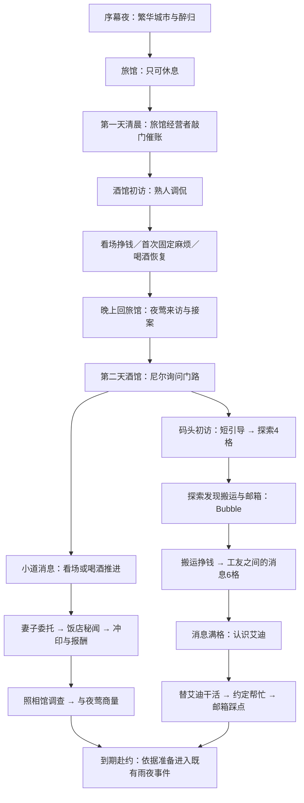
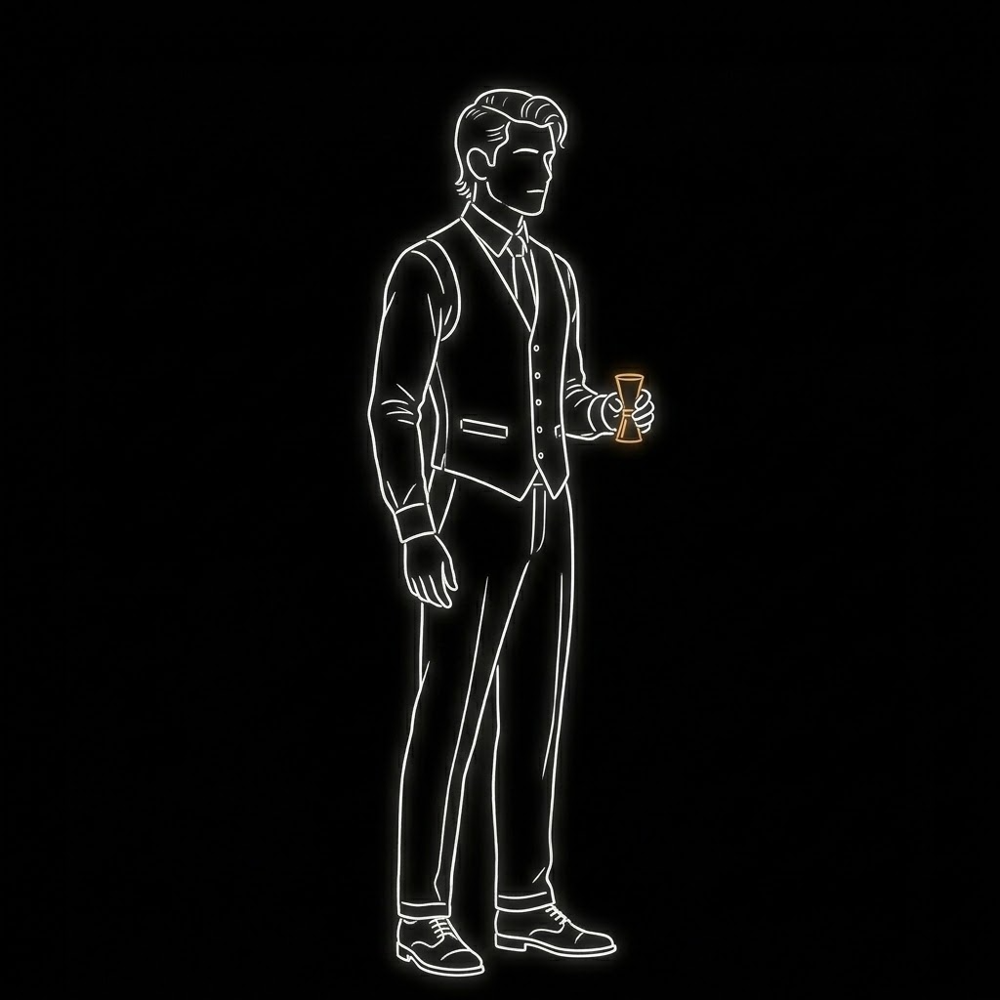
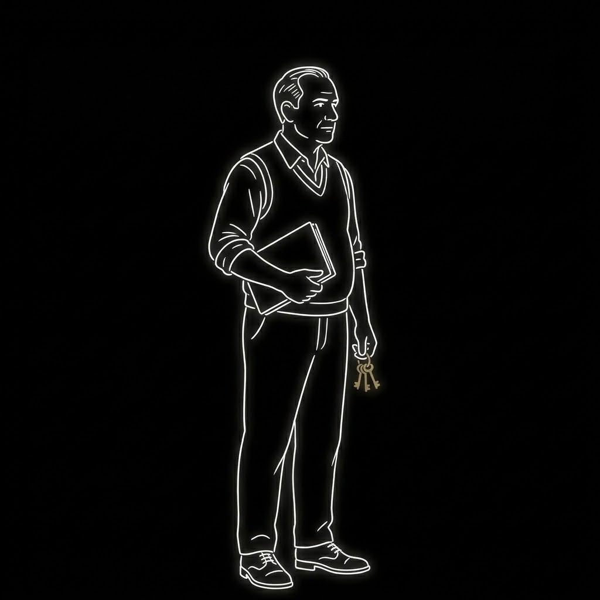

# 第一节：开场与筹备流程初稿

状态：非剧场流程正在接入；新版剧场暂不改动，由作者交 Claude 制作，见[剧场交接稿](第一节剧场演出交接稿.md)。本文包含对白初稿、演出意图、美术参考与作者建议。人物参考图用于修订，尚未替换正式资产。旧录音不因本文修改自动失效；定稿后逐句核对再处理。

## 1. 整体意图与范围

先让玩家经历尼尔维持生计的一天，再让夜莺的委托打破日常。第二天回到同一个酒馆，对话和行动目的发生变化：昨天挣钱交住宿费，今天除了谋生，还要找办法处理勒索。

所有内容服务于三个感受：尼尔失意但仍有职业自尊；熟人会调侃他，也会给有限的帮助；城市不会因为他自称侦探就主动提供答案。

序幕夜不派任务。第一天只开放廉价旅馆与酒馆，工作、处理一个小麻烦、喝酒、休息。夜莺在第一天结束时来访。第二天酒馆引出码头和小道消息，两条路线可交替推进。诊所在首次受伤后开放。

“第一天”指醉归后睡醒的第一个可工作日，不等于当前代码的世界日1。勒索期限为四天，从接案后的第二天清晨开始计算，当晚睡眠不消耗筹备日。

## 2. 人物形象与关系

### 本版形象参考

以下两张由项目 `make-images` 默认的 Gemini Images / Nano Banana 2 流程生成，输入现有尼尔立绘作描线风格与画幅参考。这里只作为人物方向稿展示，尚未做透明化、派生资源加工或游戏舞台验收，不替换正式人物。

| 调酒师：年轻、斯文、会讲价 | 旅馆老板：熟悉、关心、收账 |
|---|---|
|  |  |

本版选择：调酒师用稍长的侧分头发、修长身形与量酒器建立身份；旅馆老板用较厚实的身形、账簿和钥匙区分。两人都不戴帽，不重复尼尔的招牌轮廓。参考图的朝向不锁死对白站位，正式制作再统一核对。

生成提示词：[调酒师](第一节人物参考/调酒师-prompt.txt)、[旅馆老板](第一节人物参考/旅馆老板-prompt.txt)。

### 尼尔：沿用现有形象

意图：他缺的是生意，不是判断力。醉酒时允许抱怨、失态；清醒后的对话简短，偶尔反击调侃。不要每场都用长独白解释他有多潦倒，也不要把他写成只会被别人取笑的人。

素材：沿用基础、醉行、抱臂、伸手等已有立绘；具体姿势能复用则复用。不开新一组人物图。

### 旅馆经营者：建议给一张专属基础形象

身份：经营廉价旅馆的中年男性。不是房屋出租人；玩家可见署名建议“旅馆老板”。暂不取姓名。

理由：他承担开场的生活压力，也是玩家“住在这里”的具体关系。一张可辨识的基础形象足够；本阶段不给他扩写人物支线或制作多个姿势。

形象初稿：五十岁上下，微胖但不笨重，发际线后退，短发梳向一侧；旧衬衫袖口卷起，针织背心，下身普通长裤。肩略垂，站得很稳。一手夹住宿账簿，腰侧或手边有少量钥匙。脸部轮廓厚实，嘴角平直；没有凶狠眉眼。外轮廓与尼尔的帽子长外套明显区别。

视觉：沿用游戏黑色剪影与细亮轮廓；小面积旧黄铜色用于钥匙，不增加满身细节。不戴礼帽、不拿酒瓶，避免像另一个尼尔或酒保。

关系：认识这个住了很久的年轻人，愿意宽限，但不是无条件照顾他的父亲。“关心”藏在问昨晚喝了多少、提醒吃饭里；“边界”落在两天后的住宿费。

所需素材：基础全身立绘1张。敲门、翻账簿用演出和道具表达，不额外要求动作图。旧“房东”与新署名的替换范围需定稿时全局核对。

### 调酒师：建议专属形象，是此次重点人物

身份：酒馆的年轻调酒师，尼尔的熟人。玩家可见署名统一“调酒师”，暂不取姓名。

形象初稿：二十七至三十二岁，瘦长，肩窄；深色头发稍长，侧分，耳后有几缕散发，后颈略长，避免现代碎发或夸张长发。面部干净，鼻梁窄，目光灵活。白或灰白衬衫、深色合身马甲、窄领带，袖口整齐。无披肩毛巾、无粗壮手臂、无大胡子。

轮廓重心：头发、细长手指、马甲收腰。画面上首先是斯文利落，其次才是略带狡黠。轮廓亮度服从对白主次，不因为新人物而比尼尔更抢眼。

性格：嘴上不饶人，能看出尼尔对侦探身份的执念；帮忙时会讲价，消息也有价钱。他不是掌握所有秘密的情报商，更不是任务说明员。

关系：尼尔在他这里喝酒、干零工。他会笑尼尔赔本接案，但不会当众揭委托人的隐私；熟悉到可以开玩笑，还没熟到什么都免费。

所需素材：基础全身立绘1张；另建议一张“倚柜台”的姿态，若现有演出能表达则不单独制作。摇酒器、杯子放在场景中，不把整套吧台画进立绘。此次不设计收费情报的新系统，也不再对妻子主动提出的委托抽成；通过熟人间的台词保留他会算账的感觉。

### 艾迪：沿用形象，重写相识场景

艾迪在码头是靠体力吃饭的人，也是一个仍然把自己当拳手的人。热心、冲动、喜欢直截了当的解法。他愿意帮忙，但不能凭空丢下当天的活。

不新增立绘。饭盒、纸包食物、坐着休息的空间由场景道具与站位表达。吃饭场景不强求制作坐姿图。

### 临时人物：通用剪影

点工工头、普通工友、醉客、被纠缠的女招待均用已有通用男女剪影，同一身份保持一致。妻子、照相馆店主继续沿用现有处理。这轮不新增具名支线人物。

## 3. 逐场对白与剧场初稿

### S01 序幕夜：城很热闹，尼尔很失意

目的：建立城市和个人处境的落差，不给玩家提出赚钱或侦查任务。

形式：城市镜头接既有醉归剧场；内心独白；约20—30秒作为排演参考，不是硬性时长。

演出：先给灯火、往来人影与酒馆漏出的音乐，再看到尼尔从门里出来。他走得不稳，扶一下墙，整理外套，像仍然想保持体面。不要连续摔倒制造滑稽。镜头最终跟他回旅馆。

独白初稿：

> （描线渐显，酒吧场景，尼尔坐在卡座，周围人很多，嘈杂声，他举杯）
> 贝尔维尔，不夜城！酒！女人！多么好的地方！喝！
> （画面瞬黑切换，酒吧场景，尼尔坐在吧台，尼尔换了个姿势，侧在吧台上呢喃）
> 私家侦探？听着像那么回事，其实什么也不是！
（画面瞬黑，酒吧外的场景）
> 尼尔从酒吧门口摇摇晃晃地走了出来，扶墙，走了两步，扶墙吐了
> （画面瞬黑，旅馆场景）
> 尼尔从柜台摇摇晃晃地经过，旅馆老板在柜台后抬头，“尼尔？”，没有回复，尼尔走了上楼
> （描线渐隐）

（注意，这里的瞬黑就是那种，像电影里面很强烈的那种，一下变黑，稍稍等待，渐亮切幕）

### S02 第一日清晨：不是家，是住得太久的旅馆

目的：用一段具体关系提出生活压力，并让玩家知道今天要去酒馆干活。

形式：在黑幕中，敲门声，引出一些字幕对话；然后接一小段内心独白。

> （咚！咚！咚！）
> 尼尔？
>
> 谁？
>
> 我，你又喝多了？
>
> 哦，老板，你有事儿吗？
>
> 我是跟你说房钱的事情，你这间房该续了。
>
> 能等我两天吗？
>
> 没事儿。尼尔，你要不，（欲言又止）还是找份正经活儿吧，你那些委托是没法养活自己的
>
> 尼尔：两天后给你

独白：（尼尔）我需要先弄点钱，还是去酒吧吧，至少那儿还有些事儿做。

结束状态：显示住宿费金额与两天宽限的clock，开放酒馆。

### S03 第一日酒馆：熟悉的地方，暂时的工作

目的：建立调酒师，交代尼尔为什么只干零工；引出“看场”，不提前讲码头和委托。

形式：首次进入自动播放剧场。

演出：白天客人稀疏。调酒师擦干杯口，放回架上，没抬头就招呼尼尔。尼尔站在吧台外侧；递来的先是一杯水。通过熟悉的动作建立关系，不用旁白说“他们很熟”。

> 调酒师：今天还是没什么生意？
>
> 尼尔：没有。没有名气也就没人找你，这行就是这样。今天还是和以前一样？
>
> 调酒师：嗯，还是按老板说的，日结。替我看着点客人，别让他们把杯子扔出去。
>
> 调酒师：真要缺钱的话，就找份固定的活。这儿只能让你顶几班。
>
> 尼尔：固定工作？有人有委托找我怎么办？
>
> 调酒师：嘿，看来你还是没放弃。

演出结束：开放“看场”和“喝一杯”。第一天无小道消息钟，无码头入口，无服务员晋升／领班考核。说明用动作与结果表达，不另播教程长对白。

### S04 第一日固定麻烦：醉客不肯走

目的：玩家第一次通过两三格的小目标处理一件身边的事；体现看场不是无事生钱。

形式：第一次看场结算后出现空间障碍，短Bubble，不切完整剧场。

演出与Bubble：醉客拍桌，一只空杯被推到桌沿。

> 醉客：我付了钱！叫她回来！
> 调酒师：尼尔，看着那桌。别让他再缠着人。

障碍标题：“醉客纠缠”，初稿3格。同一根目标提供两种处理：

| 行动 | 能力 | 表达 |
|---|---|---|
| 劝他离席 | 交际 | 给他一个不当众丢脸的退路 |
| 请他出去 | 武力 | 站到他和女招待之间，把人带离 |

成功／中性／失败的推进与代价需试玩再定，目标是通常1—2颗骰可解决，不做新的长交锋。首次触发安排在仍有骰可处理的工作结算后。

完成Bubble：

> 醉客：行，行，我自己走。

当日不处理的日终Bubble：

> 调酒师：那桌的账没收回来。少的从你这班里扣。

结束状态：扣除事先明示的固定工资金额，清掉障碍；不追加职级惩罚，不自动加伤。扣款规则必须在麻烦出现时可见，不能日终突然公布。

### S05 常驻看场麻烦：同结构，换情境

目的：让酒馆有生活变化，同时让玩家能读懂重复使用的简单规则。

每次看场可能触发；同一时刻最多一个。当日解决，或打烊时扣工资后结束。第一天固定麻烦之后是否还会再触发，初稿建议不再触发，给新玩家留恢复和休息空间。

| 情境与目标 | 出现Bubble | 两种处理 | 解决Bubble |
|---|---|---|---|
| 醉客纠缠 | 调酒师：“那桌人又在惹麻烦了。” | 劝他离席／请他出去 | “行，我自己走。” |
| 门口争执 | 客人：“你小子再说一遍？” | 打圆场／隔开两人 | 调酒师：“多亏有你在，尼尔。” |
| 赖账客人 | 客人：“没长眼吗？我刚才已经给过了！” | 问清账单／拦住离席 | 客人：“拿去，我.....我只是喝断片了忘了。” |

三个事件均是2—3格，初版可统一3格；不同能力便于适配骰子，不给每种麻烦另建一套子规则。避免把当街持枪、严重暴力放进这一档日常障碍。

### S06 第一日夜：夜莺来访

目的：让一件真正的侦探委托进入已经建立的日常。

形式：沿用已制作的雨夜来访与室内求助剧场，调整触发时机。第一天点击休息后、真正结束该日之前，插入敲门／来访；接案后再完成当晚休息，第二天带着委托醒来。不要求玩家事先耗尽所有骰子。

新增／核对项：旅馆房间空间要与开场统一；旧台词中“家”“房租”等口径需逐句核对；两段剧场之间不增加重复说明。

接案后的独白沿用，末句保留已确认版本：

> 想想办法，尼尔，要么付钱，要么打听打听，想想其他办法。

此处不提前开出所有地点和筹备卡。第二天先让调酒师把门路说清。

### S07 第二日酒馆：相同的问候，不同的回答

目的：让玩家感觉今天与昨天不同；从人物交谈中自然引出两条路线。

形式：首次进入自动播放剧场。复用S03吧台空间和开头动作，不完整重复上一场镜头。

> 调酒师：今天还是——
> 尼尔：我接了个委托。
>
> 调酒师：这次是怎么回事儿？
>
> 尼尔：勒索。有人拿照片找她要钱。
>
> 调酒师：她付你多少？
>
> 尼尔：她没多少钱。
>
> 调酒师：所以现在是你替她找钱？
>
> 尼尔：你这里有挣得快一点的活吗？
>
> 调酒师：有的话，我自己先干了。

调酒师笑了一下，放下杯子。尼尔没有陪着笑。

> 调酒师：去码头看看？日结的工作就那么几样，哪儿比这儿累，钱也更多一点。
> 调酒师：最近几天晚上也有一些小道消息。你看场的时候多听听，别老站在门口。

结束状态：开放码头与“小道消息”4格。看场+1、喝酒+3先沿用现有节奏；第二天此场之前不累计，不显示钟。满格时在妻子锚点出现委托人，以短Bubble招呼尼尔，再直接播放明确的委托Dialogue；不再经调酒师引荐。当前工作或喝酒的结果先结算完，再接续对白。

### S08 码头初访：先让玩家自己探索

目的：减少进入新地点时的被动剧情，让玩家通过行动发现挣钱与调查的入口。

结束状态：码头起初只有一个可用行动“探索码头”，附带4格探索进度。探索消耗骰子；推进数值暂建议好2／中1，失败不推进、不额外扣冷静。熟悉空间本身不设失败期限。

本版建议2格发现搬运，4格发现邮箱。一次跨过两个阈值时按顺序播放两组Bubble；每项只发现一次，探索满格后行动撤下。已发现的节点保留，不需要反复付骰查看。

**发现搬运，Bubble落在搬运工作将出现的位置：**

> 尼尔：你好...请问这里？
> 工头：找活儿的？那边那边（不耐烦的语气）

出现“搬运”工作，同时开放“工友之间的消息”6格。尼尔补一句引导Bubble：

> 尼尔：这里活儿危险些，钱也来得快。跟他们干几趟，也许能听见点消息。

工作每次正常结算工资，并推进工友消息1格。未发现搬运前没有工作和消息钟，也不在后台累计。消息满格后停止，进入艾迪相识事件。

**发现邮箱，Bubble落在邮箱的Anchor附近：**

> 尼尔：请问后街有没有一个邮箱？
> 工友：报摊旁边，前面右转就是

出现邮箱节点；这次发现只告诉玩家位置，不算完成埋伏筹备，不提前派发抓人计划。

### S09 邮箱初访：认清位置，暂不展开

目的：让玩家看见将来交付发生的地点，先建立空间记忆，不再加一根调查进度或一段完整剧情。

首次进入邮箱区域只播一句尼尔Bubble：

> 尼尔：就是这里。信上说几天后，把钱放进这只邮箱。

初稿选择邮箱用只读Note呈现，不做没有子行动的空Container。玩家从已有空间入口走近，Note标出“邮箱”；若当前场景不能单独进入，就在探索发现后于邮箱锚点播放同一句Bubble，不为这一句新增空访问页。

常驻Note：

> 邮箱
>
> 信上约定放钱的地方。

之后不重复播初访Bubble。只有艾迪提出计划且答应帮忙后，才按原流程开放正式踩点；此时有实际筹备行动，才需要行动Container。不要让工友消息中途再次“发现”已经知道的邮箱。

### S10 码头消息满格：艾迪的办法

目的：通过同处劳动环境认识艾迪；让他提出符合性格的解法，不像凭空出现的打手。

触发初稿：搬运附带的“工友之间的消息”满6格。剧场演出。场景是工间休息，有纸包食物、搁在地上的饭盒。艾迪靠着货箱活动手指，尼尔拿着自己的食物。普通工友只是交谈的引子。

> 工友：他就是那个当侦探的。
>
> 艾迪：侦探？你怎么也来搬这个？
>
> 尼尔：没什么生意。
>
> 艾迪：嘿，我也是，我本来是打拳赛的。不是为了养家糊口，谁来干这个。

工友转去收拾饭盒。艾迪注意到尼尔最近在打听一些事情。

> 艾迪：你最近是不是在找人？
> 尼尔：对，有一些事，和一些混混有关。
> 艾迪：用不用我帮忙，我把他们打得落花流水。
> 尼尔：不用，他是...
> 尼尔：对啊，也许可以换一个种方式。艾迪，你听我说....
>（说了一些简单的情况）
> 艾迪：咱们在这儿埋伏着，他一伸手，就把他按住。
> 艾迪：你送给他一次，还有下一次，会没完没了的。
> 艾迪：什么时候
> 尼尔：就在信上约定的那天晚上。
> 艾迪：那天我有班。你替我把这批活干完，我就能把那晚的班换开。
尼尔：成交。

结束状态：开放“替艾迪干活”4格。独立于正常搬运，不发工资；满格换来艾迪当晚到场。消息钟退出，不再要求花三十金雇他，也不保留重复的工友顶班招募线。

此稿将口述中的“去全场”理解为“那天有班，需尼尔替他干活”；若本意是去拳场，需要改写这一段动机与交换条件。

### S11 帮忙确认与踩点入口

目的：让玩家明确劳动换来的是什么，以及接下来还要做什么。

触发：替艾迪干活满格，短Dialogue。

> 艾迪：这批活干完，我就能把那晚的班换开。到时候我跟你去。
> 尼尔：行，我先去看看位置，我们到时候计划一下。

结束状态：开放正式邮箱踩点。踩点改为4格。艾迪替班完成就会到场，不以踩点完成为前提；0格只有观察位，2格解锁拦截位，4格解锁追踪位。

踩点里程碑用Bubble：

- 2格：“路很窄。守住这边，就能拦住取信的人。拦截位找到了。”
- 4格：“巷口能盯住退路。追踪接应就放在这里。”

只有艾迪一人，他只能占一个岗位；解锁更多位置增加选择，不自动增加人手。卷宗明确显示艾迪到场与当前踩点进度。

### S12 婚外情与照片路线：保留正文，衔接称谓

目的：保留已经做好的支线，并保持调酒师的关系与口吻一致。

“小道消息”4格从开放时就挂在委托人将出现的同一个Anchor上。填满后撤下消息钟，在该处出现妻子，先用空间Bubble引起注意：

> 妻子：要是能有个人能查清楚就好了
调酒师：不瞒你说，我们那位打手，就是一个私家侦探。
> 调酒师：尼尔！
> 妻子：你是侦探吗？那你能帮我看看这件事吗？
> 妻子：我丈夫最近经常不在家，他说是陪客户。

从这里衔接现有妻子对白，之后饭店秘闻、冲印、交付与照片来源调查沿用已经确认的正文。不要再次插入“点击接取委托”或“去跟妻子谈谈”的中间步骤；Bubble与Dialogue在触发本次消息填满的行动结算后依次播放，只触发一次。

本次取消独立的调酒师转介绍步骤，保留现场搭话；妻子感叹、调酒师招呼用Bubble，从妻子正式询问开始用Dialogue。撤下“别忘了我的一份”的台词。与此绑定的委托抽成也建议撤下，交付直接按已明示成果支付报酬；不能台词删了、结算仍暗扣。调酒师讲价和卖消息的性格保留在人设中，等实际有相关情境再表现，不为了这层性格给本次接案再补一道收费手续。

照相馆正文见[第一节照相馆演出](第一节照相馆演出.md)。该文档的“先停在与夜莺商量”仍生效，不用新调酒师的台词代替玩家作调查结论。

### S13 到期与雨夜：保留主体，核对人员

目的：此前行动产生现场差异；不因重排入口而改写已做好的交锋主体。

需要核对的已有内容：

- 酒馆雇艾迪入口撤下，避免同一人被重复招募。
- 工友顶班线撤下后，原先“艾迪＋工友”双人集合戏不会自然发生。初稿建议先以艾迪单人进入，保留三个岗位供玩家作取舍，不额外增加第二个帮手任务。
- 未完成替班，艾迪不到场；完成替班就到场，踩点决定可用岗位。卷宗提前说明缺哪项，不到期才揭晓。
- 只有认识邮箱、没有招募帮手时，仍能到期赴约，沿用原独自蹲守路线。
- 抓捕／追踪／跟丢之后的烟盒与桥边分支沿用现有规则，不强行合并结果。
- 钱、假信封、夜莺补款的现有口径需统一检查；此稿不替用户决定改用假钱。

## 4. 本版直接采用的建议（作者可修改）

本版先按以下决定写作和出参考图，不留空等选择；作者可逐项直接修改。

| 顺序 | 设计部分 | 本版决定 |
|---|---|---|
| 1 | 旅馆经营者身份、关系、署名与形象 | 中年男性，署名旅馆老板；一张基础专属形象 |
| 2 | 调酒师的外形、年龄感和嘴上分寸 | 年轻斯文、稍长头发；熟悉、调侃、讲价，不恶意羞辱 |
| 3 | S01—S03的尼尔 | 醉时失态，醒后克制；贫困不等于无能 |
| 4 | 第一日固定麻烦与扣工资的合理性 | 醉客纠缠，3格；未处理扣明示金额，不让全部收入被扣光 |
| 5 | 夜莺来访与第二天开场 | 首次工作日结束来访；第二日酒馆开放两路 |
| 6 | S08—S11码头受挫、艾迪相识与交换条件 | 探索4格发现搬运和邮箱；搬运消息6格认识艾迪；替班换帮忙 |
| 7 | 帮手人数 | 初稿只有艾迪；不自动保留第二名工友 |
| 8 | 行动量和钱的压力 | 探索4＋消息6＋替班4＋踩点4先供核算，不视为最终平衡 |

还需作者确认的叙事边界：尼尔向调酒师或艾迪说明事情时，不说夜莺姓名，不展示私密照片；没有获得委托人明确同意，不在公开场合散播她的隐私。

### 玩法安排的第一版建议

- 第一日只保留旅馆、酒馆和受伤后才出现的诊所；不引出额外人物支线。地点名称保留“酒馆”，人物署名改为“调酒师”。
- 旅馆老板给两天宽限。第一日结束仍可正常休息和触发夜莺来访，催账不截断接案。
- 看场初版每次记10金到待结工资，打烊扣除损失后一次支付；首次必出3格麻烦。处理好推进2格，中性1格，坏结果扣冷静1。未处理从当天待结工资扣5金，不追扣已花掉的库存，也不新增欠款。这组数值是试玩起点，尚未作经济平衡验证。
- 第一天仅固定麻烦一次；以后每次看场有三分之一概率出现，同一天最多一件、同一时刻最多一件。处理完当天不再抽取，避免随机事件挤掉主线准备。
- 第二天酒馆演出后，小道消息才从0开始；看场+1、喝酒+3，满4在同一锚点出现妻子，以Bubble接正式Dialogue，不再经调酒师转介绍。
- 初访只有探索4格；2格发现搬运，4格发现邮箱，发现用锚点Bubble。搬运开放后才出现工友消息6格，每次搬运+1，满格认识艾迪。邮箱不再占用工友消息的阈值。
- 替艾迪干活4格，按现有顶班判定好2／中1／坏扣冷静1；不领工资。正式踩点4格。需要通过实际试玩检查消息、顶班、踩点与照片路线是否争抢过多骰子，不因写进稿子就视为平衡完成。
- 第一版只招募艾迪一个帮手；观察、拦截、追踪三个岗位供玩家取舍，不自动补出第二个人。
- 开场与人物事件按本文单一顺序接续；婚外情、照相馆、到期雨夜的既有主体保留。照片成果怎样影响雨夜暂不扩写。

## 5. 定稿后制作清单

| 类别 | 内容 | 处理 |
|---|---|---|
| 人物 | 调酒师基础形象、可选倚柜台；旅馆老板基础形象 | 先定稿形象描述，再出参考图与游戏立绘 |
| 通用人物 | 工头、工友、水手、醉客、女招待 | 复用剪影，固定人物对应形象 |
| 道具 | 住宿账簿、钥匙；酒杯、水杯；饭盒与纸包 | 优先已有资源或简单场景表达 |
| 剧场 | S01醉归调整、S02清晨敲门、S03酒馆初访、S07接案后酒馆、S10艾迪相识 | 本稿给场面与节拍；定稿后按既有剧场能力编排 |
| 短对白／Bubble | S04—S05麻烦、S08码头初访与探索发现、S09邮箱初访、S11帮忙确认；S12妻子用Bubble引入正式Dialogue | 码头发现不扩成完整剧场；妻子正式接案保留Dialogue |
| 原有演出 | 夜莺雨夜、室内求助、照片、照相馆、雨夜集合与烟盒 | 保留主体，按身份／时序／到场人员核对 |
| 规则与界面 | 地点逐步开放、看场替换旧晋升、消息钟条件、日终麻烦、艾迪替班、卷宗指引 | 定稿后接入，不在设计稿里增加新系统 |
| 文字／配音 | 旧房东、家、房租、酒保称谓及新字幕 | 逐句列差异；录音处理另行安排，不批量生成 |

验收关注：玩家是否知道下一步能做什么；第一天是否还有骰处理首次麻烦；不喝酒能否靠看场听到消息；不走码头能否仍通过筹钱与委托推进；只走码头能否承担准备成本；全部路线并行是否过挤；当日麻烦是否明确且不堆叠；到期时不会因为尚未完成任一可选路线而卡住。

## 当前接入状态

五组演出已接入 `scripts/theatre/第一节生活.scm`：醉归、清晨黑幕敲门、第一日酒馆、接案后酒馆和艾迪相识。开场不再在夜里催租；催账移到清晨，旧梦境与旧清晨独白不再重复播放。调酒师与旅馆老板使用统一尺度的新立绘，配套分层与遮挡已生成。其他短对白、工作和筹备规则沿用本稿。

调试菜单可分别试演五组内容。当前没有新增配音，新增字幕不绑定旧录音。正式演出以代码为准，稿中的动作是创作意图，不代表已逐帧复刻。无声舞台预览不等于游戏中实际声音与输入已验收。
