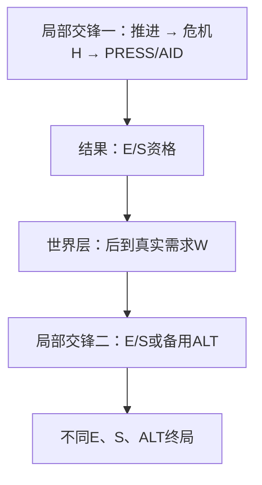

# 从单向传递许可到双向局部—世界交锋：跨家族判别

日期2026-10-15。作为[BRIDGE01—19研究记录](研究记录.md)的横向设计审查，**仅组织已有研究证据与下一实验门槛**，没有另跑新一批DP，更没有真人认可或宣布新架构。本页优先帮下一个研究者在提出“世界循环创新”前找到最便宜的反证。

## 玩家真正进行的是哪一层决策？

在《Citizen Sleeper》式网状多目标系统中，值得关注的是玩家**同时在意什么、将今天有限行动投向哪里**。在局部交锋里，重点转为**这一次要以什么方法推进、承受哪一项临时危机或选择撤退**。两层如果只共享一个数值型货币，没有发生因果上的行动集合、目标身份或新责任变化，就不一定是两个真正不同的思考单元。

对任意声称为嵌套循环的实验，用四条公开动词序列判断：

1. **局部投入与反馈（L→L）**：玩家在某个具体Contract内推进目标，结果让处理危机/救援/撤退/继续之间至少有一次正常可达的真实选择，不是一条必按清障按钮的固定流程。
2. **局部结果给世界层提出不同目标（L→W）**：完成、失败、救援或忽略危机导致世界层原本能做的另一项行动变合法/失效，或留下一项后面必须考虑的不可替代结果，不只是领取奖励。
3. **世界层选择反过来改变重返旧局部时的活动（W→L）**：世界层先处理哪个Contract、接受哪一种责任/合作/违约，使旧局部交锋再次进入时**当前实际合法动作、风险源、所保护成果身份**发生变化，并存在至少一条普通起点的最佳或值得关心的可达路径会用到这条反向边。
4. **之后的局部新结果能再改变世界计划（L→W，第二圈）**：返回旧局部后不是固定交付，而有新的公开反馈/主体动作，再次影响世界层决定。只有完成前三步且第四步有潜在反馈时，才能考虑“玩家交替在两个尺度真正重新计划”。

这**不是**要求复杂计算：每一步可以由简单、人容易学会的公开规则组成。不能因为完整条件政策可以在开局写下来，就否认后续观测与行动的真实必要性；任何有限可观测策略都可表达为一棵条件树。

## BRIDGE反证的精确位置

BRIDGE**已通过第1/2步**：危机与预测确实改变PRESS/AID；结果确实改变第二场E/S是否合法；W公开后概率1/8改投ALT。**还没有第3步**：不存在“世界层选定Contract B之后，再返回Contract A继续处理之前的危机”这一回访，资格状态可压缩为`(hasE,hasS)`的二位许可票；[全部可行动序列同构](../../../../../tools/content-validator/experiments/pattern_bridge_permission_audit_20261015.py)已证明第一场怎么产生这张票在第二场完全不可见。

它依然有**可用的成熟交锋形态**，只是不构成“世界层—局部交锋互相修改”的强主张。

## 将近期不同结构放回正确的心理层次

| 旧证据 | 对玩家而言的动作与可达结果 | 不能据此下的过度结论 |
|---|---|---|
| [RELAY](../2026-10-15-危机回流与主动失败分支/研究记录.md) | 一个局部交锋内，处理危机还推进次目标；末手放弃清理救主目标 | 两个终局成果在最优下其实都能完成，不能称不可兼得的两条人生路线 |
| [PIVOT](../2026-10-15-危机回流与主动失败分支/研究记录.md) | 故意不完成A而拿到互斥B成果，世界事实后到使结果改选 | 无须先投A就可直接B的强替代同根；未展示重返旧局部 |
| [HEDGE](../2026-10-15-保留选择权跨族审计/研究记录.md) | 真的保留不能轻易重开的旧目标退路，后来B品质不佳可回头兑现A | 取消早窗后普通串行同根，且可学短口诀已全优 |
| [CROSS-SCALE08/09](../2026-10-15-跨期责任与维护税反证/研究记录.md) | 上阶段遗留罚款与固定维护税可能被安全工序全部处理 | 增添‘义务钟’并不保证玩家真的分配注意力 |
| [PLEDGE](../2026-10-15-公开声明与延迟纠正/研究记录.md) | 前期信息让A真实行动且损失不可逆，晚期纠正B需花行动 | 知道如何通知后并不会抹掉A已发生的结果；尚非真正社会信任演化 |
| [BRIDGE](研究记录.md) | 危机结果转移实际E/S资格，下一场需求可迫使玩家弃用旧路线 | 两次改道不是完整世界—旧交锋双向回路，普通许可票能充分概括全部合法后缀 |

## 实施前必做的六个便宜反证

1. **完整结果向量**：终局是否真的分E、S、人物A安全、人物B收益、未了责任分别记录？不能以一个加权总分宣称它们同等价值。明确这些是否是玩家实际理解并关心的结果，而非研究者定义的“人性处罚”。
2. **动作映射**：不同前段历史如果归结为同一张通用`HAS_E`许可票，后面的全部合法动作/后果是否完全一致？如果是，跨场因果真实，但只需一条普通权限状态，无须复杂架构主张。
3. **普通安全路线**：等待新信息、随时重开旧机会、提前一次性买完证书、一个稳妥合同的奖励是否足以解决全部目标？如果是，必须保留这个合理路线并记录它为何支配别的冒险。
4. **普通短政策**：始终PRESS、总清危机、先做AABB、在世界W公开后只按最适合的许可按钮执行，是否与复杂模型完全等价？若是，难解性不是该模式的贡献。
5. **对手真实独立**：角色“拒绝/撤权”是否根据自己的信息与收益做决定？若只是概率牌，不要把它描述成自主NPC信任系统。
6. **真实双向再入**：如果世界决策不可能改变**再次进入旧局部**时合法行动和可达成果，停止宣称完整的两层闭环；不要额外加一个与选择无关、必按的‘RETURN’按钮救模型。

## 下一个实验的反证起点

先不增时钟或NPC。用**两个局部Contract A/B、一个世界层路由选择、一次有限的重新进入A**组成最小流程。必须展示某个普通可达的实际分支：

`A第一次局部危机反馈` → `世界层选择B或暂不做B` → `返回A时两种选择产生不同、可理解的合法动作` → `A第二次反馈促使世界层重新考虑下一站`。

若“先选B让A的第二次行动+2”是唯一差异，仍可能只是携带一个分数型SETUP；优先寻找**B自身行动造成的真实不可撤回义务、A的操作许可与代价变化或别人可以拒绝的后续参与**。必须对照普通许可票、同成本普通SETUP、免费等待和不反回的最强政策；没有实际可达严格选择时立刻停止。

**当前裁决**：成熟组合关系与架构证伪知识，待体验验证；不新建精选、不扩正式Debug。
