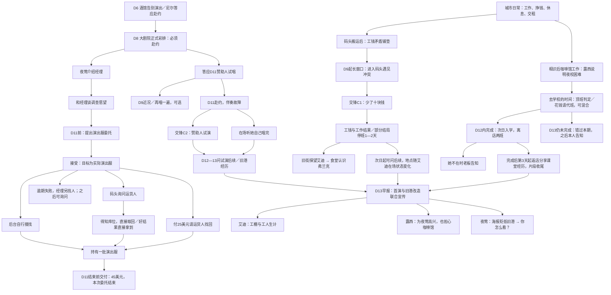

# 第二幕审核稿：故事结构、逐段对白与交锋

以 2026-10-23 当前可执行 Scheme 为准。本稿供逐段审核，记录现状，不把设计愿望当成已经实现。D 表示游戏世界日；“完成后第几天”相对实际完成日计算。动态日期在对白中以〔距D…的相对日期〕保留。

阅读顺序：总图 → 各人物故事线（完整台词与出现条件）→ 底部交锋引用。默认分支的具体含义见每段前面的说明。分支是互斥或条件出现，不代表玩家会顺次听到全部对白。“世界”是旁白；Bubble、Dialogue 和演出分别标明。没有新增或润色台词。

## 一、整个第二幕的结构

图中进入D13的连线表示共同落点，不是解锁前置：联合公告按日历发布，不等待人物线完成。经理、露西、艾迪互不构成硬前置，通过同一份骰子、钱和冷静争夺玩家注意力。艾迪若从未听过铺垫，D9起仍可直接撞见冲突；若刚听到铺垫，至少等次日。

| 时间性质 | 当前实现 |
|---|---|
| 固定公共日程 | D6告别、D8彩排、D11赞助人试演、D13联合公告 |
| 长进入窗口 | 艾迪冲突D9起，第二幕内未处理就继续存在 |
| 关系／行动引出 | 咖啡馆工作引出露西困难；彩排认识经理后主动谈愿望 |
| 接受后期限 | 经理D11收工前交付；露西本期报名D12结束前 |
| 相对后果 | 艾迪从冲突次日起停班；露西从目标完成次日起离店，上学后第3天可返店交谈 |

## 二、艾迪：工钱、冲突与停班

顺序：E1铺垫 → E2卷入 → [交锋C1](#c1) → E3探望／E5余波；探望引出E4弗兰克。D13的E6是公共事件带来的新话题，不以本线通关为前置。

### E1 · 工钱少了十块

Dialogue。第二幕内、已认识艾迪，在正常搬运后第一次说起；同日不会再触发码头冲突。

来源：`UnityClient/Assets/Resources/Content/scenes/world/第二幕.scm` → `tell-wage!`。

**否则**

> **艾迪**：一个工友说工钱少了十块。工头连账本都不肯给他看。
> **尼尔**：你要去找他？
> **艾迪**：先等他拿账出来。可他要是敢动那小子，我不会看着。
>

### E2 · 进入货栈，被卷入争执

Dialogue。D9起进入码头的长窗口；播放完进入 [交锋C1](#c1)。

来源：`UnityClient/Assets/Resources/Content/scenes/world/第二幕.scm` → `start-wage!`。

> **世界**：刚走近货栈，尼尔就听见有人喊。搬运工围成一圈，艾迪揪着工头的衣领。
> **世界**：他身后的年轻工人捂着嘴，指缝里带着血。
> **工头**：松手！你还想不想在这儿干了？
> **艾迪**：尼尔，帮我看着那小子！他少给了工钱，还动手打人！
> **世界**：尼尔挤进人群。工头把账本往桌上一拍。
>

### E3 · 去旧街看停班的艾迪

Dialogue。“拿回工钱”停班1天、“撤出”停班2天；实际停班期间在旧街选择“看看艾迪”，只播一次。

来源：`UnityClient/Assets/Resources/Content/scenes/world/第二幕.scm` → `visit-eddie!`。

> **世界**：艾迪坐在食堂后门的台阶上，手边放着一只空饭盒。
> **艾迪**：工头不让我上工，我倒是有空吃顿安稳饭了。
> **尼尔**：你那工友呢？
> **艾迪**：还在干。那小子得养家。我少挣这两天，总比他丢了饭碗强。
> **艾迪**：弗兰克在里面。他认识码头那些人，你要问什么，去找他。
>

### E4 · 食堂里的弗兰克

Dialogue。探望过艾迪后，旧街出现一次“食堂里的弗兰克”。

来源：`UnityClient/Assets/Resources/Content/scenes/world/第二幕生活.scm` → `frank-intro!`。

> **艾迪**：弗兰克，这是尼尔。工棚那事他也在。
> **弗兰克**：听说了。你替那孩子说话没错，揪住工头的领子可拿不回饭碗。
> **尼尔**：工头不认账的时候，还能怎么办？
> **弗兰克**：把同一班的人找齐，留下签过名的工时。别让他把一群人的工钱，说成一个人的脾气。
> **艾迪**：你说得容易。
> **弗兰克**：吃完饭，我陪你去找那几个工友。
>

### E5 · 问艾迪后来的事

Dialogue。冲突结束次日起一次性可问；艾迪上工时在码头，停班时在旧街。下列中间台词按交锋结果择一，最后一句按当时是否上工择一。

来源：`UnityClient/Assets/Resources/Content/scenes/world/第二幕余波.scm` → `二幕余波-艾迪!`。

> **世界**：艾迪把工帽搁在膝头，往旁边挪了挪，让尼尔坐下。
> **艾迪**：〔结果为“凭证核清”〕你把工时册找出来那一刻，他就没法再赖了。明天我们都照常上工。
> 〔结果为“拿回工钱”〕十块钱拿回来了。工头停我一天的班，算是他最后的脾气。
> 〔结果为“弗兰克调停”〕弗兰克核清了账，还顺手教训我一顿。
> 〔结果为“保住工作”〕我们这次让了步。但人没丢饭碗，也算不坏。
> 〔结果为“撤出”〕工头让我停两天班。那事没完，但剩下的我会想办法。
> 〔其他结果〕工资那事后来我和弗兰克自己去谈了。别件件事都替我操心。
> **尼尔**：你明天还去？
> **艾迪（正在上工）**：去啊。总不能为了十块钱连饭都不吃了。
> **艾迪（停班期间）**：领班暂时不让我上工。可我总得再找点别的活儿。
>

### E6 · 改造海报与一副手套

Dialogue。D13起，认识艾迪且他在码头时，选择“与艾迪谈改造”。

来源：`UnityClient/Assets/Resources/Content/scenes/world/第二幕公告.scm` → `公告-艾迪!`。

> **世界**：艾迪把一副没有破洞的旧手套推给尼尔。
> **艾迪**：你那双手套不能再用了。先穿这副。
> **尼尔**：那你自己呢？
> **艾迪**：别操心我。你看见早上的改造海报了吗？
> **艾迪**：上面连工棚都画没了。希望他们记得这儿还有人在干活。
> **弗兰克**：先问清楚谁要搬走。漂亮的画不能当饭吃。
>

**当前生活后果与事项：**停班期间艾迪不提供码头救场；返岗后恢复原有帮助。人物标注只写在场或缺席。事项仅在听说矛盾后出现，未处理或仍处停班阶段保持进行中。注意：当前了结条件不要求一定听过E5，见末尾审核提示。

## 三、露西：替她腾出上学的时间

顺序：L1说明困难 → 目标与投入 → L2完成 → L3缺席消息 → L4返店；未完成则走L5。L6为D13后独立公共话题。

### L1 · 招生纸与排班表

Dialogue。第二幕、D12以内、已认识露西且她在店，在咖啡馆工作后首次说明；说明前不开放相关行动。

来源：`UnityClient/Assets/Resources/Content/scenes/world/第二幕.scm` → `tell-lucy!`。

> **世界**：露西擦完柜台，还攥着那张招生纸。老板正在排班表上画线。
> **露西**：这次有空位了。我得去办手续，可这几段班没人接。
> **老板（咖啡馆）**：四段。你找人接上，去学校的时间就给你留着。
> **露西**：报名〔距D12的相对日期〕截止。请人一段十块，我也在找肯换班的人。
> **尼尔**：我能替你守一部分。
> **露西**：你也得挣钱。量力来，剩下的我再想办法。
>

### 目标与玩家投入（没有独立交锋）

Clock：**去学校的时间**，0/4。正文：“替她接下几段晚班，老板才肯让她去学校。还没接上的班，也可以请人代。”

| 行动 | 投入 | 坏／中／好结果 |
|---|---|---|
| 帮她顶班 | 1颗骰，社交判定，不拿工资 | 进展0／1／2；同日可再次尝试 |
| 请人代班 | 初始40美元，剩余每段10美元 | 付清余款，立即完成 |

两条路可混合。未完成的顶班行动没有老板Bubble；目标完成只播放下面L2。D12结束仍未完成，D13转为错过本期。

### L2 · 班都有人接了

Dialogue。Clock满或付清余款，立即播放。记录实际完成日；事项此时仍进行中。

来源：`UnityClient/Assets/Resources/Content/scenes/world/第二幕.scm` → `lucy-finish!`。

> **露西**：班都有人接了。我明天就去学校，把那张表交上去。
> **尼尔**：别再把它夹回书里了。
> **露西**：不会。这回连铅笔都削好了。
>

### L3 · 老板说她去学校了

Dialogue。完成后第1、2天不在店；此后第3天在店，第4天起隔天上学。第一次在她缺席时进店，老板说明。第二句按是否仍在最初两天择一。

来源：`UnityClient/Assets/Resources/Content/scenes/world/第二幕.scm` → `school-news!`。

> **老板（咖啡馆）**：找露西？她交了报名表，今天那班去学校了。
> **老板（完成后的最初两天）**：报名、领书，还要听头一堂课。这两天都得我自己看柜台了。
> **老板（之后的上课日）**：她隔一天去上一次课。今天去学校，明天这班才回来。
>

### L4 · 回来讲第一堂课

Dialogue。完成后第3天起，她在店时首次进店或正常工作后播放一次。事项在听完这段后才了结。

来源：`UnityClient/Assets/Resources/Content/scenes/world/第二幕.scm` → `class-talk!`。

> **露西**：老师让我们把一张收据从头读到尾。你猜怎么着？我以前找错过零钱。
> **尼尔**：第一堂课就挣回学费了？
> **露西**：还早呢。下回我得带店里的账单去。老板一听，比我还认真。
>

### L5 · 没赶上本期

Dialogue。D13起尚未完成目标，之后进店／工作时获知。露西第二句按是否帮助过择一；听完本段事项了结。

来源：`UnityClient/Assets/Resources/Content/scenes/world/第二幕.scm` → `lucy-missed!`。

> **世界**：柜台底下的招生纸换成了另一张。露西把旧纸折好，夹进书里。
> **露西（曾帮忙推进）**：你替的那几段我记着。剩下的还是没找齐人，学校那边已经收满了。
> **露西（没有进展）**：我找过换班的人，有人病了，有人临时不肯来。学校那边已经收满了。
> **尼尔**：还有别的办法吗？
> **露西**：下期再报。我先把书借回来，空下来自己看。
>

### L6 · 首演海报与咖啡馆的未来

Dialogue。D13起、已认识露西且她在店，选择“问露西海报的事”。不要求夜校目标完成。

来源：`UnityClient/Assets/Resources/Content/scenes/world/第二幕公告.scm` → `公告-露西!`。

> **世界**：咖啡馆柜台上贴着夜莺的首演海报。
> **露西**：她真的要在大剧院开唱了！我以前给她端过茶呢。
> **尼尔**：你看起来很高兴。
> **露西**：当然。不过旧港要改造的话，这家店明年还在吗？
> **露西**：我还没学会打字呢，可别先让我失业。
>

**生活后果：**成功入学会改变露西在店的日程；失败则仍在柜台、准备下一期。她的在场状态不改变咖啡馆工作的工资或恢复效果。完成代班后到L4之间，事项继续记录她的近况；未听说的幕后事情不提前展示。

## 四、夜莺：酒馆告别、大剧院与宣传中的旧港

N1 → N2 → 认识经理（M1）→ N3试唱约定。N4、N5是D9可选相处。N6引出 [交锋C2](#c2)，也可不花骰在场听完N7；之后N8、N9，D13接N10、N11。

### N1a · 告别演出中的台词

演出。D6必须处理。先有观众入座、三段旋律／姿势变化与掌声，后熟人散场；已认识夜莺时尼尔走近舞台交谈。以下仅列实际字幕，省略绘图和灯光参数。

来源：`UnityClient/Assets/Resources/Content/scripts/theatre/酒馆最后一夜.scm` → `酒馆最后一夜-演出`。

> **夜莺**：大家晚上好。这首歌送给今晚在场的每一个人。
> **夜莺**：谢谢大家。
>

**条件：已认识夜莺**

> **夜莺**：往后想听我唱歌，可就得买大剧院的票了。
> **尼尔**：那恐怕我买不起了。
> **夜莺**：等我混熟了，想办法把你从运道具的后门放进去。
> **尼尔**：祝你好运。
> **夜莺**：走了，尼尔。
>

### N1b · 散场后的彩排约定

Dialogue。紧接演出，已认识／未认识夜莺两个分支择一；随后显示第二幕公告。尼尔在两个分支都明确答应D8到场。

来源：`Unitylient/Assets/Resources/Content/scenes/world/第一幕.scm` → `farewell!`。

**条件：已认识夜莺**

> **夜莺**：后天第一次正式彩排。你来看看，好吗？
> **尼尔**：大剧院？
> **夜莺**：对。来侧门，跟他们说是找我的。
> **尼尔**：后天我一定到。
>

**否则**

> **夜莺**：后天我在大剧院第一次正式彩排。有空的朋友，也来听听吧。
> **尼尔**：我叫尼尔。后天我会去听。
> **夜莺**：那就说好了，尼尔。
>

### N2 · 第一次正式彩排

Dialogue。D8选择“赴彩排之约”，当晚必须处理。下列known分支为已认识夜莺；当前D6会建立认识关系，所以正常流程会走熟人分支。之后接M1、N3。

来源：`UnityClient/Assets/Resources/Content/scripts/theatre/第一幕对白.scm` → `第一幕-彩排`。

> **世界**：夜莺站在空旷的舞台中央，唱完一段。钢琴声停下，她清了清嗓子，从头又唱了一遍。
> **世界**：几个搬布景的工人停下脚步，站在台下听着。
> **舞台监督**：行了！今天先到这儿，下午乐团对谱。
> **世界**：工人们开始收拾工具。夜莺站在工作灯下，望着台下一排排空座位。
>

**条件：已认识夜莺**

> **夜莺**：你什么时候进来的？
> **尼尔**：第二遍开头。
> **夜莺**：底下听得清楚吗？第一遍我嗓子放不开。
> **尼尔**：连最后一排都能听见。
> **夜莺**：尼尔，从这上头往下看……黑压压的一大片，像个能把人吸进去的大坑。
> **尼尔**：害怕了？
> **夜莺**：有点。可我还是想留在这儿。
>

**否则**

> **世界**：夜莺拿着乐谱走向台下的人。尼尔压低帽子，从侧门走了出去。
>

### N3 · 赞助人试唱之约

Dialogue。D8正式彩排后，认识经理之后播放，答应D11赴约。

来源：`UnityClient/Assets/Resources/Content/scenes/world/第二幕剧院.scm` → `promise-trial!`。

> **夜莺**：大后天赞助人来听试唱。你也来，好不好？
> **尼尔**：我会来。到时候在后台找你。
>

### N4 · 她问的是尼尔的近况

Dialogue。D9可选“与夜莺聊近况”，一次。

来源：`UnityClient/Assets/Resources/Content/scenes/world/第二幕剧院.scm` → `show-care!`。

> **夜莺**：你的眼睛都快睁不开了。最近又去了码头？
> **尼尔**：来看看你排得怎么样。
> **夜莺**：我是问你，不是问我的排练。
> **夜莺**：后台有热茶。你坐一会儿，等我收工。
>

### N5a · 再唱一遍

Dialogue。D9，看过正式彩排，可选“再唱一遍”。

来源：`UnityClient/Assets/Resources/Content/scenes/world/第二幕剧院.scm` → `ask-about-song!`。

> **世界**：她让钢琴师把开头再弹一遍。
> **世界**：这回她唱得轻些，像还站在酒馆的小台上。
> **夜莺**：导演喜欢第一遍。你喜欢哪一遍？
> **夜莺**：不用怕说错。
>

### N5b · 更喜欢哪一遍

Dialogue。选择“酒馆里的那遍”或“大剧院里的那遍”；D10仍未回答就错过，以下台词按选择择一。

来源：`UnityClient/Assets/Resources/Content/scenes/world/第二幕剧院.scm` → `answer-song!`。

> **尼尔（选酒馆）**：第二遍像我第一次听到你唱歌的时候。
> **尼尔（选剧院）**：第一遍更像你要去的地方。
> **夜莺（选酒馆）**：那地方我唱了好多年。不过我也想试试新的唱法。
> **夜莺（选剧院）**：我很喜欢那个舞台。只是还没习惯别人替我决定怎么唱。
>

### N6 · 试唱当天伴奏故障

Dialogue。D11首次进剧院，或选择赴约后发生。“帮她想办法”进入 [交锋C2](#c2)；“在场听她唱完”走N7。答应赴约必须处理，但不强制帮忙。

来源：`UnityClient/Assets/Resources/Content/scenes/world/第二幕剧院.scm` → `sponsor-intro!`。

> **世界**：赞助人要听夜莺试演。后台的伴奏机器却在反复报错。
> **工作人员**：今天要是坏了，导演不会愿意等。
> **夜莺**：我只想把这首歌唱完。
>

### N7 · 在场听她自己唱完

Dialogue。未进入交锋而选择“在场听她唱完”；完成约定，不花骰子。

来源：`UnityClient/Assets/Resources/Content/scenes/world/第二幕剧院.scm` → `stand-back!`。

> **世界**：尼尔站在侧台，没有打断她和导演的交谈。
> **夜莺**：设备不行，就让我清唱。
> **世界**：钢琴声停着。她一直唱到最后一个音落下，尼尔才随台下的人鼓掌。
>

### N8 · 问试演后来的事

Dialogue。D12—13可问一次。四组分支按试演结果择一；未参与而错过也会落入最后的默认分支。

来源：`UnityClient/Assets/Resources/Content/scenes/world/第二幕剧院.scm` → `replay-after!`。

**分支：结果为“修好设备”**

> **夜莺**：他们说机器终于修好了。你那天一直在后台忙。
> **夜莺**：我唱第二段的时候，你甚至没听见。谢谢你。
>

**分支：结果为“替代伴奏”**

> **夜莺**：临时弹琴的那个人，手法和旧街的人很像。
> **夜莺**：我差点忘了自己是在大剧院。
>

**分支：结果为“争取清唱”**

> **夜莺**：原来我也能不用伴奏，把那首歌唱完。
> **夜莺**：但没有你开口，导演恐怕不肯让我试。
>

**其他情况／默认分支**

> **世界**：上一场试演，伴奏中途停下了。
> **夜莺**：他们想结束，我还是把最后一段唱完了。
> **夜莺**：结果怎么样，我现在也不想猜。
>

### N9 · 她过去的歌

Dialogue。D12—13可选一次，不要求N8先完成。

来源：`UnityClient/Assets/Resources/Content/scenes/world/第二幕剧院.scm` → `talk-about-past!`。

> **夜莺**：宣传的人说，我的故事最好从走进大剧院那天开始。
> **尼尔**：那你以前那些年呢？
> **夜莺**：他们说旧港不够体面。
> **夜莺**：可要是没有那个酒馆，我连第一首歌都唱不出来。
> **夜莺**：我还没想好，应该怎么和他们说。
>

### N10 · 她怎么看首演海报

Dialogue。D13起认识夜莺，在剧院选择“与夜莺谈首演海报”。之后出现“你怎么看？”的两个回答。

来源：`UnityClient/Assets/Resources/Content/scenes/world/第二幕公告.scm` → `公告-夜莺!`。

> **世界**：夜莺站在大剧院的新海报前，读了很久。
> **夜莺**：他们说我要成为这座城的一张新面孔。
> **夜莺**：听起来很好，是不是？我等了好多年。
> **夜莺**：可稿子把旧港写成人人都想逃走的地方。
> **夜莺**：你现在也去那儿干活。你会怎么想？
>

### N11 · 尼尔的回答

Dialogue。祝她成功／替旧港说话，两组台词择一。当前夜莺事项在答复后了结。

来源：`UnityClient/Assets/Resources/Content/scenes/world/第二幕公告.scm` → `公告-回应!`。

> **尼尔（祝她成功）**：先唱好你的歌。你等这一天很久了。
> **尼尔（替旧港说话）**：旧港的人不该被写成你的反面故事。
> **夜莺（祝她成功）**：我会唱好的。但事情好像比我想的复杂。
> **夜莺（替旧港说话）**：我知道。可如果我现在说不，他们还会让我上台吗？
>

## 五、经理与尼尔：第一笔调查委托

入口仅来自N2彩排后的介绍。M1 → M2谈愿望／提出工作 → M3接受。接受后搜找、打听、花钱三条路径同时存在，交付目标始终可见；不存在依次点击解锁的调查链。最后交付M7或逾期后M8。没有“说明做不了”，没有“核对供应账”。

### M1 · 夜莺介绍经理

Dialogue。正式彩排后一次性介绍。

来源：`UnityClient/Assets/Resources/Content/scenes/world/第二幕生活.scm` → `meet-manager!`。

**否则**

> **夜莺**：这是尼尔。我在酒馆唱歌的时候就认识他。
> **经理**：难怪你一散场就往这边看。你好，尼尔。
> **尼尔**：刚才那一段，她在酒馆也唱过。这里听起来很不一样。
> **经理**：往后还有得忙。你们聊，我去找舞台监督。
>

### M2 · 和经理谈打算，然后提出委托

Dialogue。认识经理后主动交谈。D11以内继续提出演出服委托；超过期限只播“已经有人接了”。

来源：`UnityClient/Assets/Resources/Content/scenes/world/第二幕生活.scm` → `talk-dream!`。

> **经理**：你也在码头做工？
> **尼尔**：哪里有活就去哪儿。不过我想做的是调查，替人把事情查清楚。
> **经理**：找你的人多吗？
> **尼尔**：还不多。总得有人肯把事情交给我，才能慢慢做下去。
>

**条件：不晚于D11**

> **经理**：我这儿还真有件事。演出服的收货单签了字，衣服却没进后台。
> **经理**：赞助人的试唱在〔距D11的相对日期〕。那天收工前，我得拿到这批衣服。
> **经理**：把演出服带回来，四十五美元。单上写着后门，也许落在后面的旧库房。
> **经理**：码头的运货人也许知道。他熟悉这些库房，花钱请他找也行。到时候没拿到衣服，我就另找人。
>

**否则**

> **经理**：这次演出的杂事已经有人接了。以后有合适的事，我们再谈。
>

### M3 · 接下演出服调查

Dialogue。明确接下后开放目标与三条并行路径，D11收工前交回一批演出服，报酬45美元。

来源：`UnityClient/Assets/Resources/Content/scenes/world/第二幕生活.scm` → `accept-contract!`。

> **经理**：衣服装在一只写着剧院名字的箱子里。旧库房在后台，运货人常在码头账房旁等活。
> **尼尔**：我会把衣服带回来。
>

### M4a · 自行搜找旧库房

Bubble。1骰敏锐判定：坏扣1冷静且没找到；中扣1冷静并获得物品；好直接获得物品。只读下面一条对应短句。

来源：`UnityClient/Assets/Resources/Content/scenes/world/第二幕生活.scm` → `search-costume!`。

**分支：结果为“坏”**

> **尼尔**：标签全泡花了。再找找别处。
>

**其他情况／默认分支**

> **尼尔**：剧院的名字，尺码也对。就是这箱。
>

### M4b · 已知道库位，直接取回

Bubble。不用骰子，获得演出服。

来源：`UnityClient/Assets/Resources/Content/scenes/world/第二幕生活.scm` → `collect-costume!`。

> **尼尔**：靠窗这一排……找到了。
>

### M5 · 询问运货人

Dialogue。1骰社交判定：坏扣1冷静没线索；中知道确切库位；好除了知道库位，还跟车找到物品。好结果会先切到剧院，再播放后半段。

来源：`UnityClient/Assets/Resources/Content/scenes/world/第二幕生活.scm` → `ask-carrier!`。

**分支：结果为“坏”**

> **运货人**：我这几天送了那么多车。你说哪一箱？我真记不清。
>

**其他情况／默认分支**

> **运货人**：那天下雨，侧门锁着。我把它送到后台旧库房，最里面靠窗那一排。
>

**条件：结果为“好”**

> **运货人**：我正好要过去取空箱。上车吧，一起把它搬出来。
> **世界**：尼尔跟车回到旧库房，找到了标着剧院名字的演出服箱。
>

### M6 · 付钱请人找回

Dialogue。25美元、不耗骰子，直接得到演出服；当前会先聚焦剧院再播这段。

来源：`UnityClient/Assets/Resources/Content/scenes/world/第二幕生活.scm` → `hire-carrier!`。

> **运货人**：二十五块，替你把这批货重新找齐送回去。我认得那些库房。
> **世界**：运货人带着尼尔找到衣箱，重新核过标签，将演出服交到他手里。
>

### M7 · 交付演出服

Dialogue。交出库存中的一批演出服，收45美元，本次委托和事项结束。没有额外工作。

来源：`UnityClient/Assets/Resources/Content/scenes/world/第二幕生活.scm` → `deliver-contract!`。

> **世界**：经理打开衣箱，按清单一件件点过，把箱子推给后台的人。
> **经理**：都在。四十五美元，你收着。以后有需要查清、办妥的事情，我还会找你。
>

### M8 · 逾期后问经理

Dialogue。D12起经理另找他人；之后“问委托后续”，听完才将失败片段归档。

> **经理**：衣服已经派别人去找了。试演不能等。
> **尼尔**：是我没赶上。
> **经理**：以后接活儿，先算好手头的时间。
>

## 六、城市共同生活与D13公告

旧街初访独立于探望艾迪，不需要点“看看旧街”；进入时一次性介绍。吃饭、牌桌是第二幕旧街日常，不是人物委托。

### S1 · 初到旧街

Dialogue。第一次进入旧街即发生，不限定某一天。

来源：`UnityClient/Assets/Resources/Content/scenes/world/第二幕生活.scm` → `street-intro!`。

> **世界**：工棚后面是旧街。食堂、牌桌和零工挤在一起。
> **世界**：码头工人常在这里收工、吃饭，谈论别人的生活。
>

### S2 · 吃顿热饭

Bubble。3美元+1骰，恢复2冷静。

来源：`UnityClient/Assets/Resources/Content/scenes/world/第二幕生活.scm` → `meal!`。

> **老板（旧街食堂）**：热汤在这儿，面包自己拿。
>

### S3 · 牌桌短句

Bubble。押5美元+1骰敏锐判定，赢／平／输择一。赢得12美元、平得5美元，输另扣1冷静；押金已在资源槽扣除。

来源：`UnityClient/Assets/Resources/Content/scenes/world/第二幕生活.scm` → `cards!`。

**分支：结果为“赢”**

> **牌客**：今晚手气不错，别把好运也赌进去。
>

**分支：结果为“平”**

> **牌客**：算是打了个平手。
>

**其他情况／默认分支**

> **牌客**：五块没了。还玩吗？
>

### S4 · D13早报

Dialogue。世界日历D13发布一次，不等待人物线结案。

> **世界**：早报头版写着：旧港改造计划启动，大剧院首演助阵。
> **世界**：酒馆角落里有人碰着酒杯。吧台边，一个装卸工把报纸翻回头版，又看了一遍。

公告之后可各自去见E6、L6、N10。目前这里发布的是首演宣传与改造公告；不是一场已实现的D13首演交锋。

共同资源约束：每四天40美元房费，到期钱不够立即锁门；补清后恢复房间及家具使用。它与人物线共用金钱，不能把经理委托当作露西线的硬前置。

## 七、交锋引用

### C1 · 少了十块钱

来源：`UnityClient/Assets/Resources/Content/scenes/encounters/少了十块钱.scm`。从E2进入，返回的结果决定艾迪后续状态。

**局面：**年轻工人少了十美元，艾迪与工头对峙。工钱进展0/3、争执升级0/3。工钱达到2或争执满3，先转入工作危机；不在这一步直接结算。

| 阶段／行动 | 投入 | 坏 | 中 | 好 |
|---|---|---|---|---|
| 初始：核对账本 | 1骰敏锐 | 冷静−1，争执+1 | 标记核过工时，工钱+1 | 标记核过工时，工钱+2 |
| 初始：向工头交涉 | 1骰社交 | 冷静−1，争执+1 | 工钱+1、争执+1 | 工钱+2 |
| 危机：请工友核签名 | 1骰，需已核过工时 | 直接“凭证核清” | 同左 | 同左 |
| 危机：先让艾迪退开 | 免费 | 放弃工钱，保住工作 | 同左 | 同左 |
| 危机：继续坚持补钱 | 1骰暴力 | 冷静−2，撤出 | 保住工作 | 拿回工钱 |
| 任意：退出这场争执 | 免费 | 撤出 | 同左 | 同左 |

结果后果：凭证核清／保住工作照常上工；拿回工钱次日起停1天；撤出次日起停2天。`弗兰克调停`有结局对白和返回值，但当前交锋没有对应行动入口。

### C1-入场对白

E2外部Dialogue之后，进入交锋再次播放。

来源：`UnityClient/Assets/Resources/Content/scenes/encounters/少了十块钱.scm` → `on-encounter-enter`。

> **年轻工人**：我只想把那十块钱拿回来。
> **艾迪**：那就把账拿出来，让大伙看清楚。
>

### C1-危机与推进

第一次工钱进展达2或争执满格时播放危机Dialogue。

来源：`UnityClient/Assets/Resources/Content/scenes/encounters/少了十块钱.scm` → `推进!`。

**分支：尚未进入危机，且工钱进展达到2或争执满格**

> **工头**：账我可以再核。可你们这么闹，明天谁还来卸货？
> **工头**：艾迪，你再带头，下次就别来领班了。
> **年轻工人**：艾迪，我还想在这里做工。
> **艾迪**：……我只是想把你那十块钱要回来。
>

### C1-结局对白

按最终返回值择一。默认分支为撤出。

来源：`UnityClient/Assets/Resources/Content/scenes/encounters/少了十块钱.scm` → `结束!`。

**分支：结果为“凭证核清”**

> **尼尔**：这是签过名的工时册。账房少算了整整半班。
> **工头**：……让账房补上。下回记得留底。
> **艾迪**：你用的是自己的本事。他还真没法再赖。
>

**分支：结果为“拿回工钱”**

> **工头**：行，就差这十块。拿去。
> **工头**：艾迪，明天你不用来了。停一天，想清楚怎么跟我说话。
> **艾迪**：钱给那小子。我的事我自己担着。
>

**分支：结果为“保住工作”**

> **艾迪**：他们不能这么欺负人。
> **尼尔**：先别把饭碗赔进去。
> **艾迪**：……我记下这笔账。
>

**分支：结果为“弗兰克调停”**

> **弗兰克**：把账拿来，我和你核一遍。
> **工头**：行。你说了算。
> **弗兰克**：都回去干活。下次先看账。
>

**其他情况／默认分支**

> **世界**：工头收了账本，工友们各自散开。
> **工头**：艾迪，你停两天班。再闹就别来了。
> **艾迪**：我在旧街食堂。这事还没完。
>

### C2 · 赞助人试演

来源：`UnityClient/Assets/Resources/Content/scenes/encounters/赞助人试演.scm`。N6选择“帮她想办法”进入。

**局面：**伴奏故障，导演与赞助人不等人。进展0/3、剩余时间4。检修和找旧乐手共享进展钟，但切换办法会把进展清零。每次行动显式扣时间；没有额外每回合扣时。

| 行动 | 投入 | 坏 | 中 | 好 |
|---|---|---|---|---|
| 检修伴奏 | 1骰敏锐 | 冷静−1，进展0，时间−2 | 进展+1，时间−1 | 进展+2，时间−1 |
| 找旧乐手救场 | 1骰社交 | 冷静−1，进展0，时间−2 | 进展+1，时间−1 | 进展+2，时间−1 |
| 争取清唱 | 1骰社交 | 冷静−1，时间−1，未说服 | 时间−1，直接清唱结局 | 同中 |
| 交还给夜莺 | 免费 | 她自己唱完 | 同左 | 同左 |

进展满3先按当前办法成功收场；否则时间归零，她自己唱完。交锋崩溃也返回“她自己唱完”。四种结果回到夜莺故事线，影响N8回顾对白。

### C2-入场对白

从N6再次进入交锋时播放。

来源：`UnityClient/Assets/Resources/Content/scenes/encounters/赞助人试演.scm` → `on-encounter-enter`。

> **世界**：大剧院。赞助人的试演即将开始，伴奏装置却忽然停了。
> **工作人员**：重新开机至少还得等一会儿。
> **导演**：我们的客人马上就要走了。
> **夜莺**：我可以先唱。
> **导演**：你先等着。
>

### C2-清唱未获同意

清唱坏结果且仍有时间时播放。

来源：`UnityClient/Assets/Resources/Content/scenes/encounters/赞助人试演.scm` → `试演清唱!`。

**其他情况／默认分支**

> **导演**：先去想办法修伴奏。我还没有答应你。
>

### C2-四种结局

修好设备／替代伴奏／争取清唱／默认她自己唱完，择一。

来源：`UnityClient/Assets/Resources/Content/scenes/encounters/赞助人试演.scm` → `试演收场!`。

**分支：结果为“修好设备”**

> **世界**：伴奏终于重新响起。夜莺在台上等了一个拍子，接上了自己的歌。
> **夜莺**：我还以为你要把那台机器整个拆了。
> **尼尔**：差一点。
>

**分支：结果为“替代伴奏”**

> **世界**：酒馆的老乐手坐到钢琴前，试了两个音。
> **夜莺**：这首歌我们以前在酒馆唱过。
> **世界**：她跟上琴声，赞助人的目光终于从故障的设备上移开。
>

**分支：结果为“争取清唱”**

> **导演**：没有伴奏？好。你只有一首歌的时间。
> **世界**：夜莺站在空舞台上，等台下安静，独自开口。
> **夜莺**：谢谢你给我这个机会。
>

**其他情况／默认分支**

> **导演**：时间到了。今天先这样吧。
> **夜莺**：等等。让我把最后这一段唱完。
> **世界**：没有伴奏。她依然唱完那段，才走下舞台。
>

## 八、审核时值得直接检查的断点（未在本次改动中修剧情）

1. **艾迪的后续与归档没有完全一致。** E5确实存在，但当前事项可能在停班结束或不被停班的结局后就了结，不要求听过E5；E6公共话题也没有纳入该事项收尾。
2. **露西事项在L4收尾，L6仍是后来可聊的新话题。** 需要审核它应作为同一片段续写，还是新的城市变化话题；目前没有单独新事项。
3. **夜莺的两次故障说明重复。** N6外部入场与C2入场各有一段Dialogue；这是当前内容，不在稿中合并隐藏。
4. **部分内容仍按短日期窗口开放。** D9近况／再唱一遍、D12—13回顾与过去的歌，仍是定日按钮；与“从生活自然生长”的方向是否一致，需要审核。
5. **经理路径仍有表现差异。** 自行搜找已改Bubble，但询问运货人好结果有前后两段Dialogue，付费路径也用Dialogue；请判断哪些保留、哪些只需结算加短句。
6. **侦探愿望事项仍有过时句子。** 当前完成委托后写“经理愿意继续把查账的工作交给你”；供应账动作已经删除，此句没有随之清理。此处如实揭示，不在审核整理时静默改写。
7. **弗兰克调停是没有入口的结局。** C1保留了该分支，但玩家当前没有方法主动达成。
8. **D13不是实际首演内容的完成。** 当前只是联合宣传、人物反应和夜莺回答；图与对白之外不应推定还有一场已制作的首演。

本稿基于源代码静态映射，未运行试玩，不作为触发顺序与画面效果已经验证的证据。
