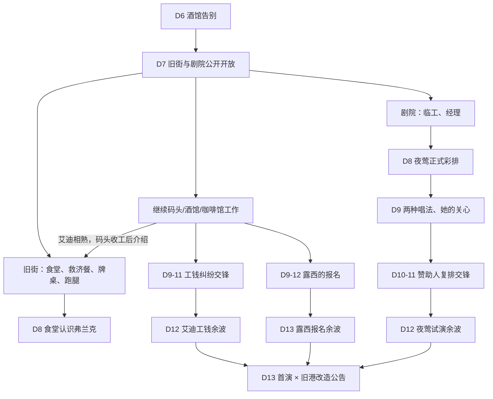

# 第二幕《这里有我的朋友》——运行版内容网络

> 结构审核稿。时间按当前接入的第7–13日组织；原有交锋保留，未擅自重写。第14日之后的第三幕尚待审定。

## 开放规则

- 第7日公开开放旧街（使用现有「码头居民区」地点）与剧院；不以认识艾迪或夜莺为前提。
- 继续码头工作且已经与艾迪熟悉，会得到食堂介绍，但这是人物引导、不是解锁条件。
- 旧街可以支付3美元及一骰恢复2点冷静；每天一次救济餐消耗一骰恢复1点；牌桌押5美元；街头零活可重复。
- 剧院临工可重复，第一次完成工作可认识经理。初次正式彩排仍由原剧场脚本及人物状态决定。
- 工钱纠纷（第9–11日）、露西报名（第9–12日）、赞助人复排（第10–11日）使用现有交锋/事件机制。
- 第13日公共公告不依赖玩家完成任意人物线，未参与的事情也会继续发生。

## 需要手动验收

- 地图中的「码头居民区」锚点与剧院节点是否可以正常访问。
- 各项工作/牌桌/恢复动作是否消耗预期的骰子、金钱，且不会重复领取救济餐。
- 工钱与露西过期窗口、艾迪/夜莺余波是否能跨日结算并读档保留。
- 旧版第一幕与旧第二章调试入口仍能装载；此次未做可玩实机验证。