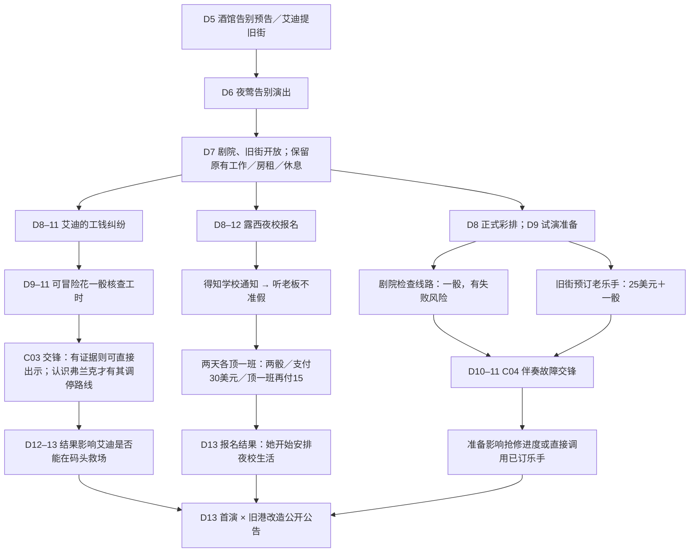

# 第二幕《这里有我的朋友》——第二阶段实际内容网络

> 第二阶段 Unity/Scheme 实施稿（2026-10-22）。只修改正式游戏内容和原生内容验收，不处理 Web。以下日程和数值与当前 Scheme 脚本对应。剧情 Dialogue 仍需作者逐句审核，部分地方后续换为剧场。

## 日常依旧开放，但人物事件开始争夺同一批资源

| 路线 | 发现方式 | 具体投入 | 参与与不参与的差别 |
| --- | --- | --- | --- |
| 露西 | D8 起咖啡馆帮工自然谈起，或玩家主动询问 | 见过老板后，需在不同两天各守一班（各一骰）；也可 30 美元请人；部分顶班后减至 15 美元 | 有人帮她安排时间；不帮她仍自己换班报名，但被老板扣两班工钱 |
| 艾迪 | D8 起码头正常搬运得知，或主动问他 | 交锋前可投入一骰核对工时，判定成功才有证据；交锋另耗骰 | 出示已核的记录能改变交锋；取得钱会引起工头短暂停班报复，撤出则可能失去更多上工机会 |
| 夜莺 | 彩排日程公开，剧院工人明确提过线路不稳定 | D8–9 花一骰检查线路；或 25 美元加一骰在旧酒馆订乐手；亦可不准备 | D10–11 试演时线路记录使抢修起步更快，订金可直接兑换乐手上场；未准备依旧可在交锋内临场处理 |
| 生活 | 房租仍每四天 40 美元；旧城码头 / 咖啡馆 / 酒馆工作仍可循环 | 同样消耗每日行动骰、金钱和冷静 | 一次性剧院临工保留，与经理认识，但不是无穷重复挣钱动作 |

## 三个不同的短篇节奏

**露西：**她先收到学校通知；老板不肯让她缺席两个班；玩家介入是一项有真实机会成本的劳动或现金支出；第十三天她带着报名表、第一本教材和之后夜晚的工作变化回来。未帮助时她也不会静止，而是自己换班，牺牲工资。

**艾迪：**年轻工人的工钱少算；尼尔若注意到，可以提前检查工时册；面对工头时，有证据、硬碰硬和请熟悉的弗兰克出面，会产生不同解决形式。停班时既在人物余波出现，也直接取消尼尔原本在码头受伤害时可依靠的每日救场。

**夜莺：**正式彩排主要是人物与梦想，而不是必须支出的任务；舞台工人提前说出设备隐患；玩家可主动花时间检查、预订老乐手、或者不准备。试演当天机器出故障，但夜莺仍坚持唱下去。预备资源影响解决手段，不替她决定是否演唱。

## 留给作者审核及真人测试的风险

- 露西帮忙成本是否足以与下一笔房租竞争？两天各一骰与 30 美元只是第一组实验参数。D12 当天才行动不能通过顶两班完成，应明确提醒只能付费。
- 艾迪的报复停班是否与交锋中的承诺、剧情因果相符？此处比单纯奖惩更重要。
- 预约乐手需要进旧街，不应变成“隐藏的每日巡查”。剧院的公开说明与「手头的事」应把这件事解释清楚。
- 剧院准备可以降低部分不确定性，不能让玩家误以为未准备就会导致夜莺无法继续唱歌。
- 原生运行时、真实多日存档、低钱/低冷静/骰子不足的情况需单独验收。正文不代表这些已全部验证。

> 具体 Dialogue 待 [第二幕对白与演出整理](./第二幕_对白与演出待替换.md) 审核。Web 客户端不在本次实施范围。
