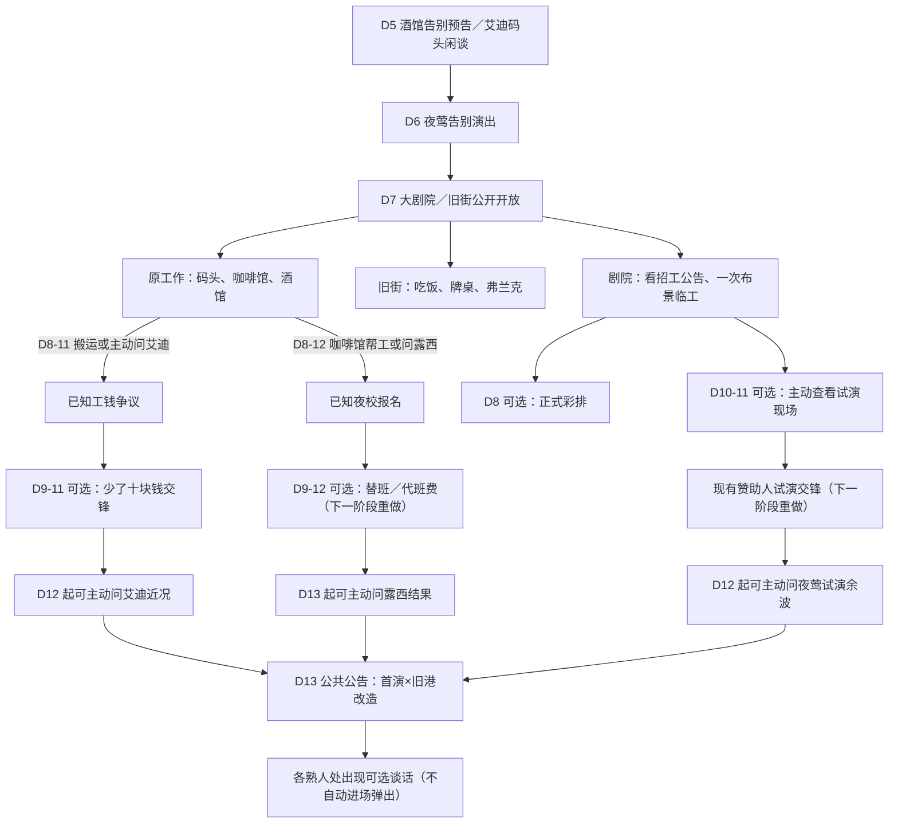

# 第二幕《这里有我的朋友》——第一阶段运行结构（审核）

> 按 2026-10-22 第一阶段“删冗余、明确事件发现和维护代价”整理。此版**不表示**露西、艾迪、夜莺三个短篇及交锋已经重新设计完成。实际数值和条件以 Scheme 为准。

## 当前日常与恢复

| 内容 | 第一阶段规则与目的 |
| --- | --- |
| 旧街热饭 | 3 美元 + 1 骰 → 冷静 +2；和酒馆恢复、家中静坐进行经济比较 |
| 旧街牌桌 | 押 5 美元，存在输赢和冷静风险；玩法深度**仍未重做** |
| 旧街救济餐 | **已删除常驻日常动作**。将来可以作为一次人物或困境事件，而非每日免费收益 |
| 旧街跑腿 | **已删除**。原有码头、咖啡馆、酒馆工作仍是收入骨架 |
| 剧院布景临工 | **一次性**；可以取得报酬、认识经理，帮助尼尔说出侦探工作的打算 |
| 旧名片 / 回家思考 | **已删除两次独立执行按钮**；愿望改经工作对白及「手头的事」表达 |
| 普通睡眠 | 室内受伤时每两夜恢复 1 点伤势 |
| 弹簧床垫 | 花费原价购买后，室内每受伤夜恢复 1 点伤势；**不再无限 1 骰换 1 伤势** |
| 诊所 | 20 美元 + 1 骰恢复 2 点伤势 |
| 药品 | 25 美元，使用时不消耗骰子，一天一次恢复 2 点伤势 |

## 事件发现方式

- **知道新地点**：D5 的告别通知及此前与艾迪同在码头工作提供连续性；D7 地图公开可见两个空间，但不是“第七天才出现这两条街”。
- **第一幕式的工作惊喜**：第二幕中原有的码头搬运、咖啡馆帮工会引出艾迪和露西的事情；若没等到工作对白，地点上的显式“问”动作也允许玩家主动求证。
- **明确的下一步**：知道工钱纠纷、报名之后，`手头的事` 才显示相应期限；日程本身与世界日期同源。
- **重要事件必须由玩家选择参加**：试演故障、人物余波、公告后的私下谈话改为可见动作，不因每日进入地点自动播长 Dialogue。D13 的公共晨报照常发生。
- **第一次去旧街 / 看剧院公告**：通过公开可见的行为主动展开，而不是第 N 天进地点突然截断工作。

## 尚未完成的第二阶段（本次不擅自定稿）

1. 露西：将“1 骰或 10 美元一次解决”改成完整的几日短篇和资源选择，结局持续影响她的生活。
2. 艾迪：在交锋前有准备与取证可能，交锋后实际影响码头工作、关系和经济。
3. 夜莺：彩排和赞助人试演形成可准备的机会，不只是日期到来时的免费交锋。
4. 牌桌：探索是否能承担低骰用途、风险与情报机会；目前仍只是简单赢钱动作。
5. 运行验证：世界脚本加载、状态存档、相对期限、CLI/Web 回归与实际客户端试玩分开记录；CI 失败不得归结为已经验收。

> 需审台词与剧场替换仍见 [第二幕对白](./第二幕_对白与演出待替换.md)，以及 [手头的事](./第二幕_手头的事_目标与对白审核.md)。
