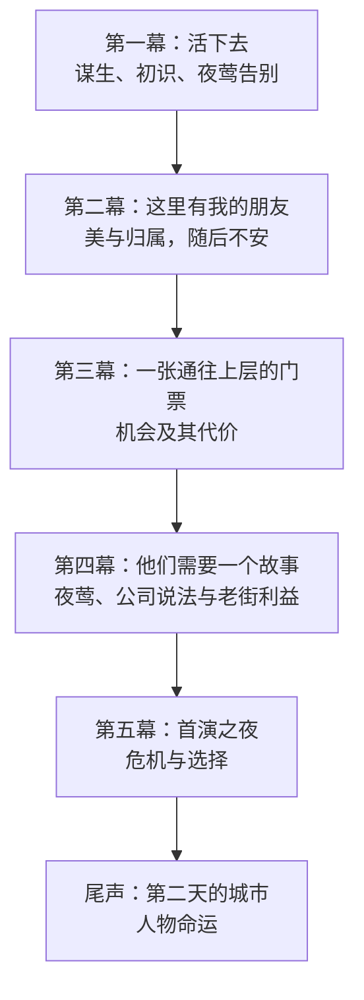
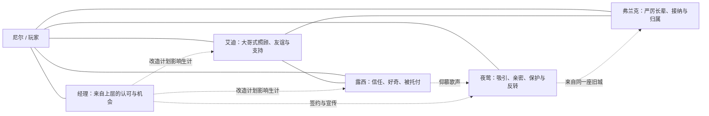

> 历史资料：当前章节请从 [文档首页](../../../README.md) 进入。本文保留当时的表述，不作为当前设计入口。

# SSNoir 第一章总纲：《这座城里的人》


## 0. 核心创作命题

**玩家先因为夜莺走进一段故事，随后在谋生过程中认识、喜欢、依靠城市里的人。当夜莺的成功与这些人的生活产生冲突时，玩家才必须决定自己愿意成为什么样的人。**

目标不是完成最多任务、养满所有人物关系，也不是证明一套复杂生活模拟有多精细，而是验证：

1. 日常工作能否自然建立熟悉感，让玩家期待再次见到某个人；
2. Scenario能否将这种熟悉感放进有压力的处境，让关系从闲聊变成共同经历；
3. 人物是否会主动对待主角，而非只等待玩家帮助；
4. 世界事件能否在不要求玩家清完支线的前提下，让既有关系产生情感与实际后果；
5. 结局以后玩家是否仍然关心人物自己的命运。


### 主角：尼尔

- **职业方向：** 尼尔不是预设的正式侦探，而是在城里位置不稳、自由接活、靠劳动生活的年轻人；能在酒馆看场、码头搬运、咖啡馆帮工、剧院跑腿，之后也可能承接调查委托。
- **固定人格：** 在意尊重；对认识的人遭受欺负不太能无动于衷；有幽默、嘴硬的一面。玩家决定他何时介入、愿意付出多少代价。
- **开放的未来身份：** 经理赏识的得力助手、老街认可的自己人、走上调查与揭露道路的人，或其他由玩家经历塑造的方向。“侦探”不应是开局必须兑现的职业成长目标。
- **避免：** 不设置独立的“成为侦探”成长数值，不让尼尔的预设理想覆盖玩家实际作出的选择。

## 1. 五幕总结构



**每幕都有一个共同的世界事件，不应等待玩家清完人物支线才发生。** 人物生活、可选Scenario和调查可以并行；错过某段经历意味着它以其他方式发展，不意味着世界停摆。

| 幕次 | 玩家面对的核心问题 | 当前设计方向 | 状态 |
|---|---|---|---|
| 第一幕：活下去 | 今天去哪里挣钱？今晚要不要陪夜莺？ | 酒馆、码头、咖啡馆的谋生与初识；雨夜同行；酒馆告别演出 | 详见第一幕设计稿；仍需按其中标注迁移与验收 |
| 第二幕：这里有我的朋友 | 为熟悉的人，要不要牺牲自己的时间与钱？ | 剧院彩排、港口热闹、工钱纠纷、夜校、短暂亲密与逐渐出现的不安 | 有纵向样本；内容和验收状态见第二幕设计稿 |
| 第三幕：上层的门票 | 高薪机会与原来的生活怎么兼顾？ | 经理给尼尔更高的调查机会；工作、金钱与旧街朋友的利益开始冲突 | 待写 |
| 第四幕：他们需要一个故事 | 优先保护夜莺、熟人还是事实？ | 夜莺的成功、公司说法与老街利益冲突；让玩家逐渐看清她的主动选择 | 待写，需足够前文证据，不提前揭底 |
| 第五幕：首演之夜 | 当众接受、质疑还是拒绝官方故事？ | 首演危机、舆论与事实之争；让既有关系和调查成为选择依据 | 待写 |
| 尾声：第二天的城市 | 我想去看看谁后来怎样了？ | 返回普通地点，看见人物继续生活，而不是只显示任务评分 | 待写 |

**边界：** 第三至第五幕是结构方向，不是已运行内容。后续具体阴谋、事故、证据链和结局可以在场景设计与试玩后调整；不要把框架写成已经实现的事实，也不要把前两幕锁进单一调查目标。

## 2. 第二幕的情感校准

第二幕不是把更多工作和更长的 Clock 排在第一幕后面。玩家需要先体验**新鲜、喜悦、亲密、美、梦想、被认可与短暂的幸福**，不安随后进入。否则玩家只是继续处理彼此独立的小麻烦，不会害怕将要失去什么。

当前第二幕设计以这些体验为节拍：

- **新鲜：** 酒馆少了夜莺，城市打开剧院与旧街的新生活。
- **美与喜悦：** 空舞台上的彩排让玩家看见夜莺的梦想，也让尼尔第一次得到上层人物的认可。
- **热闹与归属：** 大船靠岸让码头忙起来，工友一起劳动；艾迪与弗兰克的行动使玩家感到自己生活在人群之中。
- **温暖遇到阻力：** 工钱问题与演出安排让具体人物的愿望受到现实阻碍。
- **亲密与短暂幸福：** 夜莺主动关心尼尔、分享对舞台的喜悦；此时不提前把她写成反派，也不强迫玩家表态。
- **不安：** 旧港测绘和新城宣传让两个世界的利益冲突浮现，成为后续调查的钩子。

逐日事件、Scenario细节与当前实现情况以第二幕唯一有效设计稿为准；本节只保留总体情感目标，不复制旧版日程和数值。

## 3. 人物关系网络：先有情感，再有功能



| 人物 | 玩家最初应当感受到什么 | 日常里此人主动给予什么 | 中后期的复杂性与兑现方向 |
|---|---|---|---|
| 夜莺 | 魅力、脆弱、特殊的亲近 | 主动邀请、关心尼尔、愿意听他的看法 | 她的温柔是真的，渴望向上与可能伤害老街也是真的；反转不应抹杀前面的情感 |
| 艾迪 | 被照顾，有个站在自己一边的大哥 | 搬货解围、招呼、请喝酒、问候 | 为朋友承担代价，但不是任由玩家调用的免费战力；不以复杂假赛线为第一轮必需内容 |
| 露西 | 被相信、被欣赏，日常愉快 | 记住尼尔的生活、开玩笑、分享愿望 | 有自己的学打字计划；玩家能帮助她获得选择条件，却不能替她活 |
| 弗兰克 | 严厉但靠得住的长辈 | 照顾工人、解决纠纷、有限保护 | 不轻易把外人当自己人，认可必须通过共同事件获得 |
| 经理 | 终于受到上层赏识 | 薪水、工作、身份与进入新空间的机会 | 承认与利用可能同时存在，构成情感诱惑 |

艾迪一直是可依赖的人；让他因原则承受不公，比突然变坏有力量。露西向上学习，也会反过来关心尼尔。弗兰克是旧街可信的长辈。经理有利益现实的一面，但小恩惠、夸张热情与职业赏识都真实存在。**夜莺对尼尔的亲密是真的，她的野心也是真的**：玩家先真心替她高兴，后来才对她的选择感到惊讶、心痛和理解。

## 4. 日常、Scenario与余波


这表示内容职责，不是强制玩家逐节点完成的任务链。地点访问、日期推进和人物自己的行动都可以改变事件顺序；未参与的事件也应有自洽的后果。

| 内容类型 | 发生方式 | 玩家主要思考 | 行动成本 |
|---|---|---|---|
| 日常工作与互动 | 访问地点、从事重复工作时触发人物片段 | 在哪里谋生、今天的骰子怎么用、这些人是什么样的 | 工作本身消耗；人物片段通常不额外消耗 |
| 局部Scenario | 行动中出现值得连续决策的目标与风险，也可以由邀请进入 | 先解决什么？危险上涨后是否改变目标？ | 使用同一套骰子和资源，不另开小游戏 |
| 世界事件与余波 | 由已告知的日期或局势触发 | 我见过或错过什么？哪些人发生变化？ | 事件本身不强制额外消费；介入需要实际取舍 |

### Scenario设计约束

- **必须有变化：** Scenario不是把一根 Clock 填满。至少要有风险积累、时间竞争、危机打断、替代路径或目标重新评价之一。
- **目标属于角色生活：** 雨夜同行关乎亲密与保护；工钱纠纷关乎义气、工作与现实代价；彩排关乎才能、自尊与临场选择。
- **失败推动故事：** 失败可以导致冷静、伤势或收入损失，错过机会，或带来关系上的担忧；不得造成主线锁死。
- **有余波：** Scenario后的普通见面应在对白、工作机会、人物态度或可选行动中回应发生过的事。
- **不让高压泛滥：** 邀请、玩笑、陪伴和简单庆祝不需要改造成 Contract。

## 5. 玩家如何发现内容

- 介绍过的谋生方式和开放地点应当能直接使用，不要求玩家先填探索 Clock 才获得已知工作。
- 人物事件应通过地点、日常工作和角色主动行为自然发现；不要提前在全城任务表揭示全部人物事件。
- 只有角色已经告知的约定与机会，才需要可见的日期或倒计时；未知故事不挂灰色锁定卡。
- 重要机会应有不止一种合理的发现途径，避免单次错过后玩家完全不知道事件存在。
- 没有玩家介入时，人物和世界仍应自主演进；不要强制玩家同时认识所有角色。
- 每条人物线都应支持晚认识、普通熟人、共同经历等不同关系深度；对白不能假设玩家经历过未触发的事件。

## 6. 世界与人物状态：优先记事实，不泛化成好感数字

> 以下是内容设计需要表达的语义事实，不是程序接口或变量名要求。实际脚本以当前内容和运行规则为准。

| 范畴 | 事实示例 | 后续用途 |
|---|---|---|
| 城市生活 | 去过哪些工作地点、房租与资源状况 | 工作选择、行动成本、部分对话变化 |
| 艾迪 | 是否初识、是否受过帮助、是否一起工作或赴约 | 称呼、态度、之后是否愿意替谁承担风险 |
| 露西 | 是否熟悉、是否听过她的计划、是否帮助她争取机会 | 生活余波、工作去向与信任 |
| 夜莺 | 是否雨夜同行、如何处理沿途状况、是否参加重要演出 | 亲密对白、彼此理解和后续选择 |
| 弗兰克 | 是否见过他处理纠纷、是否共同做事、是否尊重工人 | 认可、有限保护、是否愿意作证 |
| 世界 | 日期、已公开的演出与工作机会、纠纷结果、街区变化 | 世界事件和后续调查入口 |

相同场景只需根据其中最相关的一两项事实安排有意味的对白或动作变化。**不要让每种状态组合都产生一篇全新的剧本。**

## 7. 内容稿的场景记录格式

设计新的情节、地点或Scenario时，可用同一张简洁的设计卡交流：

```text
场景编号 / 名称：
地点与时间：
人物：
玩家目前知道什么：
进入条件与发现途径：
这场戏想让玩家感受到什么：
开始时玩家想完成的目标：
可用的行动：
风险/局势变化（若为Scenario）：
玩家可以拒绝、失败或离开吗：
人物主动采取的行动：
结果分支（仅关键差异）：
长期记忆与下次见面的余波：
剧场表现（镜头、默剧动作、对白重点）：
待确认问题：
```

## 8. 第一轮纵向体验验收

前两幕的目标不是清空所有内容，而是在一场重大事件到来之前，让玩家已经开始关心人物。

**重点观察：**

1. 不提示角色姓名时，玩家能否自然回忆艾迪、露西、夜莺及他们做过的具体事情；
2. 玩家是否因为想见某个人而回到某个工作地点；
3. 玩家是否在工钱纠纷、露西夜校等情境中主动放弃更高收入或另一项计划；
4. Scenario发生后，玩家是否主动寻找人物、查看其状况，而非只看奖励结算；
5. 旧港变化出现时，玩家是否自行联想到熟悉的人会受到影响。

**警惕的失败信号：** 人物被当成 Clock 奖励；有趣内容只能靠反复工作刷出；Scenario结果只改变数字；夜莺只等待玩家救助；艾迪只通过给好处换取玩家忠诚；人物不参与时世界就停滞。

**待定事项：** 第三幕以后的证据链、舞台事故形式、结局分支和具体日期，待场景设计与试玩后确认。不要用增加系统规则来代替人物写作。
