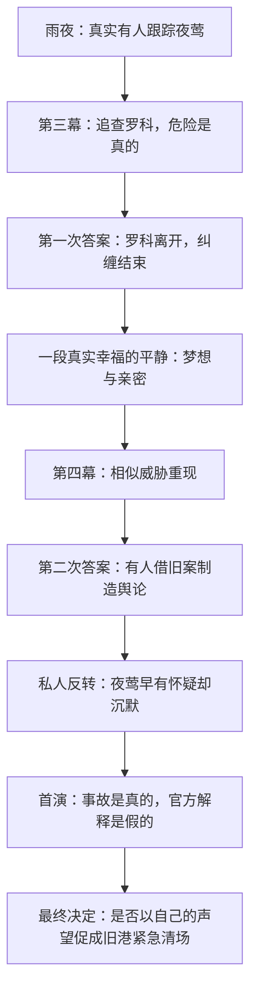
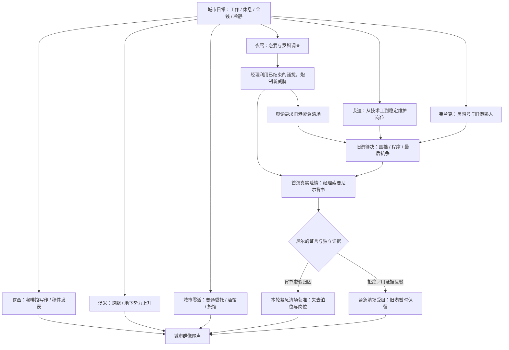
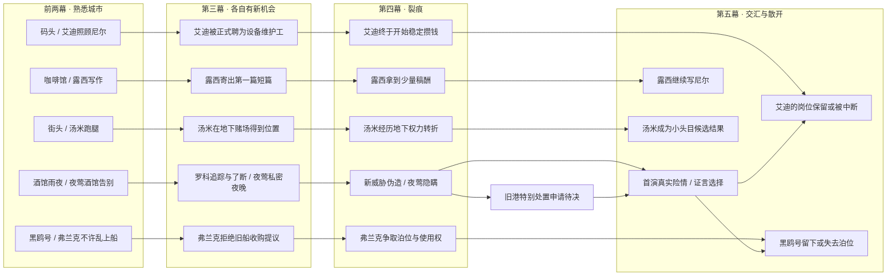
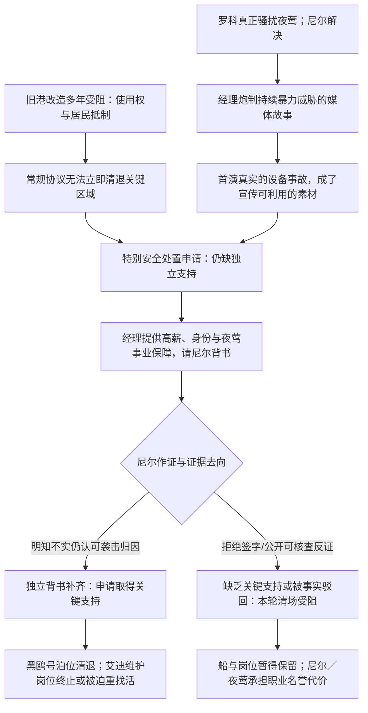

> 历史资料：当前章节请从 [文档首页](../../README.md) 进入。本文保留当时的表述，不作为当前设计入口。

# SSNoir 第一章｜故事实施总稿 V2.0

**修订日期：2026-10-26｜从 V1.0 替换式更新；未修改仓库与游戏。**

> 本文整合 README、总纲、内容网络、人物场景、Scenario规则、前两幕修订、关键抉择、变更日志；也可使用分文件 ZIP 进行协作。

---

<!-- README.md -->

## SSNoir 第一章｜故事实施设计包 V2.0

**更新日期：2026-10-26**  
**性质：当前创作共识的实施基线，不代表 GitHub 已修改或全部玩法已经验证。**

> 玩家走进一段故事、一座城市，随后在谋生过程中认识、喜欢、熟悉和依赖城市里的人。当所爱夜莺的成功与这些人的生活发生冲突，玩家才必须决定自己愿意成为什么样的人。

### 阅读顺序

1. `00_故事总纲与作者真相.md`：作者真相、五幕戏剧与**决定性**最终抉择；剧情与导演先读。
2. `01_内容网络与世界进程.md`：横向并行的城市生活网络、地点/行动集合、幕次节奏、缺席发展；章节组织先读。
3. `02_人物故事线与场景卡.md`：夜莺、尼尔、艾迪、弗兰克、露西、汤米、经理与罗科的定调、人生、场景；对白编剧先读。
4. `03_Scenario状态与条件规则.md`：可玩机制、事实变量、无参与路线、体验验收；系统、脚本与 QA 先读。
5. `04_前两幕调整与制作计划.md`：哪些沿用、哪些移除、具体制作任务、资源需求；开发规划先读。
6. `05_最终抉择与世界后果.md`：关键证言为何具有决定性、证据强度与分歧、旧港/剧院的可见变化；结局实施先读。
7. `06_变更记录与开放问题.md`：相对 V1.0 的显式替换、已确认/候选/留待实验的设计层级。

### 已经明确的创作方向

- **悬疑**：雨夜真实人影＝夜莺旧代理人罗科；尼尔追查并了结后，经理借旧案炮制新威胁、推动舆论；夜莺并非伪造者，但明知可疑仍沉默；首演舞台安全事故真实发生，并非罗科袭击。
- **决定性后果**：旧港改造早已规划但重要清场程序陷于僵局。**尼尔是否替虚构的“持续袭击”背书（以及他能提供何种反证），是本轮旧港紧急清场能否获得关键支持的决定因素**；不再只是“加快一点已必然发生的改造”。保留证据强弱和局部协商，不伪装成仅两个按钮。
- **艾迪**：可靠、善良、开朗、勤恳、略显笨拙，能修码头设备，像哥哥一样照顾尼尔。靠劳动逐步获得稳定设备维护岗位；**不出海、不打拳、不转做投机生意、不升成取舍工人的冷酷工头**。旧港清场让他的生活根基受到真实且具体的破坏。
- **弗兰克**：嘴硬、顽固、偏袒自己人，曾是船长，守着退役拖船**黑鸥号**；船是旧港共同生活的载体，也是他的人生记忆。他有自己的抵抗行动，但不能阻止所有历史变化。
- **露西**：平凡、踏实、幽默的咖啡馆员工，夜里写小说，第一篇短篇投稿获得一点稿酬；第二篇以“尼尔”为主角；如果两人真正熟悉，尼尔落魄时她可以给出具体帮助。**不再以打字学校→办公室试工为核心人生线**。前两幕已存在的夜校/打字元素可自然转写为她学习打字、整理稿件的工具，而非必需职业跳板。
- **汤米**：新增持续人物，街头跑腿少年逐渐进入地下生意，最后可能成为某小片街区的小头目；其上升不自动成为经理阴谋的必需环节。
- **关系**：人物各自主动生活；玩家可参与、错过、见证。先制作可观看的人生，再研究参与变量和跨线交汇；不要一次实现所有人物多结局树。

### 三类标记

- **【已定方向】**：由本轮讨论明确认同、创作与实施应沿用的原则。
- **【实施候选】**：为了形成可玩的版本而提出的名字、物件、场景、因果细节，可以经试玩微调。
- **【待实验】**：证据如何限制结局、每位人物参与分支、Clock 数值与时长，仍须制作与试玩验证。

**使用时**：不要把旧 `V1.0` 文件与本包简单合并；本包对其同名章节作**替换式修订**，尤其覆盖 V1 的艾迪拳赛／失业／转行、露西试工、旧港“只提前部分停班”、最终选择弱因果的设定。除非另有要求，不直接修改 GitHub 仓库、当前游戏或既有剧情资源。

---

<!-- 00_故事总纲与作者真相.md -->

## 00｜第一章故事总纲与作者真相 V2.0

> **实验命题（已定方向）**：玩家走进一段故事、一座城市，随后在谋生过程中认识、喜欢、熟悉和依赖城市里的人。当你爱上的夜莺的成功与这些人的生活产生冲突时，玩家才必须决定自己愿意成为什么样的人。

### 1. 创作核心

这是一部以**在城市中生活与爱上一个人**为中心的黑色电影短篇，而不是政治案件的说明书。主线负责悬疑、爱情、危险与决定性的选择；城市负责让那份选择真正涉及值得怀念的人生。不要为突出主题而让所有人物成为同一案件中的证人或嫌疑人。

第一幕认识；第二幕熟悉并开始依赖；第三幕夜莺接近梦想、尼尔解决真实威胁且事业起色；第四幕已经结束的威胁被人“复活”，夜莺的成功被用来对付旧港；第五幕首演危险与真相的证言把尼尔送到关键抉择前。尾声回访这些人在原本生活地点的变化。

### 2. 五幕与核心戏剧瞬间

| 幕（日期仅原型参考） | 城市与人物 | 夜莺／尼尔主线 | **必须呈现的戏剧瞬间** |
| --- | --- | --- | --- |
| I《活下去》（约 D1–6） | 靠酒馆、码头、咖啡馆谋生；艾迪带尼尔工作；露西写小说的苗头 | 夜莺在酒馆唱歌；雨夜看到人影，她真的害怕 | 艾迪一边打趣一边帮工；雨夜在追踪与护送之间选择；夜莺酒馆告别演出 |
| II《这里有我的朋友》（约 D7–13） | 旧街/剧院开放；艾迪大船、讨薪；弗兰克的老船；露西的写作日常；汤米街头跑腿 | 大剧院彩排、侧门夜宵；经理给予尼尔一次真正调查工作的机会 | 玩家真的替夜莺登台高兴；艾迪靠手艺赢得尊重；初次被允许登上黑鸥号 |
| III《银色打火机》（约 D14–16） | 艾迪得到稳定岗位的希望；露西投稿；汤米衣着与地位变化；黑鸥号的人继续生活 | 尾随→追逐→与罗科对峙→罗科离开；夜莺与尼尔度过安静、幸福的一晚 | **一场可信的破案胜利，一段无需阴谋对白的亲密** |
| IV《归来的影子》（约 D17–19） | 露西取得第一笔稿酬；艾迪的岗位真正落实；弗兰克拒绝让旧船轻易消失；汤米逐渐进入地下圈子；仓区出现管制威胁和公听议程 | 相似威胁再次出现；假威胁的媒体宣传；经理收紧调查；夜莺承认曾知情却沉默 | 尼尔察觉自己的报告被借用；在熟悉旧港看到准备封闭的标记；夜莺与他吵架 |
| V《首演之夜》（约 D20–21） | 旧港是否被**紧急清场**仍未决定；黑鸥号与艾迪的岗位可能失去 | 真实舞台险情、尼尔救人；经理递来英雄证言；尼尔决定证言/证据的去向 | **帮了夜莺可能亲手促成旧港不可逆的失去**，拒绝谎言则可能失去恋人、工作和名誉 |
| 尾声（时间可拉开，不必硬限一天） | 旧港/剧院/咖啡馆/地下街区有人继续生活 | 尼尔与夜莺的关系如何延续，不保证复合 | 回到熟悉的椅子、码头工位、黑鸥号甲板或空荡的泊位，看到选择的真实代价 |

**时间不是历史模拟**：D 编号用于组织原型，不限定人物变化一定只需三周，容许跳接与几个有意义的阶段。不要用时间真实性推翻人物戏剧，但要保证玩家能理解先后与因果。

### 3. 作者真相（内部文档，玩家应逐步发现）

#### 3.1 真实威胁

1. **雨夜人影**是罗科（暂名），夜莺旧演出代理人。曾帮她找第一批舞台机会，又靠不公平代理合同、旧材料与跟踪索取利益。夜莺的害怕是真的。罗科确实有过错，不能因后续案件另有黑手而无罪化。
2. **经理聘请尼尔调查**是真实委托，也夹杂功利。经理对尼尔的欣赏、薪酬承诺和工作机会是真实的；他想让首演顺利，也想掌控叙述。
3. **第三幕尼尔追出罗科**，通过证据、谈判或高风险Scenario使其停止纠缠。罗科确实离城，不在首演现身；未参与调查的玩家可以从其他渠道得知最低限度事实。第三幕的成功感必须真实。

#### 3.2 假威胁与沉默

4. 经理与宣传亲信掌握罗科真正骚扰夜莺的安全档案；如尼尔提交过调查摘要，其详细笔录进一步提升伪造的逼真程度。经理授意炮制**新的**匿名威胁，将其包装成来自旧港的连续暴力，借媒体宣传夜莺“勇敢抵抗故乡阴影”。
5. **夜莺同意过将原本真实的骚扰经历用于宣传**，不是虚假新威胁的策划者或执笔人，也不知首演设备会出事故。她因事业、旧约与名声受到经理控制。新威胁出现后，她至少知道罗科已经走了，并掌握足以高度怀疑宣传造假的具体信号；她在看到某些人受牵连之后，仍请求“首演之后再说”。**她真实的过错是选择持续沉默**，不能反转成彻底无辜，也不能写成单纯冷血算计。
6. **剧院隐患真实存在**：吊挂/滑轮曾报修，因预算与档期被拖延，首演正常换景时引发实际危险。不是罗科回来、不是经理另雇刺客。经理却把事故解释成先前威胁的兑现，以逃避安全责任并巩固舆论。

#### 3.3 旧港为何陷入决定性抉择【V2 核心修订】

7. **旧港改造一直是各方争执的问题，并非既定成功。** 公司已收购若干地块，但关键旧泊位、仓区的合法使用关系和听证程序尚未解决；弗兰克及其他人已通过租约、居民行动和实际经营延缓清场。旧港不必完美：环境陈旧、安全困难、有人希望获得新设施。
8. 夜莺受威胁的假新闻**为改造方制造“旧港严重治安危险”的公共证据链**。他们希望通过城市既有的特别安全处置程序，绕过缓慢的常规协商，将特定旧泊位/仓区提前收回、围封并开始不可逆拆除。这套程序是**架空城市内要先建立的故事制度**，不能无缘无故一纸签字拆整城。
9. 尼尔是**调查过真实旧案、又亲历首演险情的少数独立人士之一**。其有份量的证词，是特别清场案争取关键授权的最后证明环节；经理提供公开英雄身份和正式职业机会，要求他确认“连续旧港暴徒威胁导致首演险情”。他是否提供这份虚假佐证，以及他掌握的可公开反证，决定了**本轮紧急清场**能否获批，而不仅是清场早晚。
10. **第四幕可出现临时围挡、局部检查、停班传闻和准备通知**，让玩家看到危险在逼近；但**不可在尼尔抉择前已经无条件完成黑鸥号清退、艾迪岗位解约等核心不可逆后果**。第五幕以后随实际选择落实，形成真实的生活变化。
11. 赞同经理：旧港清场获得最后必要背书，**黑鸥号失去泊位、艾迪刚获得的稳定码头设备维护岗位失去基础**；尼尔与夜莺的公众形象可以获保护，但感情不保证美满。拒绝/公开证据：本轮特别清场失去所需证言或被证据阻断，旧港暂保；尼尔或夜莺失去名望、合约、部分生活与关系。普通改造争议仍可能在未来继续，不能让一场证词永远决定城市全部历史。
12. 本章**绝不强制二选一菜单**：保护生命与维护证言真伪不是互斥的；调查证据强度、对人物的了解和协商尝试影响可行手段。若要允许第三种部分双赢方式，应付出真实代价并经玩法验证；不能让一次高骰无成本化解一切。

#### 3.4 人物独立于阴谋

13. **艾迪**不修剧院、不离城、不打拳、不投机、不依靠人脉钻营；他以技术、纪律、勤恳渐得稳定的码头设备维护工作，善良活泼且长期像哥哥一样照顾尼尔。工作受损不是他犯了错，也不是经理特意针对他。艾迪真实的生活不断向好，才让尼尔的背书具有伤害性。
14. **弗兰克**是退役老船长，守着破旧的**黑鸥号**。船是聚会、临时歇脚、储物与人际记忆的地点；他既偏袒熟人、脾气差，又在实际照顾这个地方的居民。清场可能抹去他的过去；他会主动争取法律与人情上的空间。
15. **露西**继续在咖啡馆工作，业余写小说。第一篇短篇得到一点稿酬，第二篇主角叫“尼尔”；视真实相识，尼尔落魄时可能从她那里得到咖啡、钱或临时栖身。她不需要转职办公室，不必与伪造纸条接通。
16. **汤米**是街头跑腿少年，聪明、贪慕权势，逐渐进入地下生意，通过一次不干净却果断的权力转折上升为小头目。是否与主阴谋产生联系，**目前不锁定**；不是反派线索工具。

### 4. 悬疑的三层真相与一段必要平静

**必须有的场景**：雨夜护送与反追；罗科旅馆尾随和货栈追逐/谈判；夜莺与尼尔无案情说明的私人幸福；经理撤回通行权后潜入查证；夜莺与尼尔的难堪争执；首演真正美丽的一段演唱；舞台险情；经理递上背书材料；回旧地点见到实际变化。

### 5. 黑色电影基调

- **具体的人物欲望**高于关于阶层、时代的长演讲；爱、野心、忠诚、虚荣、尊严、羞耻都有意义。
- **危险与平静对照**：雨夜人影、货栈追逐、办公室对峙、剧院潜入、首演失控；其间继续码头上工、喝咖啡、在船上打牌。
- **好人未必获胜，坏人未必受罚**：艾迪可能被毁去稳定工作，汤米可能确实混得不错，露西可能平静地发表小说，夜莺犯错却仍值得爱。
- **结局不是道德判分**：玩家可能因同情夜莺而付出旧港代价，也可能选择事实而失去共同未来；剧场与旧港都有值得争取的生活。

### 6. 创作严禁与待验证

**禁用的旧设定**：莱恩与三封信作为并存主线；艾迪拳赛、转行或被误认成剧院技术工；露西办公室试工为强制目标；D18 旧港就已经被不可逆清退；经理凭单人魔法控制全城市政；夜莺纯粹被胁迫或纯粹贪婪。

**需要验证的细节**：罗科合同和独特识别物，幕后宣传亲信的行为证据，架空紧急处置程序、黑鸥号泊位权属与艾迪岗位关系，露西投稿被采用的节奏，汤米权力转折方式，证据强弱对抉择结果的影响。**不得把这里的实施候选误写成已存在代码或已在仓库正典。**

---

<!-- 01_内容网络与世界进程.md -->

## 01｜内容网络与世界进程 V2.0

**目标**：供章节编排与场景实现：不是一根必须按序完成的“人物任务链”，而是同一座城市中可以相遇、错过、再相逢的生活网络。日期、行动骰子容量只用于检验，不把人生变化限制为某个精确日。

### 1. 三层内容及可玩时间

1. **基础生活层**：挣钱、恢复冷静/健康、吃喝、借宿、普通委托。这层始终有吸引力，是选择的代价与舞台。
2. **人物人生层**：艾迪渐得稳定技术岗位；露西第一篇小说发表；弗兰克守黑鸥号；汤米从跑腿混到小头目。NPC 不等尼尔触发才生活，玩家的参与主要改变共同经历、互相帮助与少量关键节点。
3. **夜莺爱情悬疑层**：真实人影→调查和了结→短暂幸福→伪威胁→隐瞒→首演与背书。它具有最大的戏剧权重，但不霸占所有日常行动。

**边界**：露西和汤米不需要为了帮助揭露经理而恰好接触证据；艾迪不必认识罗科或修过舞台；弗兰克不是侦探。他们的人生由自己推动，只在一两个符合逻辑的节点与主线交汇。

### 2. 五幕生活网络：每次升级的是行动的用途

| 阶段 | 已经熟悉的行动 | 新出现的地点/行动 | 人物独立发展 | 随主线变化的世界 |
| --- | --- | --- | --- | --- |
| I 相识 | 酒馆工作/喝酒、码头搬运、咖啡馆、休息与零碎委托 | 雨夜护送，能观察人影或陪她安全回家 | 艾迪接纳尼尔；露西写作的苗头；汤米为人跑腿 | 旧港看似正常；夜莺仍在酒馆唱歌 |
| II 熟悉 | 所有基础日常继续 | 黑鸥号船舱/牌桌/小工，剧院临工、旧街食堂 | 艾迪展示维修手艺，讨薪；弗兰克的旧船与脾气；露西准备/整理稿件；汤米接下第一份更体面的差事 | 夜莺进入大剧院；旧港改造方案作为远处背景出现，但仍有争议 |
| III 上升 | 码头、酒馆、咖啡馆继续可用 | 旅馆询问、货栈夜追、罗科Scenario、正式调查工作 | 艾迪开始获得稳定维护合同；露西投稿；弗兰克仍在打理旧船；汤米的新皮鞋 | 罗科离开，夜莺与尼尔获得一段平静 |
| IV 裂痕 | 大部分工作继续；部分泊位临时检查 | 档案取证、采访/消息交涉、帮助弗兰克准备听证与租约材料 | 艾迪拿到岗位并攒钱规划生活；露西收到一点稿费；弗兰克动员熟人保住泊位；汤米获得手下 | 媒体编造“旧港连续袭击”，特别处置申请正在等待关键证明；**没有提前执行不可逆清场** |
| V 抉择 | 可以在首演前恢复、挣钱、探访人 | 舞台安全处理、提交证据、拒签/背书/针对性协商 | 人物并非全部聚集剧院；他们继续为自己生活 | 尼尔的证言决定本轮紧急清场是否得到最后的关键支撑 |
| 尾声 | 熟悉地点回访 | 显示开放/关闭/迁移后的行动改变 | 人物独立结果与双方关系；可短时间跳跃 | 被清退的泊位可能再也回不去；保住也仍有未来矛盾 |

**地点演变示例**：`黑鸥号`最初是弗兰克不欢迎陌生人的私人空间，后来可喝酒/打牌/休息/帮小忙；清场成功后泊位关闭或船只移走，熟悉行动消失，不应只有一段结局文字。`码头设备维护`是艾迪努力得到的日常岗位，玩家可以看到他上岗、新靴子、储蓄计划，再经历岗位因临时清场而中断。

### 3. 并发故事内容图

> 注：第一版避免在同一时间强制完整参与五条人物线。人物主动生活；每幕通过若干短景、工作附带对白、场景物件交付变化。上图每一行是人生，不代表五条等长 Quest。

### 4. 世界事件／玩家注意力安排（原型顺序，非必须精确日历）

| 时间窗口 | 必要世界变化 W（无需行动观看消息） | 玩家可以主动投入的候选 S/C | 彼此竞争的关注 |
| --- | --- | --- | --- |
| 前两幕 | 夜莺告别酒馆，剧院开启；大船靠岸；旧港出现建设公告 | 艾迪劳动/讨薪，露西的笔记，弗兰克旧船，汤米帮跑腿 | 谋生、熟人、夜莺 |
| III-1 | 罗科仍在活动，经理正式雇尼尔 | 旅馆打听/夜追；与艾迪维修；露西的第一篇稿；船上工作 | 危险案子 vs 熟人生活和工资 |
| III-2 | 罗科离城，真实威胁解除 | 罗科证据结算；夜莺安静的私人夜晚；艾迪获稳定职位的庆祝 | 一次值得享受的幸福，并非所有人物都必须参加 |
| IV-1 | 新匿名威胁出现；媒体大肆宣传 | 剧院调查；弗兰克收购谈判；汤米赌场机会；露西稿酬消息 | 旧案为何重现 vs 正在进展的各自人生 |
| IV-2 | 清场特别听证/行动**拟议**，出现临时检查标线，但本轮最终批准仍有悬念 | 保留证据/了解听证；和艾迪工作/庆祝；陪弗兰克整理船上资料；露西庆祝稿费 | 不知不觉逼近失去的幸福 |
| V-前夜 | 首演将至；经理寻找能背书的调查者 | 舞台安全/事实证据/具体熟人帮助，选择性投入 | 想救谁、想保住什么 |
| V-首演 | 真机械险情；经理请求为连续旧港袭击定性 | 现场保护与证据答复 | 先保护生命，随后承担证言后果 |
| 尾声 | 根据证言执行／搁置清场，报道变化 | 回访码头/黑鸥号/咖啡馆/剧院与熟人 | 亲自感受曾经生活空间的变化 |

**第四幕关键校准**：应让玩家在背书前**明确知道**清场意味着黑鸥号及艾迪的维护岗位失去根基；但不能先发生不可逆清场。公告、围挡、听证与仓区短期检查足以形成威胁。清场被否也不能把改造事业彻底抹除。

### 5. 人物缺席仍推进：优先设计基线生活，不立刻分叉所有人生

| 人物 | 玩家完全不主动参加该线 | 曾主动认识/参与 | 暂不在 V2 强行承诺 |
| --- | --- | --- | --- |
| 艾迪 | 凭能力得到维护职位，对尼尔不表现未发生的深厚友谊；清场仍伤及其岗位 | 日常劳动与庆祝的共同经历使玩家亲眼看见他的幸福；尾声有私人互动 | 玩家帮助一次就让公司保证永久安置、或改变艾迪人格 |
| 弗兰克 | 自己抗争、协商泊位；尼尔能从公告知道黑鸥号的处境 | 可进入旧船、听老事、帮打理与查文书；结局熟悉空间改变 | 单次任务无成本保住船的永久权利 |
| 露西 | 自己写作、投稿并有第一笔稿酬；继续在咖啡馆工作 | 她让尼尔阅读小说，落魄时有可能借宿/借一点钱；写“尼尔”的小说的私人版本更有意义 | 玩家不帮助就不许她发表，或需要完整文学技能树 |
| 汤米 | 他凭自身手腕经历权力变化，可能在尾声成一名小头目 | 尼尔可以在不同阶段见证、得到信息/微小帮助；汤米认识程度改变回访 | 一开始就与经理主阴谋绑定，或靠“汤米好感度”操控帮派 |
| 夜莺 | 她仍排练、登台、面对过错；尼尔可从公开事件了解关键矛盾 | 有真正私密经历，对质/结尾带来更强私人代价 | 未谈恋爱就不准做证人或拯救首演 |

### 6. 共同生活节点（工作也是人物故事）

- **码头修机器**：艾迪能展示本事、幽默、劳动尊严。随着工龄与表现获维护岗位；玩家可以和他一起完成工作，也能看见他独自解决麻烦。
- **黑鸥号**：先是陌生人的甲板禁区，后来允许坐、吃、玩牌、整理工具。黑鸥号的熟悉感由可实际再次进入构成，不能只靠“保护旧港”的台词。
- **咖啡馆**：露西一边工作一边观察客人、在收据背面写稿；投稿/稿酬/新小说改变闲聊与可见物件，持续可赚钱恢复。
- **街头酒馆与跑腿**：汤米衣着、坐的位置、跟班者与说话方式逐渐变化，展示向上爬；不要求四次任务才看到他长大。
- **剧院**：夜莺的纯粹表演与经理给尼尔的职业机会必须先足够迷人，最终失去它们才会疼。

### 7. 内容容量与“注意力竞争”验收

- 行动骰子、钱、冷静/健康沿用现有循环；人物短景优先附着工作结果或在地点触发，不把五个人人生压成五条 0/8 Clock。
- 一次游玩应该**无法毫无成本地参与每一场有分量的机会**，但应能获得每个人最基本的人生变化信息，并留有足够维持生计的空间。
- 在第三／第四幕制造至少两天“两个都很想参加但只能先顾其一”的日常选择：夜莺调查 vs 艾迪维护/庆祝；查内部稿件 vs 露西第一次发表、弗兰克整理船上材料。
- **错过≠失败**：玩家可能通过旁人得知“露西发表了”“艾迪得了岗位”“汤米混出了名头”，这些发展不会因缺乏关注停摆。
- 真正的后果在**行动集合**中体现：旧港清场后部分码头/黑鸥号活动消失或迁移；选择反驳后剧院职位与进入权限可能被剥夺。不能只弹结局文字。

---

<!-- 02_人物故事线与场景卡.md -->

## 02｜人物故事线与场景卡 V2.0

**用法**：每张场景卡至少包含**人物主动做什么、具体瞬间、玩家如何参与、玩家错过时如何发展、后续可见变化**。对白是抓文风的候选句，并非最终逐句台本。人物“独立人生”已定，细节/分支待试玩。

### 0. 群像定调：不同的人生曲线

| 人物 | 性格与生活 | 自己的人生与变化 | 如何触及尼尔最终决定 |
| --- | --- | --- | --- |
| **尼尔** | 穷困的城市年轻人，在零工与调查间生活，不必预定“终身梦想当侦探” | 从有人照顾的新人，成为拥有声望与工作机会的调查者 | 可以以自身真实信誉替谎言背书，或牺牲职业认可保护已认识的城市 |
| **夜莺** | 迷人、主动、有舞台才华，也有恐惧与野心；真实在乎尼尔 | 从酒馆上大剧院，真实危机结束后配合宣传并沉默；在首演犯下的错误不能被自动洗清 | 名声、事业、彼此亲密与事实发生尖锐冲突 |
| **艾迪** | 可靠、善良、幽默、勤恳，有修设备的手艺；有时不太会应酬 | 靠自己劳动获得稳定设备维护职位，开始攒钱打算更好的生活 | 清场让他本可延续的平凡幸福突然失去根基；不是因为他参与犯罪 |
| **弗兰克** | 退役船长，脾气坏、嘴硬、偏袒熟人，也会照顾落难者 | 守着黑鸥号与那些仍来船上生活的工人，逐渐面对旧港失去的可能 | 清场让他一生寄托的船失去泊位，且普通协商原本尚可能保留它 |
| **露西** | 普通、踏实，带幽默的观察力；白天咖啡馆，夜间写小说 | 第一篇短篇发表，收到一点稿酬；又写一个以尼尔为主角的故事 | 主要提供独立生活与人格镜像，熟悉时可在尼尔落魄时帮助他，不强行卷入结案 |
| **汤米** | 机灵、爱虚荣、善于察言观色的街头少年，野心比力量大 | 从跑腿变成真正掌握小块地盘的小头目；不要求道德报应 | 展现这座城市另一种可能的成功；与主线的直接因果留待研究 |
| **弗兰克/艾迪关系** | 两代码头人，一人粗粝、一人开朗 | 弗兰克曾教艾迪做事；看见艾迪终于稳定工作是真心高兴 | 玩家不是替抽象“旧港”作决定，而是认识过这两个人具体的过去与未来 |
| **经理** | 善于识人、热情、慷慨，同时精于控制故事 | 将夜莺与尼尔真实的努力加工成具有商业与舆论价值的叙述 | 利用尼尔成为关键第三方证人，并给予名誉与工作诱惑 |
| **罗科（暂名）** | 有过真实帮助，但以旧约及跟踪控制夜莺 | 第三幕受到阻止并离开；不负责后来伪造威胁/舞台事故 | 他留下的真实危险使后来的谎言更容易令人相信 |

**禁用套路**：艾迪为了“有层次”变拳手/野心工头/地下交易人；弗兰克每场只讲政治；露西读了主线文件恰好破案；汤米只负责偷报纸；夜莺第四幕因为被迫便无须负责。

### 1. 夜莺：危险、真正的亲密与让人心痛的沉默

#### NG01《酒馆里的一句话》｜第一幕
- **入口**：酒馆工作中偶遇。
- **画面**：夜莺顺手替陷入客人挖苦的尼尔接一句话，像对普通服务生一样体贴；她唱歌时则认真而出色。
- **玩家**：继续工作、找机会与她说话；缺席可在告别演出看见她照顾舞台工作人员。
- **生活痕迹**：她并不是一开始就把尼尔当作唯一重要的人。

#### NG02《雨夜的人影》｜第一幕
- **入口**：雨夜回家；黑大衣、银色打火机。
- **冲突**：护送夜莺 vs 追踪可疑者；恐惧是真的。认识罗科的真实身份要到后面。
- **缺席**：她自行离开/酒保转述；不“默认亲密”。

#### NG03《空舞台》《侧门夜宵》｜第二幕
- **画面**：彩排时夜莺问尼尔“我看起来怎么样？”；夜宵时她嫌演出鞋磨脚、担心高处的灯光、又很会说笑。
- **重点**：使玩家真心希望她成功，不在这里解释旧港改造阴谋。

#### NG04《世界在我们脚下》｜第三幕
- **入口**：罗科的真实纠缠暂时解决；夜莺主动邀尼尔到屋顶/河岸，分享简单食物。
- **画面**：她聊未来，问尼尔是否愿意有一天去别的城市；不要在这段私人幸福里插入政治讲解。
- **结果**：关系深浅改变言语的亲密程度，不改变她主动追求舞台的愿望。

#### NG05《你为什么让我继续找他》｜第四幕
- **入口**：尼尔发现新纸条的内幕或最低限度矛盾，与她私下对质。
- **作者已知**：她没有制造新威胁，最初只答应使用真实经历宣传；在罗科已走且经理继续宣称“暴徒威胁”的情况下，她看出可疑却没有及时说，最终明知旧港受到牵连仍想拖到首演结束。
- **对白样例**：
  > 尼尔：他已经走了。你知道的。  
  > 夜莺：我知道。  
  > 尼尔：我还在替你找他。  
  > 夜莺：我没有叫你继续。  
  > 尼尔：可你也没有叫我停下来。
- **禁止**：让她在对质中一口气讲完所有城市政策；或只靠一次高骰说服使她从此完全无辜。

#### NG06《首演的两次勇气》｜第五幕
- **事件**：她真的唱出一段令玩家动容的演出；事故时自己主动警示、帮助逃离；事后是否公开澄清，取决于此前经历与她对局势的认知，不能被尼尔一键操纵。
- **尾声**：尼尔救她与是否替她背书是不同选择；关系可能继续、疏远、复杂地维系，不能只按“选择爱情／选择正义”机械判定。

### 2. 艾迪：《两只手》——可靠大哥、劳动尊严、终于快要过好日子

**已定方向**：不是悲剧英雄转坏，也不需要隐秘野心。艾迪爱开玩笑、乐于照顾新人，性格宽厚，懂机器，踏实上班；对资质、推荐人和复杂关系不太擅长。玩家应长期觉得与他共事很愉快。

#### ED01《搭把手》｜第一幕·码头
- **画面**：尼尔工作生疏，艾迪将自己的手套递给他，帮他接住箱子/解决一处设备小问题，还说笑话。
- **人品与能力**：先展示他**能干且可靠**，不只会替尼尔挡拳。
- **玩家参与**：作为码头工作正常行动的一部分；没来时艾迪仍在工作。
- **后续**：重复劳动会逐渐出现更自然的同伴对白。

#### ED02《替工友说话》｜第二幕·码头
- **事件**：少算的工钱，艾迪替工友讨要；可能短暂得罪工头。但**不能就此让他长期失业、转行拳赛**。
- **表情**：他依然开朗，不需要插入一场自怜独白。
- **玩家**：可一同核算/交涉/旁观；事件过去以后，艾迪仍凭勤恳工作获得他人信任。

#### ED03《新工作靴》｜第三幕·码头与酒馆
- **事件**：艾迪被正式聘为码头旧设备维护工。以前机器坏了大家就找他，现在终于有稳定薪酬和岗位，可能买双新靴子、请尼尔喝酒。
- **可用短对白**：
  > 艾迪：以后那几台破机器就归我管了。  
  > 尼尔：以前不也是你在修？  
  > 艾迪：那不一样。现在他们得付我钱。
- **玩家参与**：可同他做维修工作、帮忙拿工具、一起庆祝；缺席时他照样凭多年手艺获聘。
- **生活进展**：他开始计划买一辆二手摩托、改善住处或存钱。**幸福必须在失去之前发生**。

#### ED04《未来的计划》｜第四幕·码头日常
- **事件**：尼尔下次去码头，看见艾迪有了固定工位、工资记录和维修职责。他热情地说自己最近想买的二手摩托价格降了一点。
- **世界暗流**：新闻让旧港被视作治安问题，艾迪不太理解这些事如何关联自己的岗位，也还没有真正失去它。
- **玩家可做**：与他正常工作、聊计划、祝贺或向他了解设备/岗位工作；不把职业转折替换为“只能做一次任务”。

#### ED05《我这两只手还在》｜清场结局与尾声
- **前提**：尼尔的关键背书帮助本轮特别清场成功；艾迪负责维护的旧港设备要停用，新的港区承包商不自动继承原工人合同。他失去**已经获得的稳定岗位**，不是永久丧失任何劳动能力。
- **画面**：艾迪独自收工具，新的工作靴还挺干净；他说“再找呗，我这两只手又没坏”，还问尼尔吃饭没有。之后找工并不轻松，熟人会逐渐发现这件事的重量。
- **另一走向**：若本轮清场受阻，他继续检修这些设备，摩托、住处等小计划逐渐向前，工作困难仍可能存在。
- **情感要求**：艾迪不是只为结局作道德人质；他自立、乐观、会继续生活。若他知道尼尔参与清场，可以沉默失望，不必突然辱骂玩家。

### 3. 弗兰克：《最后一个船长》——旧港承载了一生

#### FR01《船上不养闲人》｜第二幕·黑鸥号
- **身份**：年长退役船长，粗鲁、喜欢指挥别人、偏袒自己人，有本事，也固执。黑鸥号是退役拖船，系在旧泊位，船舱有炉子、木桌、牌和旧照片；工人偶尔歇脚、聚会、修东西。
- **入口**：艾迪领尼尔来旧船；尼尔一开始是生人，弗兰克把他叫去搬煤/帮忙，之后给他一杯酒。
- **关系表达**：不靠关系条；从“你别上船”到“那张椅子留给你”，靠可进入的空间和重复发生的小行为表达接纳。

#### FR02《脾气不好的好人》｜第二／三幕
- **画面**：他对陌生工人不友善，偏袒艾迪、责骂迟到的人；后来悄悄帮对方安排一份活/垫一顿饭，不愿承认是自己帮的。
- **目的**：旧港不是道德完美天堂，弗兰克也不是永远正确的长者。

#### FR03《船不卖》｜第三／四幕·黑鸥号
- **事件**：改造方曾试图用普通买卖/补偿结束旧泊位，弗兰克拒绝。黑鸥号不只是资产，是他曾经当船长、一起工作与生活过的人的记忆，也让今天的工友继续相聚。
- **别人的看法**：有老工人觉得补偿合适，有年轻人渴望更新港区；弗兰克不能代替所有人决定。
- **玩家**：帮修船/整理船上旧物/读一份泊位手续，或不介入。普通交易没法强迫他签字，旧港正常程序仍然陷于僵局。

#### FR04《我还没死呢》｜第四幕·旧港
- **事件**：假威胁报道导致“旧港严重治安危险”的特别清场申请进入关键程序；弗兰克和熟人一起找旧泊位文件、参加听证、与管事交涉，**并非坐等尼尔拯救**。
- **压力**：他能阻止常规程序过快推进，却防不住基于虚假连续袭击指控的紧急例外程序。这使尼尔的证词成为真正的分水岭。
- **玩家**：可帮他找文书/了解黑鸥号的真实使用权，获得独立于剧院的反证或人物关系；不承担“只有弗兰克知道全部阴谋”的作用。

#### FR05《铃铛》｜结局与尾声
- **清场获批**：退役船失去泊位，可能拖离、拆解或另作安置；弗兰克收拾船上木箱，嘴硬地说船上的旧铃铛不值钱，最后又自己回去取下来。
- **清场受阻**：黑鸥号保住这一次，他照常在甲板修旧桶、骂人，邀请尼尔坐下喝一杯。改造的长期问题仍在。
- **与艾迪的对照**：**艾迪可能失去未来的生活基础；弗兰克可能失去构成他过去的地方。** 两人不必同时演讲、不必因观点不同反目成仇。

### 4. 露西：《第一个读者》——平凡的写作者

#### LU01《写在收据背面》｜第一幕·咖啡馆
- **事件**：露西在服务空隙写几句小说，幽默，观察客人；她白天踏实做事，晚上继续写。她不把成为作家当“必须离职才成功”的职业升级。
- **对白候选**：尼尔问“连故事都没想好写什么？”她回答“所以才需要继续写啊”。

#### LU02《退稿／再寄出去》｜第二／三幕
- **事件**：第一篇短篇反复修改、投给小杂志，可能收到退稿或编辑意见。她有些不服气，但继续写。
- **旧版兼容**：如果第二幕已经有夜校/练习打字，就让它成为她整理稿件、学会打字的过程；不必强制删掉已实现短戏，但不能再以办公室试工为人生终点。

#### LU03《稿费》｜第三／四幕·咖啡馆
- **事件**：杂志终于接受第一篇，支付一点稿酬。露西请尼尔吃东西，自己继续端盘子上班。
- **对白候选**：
  > 露西：够请你吃一顿饭。  
  > 尼尔：那你可发财了。  
  > 露西：所以今晚你可以点贵一点的。
- **缺席**：她照样投稿和发表，玩家可能从咖啡馆熟客、小杂志与柜台上那张信纸得知。

#### LU04《主角叫尼尔》｜第四幕或短尾声
- **事件**：她第二篇小说有个笨手笨脚、爱多管闲事的青年调查者，名字叫尼尔。小说中的人并不是现实尼尔的传记，也不是主线谜题。
- **结果**：若两人相熟，她可以念给他听，尼尔抗议“这人怎么这么蠢”，她说“只是巧合”。若不熟，小说可继续存在，只是私人对话不触发。

#### LU05《楼上的钥匙》｜第五幕结果候选
- **入口**：尼尔拒绝经理的好处、短期失去收入或不得不寻找住处，且曾与露西建立真正的交情。
- **事件**：露西给他一点钱、热咖啡或暂借咖啡馆楼上的屋子，低调地照顾朋友。
- **禁止**：单一关系等级奖励；不要求她参与揭露宣传假威胁；如果从未认识，不出现无来由的亲密救助。

### 5. 汤米：《一双新皮鞋》——另一种成功

#### TM01《认识很多大人物》｜第一／二幕·酒馆与街道
- **事件**：汤米给报摊、酒馆和赌桌跑腿，常吹嘘大人物认识他，西装不合身，机灵得有点讨厌。
- **玩家**：可雇他带路或打听普通街头消息，可能被多收一点钱；不用他作为夜莺案件的必需钥匙。

#### TM02《新皮鞋》｜第三幕·赌场外围
- **事件**：地下经营者开始重用他，他穿得越来越整齐，说话不再只是吹牛。玩家可能见到他替人收钱、安排跑腿的差事。
- **生活变化**：同一个旧酒馆座位／门口的位置变了，能直观看见地位上升。

#### TM03《换一个靠山》｜第四幕·地下世界
- **事件**：内部权力更迭，汤米作出一个果断而不光彩的选择，可能牺牲对旧上司的忠诚换来手下和控制权。他不必作为“反面教材”立刻受罚。
- **玩家**：第一版只需少量见证或一次可选小Scenario；是否深入改变他的上位方式留待后续 Gameplay 研究。

#### TM04《这杯算我的》｜尾声
- **事件**：汤米已经坐在过去只能站在门口等候的包厢里，有人替他倒酒，尼尔进门他依旧打招呼。
- **对白**：
  > 汤米：大侦探，喝点什么？  
  > 尼尔：你现在混得不错。  
  > 汤米：还行。这杯算我的。
- **不要强联**：不必让他直接参与改造公司；他可能在未来章节与城市权力产生联系，但此章可独立。

### 6. 经理与罗科：让黑色电影悬疑真实成立

#### MG01《大侦探的机会》
经理认可尼尔确实能处理麻烦，愿意付薪水、给剧院通行与调查工作。他对夜莺演出的欣赏同样可能是真实的；其后以职权限制调查与媒体叙述，都是同一个“知道怎样利用人”的人。

#### RC01《银色打火机》《货栈追逐》《不公平的旧约》
罗科确实曾帮夜莺接演出，但利用不公平旧约和跟踪索取更多；追丢仍留文件线索，谈判/高风险行动可使其停止。他离开后不作为第五幕杀手回归。

#### MG02《事情总需要一个说法》
经理已握罗科旧案资料，宣传亲信炮制第二次威胁，把旧港说成无法治理的暴力来源；夜莺渐渐意识到这种说法错误却沉默。调查中尼尔发现经理过去给的剧院权限被收回。

#### MG03《你现在是英雄》
首演事故后，经理给尼尔真实的酬劳与职业机会，递上**对旧港特别清场至关重要的调查/目击证言**。他说漂亮的话，却明确希望尼尔认可根本没有证据支持的“旧港持续袭击导致事故”归因。保住夜莺声誉不能与证明不存在的袭击混为同一件事。

### 7. 人物场景的最低可用格式

写作／脚本拆卡时记录：`scene_id`、`人物主动目标`、`时间窗口`、`地点`、`进入条件`、`玩家参与动作／消耗`、`当场可见细节`、`玩家缺席时 NPC 做什么`、`下一次相遇有什么变化`、`可能关联主线的具体事实`。

强调**戏剧瞬间不是任务说明**：艾迪展示新工作靴、弗兰克默默留椅子、露西收到稿费、汤米坐上内场座位，这些可以仅用数句对白、一件物件和一次工作后的短景交付。发生改变以后留在世界里，别让同一状态的对白重复七次。

---

<!-- 03_Scenario状态与条件规则.md -->

## 03｜Scenario、状态与缺席规则 V2.0

**性质：内容行为契约，不是对仓库当前 Scheme/TypeScript 实际 API 的断言。** 接入前先确认已有事件/Clock/骰子机制，优先复用，不另造社会声望模拟或庞大关系系统。

### 1. 实施底层原则

1. **世界有自主进程**：人不因玩家没接任务而停止活；故事变化可以从海报、环境、旁人转述看见。
2. **人物状态是具体事实**：艾迪得到稳定岗位；露西稿件发表；尼尔曾登上黑鸥号。不要直接以 +10 亲密度模拟。
3. **人物小故事先稳定，再逐渐实验玩家分支**：至少一条缺席路线；小剧情无需每个都做 Clock。艾迪的长期工作是努力所得，不需要玩家替他解锁。
4. **旧港最终命运需要尼尔的决定**：背景中存在争议，第四幕有公共压力但未不可逆清场；第五幕“证言/反证”是必要关键。绝不把清场早已注定再事后归责尼尔。
5. **玩家缺席关键调查仍可理解冲突**：获得最低限度事实与拒签机会；只有独立证据足够时才可以精准指认经理伪造者，不得免费全知。
6. **人命优先**：首演救夜莺/救观众与为假结案背书是两个互不绑定的选择。
7. **状态规则沿用已有约束**：每日行动骰、金钱、冷静（影响次日骰面）、健康（影响次日骰子可用数量）、原Scenario风险和时钟；不能把当前受伤即时抹除已投行动。

### 2. 通用场景契约

每张正式事件卡应列：

`scene_id`, `chapter_phase`, `entry_window`, `location`, `npc_goal`, `trigger_mode`, `prior_notice`, `player_action_cost`, `optional_actions`, `pressure_clock`, `success`, `partial_success`, `failure`, `missed_resolution`, `facts_written`, `followup_surface`。

`trigger_mode` 建议：`WORLD`（时间自动）、`LOCATION`（访问地点）、`WORK`（劳动后片段）、`INVITATION`（提前预约）、`SCENARIO`（正式Scenario）。这些字段仅是作者约定，**不要求新建一套 JSON 引擎**。

世界变化和人物片段不要全消耗行动；大情节和特殊行动必须有清晰注意力成本。人物主动推进，玩家投入后改变互动与少量结果，不以缺席强制判人物失败。

### 3. 悬疑与首演Scenario

#### C02 雨夜同行｜真实危险的初次体验

- **目标**：使夜莺感到安全／尽量辨认后方的人。二者争夺有限行动与时间。
- **示例动作**：走有灯街道、躲避偏僻拐角、安抚、回头看人影、冒险追过去。
- **候选 Clock**：沿用既有护送进展、恐惧/不安（勿另外为人影多设全局追逐系统）。
- **结果**：保护得很好但没看清；看清打火机但让夜莺惊慌；关系疏远或缺席时她独自坐车离开。
- **回收**：第三幕银色打火机与衣着线索只提供有利路径，不是唯一入口。

#### C04 罗科追查｜第一次真实的胜利

- **地点**：旧旅馆→湿街→货栈→旧办公室。
- **结构**：旅店打听/观察/寻访工友的**替代调查路径**；罗科发现尾随引发一次追逐危机；最后可凭合同文件、谈判、付款或有限威慑了结。
- **玩家关注**：追上他还是先保住掉落文件？承受一点伤害继续追，还是改走文书线？以何种代价确保他停止纠缠？
- **固定作者事实**：罗科确实停止纠缠并离开，不在首演袭击。玩家投入决定解决的证据、补偿成本、夜莺安全感与经理如何评价他。缺席或失败的版本仍要公开最低限度“旧代理人已离开”的事实。
- **情感结算**：夜莺与尼尔有一段真正安静、幸福的相处。重点是人物，不是案件报告。

#### C05 归来的影子｜调查目标重估

- **开始的目标**：查谁又在恐吓夜莺。
- **真正的问题**：谁需要公众相信旧港暴徒一直在威胁她？
- **可查证的独立信息**：罗科离开的实际记录、第二次纸条使用剧院档案中的独特措辞、新闻稿准备时间早于纸条出现、内部人员可核验的行动与文件。
- **危险**：通行权限撤销，证据被搬走；转而需公开走访、找知情人士、保全已知材料。不可让玩家只靠一处文案就证明所有事实。
- **最低真相**：夜莺承认知晓罗科离开、新报道高度可疑、自己曾沉默；即使调查不足，也能拒绝充当经理的权威背书。
- **证据强化**：找到互相独立的材料可以让玩家公开揭穿伪造链，影响媒体/特别处置审批；不必证明经理亲自写纸条。

#### C06 并行准备｜最后一次注意力竞争

| 方向 | 实际行动 | 影响 | 与什么争夺时间 |
| --- | --- | --- | --- |
| **事实** | 保全内部措辞、报社稿件、走访罗科离城目击者 | 结局可公开发言的具体证据、反驳强度 | 不能同时陪伴所有人或赚尽全额工作钱 |
| **安全** | 查吊挂维修记录、提醒场务、熟悉撤离路线 | 首演救援的低风险选项或更多有效动作 | 少了调查或人物私人时间 |
| **熟人** | 与艾迪工作/听他谈新岗位；上黑鸥号核对手续；露西的小庆祝 | 人物关系、部分实际帮助；可能获得旧港权属事实 | 有些私人窗口会错过 |
| **生计** | 日常工作、吃饭、恢复 | 使玩家有能力进入现场与承担后果 | 不是纯粹无意义的“空耗骰子” |

**不可**设计成四条时钟都填满才准许看首演。玩家无法做完所有事，但也不因缺钱失去最终抉择的资格。

#### C07 首演之夜｜真正的危险，随后是不真实的解释

**第一阶段（救人）**：开场必须先让夜莺真诚、漂亮地演唱一小段。正常换景中，已经存在的磨损/延迟维修导致吊挂失控；夜莺、场务和观众也各自行动。玩家用现有健康/冷静/行动骰承担风险，保护夜莺、协助技术人员或疏散人群。已有安全调查可以降低风险，不能使事故凭空不发生。

**第二阶段（背书与事实）**：经理要求尼尔认可一份“旧港持续威胁导致袭击”结论，让他的独立调查资格与救援者身份成为快速清场审批的关键证明。玩家可以：签署或公开认同虚假归因、拒绝背书、提交独立反证、只说明亲眼所见、尝试局部协商；不同的证据和公开渠道，决定能反驳到哪一步。

**特别注意**：经理的提议是具体诱惑（下一份调查工作、报酬、可能的公共名誉及夜莺事业缓冲），而不是 NPC 弹出道德试卷。签字需要玩家确知自己证言所支持的特别清场范围，并预见黑鸥号与艾迪岗位的可能损失。

### 4. 城市人物的可玩片段（不是四套新子系统）

| 内容 | 玩法承载 | 玩家参与可改变什么 | 缺席默认 |
| --- | --- | --- | --- |
| 艾迪展示维修本领／新岗位 | 工作进展、帮助搬件、工作后短对白；部分奖励是真实工资 | 共事与私人信任、理解稳定岗位的来之不易 | 艾迪独自凭本事工作并获聘 |
| 艾迪购买新靴／计划二手摩托 | 一次日常闲聊、酒馆请客 | 共同庆祝、之后熟人对白 | 物件仍在世界可见，艾迪会继续存钱 |
| 弗兰克与黑鸥号 | 码头小工/打牌/修物/借宿，逐渐开放进入 | 尼尔能实际在船上生活，知道泊位权属，熟悉这个人 | 弗兰克仍维护旧船、参与听证 |
| 露西写作和发表 | 收据背面写句子、寄稿/阅读稿件、短庆祝 | 稿子中尼尔的具体性格、落魄时双方互助机会 | 她仍会收到小额稿费、继续写作 |
| 汤米从跑腿到小头目 | 街头消息交易、可选小型跑腿/见证场景 | 是否相互认识、可能的回报与信息 | 汤米仍努力上位；不要求玩家决定整场帮派斗争 |

### 5. 语义状态草案

这里的状态名**仅用于讨论信息边界**，按实际事件系统做去重，不要照单生成二十个新全局标志。

| 领域 | 候选事实标记 | 含义 |
| --- | --- | --- |
| 世界 | `rocco_departed` / `fake_threat_published` / `premiere_hazard_occurs` | 作者级事实，不随玩家亲疏改变 |
| 清场程序 | `emergency_clearance_pending` / `emergency_clearance_result` | 第四幕待审；第五幕后 `approved` 或 `blocked_or_delayed`，决定泊位/工位后果 |
| 调查 | `rocco_visual_clue` / `rocco_departure_evidence` / `internal_phrase_evidence` / `press_timing_evidence` | 拿过哪些可核查证据；证据来源彼此独立 |
| 结案 | `neil_testimony` / `evidence_disclosed` | `endorsed_false_attribution`, `refused`, `testified_facts_only` 等；具体公开程度 |
| 夜莺 | `ng_rain_shared` / `ng_rehearsal_seen` / `ng_private_evening` / `ng_silence_confronted` | 亲密事实与公开真相分别处理，不用好感条代替 |
| 艾迪 | `eddie_met` / `eddie_wage_participation` / `eddie_maintenance_hired` / `eddie_job_disrupted` | 工作成功是自主事件；遭清场才改变岗位基础 |
| 弗兰克 | `frank_met` / `black_gull_access` / `black_gull_berth_status` | 玩家接纳程度与船的法律/物理状态分离 |
| 露西 | `lucy_shared_writing` / `lucy_first_story_published` / `lucy_refuge_offered` | 小说发表为默认进程；借宿取决于真实相处及尼尔的处境 |
| 汤米 | `tommy_met` / `tommy_local_position` | 可独立发展，不强制连入剧院假案 |

不应出现：`eddie_boxing_outcome`、`lucy_office_tryout_result`、`warehouse_permanently_closed_at_D18` 等 V1 旧状态；已有仓库若存在，应在迁移阶段检查兼容/废弃方式，不贸然删除共享系统字段。

### 6. 触发／缺席原则与验收

- 第一幕雨夜没有看清人影，不阻止第三幕通过旅馆和合同查罗科。
- 未接经理调查委托，仍能从公开消息了解两次威胁的矛盾；首演可参与，结局可以拒绝成为假证人，但不能自动掌握内幕证据。
- 没见过艾迪，不能在尾声被他亲切叫多年兄弟；但他得到职位或因此失去职位的事实仍发生。
- 没上过黑鸥号，不能把对船的熟悉写成尼尔共同记忆；但其被清场的公告与泊位变化对世界真实存在。
- 没见过露西小说，不会看到她向尼尔读私人段落；投稿和发表仍继续，不把玩家忽略惩罚成露西人生失败。
- 未主动认识汤米，不能写成曾一起共患难；他仍可能出现在高级包厢里。
- 最终不论是否与夜莺亲近，不能将拯救她、签署谎言和继续恋爱三件事视为相同结果。
- 若玩家独立证明事故源于机械故障且新闻时序造假，必须允许更有根据的公开反驳，不强迫他只有“毁灭夜莺”或“牺牲旧港”两键。
- **核心验收**：选择背书后旧港工作/黑鸥号实际不可用，选择阻止后那些生活仍继续；真实的角色日常必须在抉择前就存在。

### 7. 测试路径建议

1. **只追夜莺**：几乎不认识旧港，也应看到普通人受影响与可见的证言代价，不能凭亲疏免费获得所有证据。
2. **只生活在旧港**：与艾迪/弗兰克熟，没做深入剧院调查，仍能看懂新旧威胁矛盾与最终拒签选项。
3. **露西与汤米优先**：普通委托/文学生涯/地下消息都应继续，不被主线一键暂停；他仍能进入首演最低路径。
4. **较充分调查**：证据应实际增加反驳、协商与保护某些具体人的选择，且仍有职业/感情成本。
5. **低资源与受伤**：有最低生计及恢复方式；若进入首演时身体不好，局部行动受限但不剥夺发言资格。
6. **无一条人物亲密线**：角色自主发展、新闻与事件自洽；不冒出“你是我最好的朋友”对白。

---

<!-- 04_前两幕调整与制作计划.md -->

## 04｜前两幕调整与制作计划 V2.0

**范围**：在尽量保留此前确定的第一、第二幕城市生活和玩法基础上，重新铺设人物与新五幕。**本文件是实施任务说明，不表示这些内容已写入仓库或可玩版本**。落实前必须检查仓库的最新章节和事件注册，区分讨论稿与已发布实现。

### 1. 基线内容对照表

| 内容 | V2 动作 | 具体原因/要求 |
| --- | --- | --- |
| 酒馆工作、喝酒、咖啡馆、码头搬运、冷静/健康/骰子、一般委托 | **继续保留** | 这是“生活中的注意力分配”的载体，不要被单线剧情覆盖 |
| 雨夜同行与人影 | **小改** | 人影为罗科；尽量保留护送/安抚Scenario，加入可观察打火机和追踪诱惑；当时不揭示身份 |
| 第一幕酒馆告别演出 | **保留** | 夜莺梦想第一次重要兑现，不塞额外信息密集追案 |
| 第二幕大剧院初排、侧门夜宵、试演 | **保留并增强生活魅力** | 首演前必须让玩家真心喜欢夜莺和她的事业 |
| 第二幕大船靠岸、艾迪抢修码头设备、工钱纠纷 | **保留，补几处劳动细节** | 艾迪修的是码头设备，不是剧院吊挂；善良、手艺、可靠是人物核心 |
| 后续艾迪找新行当、地下拳赛、成为争议工头 | **移除 V2 人物正典** | 统一改成靠劳动得到**稳定码头设备维护岗位**，稳步向上；未来崩塌来自外界清场 |
| 露西夜校/打字学习 | **保留可复用的生活片段、变更故事归属** | 打字可为了写作与整理稿件；不再以办公室试工和职业跳槽为必需高潮 |
| 弗兰克在食堂/工钱纠纷的出现 | **保留，增加旧船地点** | 黑鸥号的舱内空间、旧物、工作/休息活动与泊位关系是新人物中心 |
| 汤米 | **新增轻量持续人物** | 街头跑腿→地下势力小头目；此章先做几次关键相逢，不绑经理主案 |
| 旧港测绘、新城宣传海报 | **保留并调整含义** | 宣传与收购在推进，但**尚未取得关键旧泊位的紧急清场权**；不要让玩家结局前就看见不可逆拆除 |
| D13 经理调查委托 | **沿用功能，校准动机** | 查夜莺附近跟踪者，合理报酬；保留经理早期魅力和尼尔职业成长 |
| 三封信/莱恩线及“舞台工人闯入”为主案 | **与本案隔离** | 新版是罗科真实纠缠→经理借用旧案；禁止旧结案和新结案同时触发 |

### 2. 前两幕最小补充（优先依附已有节点）

1. **艾迪劳动手艺**：大船/码头设备出现时，让玩家看他听机器声音、判断故障、教尼尔做简单工作。后续得到稳定职位不能无缘无故。
2. **艾迪新工作的愿望**：他偶尔说“什么时候也让我专管这几台机器”，不必有宏大抱负。可埋一个二手摩托/换住处的平凡愿望。
3. **露西写作**：首次咖啡馆有收据背面的文字/小本子；已有打字对白可轻微改为“为了稿子更整洁”；避免提前引入成功的作家身份。
4. **黑鸥号初见**：通过艾迪或码头探索开辟退役拖船的生活空间；弗兰克嘴硬、会照顾自己人。船的泊位使用关系可以以后在四幕变重要。
5. **汤米街头出场**：送报/酒馆跑腿一两句即可，之后通过衣着、站位与别人对他的态度体现上升。
6. **改造仍未尘埃落定**：报纸、测绘标记、港务贴告示，但强调正常转让仍有争议/部分居民与租户不愿签；不急于宣讲复杂法条。
7. **剧院一处机械隐患**：普通人员顺口抱怨报修拖延，为真实事故提供前因。该隐患与罗科、艾迪、汤米**没有直接因果**。

### 3. 新三幕阶段性任务卡

| ID | 任务 | 可验收的最小产出 | 依赖 |
| --- | --- | --- | --- |
| P0-01 | 审核已实现脚本／旧设计共存点 | 旧三封信和新罗科故事不会重复触发；确认前两幕哪些角色节点已存在 | 游戏当前模块、章节事件列表 |
| P0-02 | 把人物早期伏笔嵌入自然工作/酒馆/咖啡馆 | 玩家能从简单活动认识艾迪手艺、露西写作、弗兰克船与汤米跑腿 | P0-01 |
| P1-01 | 罗科旅馆追踪 + 货栈危机 + 对峙 | 路线可替代，失败仍有局部事实，真实纠缠可解决 | 雨夜事实、D13 委托 |
| P1-02 | 夜莺与尼尔一段不解释案情的亲密夜晚 | 关系深浅不同对白，玩家能记住她的迷人和野心 | P1-01 |
| P1-03 | 艾迪获得稳定设备维护岗位 | 活动、岗位、收入与新靴子等可见变化，缺席仍发生 | 第二幕手艺伏笔 |
| P1-04 | 露西投稿 + 汤米街头身份升级 | 角色自主进展可在地点短景交付；不接主线谜题 | 人物初识 |
| P2-01 | 假威胁媒体叙述、剧院潜入、私人对质 | 至少两种证据来源；无深度调查也懂基本事实；夜莺有责但不“从头犯罪” | 罗科离城、经理档案 |
| P2-02 | 黑鸥号与弗兰克的阻拦/收购争议 | 船是实际场所，有可回访的生活行为和可了解的泊位使用权 | 旧街地点/资产状态 |
| P2-03 | **紧急清场待决程序**铺垫 | 玩家事前理解尼尔的证词为什么关键、会造成什么后果；未提前不可逆清退 | 港务公告、赞助方媒体动作 |
| P2-04 | 露西第一笔稿费、汤米真正上位（轻量） | 露西有独立喜悦；汤米在世界的座位/称谓可见变化 | P1-04 |
| P3-01 | 首演演唱、真实吊挂险情、多目标救援 | 安全准备影响局部策略，夜莺与场务有自主行动 | 剧院舞台资源/Scenario系统 |
| P3-02 | 经理递英雄报告、证言与反证去向 | 背书/拒签/有证据反驳/部分陈述符合因果；有实际职业与清场后果 | P2-03 |
| P3-03 | 旧港/剧院行动集合变化和人物尾声 | 黑鸥号/艾迪工位/尼尔剧院通行等随结果变化，可回访 | P3-02 |
| QA-ALL | 多路线纵向试玩 | 夜莺优先、旧港优先、露西汤米优先、低资源、无深度调查均可收尾；没有凭空亲密或全部必然同结局 | 各内容阶段 |

### 4. 最小美术与场景需求

| 场景/物件 | 情感/机制目的 | 低成本版本 |
| --- | --- | --- |
| 雨夜银色打火机 | 真实人影的可回收视觉记忆 | 现有雨景一个闪光与短镜头 |
| 旅馆与货栈夜景 | 尾随/追逐/失手危机 | 复用码头低模、固定机位与音效，无动作跑酷新系统 |
| 罗科合同与第二次匿名威胁 | 同样的旧案信息被重新包装 | 纸张 UI 与简短突出特征，不做三封信长线 |
| 黑鸥号（退役拖船） | 一个值得经常返回的真实生活空间 | 船甲板+简化小舱室+炉子/牌桌/旧照片/铃铛 |
| 艾迪码头维护岗位与新靴子 | 劳动所得的稳定生活与希望 | 设备交互点/制服或靴子小变化/少量专属对白 |
| 露西的小说纸稿与杂志 | 个人小小成功、与尼尔有情感联系 | 收据背面、稿纸、退稿/采纳信、杂志封面 |
| 汤米的衣着、座位与跟班 | 从跑腿到小头目的社会地位变化 | 同一街角/酒馆，台词和站位改变 |
| 改造宣传画报、港务待决告示 | 提前告知、制度真实度 | 一两套可替换标题的平面资源 |
| 首演机械隐患、调查记录、英雄证言 | 危险和谎言的证物 | 现有舞台吊挂视觉加一段失控镜头，文件 UI |
| 结局环境差异 | 玩家**亲手改变**生活空间 | 清退分支旧泊位围栏/黑鸥号缺席、维护点关闭；反驳分支剧院通行受限 |

### 5. 单位制作与验收重点

- 优先做三条**高情感密度切片**：艾迪教尼尔做事→得到正式维修岗位；第一次登黑鸥号→熟悉船上的人；夜莺真实威胁结束→私人平静。它们应在最终后果到来前独立令人喜欢。
- 人生推进不是每幕都加时钟；先用地点世界变化、短对白和人物自主行动表现场景，再决定哪里需要付骰子。
- 最终程序不是现实法律科普：只需建立可理解的架空程序、具体权限与决定性证据条件，由公告、对话、文件共同验证。不能经理一句话就命令城市拆船。
- 请区分**系统层已存在**和**剧情层新需求**：所有状态名、场景 ID、临时地点均为内容草案，需按现有实际项目映射。
- 每条事件实现需报告触发、消耗、部分成功、错过发展、写入事实、下次相遇的变化；不得仅声称“剧本已经有了”。

---

<!-- 05_最终抉择与世界后果.md -->

## 05｜最终抉择与世界后果 V2.0

**本文件是 V1→V2 的因果修正核心。** 玩家必须在做决定时，已经通过自己的生活知道两个世界各自值得珍惜什么。不能由旁白在签字后突然宣布艾迪失业、弗兰克丢船。

### 1. 冲突不该是“改造速度”，而是“是否允许本轮不可逆紧急清场”

#### 旧港的既有处境

- 改造公司／赞助方希望更新旧港，但关键区域的正常收购、租约与港务使用许可存在争执；黑鸥号有实际泊位使用关系，艾迪的设备维护岗位依赖这些旧港资产继续运转。
- 有些人希望更新设备、有更好港口；有些人不能或不愿离开。弗兰克正通过旧租约、会面与熟人网络争取保留生活空间。
- **因此，常规改造不能立即、无条件合法清退全部区域**。过去不是“所有人都知道早晚要拆且已经批准”。

#### 经理/公司想得到什么

- 利用第一次罗科真实威胁和第二次假纸条，在公众中制造“旧港暴徒持续攻击歌手”的叙述。
- 首演真实的机械事故发生后，他们准备把它解释成这场袭击的延续，同时避开剧院安全责任。
- 他们已安排一场市政层面的**临时特别安全处置**申请（架空城市的制度候选）：在已经存在连续严重暴力威胁且公共安全迫切时，可以暂时跳过部分冗长协商，强制收回特定旧港泊位/仓区、清退人员并开始拆改。
- 该程序需要多方支持，包括足够可信的独立调查/亲历证词。**经理控制新闻、公关、部分关系，却独缺可以站得住脚的外部见证**。尼尔刚好调查过罗科旧案，又是首演实际险情的目击救援者；他的有名有姓的证言正是所缺环节。

#### 为什么恰好是尼尔

- 他**确实查过罗科**，并非路过任意陌生人；他能够证明早先真威胁的确存在。
- 他在首演现场**确实救过人/目击危险**，媒体能把他包装成“坚持保护歌星的年轻调查者”。
- 经理在第四幕已有意培养并宣传他的身份；最终提出的是能改变前途的真实报酬与工作，并非临时用一张纸魔法控制市政。
- **程序性决定与公众支持**在此前两幕、第四幕应有公告/新闻/人员铺垫。玩家必须知道：经理需要把尼尔的两次真实经历伪造成“旧港暴徒连续袭击导致事故”的连贯证据。

### 2. 因果图

**边界与诚实性**：这是架空制度上的**剧作模型**，不是现实法制介绍。实施时必须在第四幕预先解释得足够具体，测试玩家是否理解其真实性；不能让一场私人演出事故凭空变成城市所有产权的自动转移。

### 3. 场景上的三个不可缺少的实物／位置

1. **报纸上的旧港袭击故事**：夜莺宣传照配合“勇敢离开旧港阴影”的词句，玩家在知道罗科已经走后读到新的威胁。
2. **一张港务临时听证/特别清场预告**：写明具体涉及哪个旧仓区与黑鸥号泊位、如果通过从何时清退；艾迪维护岗位的机器在范围内。玩家在结局前就可读到，不能后验追加惩罚。
3. **经理递出的证言文件**：一面是现实回报（报酬、工作、调查英雄的公开认可、夜莺事业不被质疑），另一面是写明“持续旧港袭击造成首演事故”的不真实结论及其在听证中的用途。

#### 既要让玩家不舍，也要让他们知道旧港并不完美

- **艾迪**：他买了新工作靴、获得维护岗位、兴高采烈计划将来买车；他并不关心政治，却十分依赖这个技术工作。
- **弗兰克**：黑鸥号可以坐、打牌、吃饭、帮忙，老人会无礼但也会给熟人留椅子；船不是纯象征，是常用生活地点。
- **夜莺**：舞台上的美丽演唱、与尼尔真实亲密、经理之前对她的帮助要让人珍惜；拒签确实可能使她此前的沉默受到公众追问。
- **剧院与更新的一面**：设施需要维修、旧港确有问题，部分居民盼望新工作机会；揭露谎言不等于整个改造理念必然错误。

### 4. 最终行动与结果矩阵【实施候选／需试玩校准】

| 玩家具体行为 | 证据要求 | 本轮紧急清场 | 对尼尔、夜莺 | 对旧港具体人物 |
| --- | --- | --- | --- | --- |
| **接受经理的不实袭击结案，并以调查者身份背书** | 不需要真实证据；需要玩家明确知道其不可靠 | **取得关键支持，获准** | 尼尔获得职位／声誉；夜莺的首演叙述获保护，但她是否爱他不保证 | 黑鸥号泊位清退，艾迪失去旧设备维护岗位，旧港部分工作和聚会地点被夺去 |
| **拒绝背书，只说明亲眼所见或保持沉默** | 人人可行，不自动掌握造假内情 | **本轮缺乏关键第三方支持，延期或受阻**；在无反证时未来仍可能重来 | 经理可能撤回工作、夜莺也受到报道的余波；不必自动曝光她的每一项隐瞒 | 黑鸥号和维护岗位在这一轮暂时保留，仍有长期不确定性 |
| **提供足够独立证据反驳经理的归因** | 至少有互相印证的档案/时序/目击者；证据标准待测 | **本轮特别清场论证遭驳回** | 尼尔可能获得事实上的可信度，却失去经理的工作与关系；夜莺知情沉默会引起追问，后果更公开 | 旧港免受此轮紧急清场；并不因此永久免于未来改造 |
| **只求针对某些人的私下补偿／不完整陈述** | 知道具体利益和对象，通常需经理愿意交换 | 取决于实际是否提供关键假证；不可“既完整背书又无条件阻止清场” | 可能暂保夜莺名声、部分收入或个人关系，也可能失去公众信任 | 少数岗位/物品可能获得补偿，**不能自动保住整座旧港** |

**事实与选择区分**：玩家可以先保护夜莺、救助观众，然后仍然反对错误归因。玩家可以爱夜莺且公开事实，也可拒签却不公开她的全部私人过往。这些应随真正的证据与关系呈现，而不是“爱/不爱”二值选项。

### 5. 结局不能成为一组静态卡片

#### 背书后的可玩变化

- 旧港某些熟悉的工作点无法再继续；玩家回到原码头，岗位牌被撤下，艾迪收拾自己的工具，他仍幽默却真实面临找活困难。
- 黑鸥号原泊位围栏封闭，弗兰克正在收拾箱子，最后留下/拿走一枚旧船铃铛。玩家可能已无法坐回曾经的椅子。
- 剧院允许尼尔继续出入，经理公开称他英雄；这些“奖励”因熟悉空间的丧失变得不安。

#### 阻止或反驳后的可玩变化

- 黑鸥号可登船，弗兰克仍然骂人、煮难喝的东西、在甲板修理，泊位未被特别收回；艾迪维护工作继续。
- 经理撤销尼尔的调查工作／特殊后台通行；剧院里夜莺的前途受到新的公共质疑。具体后果依据公开了多少材料、夜莺自己怎么应对细化。
- 旧港没有凭此永久击败所有改造压力。它只是保住了**今天和眼前那场不可逆的清场**。

### 6. “决定性”与人物自由不能互相取消

- “尼尔的证言是本轮关键”并不意味着“艾迪的整个人生只有尼尔才能拯救”。艾迪仍工作、继续找活、关心朋友；弗兰克仍尝试保船，即使他们会因外部大事遭受损失。
- 如果测试发现仅凭缺席调查的尼尔说“不签”就拥有过强魔法，应该在第四幕补足程序、经理对证人身份的经营、其他支持缺失的理由，**而不是偷偷把尼尔的选择改回只有一点作用**。
- 如果测试发现充分调查后总能既不伤夜莺又完全阻止清场、自己还保住经理工作，则设计过于无成本；应通过时间、证据、公开性与人的自主回应保持真实选择。

### 7. 决定性测试：玩家是否清楚自己在做什么

- [ ] 在首演之前明确出现特别清场申请和具体涉及的旧船泊位、码头岗位。
- [ ] 玩家亲眼见过艾迪的稳定工作与小小喜悦，至少可公开知晓而不必完成任务。
- [ ] 玩家若经常上黑鸥号，其行动体验与船被清退后有直观差异。
- [ ] 尼尔知道罗科是旧案、新威胁另有伪造疑点、吊挂事故不能自动归因于旧港暴徒。
- [ ] 经理提出的名誉与报酬足够具体，玩家想要，却知道背书的事实并不可靠。
- [ ] 不同证据强度和陈述方式产生不同公开后果，而非只换道德台词。
- [ ] 艾迪/弗兰克没有在玩家作最终选择之前就被不可逆清退。
- [ ] 选择后的地点开放、工作节点、人物位置和对白确实发生变化。

---

<!-- 06_变更记录与开放问题.md -->

## 06｜V1.0 → V2.0 变更记录、共识与开放问题

### 1. 本次直接替换的结论

| V1.0 曾写 | V2.0 统一改为 | 修改原因 |
| --- | --- | --- |
| 旧港已准备改造，假威胁仅让局部仓区提前停班；证言多半只是加重变化 | 旧港关键泊位/仓区清场**尚未获批**，经理借连续袭击谎言申请特别安全处置；尼尔的证言/反证是**本轮批准或受阻的关键** | 让玩家真正亲手改变自己已经生活过的城市，而不是加快命定的衰落 |
| 艾迪缺工后打地下拳赛、考虑转行或赌博 | 艾迪靠修码头机器、勤恳和守职取得稳定维护岗位，有新靴子与简单生活希望；若清场批准岗位被夺 | 保留哥哥式善良、欢快、劳动尊严，不为了制造反转而变复杂 |
| 艾迪不断替工友出头、陷入更大麻烦 | 保留第二幕讨薪，但不在后续反复套用；后续主要表现**生活一点点向好** | 被伤害的分量来自本来可以拥有的未来，非不断自找麻烦 |
| 弗兰克主要负责工人名单/食堂困难 | 弗兰克是退役老船长；黑鸥号成为可进入、休息、做零活、听故事、聚会的空间；维护泊位与记忆，也有排外和固执 | 由抽象老街领袖变成具体有趣的人、有故事的地点 |
| 露西打字学校→办公室试工 | 露西一直在咖啡馆工作、写小说，第一篇拿到小额稿费，第二篇以尼尔为主角，熟时可能帮落魄的他 | 让她拥有平凡而有韵味的独立人生，不只是职业任务升级 |
| 未列汤米持续人物线 | 汤米作为街头跑腿少年进入地下世界，逐渐成为一片街区的小头目 | 增加不同的命运曲线与黑色电影气质；不强行成为主案关键 |
| D1–D22 为实施日历，容易误读为现实固定节奏 | 五幕仍存，但**阶段、场景先后与玩家注意力**优先，D 是原型参考，可合理跳接 | 人物变化的戏剧节奏优先于日期真实性 |
| 为每条人物线及相互影响大量设计分支 | 先让每人拥有自发的人生基线，只给关键生活/结局少量可见差异，待实验再扩大分支 | 防止过度设计、制作成本失控，同时保留 NPC 的独立意志 |
| 第四幕仓区“已封闭” | 第四幕仅展示公关压力、拟议特别清场、局部临时管制与迫近的期限；第五幕结局后才执行不可逆清场 | 保持真正的最终决定性 |

### 2. 跨版本仍然保留的内容

- 第一幕酒馆、码头、咖啡馆、雨夜同行；第二幕夜莺彩排与侧门夜宵、大船靠岸、艾迪讨薪、弗兰克旧街活动、D13 经理调查机会。
- 真实雨夜人影（罗科）→第三幕侦探追查解决→短暂幸福→第四幕伪造新威胁→夜莺隐瞒与经理利用→第五幕真实设备事故→错误归因与英雄背书。
- 剧院、旧街、咖啡馆、酒馆等生活持续可玩；注意力与金钱／冷静／健康、骰子行动转换仍然是核心体验。
- 角色自己会行动；玩家不关注也能从公开消息和再次相见得知部分结果。
- 夜莺既有真实爱和野心，也对沉默负责；经理的赞美、报酬与操控可以同时真实；罗科不会成为最后舞台杀手。

### 3. 已定方向 vs 实施候选 vs 待实验

#### 【已定方向】不可无声回退

1. 整章创作命题；玩家先生活再因爱情与旧港发生不可轻易兼得的冲突。
2. 主悬疑脊柱与夜莺的可责沉默，首演事故真实机械危险。
3. 尼尔的最终证言**决定本轮旧港紧急清场能否得到关键支持**；旧港重大损失不能在他选择之前就注定发生。
4. 艾迪的善良、勤恳、可靠、劳动尊严与稳定工作；弗兰克的老船长/黑鸥号；露西写作与小额稿酬；汤米向地下小头目上升。
5. 人物人生先行，不因玩家没有点击就暂停；首次制作无需每条人生巨大多分支。

#### 【实施候选】可修改，但必须保持上述结构

- 罗科、黑鸥号、汤米名字（汤米暂名）；打火机、二手摩托、新工作靴、旧船铃铛等视觉细节。
- 露西第一篇稿件经历一封退稿还是直接被采用；小说中的尼尔如何被描写。
- 市政特别安全处置的具体制度、清场区域范围、黑鸥号合法使用权形式、艾迪维护合同雇主。
- 剧院究竟是哪处吊挂/滑轮机械故障、报修材料来自哪里、谁最终负责事故。
- 各场景实际工作数值、镜头制作方式、经历的阶段数和时间跨度。

#### 【待实验】现在不急于“定稿”

- 玩家参加或缺席露西投稿，是否应改变稿件是否录用？初版更建议只改变关系与相处细节。
- 玩家介入汤米的地下权力更迭，能否改变他成为头目的路径或地位？初版仅需独立成长与少量互动。
- 艾迪的维护工作能否通过玩家帮助获得更稳妥的转移安置？不应轻易取消最终选择的代价。
- 尼尔拒签、只证实自己看到的事实、公开充分证据、部分协商之间如何细化；是否允许有成本的第三种局部妥协？
- 怎样让两个值得关心的活动真正竞争有限骰子，但又让玩家能够维持日常生计。
- 玩家未亲近夜莺/未认识旧港重要人物时，怎样让最终情感依旧可理解而不捏造关系。

### 4. 给下一位内容 Agent 的交接要求

> 以本设计包 V2.0 为故事基线，先读 `00`、`01`、`02`、`05`，再读状态/开发文件。当前没有要求修改 GitHub，设计文件不代表游戏已实现。实施时先核实项目最新脚本与人物事件，以最小改动保留前两幕生活循环；不要把旧 V1 里艾迪拳赛、露西试工、仓区 D18 无条件封闭、薄弱结局后果混入新剧情。先实现人物在旧世界里值得喜欢的生活，再做最终毁坏或保留。允许 NPC 在玩家缺席时继续发展。每次完成实际变更需报告触发/状态/测试记录与未完成内容；不要把候选当已通过试玩的定案。

### 5. 当前最需要验证的剧作弱点

**“一份尼尔证言怎么决定清场？”** 必须在故事世界建立明确可信的程序和多方力量僵局；经理不可能一句话任意拆迁。签字要成为原本缺少的关键独立证据，而不是魔法按钮。若经过小型纸面试玩仍显得勉强，应重新设计阻碍清场的具体机制，不应削弱玩家选择的因果力度。

**“夜莺到底知道多少？”** 罗科离开本身不能证明后来的威胁全是假，必须有她亲眼见到/听到的具体不实信号，才能让沉默构成真正可理解的过错。若她完全不知情，故事失去背叛；若她早已完整共谋，她又难以令人怜惜。

**“艾迪失去工作的具体连锁是什么？”** 需清楚绑定旧港设备维护合同、特别清场范围、新承包方不承接旧工位；不能随便一句“城市更新让艾迪没工作”，也不能把他写成再就业永久无望。

**“为什么玩家在乎黑鸥号？”** 黑鸥号必须在前面开放为真正能工作、休息、认识人的生活地点；否则最后只是一个陌生的漂亮道具。

**“多人生活是不是仍然只是主线插花？”** 艾迪的新岗位、露西的稿费、汤米的上位、弗兰克独自维持黑鸥号应可独立于罗科案件被看见或错过。关键体验是玩家主动作出每天的注意力选择。
