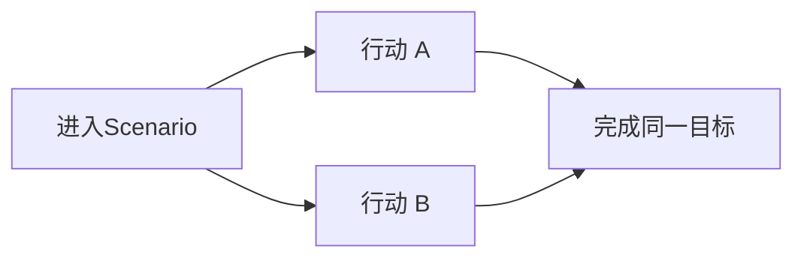
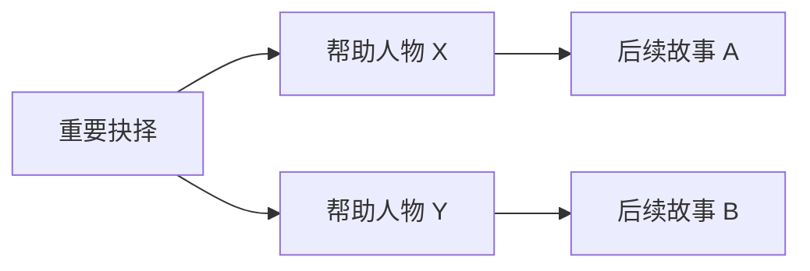

# Scenario · 决策结构卡

示例：雨夜追逐

| 情景   | 尼尔在雨夜追逐送信人                       |
| ---- | -------------------------------- |
| 目的   | 在送信人脱逃之前截获信件                     |
| 行动对象 | 追逐进度、失去目标的危险、寻找捷径                |
| 决策核心 | 如何在推进追逐、控制脱逃风险、改善后续追逐条件之间分配有限行动？ |
| 局势变化 | 距离与风险变化，让不同行动的价值改变               |
| 结果   | 统一的任务完成目标，差异主要体现在资源损耗            |

---

## 一、从实际合同出发，描述「决策核心」

### 1. Solheim HS22：回收数据核心

Scenario目的：进入一艘严重损坏的废弃飞船，取得数据核心，用来交换修复自己飞船需要的零件。

Scenario过程：选择合适的路线寻找核心，尽量避免进一步损坏飞船；合同压力积累到一定程度时，会出现必须处理的危机；取得核心后，还需要考虑怎样把它完整提取出来。

我会这样描述它的决策核心：

> 在一艘不断恶化的废船中，如何分配有限的行动，在推进核心回收工作的同时，应对突发事故，并尽量减少损坏？

这里有三个同时存在、但作用不同的事物。

- 回收数据核心 — 必须推进的工作
- 船体危机 — 需要分配行动去处理的额外问题
- 核心完整性 — 希望尽量保住的成果质量

玩家不需要决定「救人还是拿核心」，也不必面临两条同等重要的故事路线。他想要的始终是成功回收核心。策略来自：什么时候推进主工作，什么时候暂停工作处理危机，采用哪种技能路线，愿意承受多大风险。

更重要的是，这几个问题会随着局势改变。如果船体暂时稳定，玩家可以集中推进工作。如果即将触发灾难，就必须考虑先控制危险。如果即将取得核心，某些额外的行动可能又不值得进行了。这是一个目标固定、行动优先级动态变化的Scenario。

值得注明的是，这个合同在结束时还有 Juni 希望保留核心的剧情抉择，可能导向另一条取得飞船零件的路线。那是它额外加入的关键叙事选择，不是上述资源分配结构具有策略性的必要条件。

### 2. Hidden Wreck：抢在竞争者之前找到残骸

**Scenario目的：**抢在 Vesna 的队伍之前找到目标残骸。

**Scenario过程：**探索受损穿梭机和散落残骸，寻找关键地点；竞争者会在两轮后到达，并在之后几轮继续推进。附近还存在可以取得额外物资的探索活动。这个合同没有独立的 Derelict Stress，主要压力来自时间竞争。

它的决策核心可以描述为：

> 在竞争者不断逼近的情况下，怎样分配行动，尽快完成必要的搜索，同时判断是否值得花时间收集额外物资？

这里的结构比 Solheim HS22 简单：

- **必要工作：**探索目标残骸。
- **额外机会：**获取其他资源。
- **压力：**竞争者持续逼近。
- **资源：**有限的骰子和补给。

不过，这个例子也暴露一个值得研究的设计细节：如果玩家知道额外物资可以在主要竞赛结束后再拿，那么「先收集还是先推进」就可能存在明显的最优解——先完成竞赛。因此，多目标未必自动形成精彩的决策。我们需要具体检查目标之间的关系，判断是否确实存在值得权衡的机会成本。

### 3. Shipmind Wreck：在警报触发前完成回收

**Scenario目的：**从废弃飞船中取得 Prime Shipmind。

**Scenario过程：**探索残骸、寻找 Shipmind 的连接结构，再处理左右两侧节点。追踪线缆较慢但不会因此触发警报；某些更直接的操作需要面对警戒风险。失败过多会引发 Conway 无人机警报，使安全回收变得困难。

我会这样描述其决策核心：

> 为了回收 Shipmind，玩家需要在工作速度、操作风险与警戒压力之间进行权衡，并合理分配骰子完成一系列必要的步骤。

与前两个合同相比，它有一个明显特点：它的多个目标主要是相互依赖的工作阶段，而不是各自独立的故事目标。玩家仍然只想取得 Shipmind。但他要考虑使用哪种方法推进，以及是否值得冒着提高警报的风险加快速度。

这个合同还可以出现未能安全完成断开程序的情况，但攻略记录显示，这不一定会导致整个后续故事分叉，主要目标仍可能得到推进。这恰好支持你的观点：Scenario中的不同过程和局部后果，不必转换成不同的叙事路线。

### 4. Headstream：在不引起怀疑的情况下发动哗变

**Scenario目的：**在一艘 Lotic 飞船上组织哗变。

**Scenario过程：**玩家可以在引擎室、导航控制室和货物作业区行动。每个区域都有两类工作，例如破坏引擎或批评雇佣合同、争论 Wellspring 的局势或伪造数据。这些工作分别对应不同技能，并服务于哗变目标。与此同时，负面判定会增加合同 Stress，达到阈值便触发必须应对的危机。

它的决策核心是：

> 在逐渐增加的暴露风险下，如何利用队员的不同能力，在多个工作地点之间分配行动，积累足够的哗变力量，同时控制敌人的怀疑？

它对 SSNoir 尤其有价值。这里的行为虽然都是社交、破坏、欺骗，却没有必要为每一种行为设计不同结局。批评雇佣合同、伪造数据、破坏设备，都是组织哗变的具体手段。它们可以通过共同的「哗变进度」来推进统一目标。

情景决定行动的具体内容，规则决定行动之间如何竞争。我们可以在这套结构里表现不同的人物行为，而不必建立一棵庞大的叙事分支树。

### 5. Stranded Rig：修理钻机，顺便获取废料

这个例子其实也很重要，因为它相对简单。

**Scenario目的：**帮助 Alma 修理她的钻机，换取收集附近废料的报酬机会。

玩家可以使用 Endure 或 Engineer 完成维修，也可以在附近设施收集 Raw Scrap 和 Components。这里没有独立的合同 Stress 或 Cycle Clock，主要消耗是补给和行动；完成维修及回收物资后即可离开。它的决策核心可以描述为：

> 在有限补给内，如何安排修理与回收工作，并决定投入多少行动取得额外收益？

相比前面几个合同，它的决策压力明显更弱。但这不是坏事。它可能就是一段相对轻松的工作经历，而不必承担激烈Scenario的职责。它也说明：并不是所有 Contract 都具有同样的策略深度，也没有必要如此。

## 二、比较这五个合同，会发现什么？

我想把它们归纳成一张表。

| 合同 | 明确的最终目的 | 玩家反复思考的问题 |
| --- | --- | --- |
| Solheim HS22 | 回收数据核心 | 推进工作、应对事故、保护成果，应该怎样分配行动？ |
| Hidden Wreck | 抢先找到目标残骸 | 必要搜索和额外收益如何安排，怎样不浪费时间？ |
| Shipmind Wreck | 取回 Shipmind | 怎样平衡推进速度、行动风险和警戒压力？ |
| Headstream | 发动哗变 | 怎样利用不同人员和行动，在争取支持的同时避免暴露？ |
| Stranded Rig | 修理钻机并获得报酬 | 修理和回收各值得花费多少行动？ |

我认为这里有一个很重要的发现：决策核心不必是一道「A 还是 B」的二选一题，它可以是玩家在多个相互竞争的工作之间，反复进行的优先级判断。而且，几乎所有合同都可以拥有一个稳定、明确的终点。

因此，我想修改之前的定义。对于这种Scenario，最合适的描述可能是：

> 为了完成某个确定的目标，玩家需要在什么样的约束下，协调哪些互相竞争的行动与问题？

它包含三个最重要的东西：

- 目的（Objective）：这段Scenario要完成什么？
- 行动结构（Action Structure）：有哪些需要玩家投入行动的事物，它们之间如何相互作用？
- 决策核心（Decision Core）：在这些条件下，玩家不断需要权衡、调整的是什么？

最后还可以补上一个维度：动态变化（Dynamics）——是什么使玩家在Scenario前、中、后期采取不同的策略？这样就既能描述《Citizen Sleeper 2》的现有玩法，也能为我们研究新模式保留空间。

## 三、尤其要区分：行动多样性、过程差异与叙事分支

你指出的设计成本问题，我认为是成立的。

我们可以把玩家能够造成的差异区分为三个层次：

层次一：不同的行动路径

低叙事成本

玩家采用不同的方法，却抵达同一个终点。例如技术破解或暴力拆除。

层次二：不同的过程代价与成果质量

可控成本

玩家都完成任务，但有人受伤、有人付出更多时间、有人获得额外材料。这些差异在统一的城市循环里兑现。

层次三：故事结果产生分歧

高叙事成本2

选择改变人物立场、事件走向或后续任务，往往需要更多剧本和状态管理。

我会建议 SSNoir 的普通Scenario以第一、第二层为主，第三层只用于真正值得展开的重要情节。

而且第二层可能特别适合你已经在建立的城市日常循环。

假如尼尔在Scenario中受伤，回到城市就需要花钱治疗；如果精神损耗过高，就需要休息；如果额外获得了钱，接下来便有更多行动空间。

这些代价都通过已有系统兑现。

我们不需要另外编写一条「尼尔受伤之后的特殊故事」，伤势本身就已经影响了玩家接下来的生活。

这也是统一状态系统的价值：大量不同的Scenario可以产生有意义的后果，而不需要大量独立编写的剧情分支。

## 五、所以，我们之后可以怎样描述和研究每个Scenario？

我建议形成一张很简短的设计卡片。

## Scenario · 决策结构卡

示例：雨夜追逐

|  |  |
| --- | --- |
| 情景 | 尼尔在雨夜追逐送信人 |
| 目的 | 在送信人脱逃之前截获信件 |
| 行动对象 | 追逐进度、失去目标的危险、寻找捷径 |
| 决策核心 | 如何在推进追逐、控制脱逃风险、改善后续追逐条件之间分配有限行动？ |
| 局势变化 | 距离与风险变化，让不同行动的价值改变 |
| 结果 | 统一的任务完成目标，差异主要体现在资源损耗 |

但我还想为它增加一个更严格的判断：不要只写玩家有哪些选择，还要写玩家为什么会改变选择。这是区分「列出了三种行动」和「形成了真正的决策结构」的关键。

举例来说，玩家是否会在前期倾向抄近道、中期倾向保持视线、后期倾向全力冲刺？

不一定必须如此，但如果我们完全找不到能使玩家改变优先级的条件，那么这套结构很可能是静态的。

反过来，假如玩家真的会根据压力、骰子、剩余进度不断改变行动安排，我们就已经获得了一种有意义的Scenario。

## 六、这还可以回答你关于创新的疑虑

我现在更倾向于把 SSNoir 的Scenario研究分成两个层面。

第一个是基础的行动分配框架。

这一点我们完全可以从《Citizen Sleeper 2》继承：骰子、风险、进度、资源损耗、相互竞争的工作、不断变化的压力。不需要每个Scenario都发明新的思考方式。

第二个是不同情景能够提供什么独特的行动关系。

例如，追逐中的距离、捷径和脱逃风险。
维修中的进度、故障与设备稳定性。
调查中的线索搜集、证据可靠性与暴露风险。
谈判中的说服进展、对方的戒备与维持关系。

在这些情景中，我们可以尝试引入新的机制，例如对手意图。但它的目的并不是增加一个新系统，而是创造一种新的、能够与现有目标和压力相互作用的关系。

人物意图完全可以只改变玩家当前工作的难度、风险或可用行动，而不产生任何新故事分支。例如弗兰克正在准备结束谈话，玩家可以尝试先让他平静下来，再继续获得情报。最终目的仍然只有一个：从弗兰克那里得到所需的信息。

这种设计就可能同时保留《Citizen Sleeper 2》的资源分配策略，又让人物成为一个具有自主反应的对象。

而且从研究角度看，它很适合做成一个具体实验：在同一个Scenario里比较「固定危险 Clock」和「随玩家行为变化的人物意图」，看看后一种究竟有没有创造不同的决策。

我认为最终可以形成这样一个设计原则：

> 一个Scenario通常只需要一个明确的戏剧目的，但可以包含多个需要行动的事物。这些事物通过资源竞争、风险、时间、前置条件和状态变化相互作用，使玩家持续决定应该优先做什么。Scenario的策略复杂性主要发生在过程之中，而不是必须依靠故事结果的分叉。

这比之前那个过于强调「两种故事结果」的决策核心定义更准确，也更适合作为 SSNoir 的常规Scenario设计方法。

它还为我们保留了两种自由：一方面，可以使用《Citizen Sleeper 2》已经验证有效的结构；另一方面，可以研究更加适合侦探、人物与黑色电影情景的新关系，而不必把每一种新关系都变成新的剧情分支。

---

---

## 错误一： 以追逐为例，为什么一个情景可能没有策略性？

假设我们的情景是：

> 雨夜，尼尔发现一个可疑的送信人。他立刻追了上去。

这本身是一个很好的戏剧情景。它可以紧张、漂亮、激动人心，也能够通过城市环境表现一种黑色电影式的追逐。

但是，如果直接把它做成 Contract：

- 目标：填满「追上送信人」Clock。
- 行动一：稳妥追踪，低风险、低收益。
- 行动二：全力冲刺，高风险、高收益。
  - 时间限制：三个 Cycle。

那么你的担忧完全成立。在大多数情况下，玩家只需要高骰冲刺、低骰稳妥追踪。时间紧张时冒险，时间充裕时保守。除非随机事件打乱局势，否则基本没有什么需要重新判断的东西。

这个场景有戏剧张力，但没有充分的决策张力。这里要特别区分：戏剧张力来自「接下来会发生什么」，决策张力来自「我究竟应该怎么做」。

两者可以重合，但不是一回事。

不是所有具有戏剧张力的情节都必须做成策略 Scenario。有些追逐可能更适合动画、短暂的动作选择，或者一个简单判定。如果我们确实认为这场追逐值得玩家反复投入行动，就需要寻找它内部真正值得权衡的东西。

## 错误二：新的决策结构，不一定需要新的底层机制；但新的玩家思考方式，也不一定都能无损地塞进现有机制。

《Citizen Sleeper 2》给了我们很好的基础。第一次彩排和雨夜追信已经证明：使用相同的骰子、Clock 和行动判定，可以产生两种不同的决策体验。接下来，我们可以继续研究不同 Clock 的关系，例如相互促进、相互阻碍、自动推进、条件改变、提前完成、延迟兑现等。这是一条相对可靠的探索路线。

但假如我们真的想让玩家从「资源分配」转向「逻辑推理」或「理解人物心理」，那可能就需要一套真正不同的机制。这可以作为独立的研究课题，而不应该偷偷混入普通 Scenario。我认为我们现在没有必要急着跨过去，因为让一套简单的系统表达足够丰富的故事与情景，本身就是一件很有价值、也并不容易的工作。

我会把研究目标从「不断发明新的Scenario模式」稍微调整成：

> 在保留统一骰子与 Clock 语言的前提下，探索行动、目标、压力和独立行动者之间，还能形成哪些有意义的关系。这些关系必须改变玩家实际的决策，而不仅仅改变界面或故事描述。

如果一种新想法需要隐藏大量规则、增加独立的操作方法，或者使玩家无法预见自己行动的大致效果，就应该先单独验证它是否真的值得引入。

## 错误三：我们设计了一场有策略性的劳动，又在劳动中插入了一段有戏剧性的故事，但玩家的决策并没有真正参与塑造这个故事。

例如，艾迪因为吊机故障与工头发生争执。如果玩家接下来依旧只是分配骰子、修好机器、完成搬运，那么这场争执主要是编剧写出来的，而不是玩家亲身参与的冲突。即使这段剧情写得很好，游戏与故事仍然是两件相对独立的事情。

我认为应该改变设计顺序：先确定这次大船靠岸发生了一件什么特别的事情，然后让玩家所要克服的困难，就是这件事情本身。而且，这件事不一定是事故、犯罪或者道德困境。一次特别艰难、特别漂亮的共同劳动，也可能有真正的戏剧性。

我觉得我们对戏剧性 Scenario 可以提出一个比之前更严格的要求：玩家反复作出的决策，应该直接推动、阻碍或改变这段戏剧性经历的发展。“那天发生了一件事情，而我在其中做了这些决定，所以事情变成了那个样子。”这种影响不必延伸成长期剧情分支；只要能改变事件内部的过程、代价、成果与人物回应，就已经足够。

反过来，我们也应该对某些想法保持警惕。如果我把 Contract 里的所有玩家行动删除，故事依然以几乎相同的方式展开，那么它很可能只是附带玩法的剧情。这未必是坏事。有些人物剧情本来就不需要复杂互动。但如果我们希望它成为一场有分量、值得投入的 Contract，这种分离就是一个需要解决的问题。

这样不是放弃我们已经研究出的可组合交锋结构，而是让这些结构真正服务于经历本身。这可能是 SSNoir 最值得追求的一种设计：玩家因为玩法而亲身参与一件事，又因为这件事中的人物与情感，最终忘记那些 Clock，只记得自己经历了什么。