# 从《Citizen Sleeper 2》到 SSNoir：可组合的 Scenario

> **主题**：如何用简洁、统一的行动语言，把局部决策组合成一段有纵深、有变化、有戏剧性的可玩过程。
>
> **用途**：SSNoir 的长期设计记忆与 Scenario 研究参考。本文记录当前形成的认识，而不是一份必须照做的实施规范。有关《Citizen Sleeper 2》的图示是根据游戏攻略及访谈整理的**研究性简化**，不是官方关卡图、引擎结构或穷尽所有分支的流程图。SSNoir 的具体设计应继续由原型与实际试玩检验。
>
> **研究时间**：2026-10-27

## 一、我们究竟在研究什么

《Citizen Sleeper 2: Starward Vector》的 Contract 提供了一种很值得学习的游戏组织形式。玩家接受一项具有明确目的的工作，携带有限的骰子、船员和补给进入现场，在一个个可执行的行动中推进工作，承担风险，遭遇变化，最后带着成果与损耗返回城市生活。令人感兴趣的不是某一条 Clock 本身，而是这些简单的元素可以被反复组合，组织出修船、回收、救援、潜入、追踪等性质不同的冒险。

我们最初研究的是一个局面里的策略性：为什么拿起一枚高骰或低骰时，玩家会犹豫把它放到哪里？为什么剩下一两枚低骰时，玩家有时会继续冒险，有时会提前结束 Cycle？为什么 Push 不是一个永远应该使用的增益按钮？后来我们又发现，只研究这种局部行动分配是不够的。《Citizen Sleeper 2》的中后期 Contract 往往不是一张始终不变的工作清单。玩家先探索，再找到入口，进入下一层，在里面处理两个并行节点，最终才获得真正想要的东西。另一些合同会在原计划进行到一半时发生事故，突然出现新工作或更紧的期限。

于是，一个更准确的研究对象浮现出来：**可组合Scenario（Composable Scenario）**。它不是指简单地把几条进度条放在同一张地图上，而是用少量共通规则构建局部工作，再通过前置、并行、替代、打断、共享状态等关系，把它们组合成一段持续展开的旅程。

这与戏剧中的“分幕”有关，却不是一回事。分幕强调情节如何铺垫、转折和到达高潮；可组合 Scenario 强调玩家怎样完成工作、一个工作怎样开放另一个工作，以及前面的行动如何改变后面的处境。好的Scenario可以同时具有这两种结构：**任务关系使它可玩，戏剧节奏使它值得经历。**

本研究中的英文术语——如 *Scenario Decision Structure*、*Scenario Pattern*、*Composable Scenario Grammar*——是为了组织 SSNoir 的分析而使用的概念，不是宣称《Citizen Sleeper 2》官方以这些名称实现了关卡系统。

## 二、局部决策：一个 Clock 为什么不够

设想一个很简单的Scenario：修理设备，Clock 为六格。玩家可以稳妥修理，每次收益较少；也可以冒险抢修，成功收益更大、失败代价更高。如果没有其他变化，玩家很容易形成固定策略：高骰投入危险但高收益的工作，低骰投入稳妥工作。游戏可以有随机性，玩家也可能失败，但这不代表它持续要求玩家作出新的判断。

这里的关键不是有几个按钮，而是**相同的行动在不同局势下，其相对价值是否会发生变化**。当设备只差一格完成时，高骰的额外收益可能浪费；当时间快到时，冒险抢修可能变得合理；当角色已经接近受伤阈值时，本来可以接受的失败也可能难以承受。这些都是行动边际价值发生变化的例子。

多目标是一种很直接的设计方法。假如除了修好设备，还要关闭泄漏、顺路收集材料，那么玩家必须在必要工作、风险控制与额外收益之间分配有限行动。但**多目标不是策略性的必要条件，更不是充分条件**。如果所有目标都能轻松完成，玩家只是依次清空列表。只有当它们争夺行动、时间、资源，或会改变彼此的价值，多目标才真正形成决策。

同样，有限资源也不意味着约束已经生效。假如一场工作通常三轮完成，而玩家有五份补给，补给暂时可能只是界面数字，并未改变任何选择。只有当进一步拖延会影响另一个目标，或未来阶段仍需要补给时，它才真正参与决策。这可以借用经济学中“非紧约束”的理解：资源有上限，不等于它当下就是有分量的取舍。

一个局部 Scenario 能产生意义明确的思考，通常需要几种力量共同作用：行动之间存在机会成本；行动的收益和失败代价可比较；局势会改变它们的相对价值；而玩家能够理解这种改变，至少可以预见主要规则与后果。

**推进与等待也是一组竞争选择。** 低骰危险，并不代表应该永远留着不用。等待下一轮可能消耗补给、推进倒计时、错过某项工作；贸然使用低骰，又可能增加 Stress 或触发危机。如果等待过于便宜，玩家就一直等；如果等待过于昂贵，玩家就一直赌。策略性产生于两种行为各自都有代价而且局势会变化。

Push 也可以用相同思路理解：它将当前行动的可靠性与未来的 Stress、能力损伤和本轮使用机会相交换。玩家不仅比较“此刻能多推进多少”，还要考虑“是否值得在这里使用一次机会、把代价带进后面的工作”。这种跨时间的交换为更长的 Contract 提供了基础。

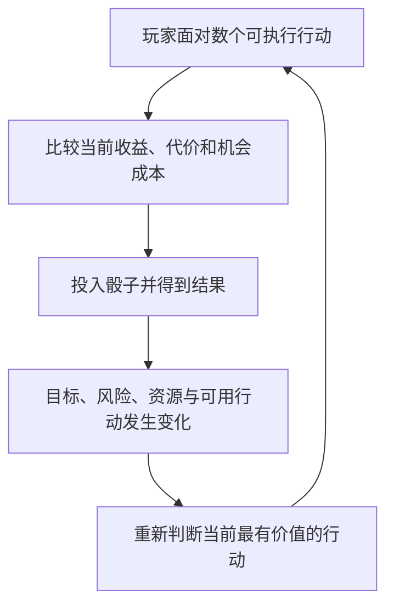

它描述的不是玩家每次都必须苦思冥想。真正优秀的Scenario可以有许多顺畅、直接的操作，但在必要时让玩家重新规划，而不是从头到尾执行同一固定公式。

## 三、从《Citizen Sleeper 2》看局部模式

下列案例先看一个局面里玩家究竟在协调什么，再看它们如何组织成更长的过程。为便于对比，图示会省略部分交互、人物台词与不同难度的细节。

### Stranded Rig：简单工作与额外回收

在 Stranded Rig，玩家帮助 Alma 修理钻机，也能在附近设施收集废料和零件。没有独立的合同 Stress 或 Cycle Clock，主要成本来自行动与补给。修理和回收并不构成强烈的持续危险，因而这是一个较温和的 Contract。

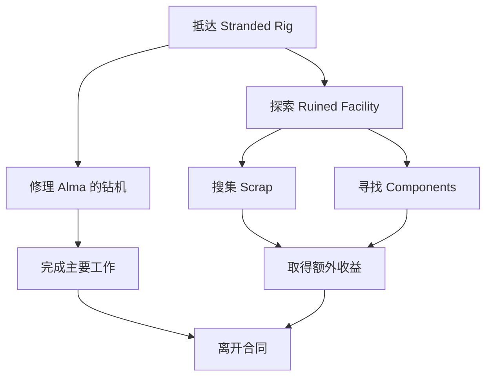

它体现“主要目标 + 可选收益”，但不能仅凭有两个工作区域就断言它有很深的策略。如果资源充裕、先后顺序显而易见，多目标仍然可以只是工作清单。较低的决策压力不必视为缺陷：有些 Contract 本来就适合表现一次相对平和的工作。

### Hidden Wreck：玩家进度与竞争者时间赛跑

Hidden Wreck 的主要压力不是一条不断上升的合同 Stress，而是竞争者 Vesna 的队伍即将抵达，并逐步逼近目标。玩家需要优先完成关键搜索；周边资源又提供额外机会。

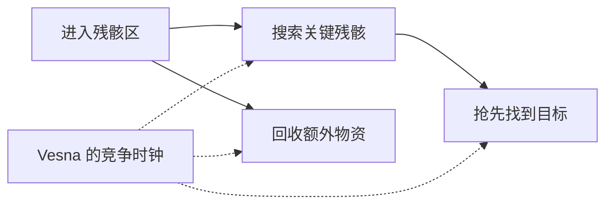

这里玩家主要判断时间是否还允许做其他工作，以及哪些行动足以确保在对手之前完成。它与危险累积模式不同：即使玩家一次也没有失败，时间本身仍会带来损失。不过，若额外资源可在竞赛结束后无代价回收，相关先后选择可能退化为固定最优解。设计时必须实际检查这些机会是否真的在竞争。

### Headstream：多个行动地点，共同服务于一项目标

Headstream 的目的是在 Lotic 飞船上促成哗变。玩家可以在引擎室、导航控制和货物作业区，通过不同技能与手段推进工作；负面结果可能推高 Stress，并引发 Crisis。这里的社交、煽动、造假和破坏不是几条必须分别通向不同结局的故事线，而是同一行动目的下的多种可执行工作。

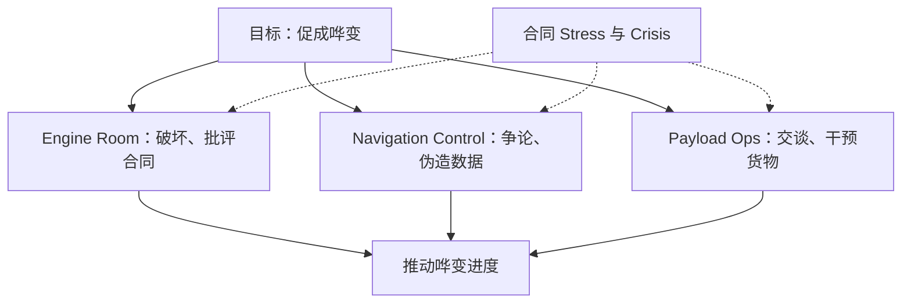

这个例子说明：完全可以使用统一的骰子与 Clock 语言表现社会冲突。人物行为的具体内容可以丰富多样，但不必每个行动都产生一个独立的剧情分支。玩家需要比较的是技能适配、行动风险、时间和任务进度。

### Solheim HS22：先找到进入和定位的办法，再取出核心

在 Solheim HS22，玩家受雇回收一枚数据核心。前期需要通过入口和定位工作找到核心，之后才能执行提取。损坏的飞船会使不利结果积累合同 Stress，部分压力阶段可能出现必须处理的 Crisis；提取时还要考虑核心的完整性。取得核心之后，还有与 Juni 有关的重要剧情选择，但这种叙事分歧并不是前面行动分配策略性的必要来源。

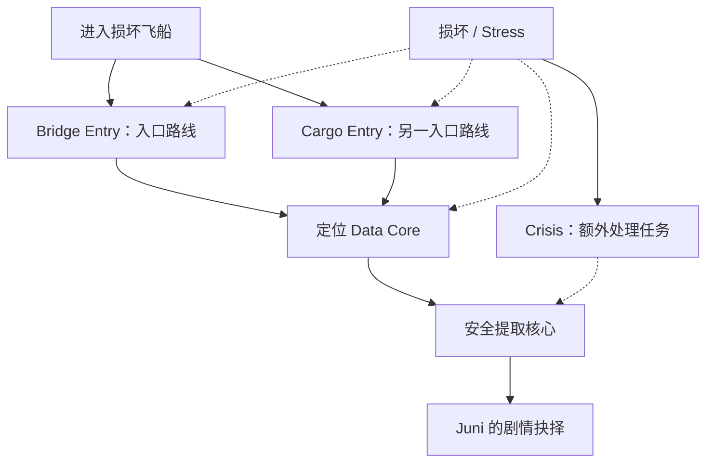

这张图是概念化的任务关系，不应据此假定两条入口在所有版本和情况下严格等价。它表达的是：**最终目标稳定，但中途需要先解决进入、定位、提取三个不同性质的问题**。工作阶段开始出现纵深。

## 四、为什么后期的 Contract 具有更大的长度和深度

我们一开始为 SSNoir 设计的Scenario，大多假设所有行动从开场就已出现：一个主目标，一条危险 Clock，再加一项可选收益。这些结构可以很好地支撑短场景，但当玩家持续十几次行动都在相同选项之间切换时，熟练之后就容易感到重复。

《Citizen Sleeper 2》的大型合同展示了另一个维度：**目标空间本身可以逐层展开。** 玩家完成当前工作才抵达下一处，新的区域可能出现新的工作关系，既可能从单目标变成两项必要目标，也可能从风险管理变成倒计时救援。它不是简单延长同一局面，而是沿着一个任务目的展开一段旅程。

### Shipmind Wreck：探索 → 追踪 → 双节点 → 回收

Shipmind Wreck 最适合说明这种结构。玩家需要获得 Prime Shipmind，但不会一开始就直接处理最后的核心。最初只能探索孤立残骸，随后开放连接与线缆区域，接着进入需要分别处理 Port 与 Starboard 两个节点的工作，最后才回收 Shipmind。Conway 无人机的警戒贯穿其中，使过于冒险的操作可能威胁整个工作。

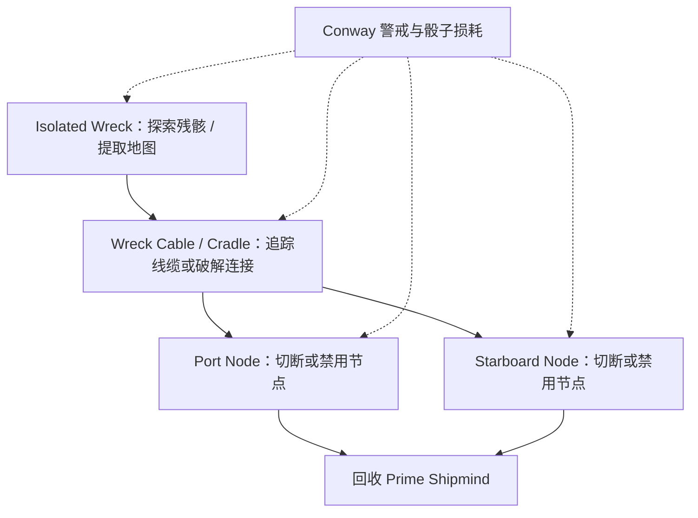

最初是找到工作对象，中间是探索进入更深处的方法，最后突然变成两项并行工作。于是玩家不是在同一组按钮前反复循环，而是随着任务推进，面对不同的行动集合。图中的两条节点都是回收的必要工作；它们并行出现又汇合到一个明确结果。这种“串行深入—并行展开—重新汇合”的形式，特别适合表达一个深藏在复杂设施内部的目标。

它仍然可能有固定或低价值的局部动作，但在整体体验上，会形成一种逐步接近核心的感觉：打开一个问题，发现下一层问题，直到最后抵达真正的目标。

### Cutter's End：路线选择、危险穿越、深入与救援

Cutter's End 的目标是找到被困的 Nia。起初玩家在 Central Shaft 与 Borehole 两条路线之间选择；深入后遭遇活动的大型机械，需要穿越危险的隧道；随后进入 Tunnel Complex，最终抵达 Machine Room，打开通向 Nia 的门。旁边的 Tailing Pit 则提供回收资源的机会。

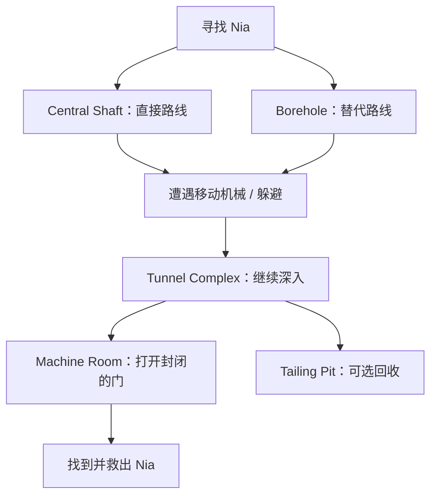

这段冒险并非每个步骤都要创造一个新的复杂小游戏。其力量来自任务的空间性与因果性：要救人，先要进入；进入后才遭遇机械；穿过去之后才见到最后一扇门。玩家使用的是熟悉的技能与行动语言，却在不断进入不同的局部处境。

这也提供一个警告：串行目标使一段任务变长，却不自动使策略变深。如果每层只是重复填四格 Clock，前后之间没有共享压力、资源约束或路线差异，那么它可能仅仅是更长的工作。

### Darkside Recon：原任务中途出现新的限时问题

Darkside Recon 最初是一场潜入与情报收集工作。玩家需要处理一开始就存在的码头监视 Crisis，再穿越内部区域完成侦察。随后 Marko 被抓，Ankhita 的接应还需要两个 Cycle。这段撤离等待期突然变成一个可用于营救同伴的紧迫窗口。

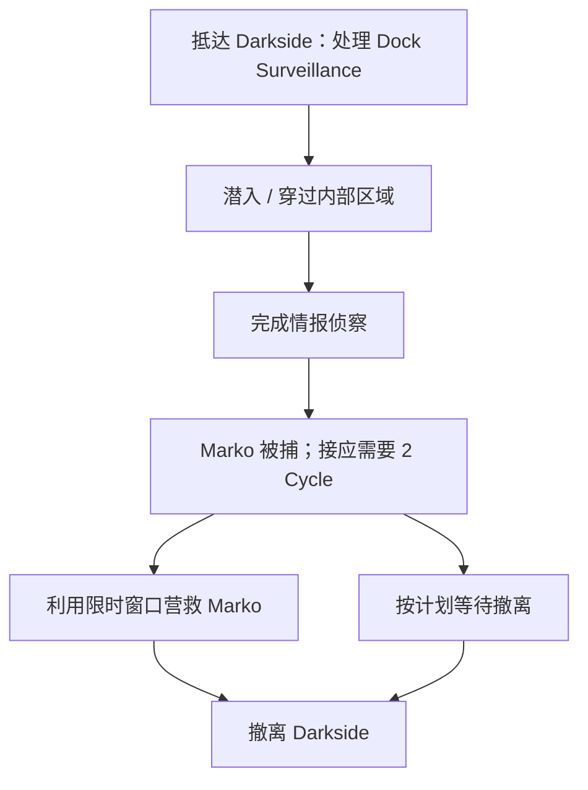

这和开场同时展示“主要目标、额外救人目标”不一样。营救任务来自中途发生的事，玩家已经为侦察消耗了补给、骰子与角色状态，才被要求重新安排剩余能力。于是前半段和后半段通过同一批资源连接起来。

这类场景可以有重要的人物后果，但值得继承的首先是**计划被打断后，旧有资源如何承担新问题**。即使 SSNoir 不愿大量编写不同故事结局，也可以在普通Scenario里使用“危机出现，新的必要工作改变优先级”的结构。

### Aphelion Beacon：达到局部目标后，冒险改变了性质

Aphelion Beacon 从寻找信标与追踪线索开始。玩家完成前一项定位工作后，Vesna 的袭击使自己的飞船驱动失效。新的阶段需要一边修复驱动，一边完成最后的信标定位，然后才进入后续对峙与撤离。

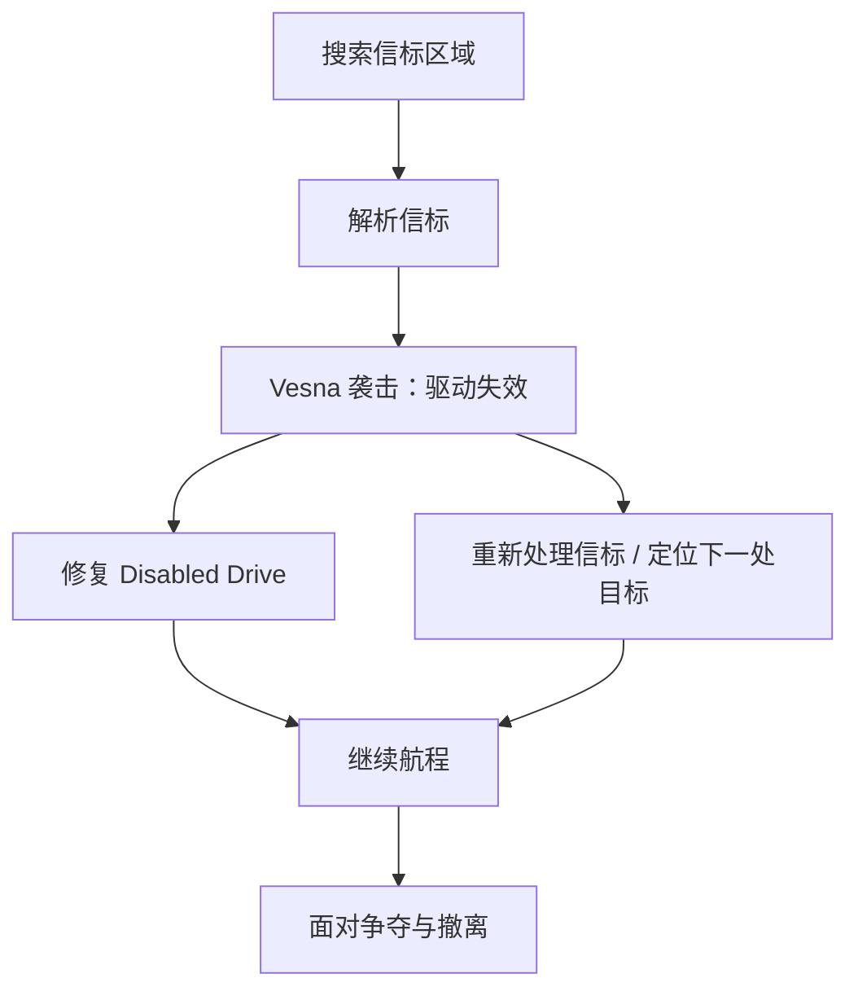

这不是把原来的危险 Clock 从三格提高到五格，而是事故创造了一项新的必要工作。玩家原本正在寻找，转眼必须应付失能的飞船；工作性质改变了，操作语言却没有变。

一个值得留意的细节是：剧情上表现得紧迫，不代表所有相关步骤在机制上都有严格倒计时。分析时应该区分“故事中的危急感”与“实际存在的时间约束”，不能以戏剧紧张替代策略证据。

### 最终 Darkside：并行、深入、选择节点、返回核心

最后的大型 Darkside 行动把前面的关系进一步组合起来。玩家先完成数个外围调查目标，深入下层结构并抵达 HABPEP Core；之后由于访问受阻，需要转去多个网络节点中完成其中两个，再返回核心执行最终工作。在这个过程中，合同也改变了 Stress 与 Supplies 的条件。

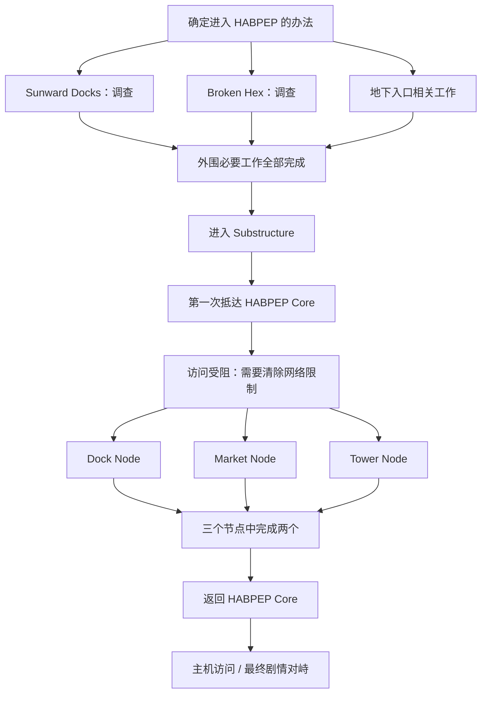

在这张**概念依赖图**里，“三个中选两个”的汇合节点表示计数条件，并不表示图上任意一条箭头单独就已满足目标。外围三个工作则是全部需要完成的另一种条件。

这一合同尤其体现“返回旧地点”的意义。同一个 HABPEP Core，第一次到达时是遭遇阻碍，第二次回来时外围条件已经改变，因而旧地点拥有新的任务意义。阶段推进不必永远是空间上的直线深入；也可以回到原处，而玩家已经做过的工作让原处变得不同。

## 五、案例背后的组合思想

现在可以把前面的案例看成一套简单的任务语言。它大致分为**基本元素、局部组件、组合关系、完整 Scenario**四个层次。

基本元素是骰子、行动、判定、Clock、资源、风险类型、成功或失败的状态变化。局部组件则是一项能够被玩家执行并完成的工作，例如“打开门锁”“核对一组记录”“切断 Port Node”“准备舞台灯位”。组件有自己的进入条件、内部行动与完成效果。它不需要了解整段故事，只需要在规则上清楚地说明：何时可做、如何推进、可能付出什么、完成后改变什么。

从程序设计来看，这可以近似理解成一个**状态转换**：组件读取当前游戏状态，玩家的行动与随机判定改变状态，再将新的状态交给后续工作。封装的价值在于组件内部有边界；组合的价值在于它的结果能够成为另一个组件的条件。

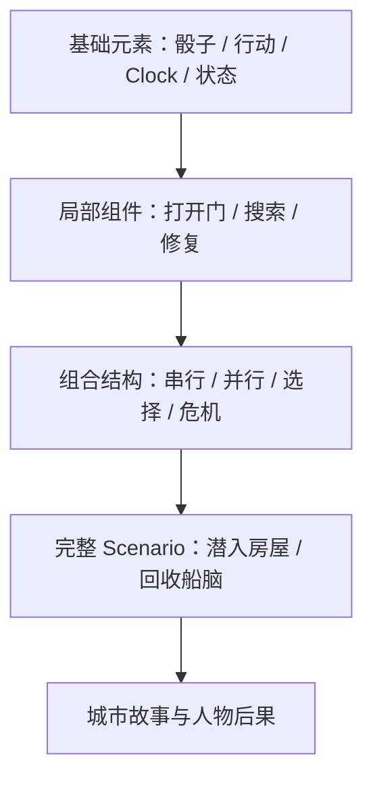

这与程序中的 **Composition（组合）**、**Encapsulation（封装）**、**Hierarchical Decomposition（层次化分解）** 很接近；在表示目标的父子关系时，也可以借鉴 *Composite Pattern*（组合模式）或层次任务网络的思路。但不要误解为《Citizen Sleeper 2》的实际代码必须采用这些架构。它们首先是帮助我们理解和设计游戏的一种抽象。

局部组件之间，至少存在下列几种值得反复使用的关系：

| 组合关系 | 基本含义 | 主要贡献 |
|---|---|---|
| 顺序（Sequence） | 完成 A，开放 B | 逐层深入、过程长度 |
| 并行（AND） | A、B 都需要完成 | 调度、行动竞争 |
| 替代（OR） | 选择 A 或 B 达到同一目的 | 能力适配、路线选择 |
| 可选（Optional） | O 不阻挡主目标 | 额外收益与机会成本 |
| 条件（Conditional） | A 的结果改变 B 的条件 | 跨阶段策略 |
| 打断（Interrupt） | 危险或剧情触发新的工作 | 重组计划、戏剧转折 |
| 汇合与返回（Merge / Return） | 不同路线汇合，或回到旧地点 | 保持主线统一、赋予旧地点新意义 |

这些并不是七套互不兼容的小游戏。它们更像一套少量、稳定、可以反复组合的语法操作。一个大型 Contract 可以从顺序结构开始，在内部嵌入并行工作，在途中出现 Crisis，再通过一次条件变化让玩家返回此前经过的地点。

## 六、一个抽象例子：进入房屋，取回文件

假设尼尔要进入某栋房屋，取回枪手保管的一份文件。这是一个单一而清楚的最终目的。入口有门锁，进门后可以选择东边或西边的楼梯，其中一边有猎犬，另一边有不同的危险；到了大厅还需要处理枪手的阻挡，最后才能拿到文件。

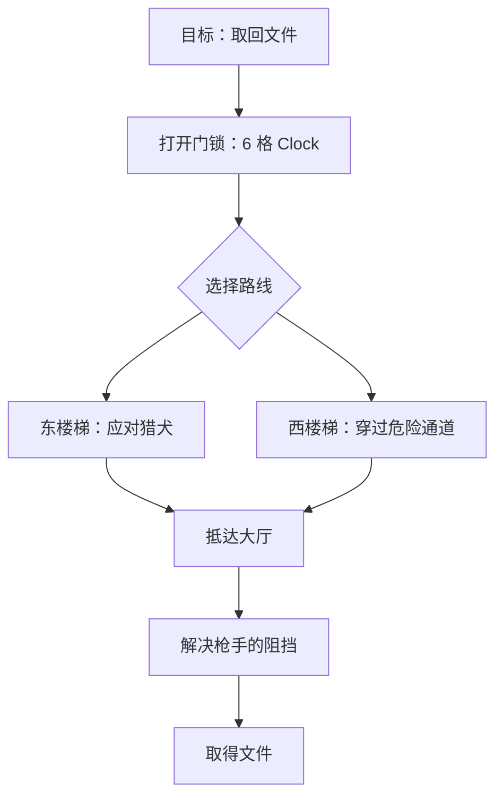

最简单的“打开门锁”组件只需知道：抵达门前、通过某种行动推进六格、开门后开放内部区域。门后的世界不必写进它的内部规则，因此理论上可以复用于剧院、仓库或船舱。猎犬、通道与枪手也可以作为具有各自规则的局部工作。

但只把它们首尾相连，并不会自动产生深度。真正有价值的是进一步让它们相互影响。例如强行破门虽然更快，却会增加一条贯穿全场的“警戒”Clock；警戒越高，进入大厅后枪手的条件越不利。东楼梯耗时较长但可能降低暴露，西楼梯更快但可能受伤。健康、时间与警戒都由前面的组件传递到后面的组件。

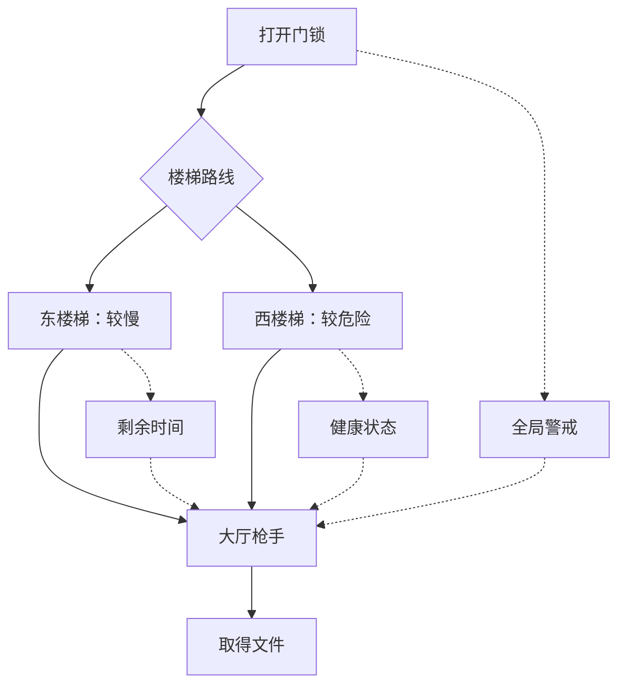

于是玩家拿起一颗高骰时可能不再只问“哪里成功率最高”，而会问“我现在强行破门，后面的枪手是否会更难处理？”这就是**跨组件的机会成本**。局部组件仍然简单，但整个 Scenario 已经有了前后相互牵连的策略。

这里还有一个必要的警告。如果东楼梯永远比西楼梯好，或者帮助门房永远是询问门房之前的最佳步骤，那么所谓选择仍然会变成固定程序。可以组合，不等于值得选择。我们需要同时检验组合的**结构有效性**与**决策有效性**。

## 七、长度、深度与复杂度不是一回事

从这些案例可以进一步区分三个变量。

**长度**指玩家实际经过多少工作阶段、需要投入多少行动，以及一段冒险在时间上如何持续。把一条八格 Clock 拆成四条两格 Clock，能够改变呈现节奏，却未必增加策略。

**深度**指行动与工作阶段之间存在多少有意义的相互作用。玩家是否需要为了后面的阶段保存资源？能否选择另一条符合自己能力的路线？当前决定是否改变以后处理障碍的条件？突发危机是否真正改变行动优先级？

**理解负担**则是玩家为了作出判断需要同时记忆多少规则、状态与隐藏条件。它与前两者不同。一个很长、具有多层目标的 Contract，也可以在任何一个时刻只让玩家面对两个或三个清楚的工作；反过来，短短一次谈话如果充满不公开的分支、隐藏数值与不可预测的解锁，也可能令人困惑。

| 结构 | 长度 | 潜在决策深度 |
|---|---|---|
| 一条 20 格的 Clock | 长 | 可能很低 |
| 四条依次解锁、互不影响的 Clock | 长 | 仍可能很低 |
| 两项争夺同一批骰子的工作 | 短 | 可以很高 |
| 多阶段工作，共享时间、损伤和风险 | 长 | 更有机会形成跨阶段策略 |
| 多阶段工作，中途出现改变优先级的危机 | 长 | 有机会形成重新规划 |

因此，设计复杂 Scenario 的关键不是不断增加 Clock 数量，而是**让整体任务逐步展开，使每个局部保持清楚，同时让不同局部通过少量共同状态产生联系。**

## 八、保持统一的玩法语言，不靠隐藏触发制造复杂

在研究侦探或人物Scenario时，很容易走向另一种方向：玩家与门房交谈，隐藏触发一项新行动；询问另一人，再解锁另一种调查方式。表面上似乎更像侦探或社交故事，但玩家开始猜测作者安排的触发条件，而不再围绕可见的进度、风险和行动结果作规划。

这种设计并不必然错误，却已经接近另一种玩法：传统的叙事冒险、信息推断或对话树。若不打算认真建立一套新系统，便不应把它伪装成 Clock Scenario的一种普通变奏。

我们更希望保留统一的基本语言：**玩家有明确任务，知道当前可执行的行动，能理解它们大致会推进什么、消耗什么、威胁什么；阶段深处尚未揭示的工作可以随着探索开放，但新出现的规则应该清楚可读。**

同样，人物可以拥有独立的行为，却不一定需要一套不可见的心理模拟。门房每轮会按既定工作时间交班；守卫下一轮准备巡逻；对手将在当前 Cycle 结束时推进自己的目标。这些都可以通过 Clock、公开预告或现有的状态变化表示。人物自主行动的价值在于它改变玩家接下来要处理的工作，而不是给人物换上一条名为“意图”的危险进度条。

还要警惕**表面不同、结构同构**。旧旅馆调查如果是“推进调查—累积戒备—花行动降低戒备”，湿街跟踪如果是“推进追踪—累积脱逃危险—花行动降低危险”，那么它们可能仅仅是同一种策略模型的不同叙事皮肤。换名字、换美术、增加角色台词，都不等于玩法内部形态发生了变化。设计者可以有意复用成熟模式，但应该明确知道自己何时在复用，何时确实在探索新关系。

## 十、如何从情景设计到组合结构

我们不必坚持机制先行或情景先行，而应让两者围绕**玩家需要完成的工作**相互校准。

从情景开始，先用一句话写出明确的最终目的：“从废船回收核心”“让彩排工作在需要时完成”“进入房屋拿到文件”。然后不急着设计 Clock，而是问：为了完成它，现实或故事中必须先解决什么问题？这些工作哪些需要依次进行，哪些可以同时处理，哪些存在不同办法，哪些只是顺路收益？

得到工作依赖图以后，再为每个局部选择简单的行动与判定方式。不是每一个细节都值得一个独立 Clock；短暂而无决策的动作可以用普通叙事或一次判定表现。只有当某项工作值得玩家多次投入、存在风险与状态变化时，才考虑将它展开为一个可玩组件。

随后，为不同组件设置少量关系。最简单的是完成 A 后开放 B；进一步可以让 A 的结果改变 B 的风险，让 A 与 B 共同争夺有限骰子，让可选收益牺牲后面的补给，或让突发危机改变当前最紧要的工作。最后检查：**这些联系有没有使玩家前面的行为真正影响后面的选择？** 如果没有，任务只是被拉长，而没有加深。

大型 Scenario 可以用下面这张研究卡描述：

| 字段 | 要回答的问题 |
|---|---|
| 最终目的 | 这段任务从头到尾要完成什么？ |
| 工作组件 | 哪些局部工作值得让玩家反复投入行动？ |
| 目标依赖图 | 串行、并行、替代、可选和汇合关系如何组织？ |
| 局部决策核心 | 每个局面里，玩家到底在权衡什么？ |
| 跨组件状态 | 哪些风险、资源、损伤、优势会传到下一层？ |
| 阶段变化 | 什么让下一阶段与上一阶段的决策不同？ |
| 可见性 | 当前行动与后果是否清楚？未来未知是否属于合理探索？ |
| 结果兑现 | 成果与代价怎样通过统一的城市状态、报酬、健康或人物关系兑现？ |

研究卡只是帮助思考，不是要求每个小Scenario填一大张表。重要的是能用自然语言说清：**玩家从哪里进入、沿着怎样的工作关系逐步深入、在什么时刻会重新规划，以及为什么这些工作属于同一段冒险。**

## 十一、什么应该被组合，什么不应该被强行做成 Contract

可组合设计并不意味着所有故事都应该成为一套多层进度系统。

夜莺在空舞台上唱完一段歌，回头问尼尔“我在上面的时候看起来怎么样”，这一刻的吸引力来自人物、亲近和梦想，不需要硬塞风险 Clock。弗兰克留一把椅子、艾迪换了新靴子、露西收到稿费，也可以通过普通生活与剧情自然呈现。游戏里需要值得玩家思考的工作，也需要不被机制打断的情感体验。

同样，SSNoir 的常规Scenario不必制造大量故事分叉。**同一个最终目的可以有不同过程、消耗、额外收益与局部后果。** 玩家在不同路线进入大厅，最后仍然拿到同一份文件；玩家选择不同方法推进彩排，演出仍然完成。伤势、冷静、金钱和线索可以回到统一的城市循环中兑现，而不必每个差异都增加一条独立编写的后续剧情。

真正值得保留的叙事分支，应该放在少数对人物与主题具有重量的节点。重要的最终证言可以要求尼尔作出立场选择；普通的开锁、潜入、维修和调查则未必需要。

这使我们能够在设计成本可控的条件下，同时拥有大量有意义的行动选择与少量真正值得书写的重大结果。

## 结语：复杂的旅程，简单的局部语言

《Citizen Sleeper 2》的重要启示不是“用更多 Clock 就能做出更丰富的游戏”，而是**一套简洁的动作与状态语言，可以通过层次化的任务依赖，组织出不同长度和性质的冒险**。

一条 Clock 可以模拟一扇门；完成这扇门，开放楼梯。两条路线可以汇合到大厅；大厅的阻挡又可以由几个局部工作组成。前面的行动留下警戒、伤势、时间与资源消耗，让后面的工作具有不同条件。某个局部突然发生危机，玩家必须重新安排手中的骰子。最后，所有这些局部都服务于一个清楚的目的：拿到文件，或回收核心，或救出一个人。

这是一种与程序设计中的组合、封装、层次化分解非常相近的设计思想。它让我们既可以研究单个组件内部的决策，也可以研究组件之间的因果关系。**局部组件的好坏决定玩家眼前是否有趣，组合关系的好坏决定整段旅程是否有纵深。**

SSNoir 希望在同一套规则里表现黑色电影的追逐、调查、维修、潜入、谈判和人物命运。我们并不需要为每一种情景发明一款新的小游戏，也不需要为了让它复杂而把大量后果藏在对话触发中。应该先继承成熟的骰子、Clock、风险和资源系统，再研究它们怎样被安排成一段段具有明确目的、自然因果与局势变化的过程。

最后需要记住的原则是：

> **用统一的规则定义简单的局部工作，用可组合的关系组织完整的任务；让整体逐步展开，让当前局面始终可理解，并让前面的行动真正改变后面的选择。**

这就是我们希望发展的 **Composable Scenario Grammar——可组合Scenario语法**。

---

## 参考与核对资料

以下用于核对《Citizen Sleeper 2》的关卡顺序和规则。文中有关“组合语法”“局部决策核心”“复杂度控制”等评价，属于 SSNoir 的设计归纳，而非资料原文提出的官方理论。

1. Gareth Damian Martin 访谈：[Bodies and Long-Term Harm — Citizen Sleeper 2 Interview](https://www.pastemagazine.com/games/citizen-sleeper/bodies-and-long-term-harm-gareth-damian-martin-discusses-citizen-sleeper-2)（Contract、Stress、非战斗战术遭遇与科幻电视剧式节奏）。
2. [Citizen Sleeper 2 — Hexport / Solheim HS22](https://www.neoseeker.com/citizen-sleeper-2-starward-vector/Escape_Hexport)（进入、定位、提取与危机）。
3. [Far Spindle / Hidden Wreck](https://www.neoseeker.com/citizen-sleeper-2-starward-vector/Exploring_Far_Spindle)（Vesna 的竞赛时钟）。
4. [Flotsam / Stranded Rig / Cutter's End](https://www.neoseeker.com/citizen-sleeper-2-starward-vector/Flotsam)（修理与回收、两条路线与深入救援）。
5. [Helion Gate / Shipmind Wreck](https://www.neoseeker.com/citizen-sleeper-2-starward-vector/Helion_Gate)（残骸、线缆、两个节点）。
6. [Wellspring / Headstream](https://www.neoseeker.com/citizen-sleeper-2-starward-vector/Wellspring)（多个区域推进哗变与 Crisis）。
7. [The Scatteryards / Darkside Recon](https://www.neoseeker.com/citizen-sleeper-2-starward-vector/Scatteryards)（初始危机、中途营救、撤离时限）。
8. [The Hollow / Aphelion Beacon](https://www.neoseeker.com/citizen-sleeper-2-starward-vector/The_Hollow)（信标、驱动失效与新目标）。
9. [Darkside 终局合同](https://www.neoseeker.com/citizen-sleeper-2-starward-vector/Darkside)（外围必要工作、网络节点三选二、返回核心）。
10. [SUPERJUMP — Gareth Damian Martin Interview](https://www.superjumpmagazine.com/citizen-sleeper-2-hands-on-preview-interview-with-gareth-damian-martin/)（Contract 系统、技能、Stress 与骰子损伤）。

> **资料边界**：公开攻略偏重通关路径，并不能证明所有玩家都会产生某种策略性，也无法替代独立实机验证。特别是隐藏路线、不同难度、随机事件和各版本细节，应在需要实施具体规则时再次核实。本文的目标图保留主要关系，刻意不等同于一份可直接导入引擎的完整状态机。
