我核对了《Citizen Sleeper 2: Starward Vector》的合同索引和逐区域攻略。你的观察很有价值，但有一点需要修正：游戏并不是简单地让早期合同只有一个阶段、后期合同越来越多阶段。实际上，前两个合同就已经出现目标解锁、并行工作与危机。后期真正增加的是这些结构的组合范围，以及跨阶段决策的连续性。

例如，第一个可以从合同板购买的 Conway Signal，表面上是关闭一架失控无人机，但实际已经需要分别处理控制系统和广播系统；完成初始工作后，两边还会出现进一步的操作，其中一项有独立的时间限制。第二个 Solheim HS22 则有替代入口、深入定位核心、最终提取，以及由危险积累触发的危机。

而到后面的 Shipmind Wreck，游戏反而没有使用同样复杂的危机结构。它主要依靠逐层探索、解锁内部工作，以及最终两项并行节点构成一段完整的回收任务。

这暗示了一种更有意思的设计方法：玩家逐渐学会更多组合关系，但每个合同只强调其中一部分，不要求所有复杂机制同时出现。

## 一、统计口径与时间顺序

目前核对到的完整合同索引包含 15 个具名 Contract。另外，首次进入 Darkside 时会直接启动一个大型终局 Contract，攻略将它写在主线流程中，而没有列入普通合同索引。

因此，以下会分析 15 个具名合同，加上 1 个终局合同，共 16 项。Hub 中的普通工作、Minor Drives，以及 The Hollow 中的 Help Helion Dispatches 支线活动，不与这 16 项混算。

时间顺序需要留一点弹性：玩家能够自由访问一些地点，部分合同属于可选内容，Wellspring 的 Headstream 和 Debris Field 则对应不同立场。下面采用适合分析教学与难度演进的典型主线推进顺序，而不是声称所有玩家一定按这个顺序完成。

### 一个需要补充的合同

继续交叉核对时，我发现普通合同目录遗漏了 Olivera 首次抵达时自动触发的 Rescuing Karman and Flint。成就攻略明确将它与随后解锁的 Old Manufactory 视为两个独立合同。

所以，采用更完整的口径应为 17 项：15 个合同目录条目、Olivera 的自动救援合同，以及 Darkside 终局合同。下文把这两项单独列出；对于自动救援中无法核实的内部目标细节，不作推测。

## 二、17 项合同的时间顺序与结构分类

为了避免把“有多个地点”直接等同于“多阶段”，先确定一个分类标准。

| 结构分类 | 判断标准 |
| --- | --- |
| 单阶段 | 玩家主要在一组同时存在的工作中分配行动。即使有三个地点、三条 Clock，也不一定构成三个阶段。 |
| 浅层展开 | 完成一个目标后出现下一项工作，或发生一次局部变化，但决策结构没有明显重组。 |
| 多阶段 | 出现两次或更多明显的目标转换，玩家逐步进入新的区域、工作或决策局面。 |
| 复合型 | 在多阶段结构之外，还组合危机打断、限时机会、阶段性目标重组、返回旧地点等关系。 |

这些是为了研究而建立的分类，不是游戏官方难度或关卡标签。

### 典型推进顺序总表

| 顺序 | Contract | 结构分类 | 主要决策核心 |
| --- | --- | --- | --- |
| 01 | Conway Signal | 浅层展开 | 并行关闭系统，控制爆炸危险与局部时限 |
| 02 | Solheim HS22 | 复合型 | 选择入口，深入回收核心，控制持续危险与突发危机 |
| 03 | Hidden Wreck | 单阶段 | 与竞争者赛跑，决定如何分配有限时间 |
| 04 | Ice Rich Asteroid | 单阶段 | 完成冰芯提取，兼顾额外收益并保护易损目标 |
| 05 | Stranded Rig | 单阶段 | 修理工作与废料回收之间分配行动 |
| 06 | Shipmind Wreck | 多阶段 | 逐层进入，最后完成两个必要节点，避免警报 |
| 07 | Solheim Bunker | 多阶段 | 突破入口后，在有限安全窗口内搜集资源、提取数据 |
| 08A | Headstream | 单阶段＋危机 | 三处并行工作，推动哗变并控制怀疑 |
| 08B | Debris Field | 单阶段＋剧情转折 | 重复设置导航信标，中途重新判断是否继续 |
| 09 | Cutter's End | 多阶段 | 选择入口、穿过危险矿洞、深入救援 |
| 10 | Darkside Recon | 复合型 | 潜入取得情报，中途出现限时营救 |
| 11 | The Wind's Long Shadow | 单阶段 | 在不同工作地点回收易损货物 |
| 12 | Aphelion Beacon | 复合型 | 逐步追踪信标，遇袭后增加并行的维修工作 |
| 13 | Rescuing Karman and Flint | 待细化 | 紧急救援；自动进入合同，准备受限 |
| 14 | Old Manufactory | 单阶段＋时限 | 在猎人到来前完成多处陷阱部署 |
| 15 | Darkside 终局合同 | 大型复合型 | 并行调查、逐层深入、重组节点、返回核心 |
| 16 | Hexport Remains | 浅层展开 | 辐射倒计时内探索遗迹，决定有限时间投向何处 |

08A 与 08B 是不同路线，并不是要求玩家连续完成两个合同。第 16 项实际发生在终局行动之后，属于后日谈性质的可选工作。Greenbelt、The Hollow 等区域的部分合同也可能更早完成。表中还可以看出一个值得研究的现象：单阶段合同没有随着游戏推进而消失，而是穿插在越来越长的多阶段合同之间。下面再看各项的内部结构，判断这种安排为什么有效。

## 三、前期合同：先教会玩家处理局部问题

### 01. Conway Signal｜第一次组合两套工作

**地点与结构：**Hexport · 浅层展开

目标是关闭一架危险的无人机，不能让它爆炸。

一开始玩家就面对两套工作：取得控制系统访问权，以及找到关闭广播系统的办法。完成各自的初步工作后，又会出现进一步的关闭操作，其中控制系统的后续操作受到单独的时间限制。失手则会增加 Drone Stress。

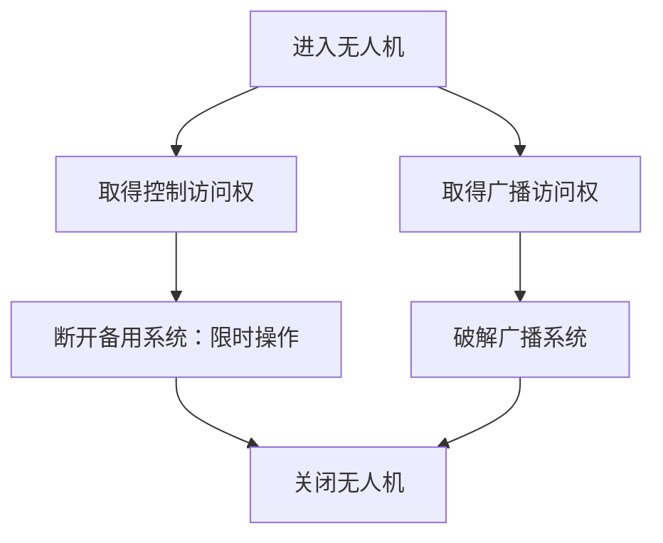

**决策核心：**有限骰子怎样分配给两套必要工作？何时优先处理新出现的限时操作？哪些行动值得承担增加爆炸风险的代价？

这并不是一个完全单阶段的教学任务，但层次很浅。它没有连续深入三个区域，也没有再嵌套一个新的大型目标。

更准确地说，它让玩家第一次理解：两个并行的工作，各自可以拥有一个后续步骤。

### 02. Solheim HS22｜第一个高压力的复合合同

**地点与结构：**Hexport · 复合型

这应该就是你记忆中第一个令人紧张的废船合同：玩家要取出一枚 Data Core，用它交换飞船所需的 Feed Lines。

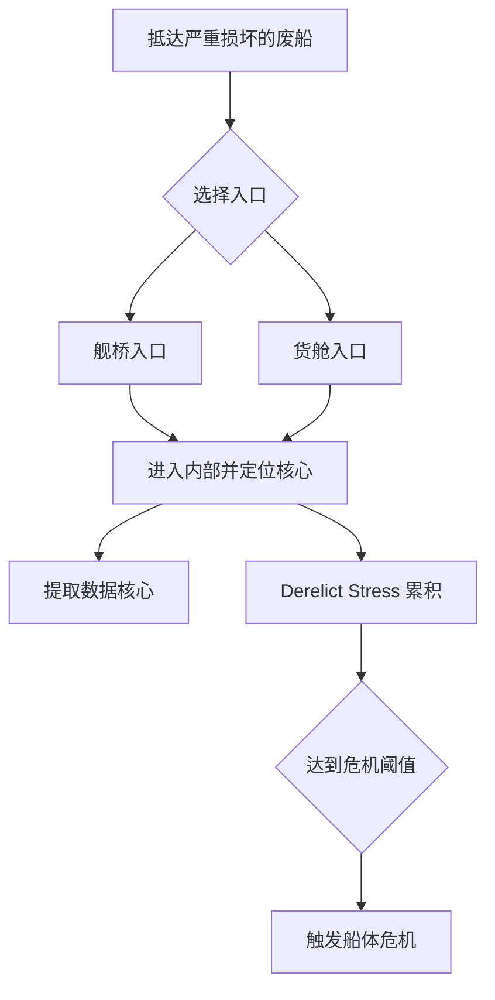

这个合同已经相当丰富。它包含两条可选入口、内部核心定位、最终提取，以及贯穿整个过程的 Derelict Stress。危险达到某些阈值，还会出现必须处理的危机。

**决策核心：**在持续恶化的废船中，怎样选择进入路线、分配船员与骰子，既推进回收，又避免损坏核心及触发严重事故？

这里有一个重要区别：它虽然有几个步骤，整体上却更像一项连续的废船回收工作，各阶段始终受到同一种环境危险的约束。它的紧张感很大程度上来自危险压力，而不只是阶段数量。这说明单个场景不需要很长的目标图，也能依靠强烈的全局压力关系产生很高的紧张程度。

### 03. Hidden Wreck｜一场纯粹的时间竞赛

**地点与结构：**Far Spindle · 单阶段

玩家帮助 Yu-Jin 寻找一处隐秘残骸，抢在 Vesna 的队伍之前取得关键成果。

两处主要工作地点——Crushed Shuttle 与 Scattered Wrecks——都可供玩家投入行动。Vesna 在前两轮之后到达，随后继续推进竞争。这个合同没有独立的 Derelict Stress。

**决策核心：**是否应该集中行动尽快取得必要成果，还是有余裕探索其他有价值的东西？

它没有特别复杂的目标展开，而是突出一种强烈且容易理解的关系：玩家的工作进度与对方的时间进度竞争。

这是一次刻意的结构简化：前一个 Solheim 已经要求玩家管理危险和危机，这里主要考验工作效率与行动优先级。

### 04. Ice Rich Asteroid｜保护正在被破坏的成果

**地点与结构：**Far Spindle · 单阶段

玩家要取得冰芯，但抽取过程可能破坏冰体。与此同时，还有可供探索和搜刮的额外地点。

这个合同的关键是一条表示冰体损坏的压力状态。中立及失败结果都可能造成损伤，积累过多便无法取得完整成果。

**决策核心：**怎样在获得必要冰芯与争取额外物资之间分配行动，同时控制不可逆的损伤？

与 Hidden Wreck 相比，这里不再主要惩罚拖延，而是惩罚不够谨慎的操作。虽然两者都是单阶段，但一个围绕时间竞争，另一个围绕成果损坏，构成很好的教学对照。

### 05. Stranded Rig｜低压的工作与回收

**地点与结构：**Flotsam · 单阶段

玩家帮助 Alma 修理钻机，之后可以从附近的废弃设施中收集 Scrap 和 Components。

没有独立的合同 Stress，也没有 Cycle Clock。两处地点都可以进行工作，主要限制来自玩家携带的 Supplies。

**决策核心：**为了取得物资与报酬，应该花费多少行动？修理完成后，还值得继续搜集到什么程度？

它是一个明显的低压合同。最值得我们学习的不是其策略深度，而是它的存在本身：在更复杂的合同之后，游戏仍然保留相对简单的工作，让玩家恢复对行动的掌控感，也提供修理骰子需要的物资。如果所有 Contract 都不断提高危险和目标数量，玩家很容易陷入持续疲劳；简洁的回收工作则既能服务经济循环，也能调节冒险节奏。

## 四、中期合同：开始强调纵深、工作依赖与不可逆时机

### 06. Shipmind Wreck｜非常典型的逐层深入

**地点与结构：**Helion Gate · 多阶段

这是我认为最值得作为 SSNoir 组合式交锋基础范例的一个合同。

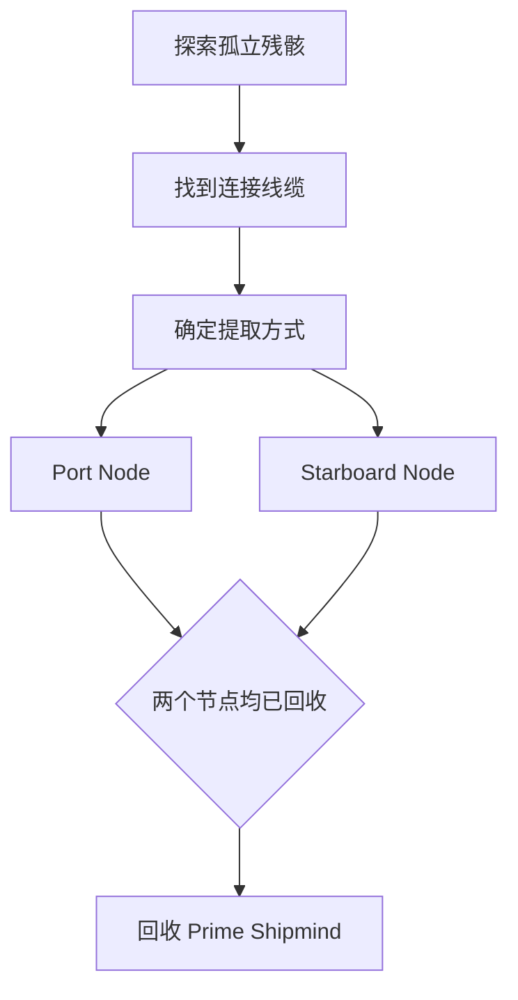

实际玩家最初只能操作 Isolated Wreck，完成后才开放 Wreck Cable。继续完成 Extraction Strategy 后，两处节点同时开放，两个都完成才可以正常取得 Shipmind。过程中还存在 Conway 无人机的警戒压力。

**决策核心：**在逐层展开的回收工作中，根据当前阶段的技能需求分配骰子，避免引发警报，并在最后协调两个必须完成的节点。

这里的教学价值主要来自目标图的变化：一项工作，深入到下一项工作，再展开为两项并行工作，最后取得成果。它没有特别复杂的危机打断，也没有强制玩家在多个故事结果中选择。因此，它虽然更长，却不一定比 Solheim HS22 更难。这正是通过组合增加旅程层次，而不必同时增加每一层的规则复杂度。

### 07. Solheim Bunker｜进入设施后，玩家获得一个有限的机会窗口

**地点与结构：**Holm's Rock · 多阶段

玩家与 Juni 进入一处 Solheim 地下设施。

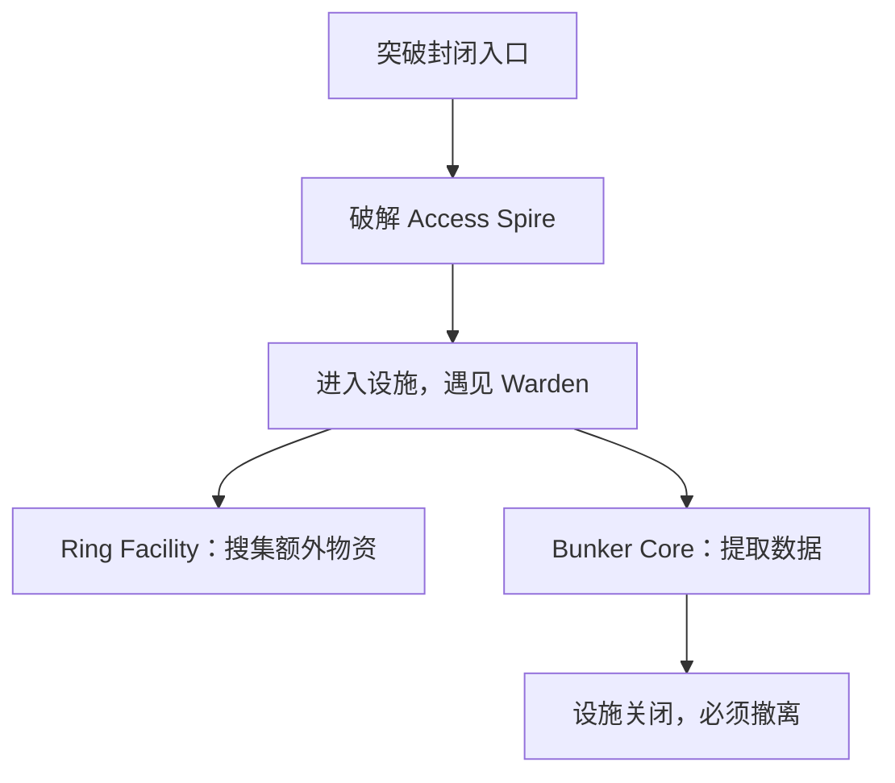

进入设施后，Ring Facility 与 Bunker Core 都可以选择；玩家可以先搜集物资，也可以直接提取核心数据，但一旦提取就必须撤离。Warden 的怀疑会随着时间和不利结果增加。

**决策核心：**在不断缩短的安全窗口内，应该先取得多少额外物资，再进行会结束探索机会的核心提取？

它和 Shipmind Wreck 的区别很明显：Shipmind Wreck 的重点是逐步解锁必要工作；Solheim Bunker 则在逐步进入设施后，创造了一个有退出边界的资源搜集阶段。玩家决定提取核心时，也就决定放弃剩余的搜集机会，阶段转换本身因此成为值得权衡的动作。

### 08A. Headstream｜三处并行工作与危机管理

**地点与结构：**Wellspring · 单阶段＋危机

玩家帮助 Kirk 在 Lotic 飞船上发动哗变。

有三个主要工作地点：Engine Room、Navigation Control、Payload Ops。每处可以通过不同技能与方式开展工作。整体需要推动哗变，同时避免因不利行动增加怀疑；怀疑到达阶段阈值，会引发 Crisis。

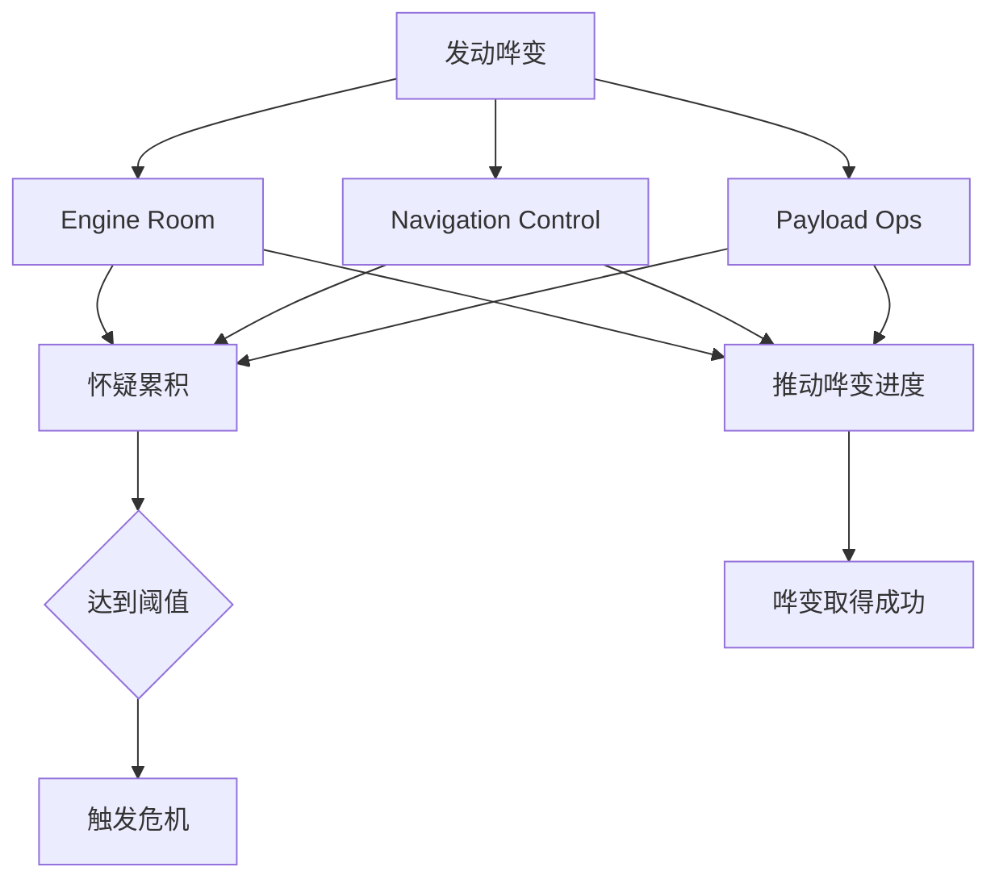

**决策核心：**怎样在不同的工作地点之间分配行动与船员，同时控制逐步增加的怀疑，以及危机造成的额外行动需求？

它是一个很有价值的反例：到了游戏中期，设计仍然可以回到较为平面的多目标局面。这里的丰富程度来自工作种类、人员技能、风险和危机之间的关系，而不是纵深。

### 08B. Debris Field｜重复工作中发生的叙事转折

**地点与结构：**Wellspring · 单阶段＋剧情转折

另一条路线中，玩家帮助 Lotics 在几颗小行星上设置导航信标。

基本工作具有重复性：处理小行星，准备信标位置，再安装信标。

在完成前两处之后，Kirk 与 Tala 会联系玩家，请求停止工作，以免破坏他们的抵抗行动。

**决策核心：**在执行一项重复的合同工作时，是否继续完成原定任务，还是因新出现的事实放弃原来的目标？

这项合同的特点不是行动优化不断变得更复杂，而是中途增加一个关于任务价值的判断。从纯机械目标结构看，它仍然比较平面；但从故事体验看，玩家会重新解释自己已经做过的那些工作。

对 SSNoir 来说，这种设计不应成为每个普通交锋的标准配置，却很适合少数重要任务：前半段让玩家认真工作，后半段才使他开始怀疑这项工作的意义。

### 09. Cutter's End｜路线选择、深入、遭遇、最终救援

**地点与结构：**Flotsam，Wellspring 之后 · 多阶段

这是第二个我非常推荐研究的组合范例。

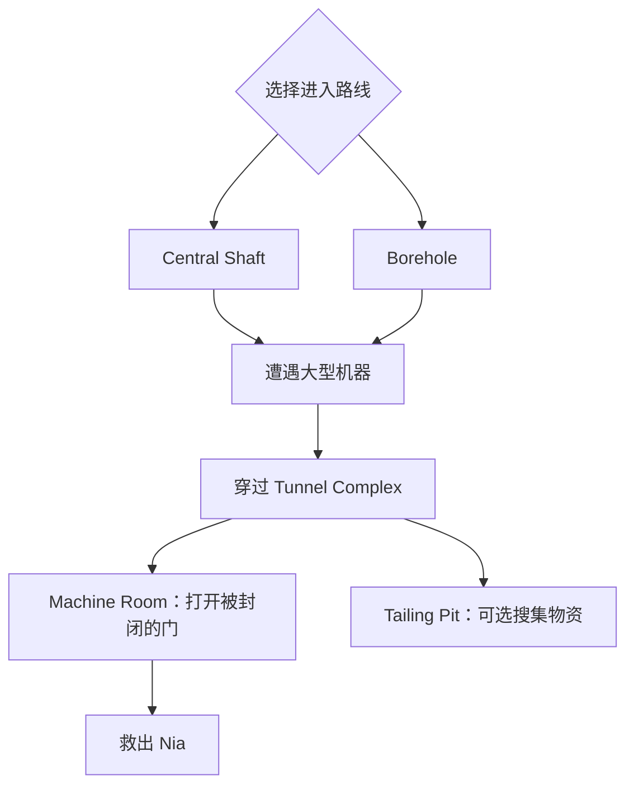

玩家最初有两条可替代的进入路线。之后要躲避隧道中移动的大型机械，继续深入矿洞；最终抵达 Machine Room，突破被封闭的门找到 Nia，途中还可选择前往 Tailing Pit 搜集物资。

**决策核心：**怎样结合已有队员能力选择进入方式，在危险深入过程中减少损耗，最后留出足够的行动能力突破最终障碍？

这个合同与 Shipmind Wreck 相似，都具有明显纵深。但 Cutter's End 的阶段变化更有事件感：开辟道路、遭遇大型机器、与时间赛跑、突破最后的门。这里不需要每一阶段都重新设计危机条，大型机器的出现本身就能改变工作的性质。它的长度来自连续遭遇，而不是把同一个问题重复十五次。

## 五、后期合同：更长的旅程，以及不同结构的重新组合

### 10. Darkside Recon｜原本的任务进行到一半，出现了另一项紧急工作

**地点与结构：**Scatteryards → Darkside · 复合型

这个合同的目的是潜入 Darkside 取得情报，并安全撤离。

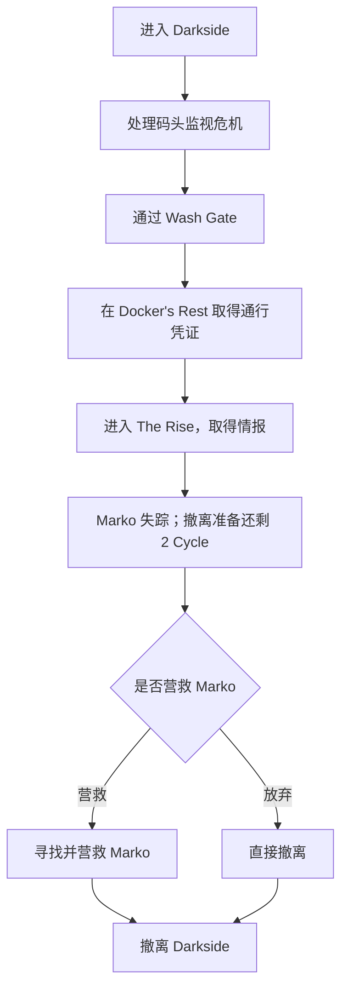

它在开始时就设置 Dock Surveillance 危机。不处理会使合同 Stress 随 Cycle 增加。

危机解除后，玩家按次序深入：通过 Wash Gate，在 Docker's Rest 取得通行凭证，再进入 The Rise。

任务推进到后半段时，Marko 失踪。接应者 Ankhita 需要两轮准备撤离，而玩家可以利用这个窗口寻找 Marko。

**决策核心：**前半段怎样避免暴露、完成潜入；后半段又怎样在固定撤离窗口内，判断是否有能力完成营救？

这里的长度有两种来源：一是正常的潜入纵深，从外围到凭证再到内部；二是中途出现新的任务需求。

特别重要的是，后半段不是简单延长前半段的潜入 Clock，而是让玩家此前剩余的行动能力面临新的用途。玩家已经承受的损伤和耗费，也会影响他是否敢于营救 Marko。这是较长合同产生整体策略性的办法之一。

### 11. The Wind's Long Shadow｜后期仍然可以有单阶段的专业回收工作

**地点与结构：**Greenbelt 支线 · 单阶段

玩家需要回收三份 Stepsilk。

三个地点分别是 Crop Processing、Storage Vault、Broken Dusthouse。每处工作有不同技能要求，其中部分 Stepsilk 十分脆弱，错误操作可能永久损坏可回收物。没有整体 Cycle Clock，也没有独立的合同 Stress。

**决策核心：**如何根据人员技能和当前骰子，安排三个地点的回收工作，并保护易损成果？

这相当接近一种具有三个独立目标的单阶段回收合同。三个地点提供工作多样性和技能分配问题，但不形成大型的连续冒险。它的重要性在于：后期不是每项 Contract 都要多阶段化。玩家已经掌握许多规则，此时完全可以用相对简单的任务重新考验精确分配骰子的能力。

### 12. Aphelion Beacon｜探索中突然增加维修工作

**地点与结构：**The Hollow · 复合型

玩家最初与 Yu-Jin 搜索 Fraction Drive 的位置。

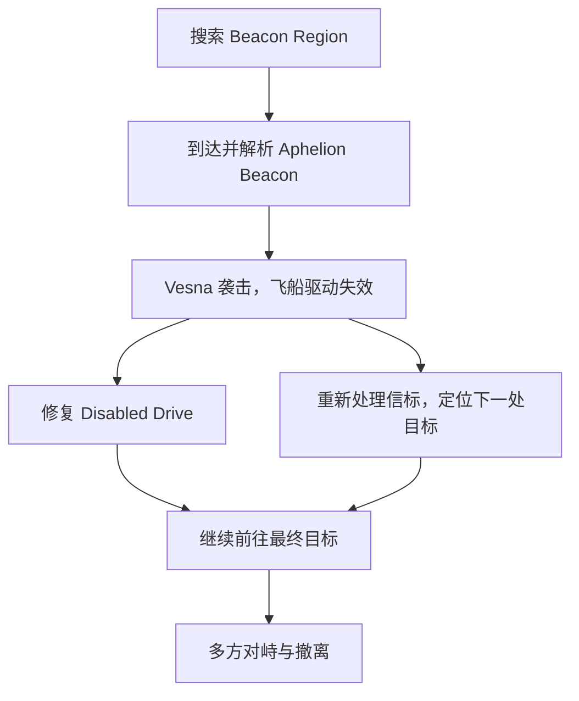

实际游戏在解析初始信标后，安排 Vesna 的飞船突然发动攻击，使玩家的驱动系统失效。此后同时出现飞船维修与信标处理两项工作。

**决策核心：**原本只需要追踪信标，但现在还必须修好飞船。怎样把剩余资源重新分配给两项必要工作？

这项合同特别适合说明一种组合方法：先让玩家习惯一种工作，再用情节事件改变目标结构。任务一开始是串行的搜索与解析；袭击发生后，转为两项并行的必要工作，最后再次汇合。它不需要新的战斗系统来模拟飞船遇袭，只要让袭击改变任务状态，后续仍可用熟悉的骰子和 Clock 处理。这就是把戏剧变化转换成目标图变化。

### 13. Rescuing Karman and Flint｜准备不足的紧急救援

**地点与结构：**Olivera · 自动合同，内部分类待核实

玩家初次到达 Olivera，会直接进入一场与 Karman 和 Flint 有关的救援合同。

这一点与此前大部分合同不同：通常玩家可以先在 Hub 购买补给，再主动出发，但 Olivera 的第一次救援会自动启动。玩家社区曾讨论这种缺少准备窗口的设计。

**能够确认的核心条件：**玩家在缺少常规事前准备机会的情况下，需要执行紧急救援。

不过，目前检索到的资料不足以可靠复原它的完整目标依赖图，因此我不把它武断地归为单阶段或多阶段。

它仍然提供一条重要的设计观察：

除了改变合同内部的目标结构，游戏还可以通过改变进入合同的条件，影响玩家的资源规划。

但这种方法有风险。玩家如果无法预见需要储备资源，可能觉得自己受到不公平的惩罚。它不一定是值得 SSNoir 直接继承的做法。

### 14. Old Manufactory｜三个地点，但仍然以同一阶段为核心

**地点与结构：**Olivera · 单阶段＋倒计时

玩家需要在追杀 Flint 的 Hunter 到来之前，布置陷阱。

可确认的三项 Clock 分别是：

- Factory Exterior

- Assembly Line

- Storage Silos

要达成完整的三重陷阱，需要在三轮的准备窗口内完成这三项工作。

这里非常值得区分一个概念。

虽然游戏成就称之为 three-stage trap，但从玩家的工作分配来看，这三项并不是严格的「先完成 A 才能解锁 B，再解锁 C」，而是同一准备阶段中需要协调的三个工作地点。

**决策核心：**在猎人到来之前，怎样把行动分配到三个陷阱地点，尽量完成全部布置？

所以它与 SSNoir 的「第一次彩排」反而具有很强的结构相似性。

三项必要工作、固定的截止时间、有限的行动能力。

游戏已经来到后期，仍然继续使用这种基本的调度模式。

这是很值得注意的证据：游戏并没有认为玩家到了后期，就必须每次面对五六层目标。

### 15. Darkside 终局合同｜全游戏最明确的大型组合结构之一

**地点与结构：**Darkside · 大型复合型

这是前面各种结构关系的集中运用。

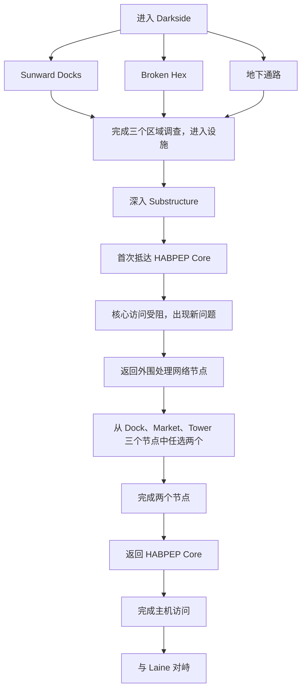

根据攻略，首先需要完成三个区域的调查工作，寻找通往 HABPEP 设施的办法。

进入内部之后，玩家逐步到达核心。

但此时受到额外协议的阻碍，必须返回外围处理网络节点。三个网络节点只需要解决两个，就可以回到核心继续访问。

这个阶段还会启用随时间和失败结果累积的 Contract Stress，同时获得一次 Supplies 补充。

**决策核心：**如何在一段较长的潜入与系统突破工作中，协调并行目标、保留行动能力，并在新的访问障碍出现后，重新选择最合适的完成路径？

从任务图来看，它比前面所有案例都更复杂，但并没有让所有目标同时出现。玩家最初只需考虑三个进入设施的工作，随后深入内部；抵达核心后才出现新的网络节点任务。玩家不必完成全部三个节点，只需选择两个，再返回此前的核心地点。这是成熟的层次化组织：各阶段的局部问题清晰，整体旅程则相当复杂。

### 16. Hexport Remains｜后期的短时间探索

**地点与结构：**Darkside 终局之后 · 浅层展开

玩家陪同 Kadet 返回 Hexport 遗迹。

这里有辐射危险，只能停留三个 Cycle。

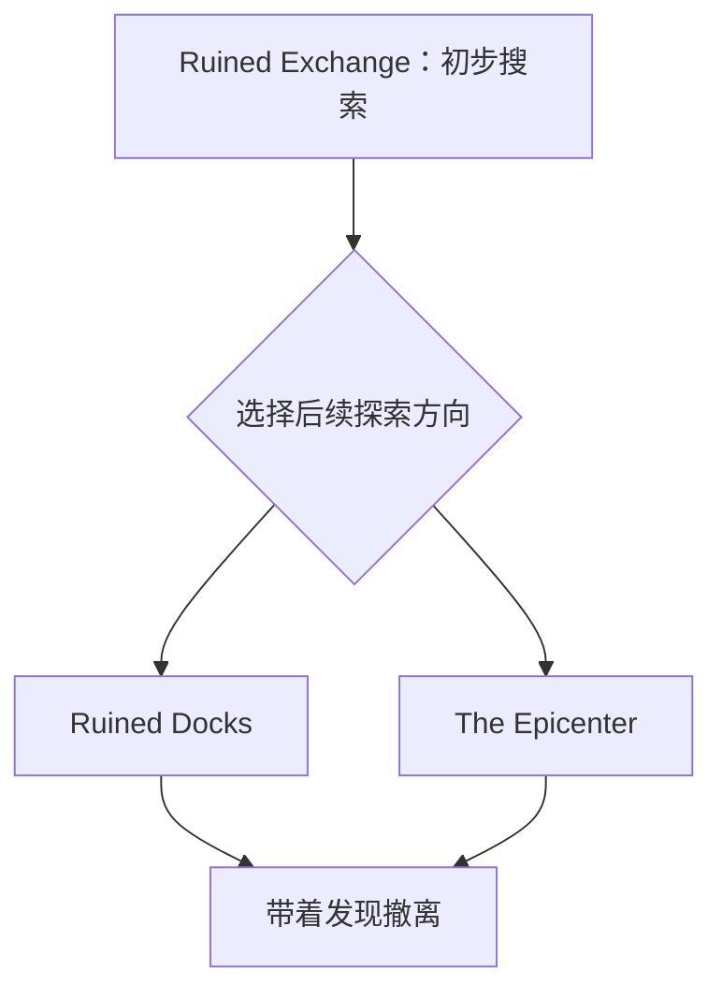

完成 Ruined Exchange 的初步目标后，会开放 Ruined Docks 与 The Epicenter。两处可以调查不同内容，但三轮辐射时限使玩家通常必须有所侧重。

**决策核心：**在严格的时间限制内，如何安排初步搜索与后续探索，决定哪些发现最值得争取？

这个合同再次体现了设计的灵活性：玩家已经完成终局大型合同，接下来遇到的却是一个相对简短的探索任务，只包含一次阶段解锁、一个时间窗口和两个可选的深入方向。游戏没有因为进入后期，就把每个新合同都设计得比前一个更庞大。

## 六、整体来看，Contract 的复杂性是怎样演进的？

我觉得现在可以作出一个更准确的判断：

《Citizen Sleeper 2》采用的并不是线性增加复杂度的曲线，而是一种不断引入结构关系、再重新组合这些关系的设计方式。

### 1. 前期先让玩家掌握几种基本的决策关系

前期：同一套骰子，不同的局部问题

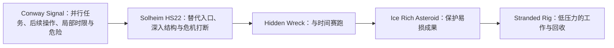

这些玩法并非严格一个个首次出现，也不是互不重叠。它们共同说明：前期合同已经在教玩家理解不同类型的工作与压力。

尤其值得注意的是 Solheim HS22：它相当紧张，也具有几层目标，却没有要求玩家使用陌生的底层机制。之后的 Hidden Wreck、Stranded Rig 等合同又明显收敛了结构复杂度。这可能是重要的节奏设计：先用强烈经历让玩家认识系统的可能性，再让玩家在相对单纯的工作里熟悉它。

### 2. 中期开始增加任务的纵深

Shipmind Wreck、Solheim Bunker、Cutter's End 在这里很有代表性。

它们不只是把原本的 Clock 增长到十格，而是把一件工作拆成具有依赖关系的几个局部任务。

| 结构 | 典型步骤 | 决策特点 |
| --- | --- | --- |
| 早期局部结构 | 工作 A、工作 B、共同完成目标 | 主要在同一局面中调度 |
| 逐层展开结构 | 探索、进入内部、节点 A、节点 B、完成目标 | 局面随工作推进而改变 |

这种结构增加的不只是工作量，还增加了任务尚未完成、仍有更深处等待玩家的感觉。

而且它使每个阶段只需要关注局部问题。玩家不会从一开始就面对整张复杂的目标图。

### 3. 后期更多地使用中途变化和组合重组

到了 Darkside Recon、Aphelion Beacon 和终局 Darkside，我们看到一种更复杂的关系：玩家先在一个结构中工作，随后发生某件事情，让原来的计划不再充分。例如：

- Darkside Recon：已经取得情报，新的问题却是同伴失踪，而撤离时间有限。

- Aphelion Beacon：原本只需要追踪，袭击却让玩家必须同时维修飞船。

- 终局 Darkside：已经进入主机核心，却发现还需要返回外围处理网络节点。

这些事件都把正在推进的任务转换成新的决策局面，却没有改变基础操作：玩家仍然使用骰子、Clock、技能与资源。从设计角度看，这相当于在已学会的规则语言中增加更复杂的句子，而不是不断引入新语法。

## 七、真正的难度增长，其实有三个独立维度

我认为这是这次研究最值得保留的结论之一。

| 维度 | 如何增加 | 产生什么体验 |
| --- | --- | --- |
| 局部决策难度 | 更紧的时限、更高的风险、更强的资源竞争 | 紧张、谨慎、犹豫 |
| 任务结构长度 | 更多前置工作、逐层深入、不同阶段之间的依赖 | 探索、旅程、逐渐接近目标 |
| 整体策略复杂度 | 前期损耗影响后期、阶段改变目标优先级、危机要求重新规划 | 计划、应变、长期权衡 |

这三个维度可以独立变化。Solheim HS22 的局部决策压力很强，但没有最终 Darkside 那样长的任务结构；Shipmind Wreck 拥有明显纵深，却不需要像 Solheim 那样依靠多次危机打断；Old Manufactory 的内部目标结构相对集中，但固定截止时间依然能制造紧张的调度问题。因此，增加阶段不等于增加难度，增加 Clock 也不等于增加策略深度。

我还会特别区分另外两种关系：任务依赖让玩家知道下一步要完成什么，例如打开门后才能进入内部；策略耦合则让玩家考虑眼前行动如何影响之后，例如强行开门会提高后续区域的警戒。前者负责组织长度，后者让不同阶段之间产生更长远的思考。一个大型 Contract 可以同时拥有两者，但不必让每个组件都产生复杂的跨阶段后果。

## 八、我认为《Citizen Sleeper 2》真正采用的是一种交替节奏

如果抽象整个流程，我不会把它画成一条持续上升的难度曲线，而会这样理解：

根据典型合同顺序进行的设计归纳，不是开发者公布的难度安排。

游戏逐渐扩大玩家理解的规则组合范围，但并不要求每个新合同都比上一个大。这很像一门逐渐发展的语言：早期玩家学会简单句子，中期开始理解从句、并列与前后依赖，后期能够阅读较复杂的篇章；而复杂篇章中仍然可以有简单句子，这恰恰是清晰性的来源。

## 九、对 SSNoir 的直接启示

这次研究让我觉得，我们之前研究的「第一次彩排」和「雨夜追信」已经可以成为两种很好的基础组件。第一次彩排提供的是：

> 两项有期限的工作，与额外收益共同竞争有限行动。

雨夜追信提供的是：

 > 在推进目标的同时，管理逐渐恶化的危险，并判断何时冒险、何时控制风险。

它们都足以独立构成短 Encounter。如果以后要制作一场大型剧院调查或首演夜事故，就可以在这些局部模式之外增加纵深。例如，剧院事故的最终目的始终是让受困人员安全离开：

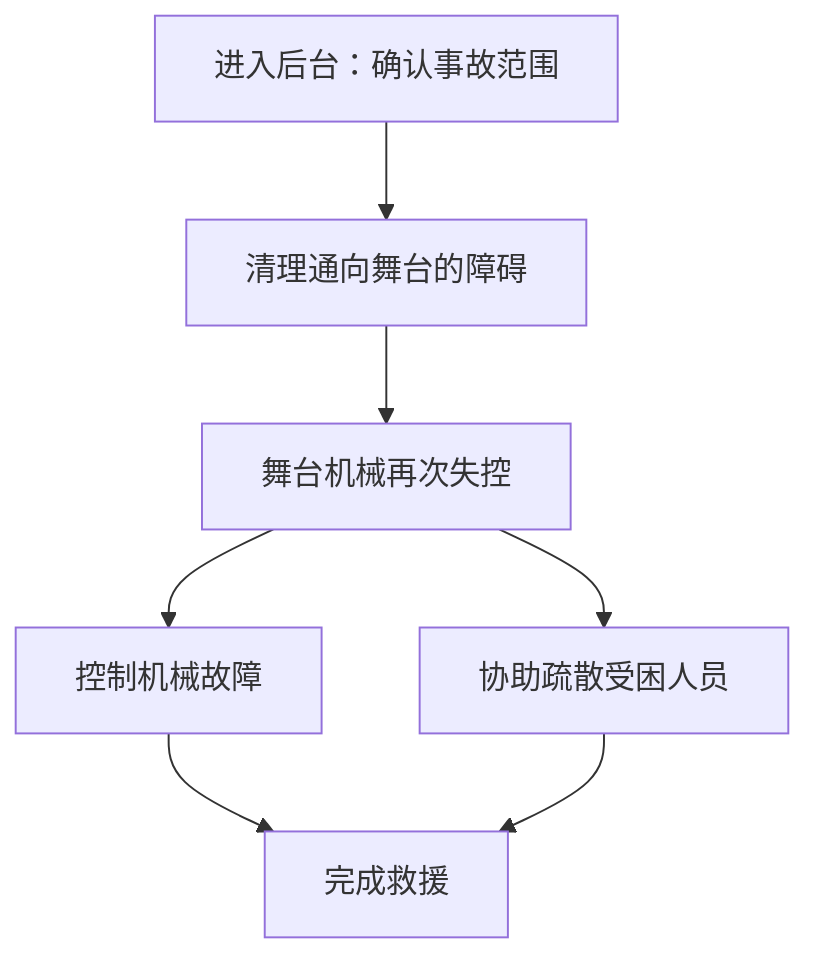

初步调查和清理障碍可以很简单；机械失控后，再出现两项需要协调的工作。这样既延长了场景、创造新的决策局面，也不需要玩家学习另一套交锋系统。

我会建议我们把 SSNoir 的交锋划分为三个实际制作尺度：

| 尺度 | 适合的情景 | 设计重心 |
| --- | --- | --- |
| 短交锋 | 追逐、简单调查、临时工作 | 一个清晰的决策关系 |
| 中型交锋 | 彩排、仓库搜索、复杂交涉 | 两三个相互影响的工作或一次阶段转换 |
| 大型交锋 | 重要潜入、救援、首演夜 | 逐步展开的任务图，结合少量关键的局势变化 |

这里的划分不是要求短交锋只能有一个 Clock，或者大型交锋必须有三个阶段。它是为了帮助我们控制体验的规模。

我尤其不建议为每个阶段都设计一套「主目标＋降低危险＋获得长期收益」的完整结构。这可能正是你之前觉得 Encounter 总有些重复的原因。更好的办法是让一个阶段承担一种主要玩法问题，再用任务依赖把不同问题连接起来：第一阶段寻找入口，第二阶段进行紧张的风险管理，第三阶段完成两项并行工作。这样整段 Encounter 有足够长度，每个阶段也仍然容易理解。

### 我最终会保留的四个设计原则

第一，大型 Encounter 的长度应来自有意义的工作展开，而不是简单增长 Clock。 玩家是在逐步完成一个任务，而不是重复做同一件事。

第二，局部组件可以简单，整体任务可以复杂。 不必让每个阶段同时拥有危机、时间压力、额外收益和人物意图。

第三，不同阶段应当产生不同的局面，但不要求每阶段都创造全新的决策模式。 已经成熟的风险管理、目标调度和替代路径，可以在新情景中重新组合。

第四，前后阶段应当有适量的策略联系。 共享的资源与状态，让早期决定影响后期；明确的完成条件与逐步解锁，则让整个过程仍然可理解。

我认为最核心的一点是：

> 《Citizen Sleeper 2》的发展不是从简单 Contract 逐渐变成复杂 Contract，而是让玩家逐渐掌握一套可以组合的任务语言，再用这套语言组织规模、压力和节奏各不相同的冒险。

这也回答了你最初关于难度增长的疑问：玩家的熟练程度在提高，因此游戏可以开始使用更长、更复合的任务；但它仍然不断穿插简单的局部工作，让玩家使用已经掌握的能力。

对 SSNoir 而言，我们不必急着发明很多新的交锋机制。更值得做的，是先建立若干真正成立的局部模式，然后研究它们怎样通过前置、并行、替代、打断和共享状态，组合出更长的经历。

整个 Encounter 的复杂性应当存在于它的组织关系中，而不是要求玩家在每一个时刻都面对同样复杂的局面。
