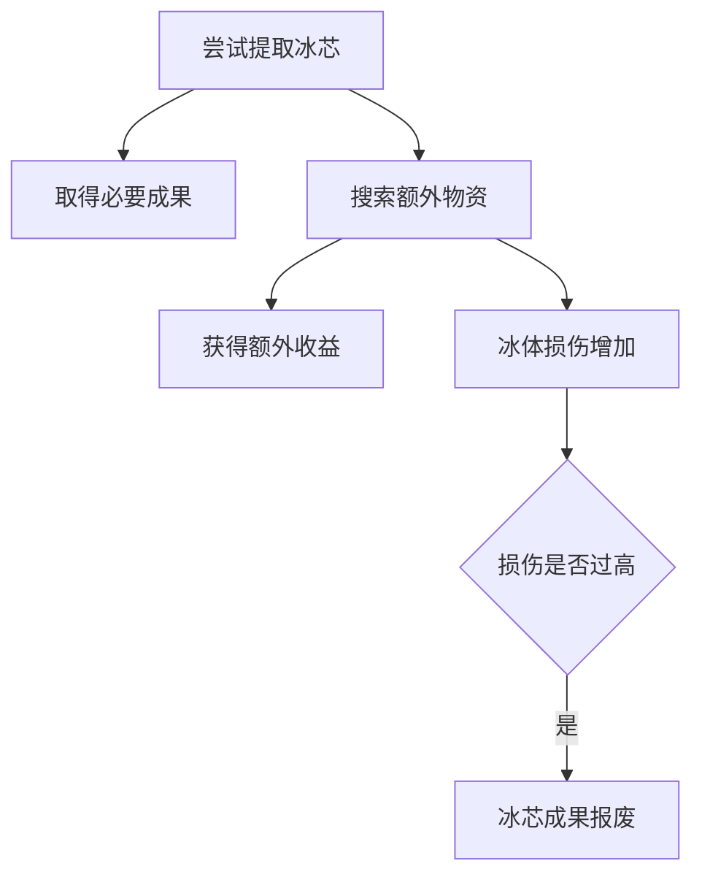
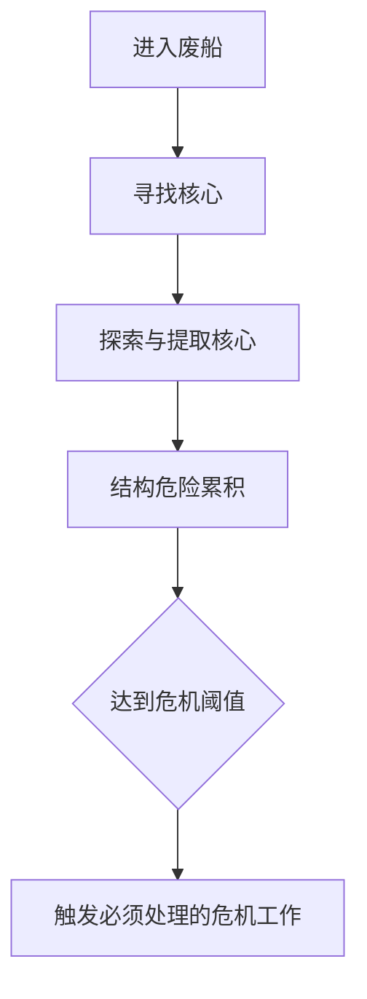
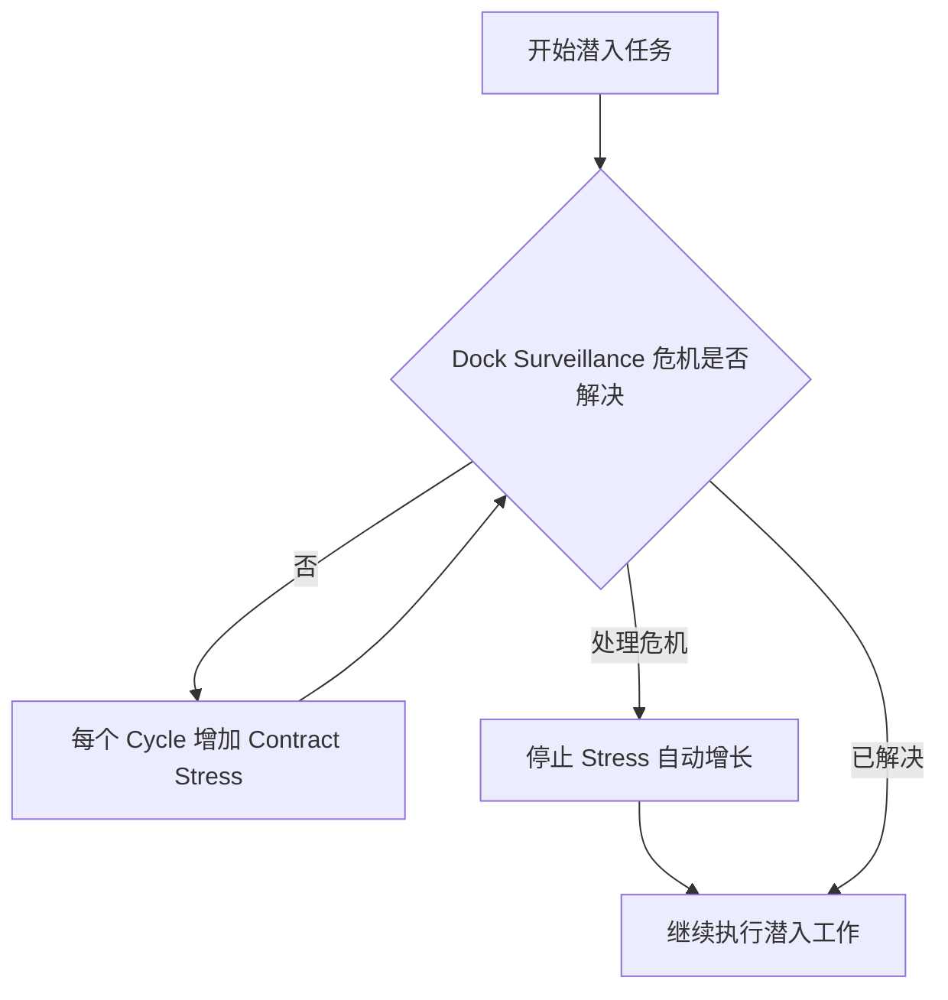
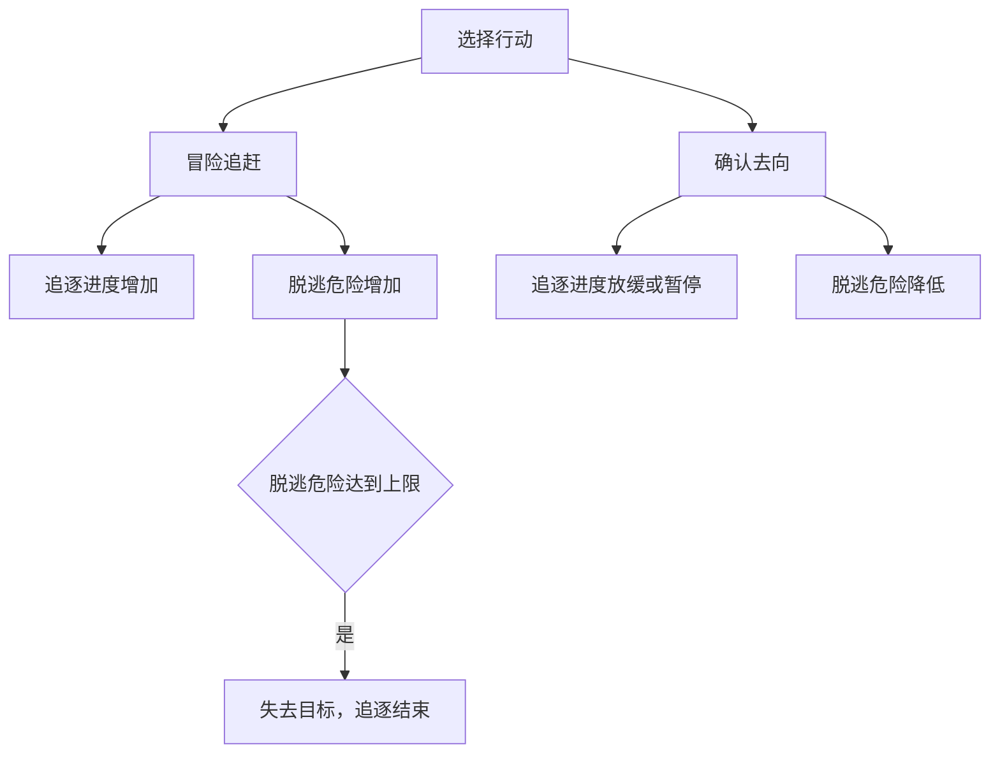
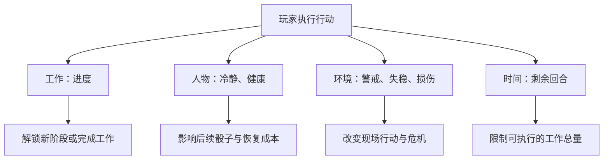

我认为你现在困惑的，其实不是应该给哪条 Clock 增加几点，而是一个更基本的设计问题：一次行动失败，究竟意味着什么东西变坏了？又是谁在承担这个后果？这个问题比选择「冷静 -1」还是「危险 +1」重要得多。

Gareth Damian Martin 在访谈中明确谈过这个设计思想：Stress 不只代表人物的精神压力，而是一种能够表示多种对象受压状态的抽象机制。它既可以表示 Sleeper 身体承受的压力、船员还能坚持工作的程度，也可以表示废船正在解体，或哗变中船员对船长的不满正在累积。设计者明确提到，他借鉴了《Blades in the Dark》等桌面角色扮演游戏，用这种抽象伤害来表现不适合用生命值描述的挑战。

## 一、先区分三种不同的压力

| 压力对象 | 在 CS2 中的意义 | 玩家担心什么 |
| --- | --- | --- |
| 主角 Stress | 长期积累会影响骰子状态，甚至导致骰子损坏 | 接下来还有没有能力完成工作？回城后要付出多少恢复成本？ |
| 船员 Stress | 船员的承受能力有限，满值后无法继续参与该合同 | 关键同伴会不会提前退出工作？ |
| Contract Stress | 废船、环境、警戒或整体局势正在恶化 | 任务会不会触发 Crisis、损失成果或直接失败？ |

| 代价落在哪里 | 玩家主要考虑什么         |
| ------ | ---------------- |
| 剩余时间   | 我是否还来得及？应该先完成什么？ |

例如，同样是尼尔尝试操作一台故障吊机：
- 如果失败导致冷静下降，说明这次操作让尼尔承受了心理或身体压力。他即使离开码头，仍然带着这次经历的损耗。
- 如果失败导致吊运危险增加，说明重物变得更不稳定，或者现场工作条件恶化，直接影响眼前的吊运。
- 如果行动花费了时间，则不管成功还是失败，船只离港的期限都更近了。

这三种 Stress 的结算方式也不完全相同：主角的 Stress 会在合同之外继续影响骰子，需要休整或维修；船员的 Stress 则在合同结束后清除，主要限制其当前任务中的贡献；Contract Stress 通常随该合同结束而终止。

玩家面对一个行动时，实际上是在决定：为了推进眼前的工作，我愿意让哪一部分承担风险？这比单纯比较成功率有意思得多。三种代价都能成立，但它们表达的是不同的因果事实，不能只因为需要增加游戏难度就随意互换。我会把它们理解为三个作用范围：人物、局面、时间。

## 二、《Citizen Sleeper 2》的三种 Stress 在规则上怎样运作？

这里有一个很重要的设计：三类 Stress 并不是同一种失败惩罚换了三个名字，而是具有不同的累积方式、阈值和持续时间。

### 1. 角色 Stress：它主要让未来的行动能力变得脆弱

在 CS2 中，角色可以因为不利判定、危险行动、饥饿，以及主动使用 Push 而增加 Stress。Stress 不会简单地将当前行动的成功率统一减去百分之十。它会改变下一次掷骰时骰子受损的概率。

| Sleeper Stress | 掷出这些数值时，骰子有受损风险 |
| --- | --- |
| 0–1 | 不触发 Stress 伤害 |
| 2–3 | 1 |
| 4–5 | 1、2 |
| 6–7 | 1、2、3 |
| 8–9 | 1、2、3、4 |
| 10 | 1、2、3、4、5 |

实际阈值受游戏难度影响。骰子有自己的耐久，损坏到一定程度会无法使用，需要之后修理。Contract 中不能像在安全的 Hub 那样正常休息恢复。由此产生的不是单纯的「失败让我损失了一些生命值」，而是：我现在承担压力，可能使下一回合失去宝贵的行动能力，甚至影响回城后的生活。

### 2. 同伴 Stress：让玩家考虑由谁承担工作

CS2 中的船员有独立的 Stress。某个同伴如果在合同中积累了过多 Stress，就无法继续提供行动骰。与 Sleeper 不同，船员的 Stress 通常在合同结束时清除，而 Sleeper 还需要考虑自己后续的恢复成本。开发商的官方提示也明确建议玩家注意这一差异：有时让船员承担高风险工作，比继续增加主角的 Stress 更划算，但也不能把船员逼到无法工作。
这制造了另一种决策：同样一项工作，是尼尔来做，还是艾迪来做？它不仅取决于谁的骰子更高、技能更合适，还取决于他们各自的剩余承受能力，以及后面是否还需要依赖这个人。

### 3. Contract Stress：它改变的是任务能否继续

这个系统和角色 Stress 的区别最明显。《Conway Signal》合同的实际界面。顶部显示角色骰子与个人状态，任务区域则另有 Drone Stress。两者属于不同对象。在 Conway Signal 中，玩家需要关闭失控无人机。执行目标时产生不利结果，会增加 Drone Stress。积累到 4 点，无人机便会爆炸；部分后续操作还有独立的 Cycle 时限。

假设你现在有一枚低骰。你可能会这样思考：“我现在再冒险尝试一下，也许可以更快关闭无人机。但是如果失败，Drone Stress 就可能满了。”

注意，这种判断不同于个人 Stress。这里玩家不是主要担心自己接下来还能不能掷骰，而是担心任务对象直接发生不可逆的变化。任务现场的危险是一笔短期债务。它可能在玩家完成任务之前兑现。而个人 Stress 是另一笔债务，它可能延续到任务结束之后。

## 三、几个具体合同，怎样用不同的 Stress 制造不同的决策？

我选了五个具有代表性的合同。

| Contract          | 情景压力表示什么        | 主要增长方式             | 对玩家决策的影响              |
| ----------------- | --------------- | ------------------ | --------------------- |
| Conway Signal     | 无人机即将爆炸         | 不利操作结果             | 尽快关闭系统，避免一次失手造成灾难     |
| Solheim HS22      | 废船结构不断恶化        | 危险操作、不利结果；达到阈值出现危机 | 既要回收核心，也要应对逐渐恶化的现场    |
| Ice Rich Asteroid | 冰芯被破坏           | 某些行动的中立或失败结果       | 是否值得冒险取得额外资源，还是尽早保住冰芯 |
| Shipmind Wreck    | Conway 无人机的警戒程度 | 引起注意的不利操作          | 在被发现前完成多层任务           |
| Headstream        | 对哗变行动的怀疑        | 不利结果；阈值触发危机        | 推进哗变的同时，避免过早暴露        |

### A. Ice Rich Asteroid：危险是有限的「可承受损伤」

在这里，冰体损伤是一种累积的环境后果，部分行动即使得到中立结果，也可能增加它。玩家可以完成主要提取之后继续搜寻资源，但每次行动都可能使已经取得的成果受到威胁。

玩家会思考：“我已经拿到了需要的样本，还要不要继续找宝物？”这里的压力是一个有限的风险预算：可以用它换取更多收益，但不必把它全部用完。这是我认为非常漂亮的一种设计。

### B. Solheim HS22：危险会产生新的工作

危险不仅意味着失败的可能增加。它到达特定阈值时，会打开一项 Crisis 工作，需要玩家投入新的行动处理。

这产生了一条很有意思的因果链：冒险操作使现场恶化，继而触发新的工作，消耗更多行动，并让补给与个人状态继续承压。Stress 不只是一个倒计时，也是新的行动需求的来源。玩家可能原本已经计划好这回合怎样提取核心，结果突然必须把高骰转去处理事故。这就是局势变化如何直接改变行动分配。

### C. Darkside Recon：危机让压力获得时间上的增长能力
在 Darkside Recon 开始时，就存在 Dock Surveillance 危机。没有解决时，Contract Stress 每个 Cycle 都会增长。解决这个危机之后，自动增长停止，主要剩下行动不利结果带来的 Stress。

这和冰芯损伤是两种完全不同的时间关系：冰芯在没有被操作时不一定会继续恶化，但 Dock Surveillance 危机存在时，即使玩家什么都不做、只是等待，局势也会变差。因此玩家必须思考：“我应该先解决正在持续制造危险的来源，还是直接冒险冲向目标？”这种结构能产生紧迫感，但也容易形成固定策略：如果处理危机的代价很小，又能长期停止压力增长，玩家便会毫不犹豫地先处理它。危机是否值得处理，必须与时间、骰子、技能和当前状态之间形成真实权衡。

## 四、CS2 的 Safe、Risky、Dangerous，并不等于三种固定的故事后果

游戏中的 Safe、Risky、Dangerous 主要帮助玩家判断行动结果可能带来的风险。开发商在官方论坛中确认了大致规则：Risky 行动通常只有负面结果会产生 Stress；Dangerous 行动在中立结果和负面结果时，都可能产生 Stress，并且 Dangerous 行动成功时通常提供更多进度。

但这里的 Stress 不必全都指向同一个状态对象。因此，我建议区分两个问题：

| 问题 | 关注内容 |
| --- | --- |
| 行动有多危险？ | 判定类别、成功率、收益与可能后果 |
| 行动究竟会伤害谁，或者破坏什么？ | 后果归属 |

如果只根据「这是一项 Dangerous 行动」就统一令尼尔冷静 -1，那么我们实际上把情景的因果关系抹平了。同样，如果所有 Dangerous 行动都统一让全局危险 +1，也会造成类似的问题。更好的设计应该是：先确定行动的具体风险，再决定它对应哪个状态。

## 五、从设计角度看，不同压力会创造哪几种决策？

我觉得这是整个问题最重要的部分。与其问「什么样的行动应该增加冷静损失」，不如先问：

我希望玩家在这项工作中，主要担心什么？

我们可以把不同的关联方式理解为几种决策结构。

| 代价结构 | 玩家产生的典型思考 | 适合的情景 |
| --- | --- | --- |
| 只有行动时间成本 | 这枚骰子放哪里最有效率？ | 普通工作、简短调查 |
| 个人冷静损耗 | 这件事值得让我继续消耗自己吗？ | 高强度工作、艰难交涉、持续追查 |
| 情景危险累积 | 再冒险一次，会不会毁掉整个任务？ | 潜入、追逐、危险设备操作 |
| 角色损耗与情景危险并存 | 我该保护自己，还是冒险保住任务？ | 高风险的大型 Encounter |
| 危险触发 Crisis | 是否需要现在处理危险，避免之后付出更多行动？ | 长时间潜入、复杂救援、不断恶化的事故 |

### 1. 个人冷静：跨时间的资源交换

以 SSNoir 已确定的冷静规则为例。冷静降低后，不会直接改变已经掷出的骰子，而是在下一次掷骰时限制骰子点数范围。

因此，假设尼尔在码头工作中损失了冷静，这个后果可能影响合同后面的 Cycle，也可能影响第二天在城市中的生活。玩家实际上在思考：“我今天为了拿到这份钱，把自己搞得筋疲力尽。明天还有别的事情要做，值得吗？”这是个人冷静最有价值的用途：它让一场 Encounter 与整个城市的生活循环产生联系。

但有一个容易忽略的问题：如果一场 Encounter 非常短，玩家损失冷静后交锋就立刻结束，那么冷静对本次 Encounter 的策略影响可能很小，主要成为结算之后的一项代价。

因此，个人冷静更适合表现长期消耗，不适合承担所有局部危机的职责。

### 2. 情景危险：直接改变眼前的行动价值

例如雨夜追信：如果继续追赶会增加送信人脱逃的危险，玩家就需要考虑是否改为确认去向、降低危险。这条 Clock 可以直接改变本次交锋中的行动优先级。

这里的「脱逃危险」不是尼尔的心理压力，而是目标人物脱离控制的程度，它主要制造局部风险管理。同样一颗低骰，在危险只有 1/6 或已经达到 5/6 时，可能产生完全不同的决策。因此，情景危险特别适合有明确紧张局面的 Encounter。

### 3. 两者并存：谁来承担代价？

假设玩家需要完成一项危险工作，可以为它设计以下几种方法：

| 方法 | 进度 | 主要代价 |
| --- | --- | --- |
| 按正常流程工作 | 较慢 | 消耗行动时间 |
| 集中精力赶工 | 较快 | 消耗个人冷静 |
| 在困难条件下继续操作 | 可能较快 | 增加现场危险 |

这样便出现了一个新的决策问题：为了加快工作，我更愿意承担个人损耗，还是消耗现场能够承受的风险余量？但这种结构只有在情景上成立时才应该使用。

不能为了制造策略，把每项工作都配上三种抽象的「花冷静、花危险、花时间」方式。例如审讯、交涉和潜入都可能合理地令人精神疲惫；而装卸货物的普通步骤，就不必每次失败都使尼尔心理崩溃。

玩家应该能够从行动描述中理解代价，而不是只根据数值选择一种更便宜的惩罚。

## 六、最实用的设计方法：先判断结果作用于谁

我建议之后给 SSNoir 编写行动时，采用以下判断顺序：

| 不利结果代表什么 | 对应后果 |
| --- | --- |
| 只是没取得预期进展 | 损失行动机会或时间，不必追加状态惩罚 |
| 尼尔承受精神或身体负担 | 冷静减少 |
| 任务对象或现场局势恶化 | 对应的情景状态恶化 |
| 发生实际身体伤害 | 健康减少 |
这里我尤其想强调：失败不一定需要另附一种惩罚。玩家已经消耗了一枚行动骰，还没有推进 Clock，这本身就是真实的损失。如果因为「失败必须痛苦」就让每次失败都额外降低冷静，短短几回合的工作很容易积累大量不合理的损耗，也会让所有行动变得相似。可以用更具体的例子理解：

| 行动与不利结果 | 更合理的后果 | 原因 |
| --- | --- | --- |
| 整理工具时没找到合适的零件 | 无进度 | 只是浪费时间 |
| 高强度工作，尼尔勉强坚持到完成 | 冷静 -1 | 人物承担了持续消耗 |
| 起吊过程中传错信号 | 吊运失稳 +1 | 现场操作受到影响 |
| 潜入时撞响了一扇铁门 | 警戒 +1 | 外部人员更容易发现玩家 |
| 与罗科交涉时被对方威胁、逼迫 | 冷静 -1 | 尼尔遭受心理压力 |
| 躲避危险时实际受伤 | 健康 -1 | 有明确的身体损伤 |
| 冒险救援时受伤且未能稳住现场 | 健康 -1、现场危险 +1 | 两种独立的后果确实同时发生 |

最后一种双重代价可以存在，但应该谨慎。如果每次失败都同时「冷静 -1、危险 +1」，往往只是双倍惩罚；只有当两种后果都来自同一件真实发生的事情，而且各有不同的未来影响时，才值得一起使用。因此，我建议把这作为默认约束：一次普通的不利判定，通常只产生一种额外损害。

## 八、一个可能更重要的结论：压力应该用来创造不同的决策关系，而不是增加困难

现在回看《Citizen Sleeper 2》，会发现它的一些合同其实刻意没有同时使用所有压力机制。

例如，Hidden Wreck 主要依靠与 Vesna 竞争的 Cycle Clock，而没有独立的 Derelict Stress；Stranded Rig 也没有强烈的合同危险倒计时。这些取舍值得 SSNoir 学习。假设 SSNoir 有三种 Encounter：

| Encounter | 已有的决策关系 | 压力配置建议 |
| --- | --- | --- |
| 第一次彩排 | 两个明确的截止时间，以及额外情报的机会成本 | 不必再人为加入舞台危险 Clock |
| 雨夜追信 | 追逐进度与逐渐增加的脱逃危险之间的选择 | 冷静可以体现追逐疲惫，但要避免与脱逃危险同时增长过快，导致玩家无从应对 |
| 大船靠岸 | 同步吊运与工作失稳 | 以失稳作为主要局部压力，冷静作为少数主动强化行动的代价；不必再加全局「码头压力」 |

我会形成一个相对简洁的设计原则：

一个 Encounter 应当先有自己的主要决策关系，再根据这个关系配置必要的压力。不要先规定每场交锋都必须拥有个人损耗、全局危险和时间倒计时。

具体而言，我们可以用四个问题检查设计：
1. 这次压力代表什么实际事物？ 如果说不清楚，不要增加它。
2. 它为什么会增长？ 是时间在流逝、人物在冒险，还是任务对象被破坏？来源应当明确。
3. 它达到某个程度会怎样？ 如果只是一条红色进度条，却不改变玩家的行动价值、机会或结果，意义很有限。
4. 玩家是否能够对它作出有意义的回应？ 例如降低它、避开会增加它的行动、利用剩余余量换取更大收益，或在它彻底失控之前完成目标。

第四个问题尤其重要。如果某个危险只是被动增加，玩家只能看着它增长，而不影响任何选择，它可能只是一个剧情倒计时。剧情倒计时也可以有用，但我们不必把它误认为策略系统。

## 九、我会怎样总结这一套设计思想

我觉得这里存在一个很漂亮、也很有拓展性的统一模型：一次行动可以改变多个对象的状态，但每个对象拥有自己的因果关系与后果。例如：

这不是要求每次行动都改变四个对象，而是说明它们属于不同的状态与因果关系。这与 The Sims、RimWorld 式的对象和状态建模也有联系：人物有自己的状态，机器有自己的状态，工作有自己的进度，事件有自己的触发条件，行动只改变它真正作用的对象。这些对象通过简单规则相互影响，就可以产生复杂的过程。

所以我不建议把 SSNoir 的冷静理解为「所有失败统一扣除的惩罚」。冷静和健康属于尼尔；吊运失稳属于机器及其作业局面；警戒属于潜入现场；脱逃危险属于追逐。每种状态都应该有自己的含义，不需要统一增长，但可以通过玩家的行动自然联系起来。

最后，我会把我们对《大船靠岸》的下一步研究收敛到一件事：先分别验证「两侧同步协调」是否产生真正的骰子分配，以及「失稳」是否使玩家在推进与校正之间产生真实权衡。如果两者能够成立，再测试是否需要加入「消耗冷静来加快工作」的手段；如果加入后只是让原本的决策更复杂，却没有增加新的有意义的选择，就删掉。

我们不是在不断增加压力条，而是在寻找最少的几个状态，判断它们能否准确表达这样的经历：艾迪和尼尔与其他工人一起面对一件困难的工作，在紧张中不断协调、付出代价，最终把那台庞大的机器安全地送到岸上。这才是我们希望机制本身创造的经历。
