> 研究主题：Scenario Decision Patterns（Scenario决策模式）
>
> 用途：SSNoir 玩法设计与模式研究
> 说明：本文整理此前对《Citizen Sleeper 2: Starward Vector》Contract 结构的分析。**九种模式是设计归纳，不是游戏官方公布的分类。**文中的流程图是抽象结构示意，并非逐帧复刻游戏实际任务。

## 一、我们究竟在研究什么？

先从一个基础 Contract 结构出发：

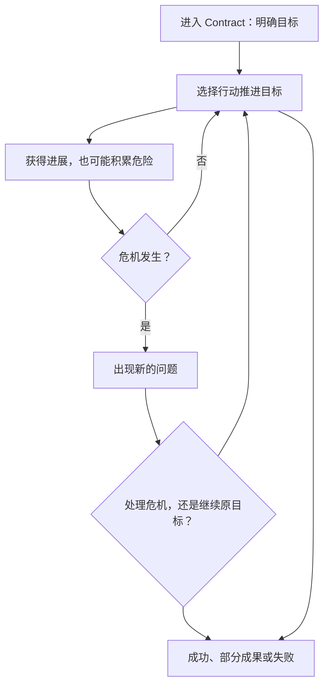

这不只是流程图，也不只是任务的内容拓扑。它描述的是：**玩家面对什么目标、有哪些行动、行动怎样改变局势，以及局势变化后如何迫使玩家重新决策。**

适合把这一研究对象称为 **Scenario决策结构（Scenario Decision Structure）**，把可以复用的具体形式称为 **Scenario决策模式（Scenario Decision Pattern）**。

### 相关术语

| 英文术语 | 中文理解 | 描述的内容 |
|---|---|---|
| Scenario Design | Scenario／遭遇设计 | 一段有明确目标、障碍和结果的可玩情境 |
| Decision Structure | 决策结构 | 玩家有哪些有意义的选择，以及选择如何影响后续决策 |
| Gameplay Loop | 玩法循环 | 玩家反复行动、获得反馈、调整策略的循环 |
| Objective Graph / Objective Topology | 目标图／目标拓扑 | 目标间的串行、并行、前置、替代与可选关系 |
| State Transition System | 状态转换系统 | 行动如何改变状态，新状态又开放或关闭哪些行动 |
| Scenario Pattern | Scenario模式 | 可跨情境复用的Scenario组织方法 |

可以把一段Scenario分为三个层次：

1. **底层机制（Mechanics）**：骰子、行动、成功／失败、Clock、Stress、Push、物品与角色能力。
2. **Scenario决策结构（Scenario Decision Structure）**：目标如何排列、压力如何演变、危机如何改变计划、玩家反复权衡什么。
3. **具体情境（Scenario）**：回收废船、潜入、救援、偷拍、追逐、人物谈判。

第二层是这项研究的重点。同样的骰子与 Clock，通过不同的目标结构、压力和状态变化，可以形成完全不同的体验；同一种决策结构也能用于不同故事。

《Citizen Sleeper 2》的 Contract 可以看成**非战斗的战术遭遇**：把一个有明确目标的情境封装起来，让玩家在限定资源与变化的风险中持续作决策。

---

## 二、第一组：目标怎样组织？（Objective Topology）

这五种主要描述目标之间的连接关系。

### 01. 单目标推进（Single Objective Progression）

**结构**：投入行动 → 取得进度 → 完成目标。

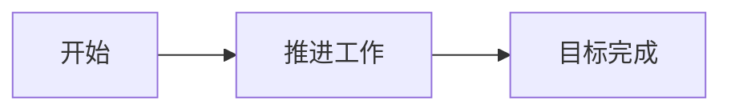

玩家考虑把哪些骰子投入工作、要付出什么代价。较简单的维修工作可近似理解为此类，例如 **Stranded Rig** 中的维修环节；同时仍需注意补给消耗。

**主要心理问题**：怎样以合理成本完成目标？

**局限**：如果没有其他限制，这最容易变成机械填进度条。

### 02. 阶段解锁（Sequential / Gated Objectives）

**结构**：A 完成 → 开放 B → B 完成 → 开放 C。

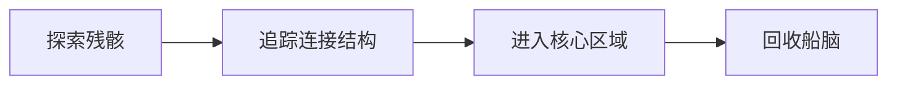

**Shipmind Wreck** 可用于说明这种逐阶段开放新节点的结构：探索残骸、进入连接区域、处理更深层目标。

**主要心理问题**：下一步出现了什么新障碍？需要换一种能力或策略吗？

**设计价值**：同一委托不断出现新内容，避免全过程使用一组不变的行动。

### 03. 并行目标（Parallel / AND Objectives）

**结构**：A 和 B 都必须完成，才能得到 C。

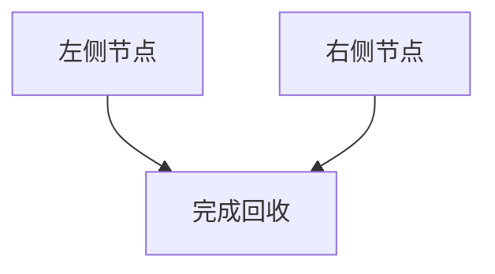

**Shipmind Wreck** 后期要求处理多个节点，例如 Starboard Node 与 Port Node，然后才可以完成核心回收。

**主要心理问题**：先做哪个？哪种骰子或队员适合哪边？如何在多个必需目标之间分配资源？

当并行目标叠加时间或风险，便会形成真正的资源调度问题。

### 04. 替代路径（Alternative / OR Objectives）

**结构**：完成 A 或 B，皆可达到共同目标。

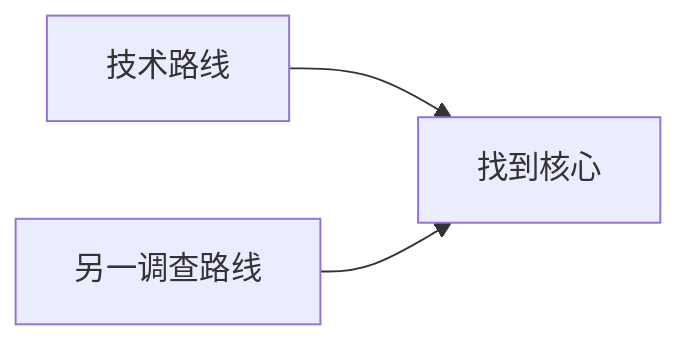

**Solheim HS22** 前期有不同方式推进定位目标，适用路径随技能与船员配置变化。

**主要心理问题**：什么方法最适合我现有的能力和资源？

**设计价值**：让玩家在同一个问题上产生主动性，也与 SSNoir 第一节的「筹钱、查照片、邮箱做局」多途径处理问题高度相关。

### 05. 主要与额外目标（Primary / Optional Objectives）

**结构**：可以满足基本目标，也可以冒险争取额外收益。

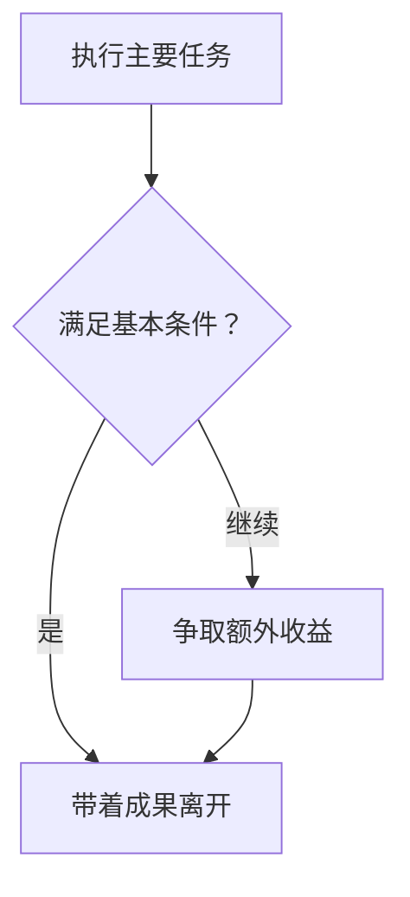

**Hidden Wreck** 的竞速搜寻伴随着额外回收机会；**Stranded Rig** 则可以用于观察维修与残骸回收之间的投入权衡。**是否能够随时撤离，仍须以具体 Contract 的规则为准。**

**主要心理问题**：当前成果够不够？还要不要冒险多拿一些？

这是一种经典的 **Risk–Reward / Push Your Luck** 结构。

---

## 三、第二组：压力怎样改变决策？（Pressure Dynamics）

仅有目标拓扑还不足以解释《Citizen Sleeper 2》的紧张感。关键在于：即使目标图没有改变，时间、风险与危机会改变玩家真正面临的问题。

### 06. 与时间赛跑（Race / Competing Clocks）

**结构**：玩家目标进度与外部倒计时竞争。

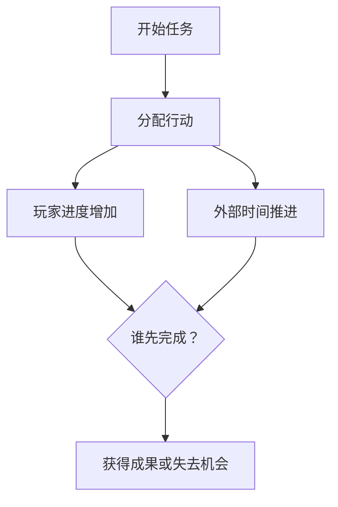

**Hidden Wreck** 是典型例子：玩家寻找残骸，而 Vesna 的队伍也在接近并争抢目标。

**主要心理问题**：还来不来得及？应不应该放弃额外目标，全力完成关键工作？

**与危险累积的区别**：外部时钟可以在玩家没有犯错的情况下推进；不行动也可能损失机会。

### 07. 危险累积（Escalating Risk / Danger Clock）

**结构**：玩家尝试推进目标，不利结果积累危险。

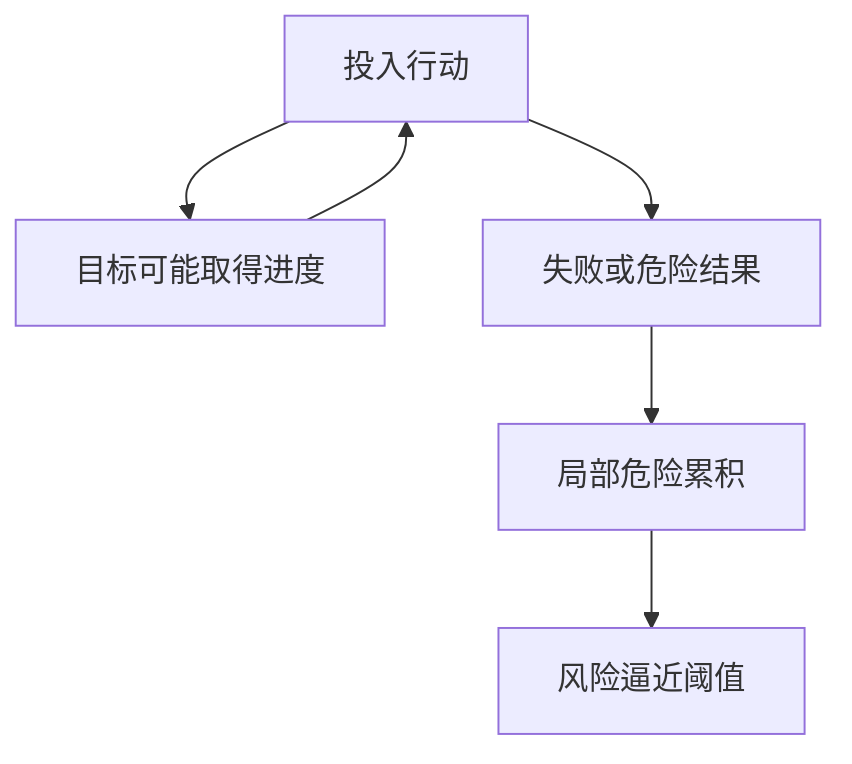

**Headstream** 的 Mutiny 情境中，推动行动与避免引起严重怀疑相互竞争，局部 Stress 会随不利结果增长。

**主要心理问题**：继续尝试高收益却有风险的动作，还是换安全方法？

**与时间赛跑的区别**：危险主要由玩家行为或其结果造成，而非单纯随外部时间前进。

### 08. 危机打断（Crisis Interruption / Complication）

**结构**：危险或情节条件达到阈值后，产生一个新问题，迫使玩家重新分配注意力。

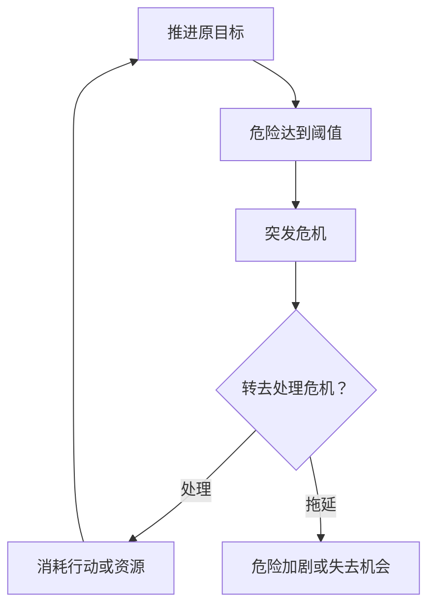

**Solheim HS22** 中合同 Stress 的阶段变化可以引出 Crisis；**Darkside Recon** 也有进入现场便存在的监视问题，不及时处理会不断施加压力。

**主要心理问题**：是先处理突然出现的麻烦，还是冒险继续完成原来的任务？

这一模式特别有价值，因为它不仅改变行动成功率或成本，**还改变玩家眼下需要解决的问题本身**。原本只是回收物品，突然要躲避追查或修复严重故障，于是原计划必须调整。

### 09. 目标意义反转（Goal Revaluation / Narrative Reversal）

**结构**：随着故事揭露新的事实，玩家需要重新判断原来的目标是否值得完成。

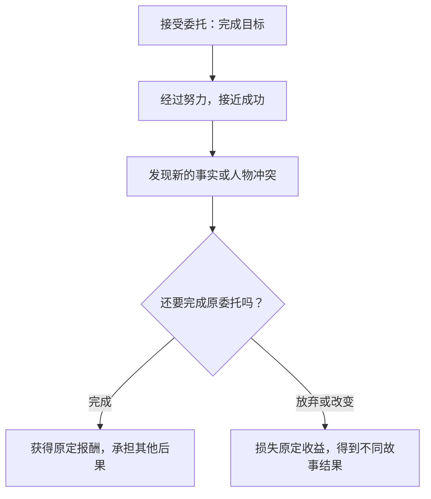

**Solheim HS22** 中，玩家回收 Data Core 后会面对 Juni 的另一种要求；支持她的选择可能意味着放弃最初约定的完成方式。**Debris Field** 也可用于观察委托目标与人物请求发生冲突时，玩家是否愿意继续执行合同。

**主要心理问题**：我还想不想完成这件事？为了谁完成？原来答应的报酬或承诺还重要吗？

它与其他八种模式有些不同：前面的结构多围绕**如何完成任务**，这里则将决策提升为**是否仍然认可任务目标**。

---

## 四、两种跨模式机制

它们可以叠加到上述多种Scenario结构上，但不宜简单地把它们当作新的目标拓扑。

### A. 资源衰竭与能力恶化（Attrition / Negative Feedback on Capability）

玩家在 Contract 中消耗补给、承受 Stress，骰子可能受损，队员能提供的行动也可能受到限制。Push 可以牺牲长期稳定性以换取眼前更好的行动机会。

其决策问题是：**现在再冒险一次，是否会损害下一轮完成任务的能力？**

这形成一种动态风险：状态越差，未来越难恢复局面；但及时退缩也可能错失目标。

### B. 事前准备与能力组合（Preparation / Crew Composition）

玩家进场前选择船员与补给；不同船员、技能和骰子会改变现场可用策略或成功成本。

它把一场Scenario分成两个时间尺度：

1. **事前**：我要带什么、准备什么、用什么办法切入？
2. **事中**：在已有条件下，怎样应对不断变化的局面？

这一点尤其适合 SSNoir：三天内的邮箱踩点属于事前准备，雨夜拦截则是现场兑现。

---

## 五、模式如何组合？

以上九种不是九套相互独立的小游戏。一个 Contract 可以包含两种替代路线、多个必需节点、局部危险、突然出现的危机，以及最后是否继续索取额外成果的选择。

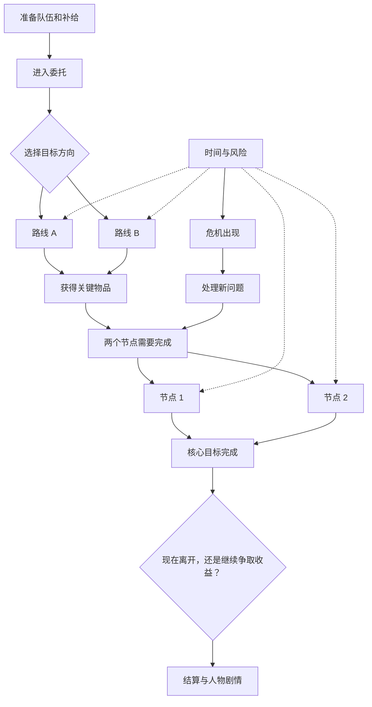

*以上是综合多种 Contract 归纳出的组合示例，不对应游戏中的单一具体委托。*

它包含：

- 替代路径（OR）；
- 必须完成的并行目标（AND）；
- 风险或时间压力；
- 危机打断；
- 见好就收与额外收益间的决策。

最关键的是：**骰子和基础行动机制没有明显膨胀，但因目标连接和局势变化的方式不同，玩家进行的思考发生了改变。**

---

## 六、内容拓扑、动态机制与决策结构究竟是什么关系？

| 研究对象 | 主要问题 | 英文术语 |
|---|---|---|
| 目标连接结构 | 哪些目标需要先做、后做、任选、同时完成？ | Objective Topology / Objective Graph |
| Scenario中的动态变化 | 行动如何改变进度、危险、资源和可选策略？ | Scenario Dynamics / State Transitions |
| 玩家的思考结构 | 玩家在权衡什么，为什么犹豫，何时改变计划？ | Decision Structure / Decision Architecture |

**目标拓扑并不等于完整的决策结构。**

例如玩家必须完成 A、B 两个目标：

- 没有时间限制：主要是行动顺序问题。
- 加入倒计时：变成效率与优先级问题。
- A 的失败使 B 更困难：变成风险管理问题。
- 中途突然出现 C：变成动态重规划问题。
- 发现 C 揭露了任务的道德代价：变成要不要继续原目标的问题。

目标图可以保持相同，玩家的思考结构却发生显著改变。

因此，评价 Scenario Pattern 时应当问：**玩家在这里反复进行的、有意义的决策究竟是什么？**

---

## 七、Scenario模式的统一描述格式

建议 SSNoir 的模式库把一个 Scenario Pattern 描述为五个要素：

| 维度 | 应回答的问题 |
|---|---|
| 目标结构（Objective Structure） | 玩家要完成什么？目标如何连接？ |
| 行动与资源（Actions & Resources） | 玩家有哪些具体行动？需要什么、消耗什么？ |
| 压力与变化（Pressure & Dynamics） | 哪些状态随行动或时间恶化？ |
| 局势转移（State Transitions） | 哪些成功、失败和事件会改变问题本身？ |
| 结果与后果（Outcomes & Consequences） | 获得什么成果？人物与世界发生什么变化？ |

可以增加一个用于评审的独立字段：

> **玩家核心思考（Core Player Decision）**：玩家究竟需要权衡什么？这种思考是否区别于已有模式？

例如：

- 只是把最高骰子投入收益最大的行动：实际策略较浅。
- 必须在进展和危险间权衡：出现风险管理。
- 突然出现危机，必须调整原计划：出现动态计划。
- 发现原目标本身可能有问题：出现价值判断与叙事抉择。

因此，**玩法上的实质性创新**不应只看内容、故事包装或目标图是否更复杂，而应看玩家实际重复进行的行动—决策—反馈—后果结构是否有意义地改变。

---

## 八、SSNoir 第一章的对应关系

| 第一章情境 | 建议组合 | 玩家核心思考 |
|---|---|---|
| 婚外情偷拍 | 单目标 + 时机窗口 + 暴露风险 | 什么时候拍？什么时候见好就收？ |
| 照相馆交涉 | 替代手段 + 危险升级 + 部分成果 | 用钱、证据还是施压？拿到多少信息就够？ |
| 雨夜追逐 | 与时间赛跑 + 连续障碍 | 怎样保持追踪？承担多大风险？ |
| 邮箱做局 | 事前准备 + 替代路径 + 危机转化 | 怎样利用位置和时机？失手后怎么办？ |
| 弗兰克Scenario | 危险累积 + 人物态度变化 | 怎样达到目的，同时避免激怒旧街？ |
| 莱恩Scenario | 阶段解锁 + 目标重新判断 | 是要求他停止、认错，还是寻找别的办法？ |
| 首演夜 | 并行目标 + 危机打断 + 有限时间 | 先处理什么？哪些后果只能接受？ |

这里的结构是 SSNoir 的**建议**，不是游戏既有内容已经实现的机制。

### 婚外情偷拍：低复杂度的 Contract

- **主目标**：拿到可交付委托人的照片。
- **压力**：目标逐步离开，尼尔可能暴露。
- **行动**：观察、改变位置、按下快门、提前撤离。
- **危机**：丈夫察觉有人跟踪，转而向尼尔走来。
- **抉择**：收起相机躲避、放弃好位置、冒险马上拍摄。
- **结果**：清晰证据、普通同框照、无效照片或被发现。

### 雨夜追逐：反应式、局势不断恶化

- **主目标**：辨认并跟住取信者。
- **压力**：距离被拉开、目标混入人群、转入岔路。
- **行动**：跟随、抄近路、维持视线、冒险加速。
- **危机**：目标突然拐弯或被障碍遮挡。
- **抉择**：冒险冲过去、绕路，还是保守地保持目标视线。
- **结果**：追踪证据、烟盒、交接地点或失去目标。

### 邮箱做局：事前计划改变现场初始局势

- **主目标**：让取信者难以逃脱。
- **准备**：侦察观察点、后巷出口与人流。
- **行动**：选择守候位置、确认目标、决定拦截时机。
- **危机**：认错人或过早暴露，目标开始逃跑。
- **状态转移**：预先拦截失败后转为普通追逐。
- **结果**：拦住跑腿人、跟踪到交接地点，或仅获得有限线索。

由此可见，**偷拍强调何时出手，追逐强调如何回应持续变化的障碍，做局强调怎样通过准备来控制初始局面。**

它们可以共享行动骰与风险／状态系统，而不必做成三个相互独立的小游戏。

---

## 九、面向后续机制研究的总结

建议把可持续扩展的研究对象命名为：

# Scenario Decision Patterns（Scenario决策模式）

使用三个主要分类轴：

1. **Objective Topology（目标拓扑）**：单目标、串行、并行、替代路径、可选目标。
2. **Pressure Dynamics（压力动态）**：时钟竞争、危险累积、危机打断、资源衰竭。
3. **Outcome Structure（结果结构）**：完整成功、部分成果、失败后的新局面、目标意义反转。

这三个轴可以自由组合。角色技能、行动骰、Push、Stress 等归入底层 Mechanics。

《Citizen Sleeper 2》的重要启发不在于它拥有许多独立的小游戏，而在于**用少量一致的系统，让不同的目标连接、压力变化及结果方式，形成不同的心理决策体验**。

对 SSNoir 来说，侦探Scenario的核心问题也不该只是「我能否把进度条填满」，还应该包括：

- 我目前知道什么？
- 我可以用什么方法达到目的？
- 新危险发生后，是否要改变计划？
- 我愿意承受哪一种代价？
- 最后，原先的目标是否真的是我想实现的？

**研究目标：不是收集十种小游戏，而是探索一套简单行动系统能够创造多少种真正不同的玩家思考体验。**

---

### 研究性质与使用限制

- 文中所列的九种模式、三条分类轴和 SSNoir 的应用示例均为设计研究归纳，不是《Citizen Sleeper 2》的官方模式表。
- Solheim HS22、Hidden Wreck、Shipmind Wreck、Stranded Rig、Darkside Recon、Headstream、Debris Field 等仅用于说明局部结构；不要把抽象流程图当作相应任务全部节点的精确复刻。
- 后续若用于具体规则实现，应重新核对相应委托的条件、失败结算、危机触发及可退出时机。
