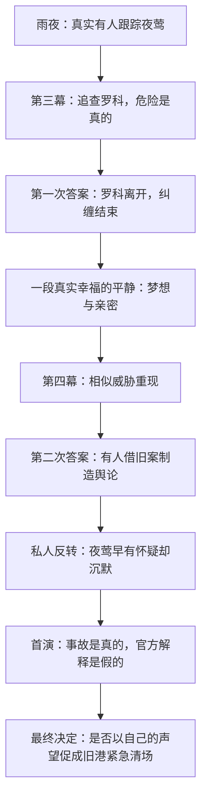

# 00｜第一章故事总纲与作者真相 V2.0

> **实验命题（已定方向）**：玩家走进一段故事、一座城市，随后在谋生过程中认识、喜欢、熟悉和依赖城市里的人。当你爱上的夜莺的成功与这些人的生活产生冲突时，玩家才必须决定自己愿意成为什么样的人。

## 1. 创作核心

这是一部以**在城市中生活与爱上一个人**为中心的黑色电影短篇，而不是政治案件的说明书。主线负责悬疑、爱情、危险与决定性的选择；城市负责让那份选择真正涉及值得怀念的人生。不要为突出主题而让所有人物成为同一案件中的证人或嫌疑人。

第一幕认识；第二幕熟悉并开始依赖；第三幕夜莺接近梦想、尼尔解决真实威胁且事业起色；第四幕已经结束的威胁被人“复活”，夜莺的成功被用来对付旧港；第五幕首演危险与真相的证言把尼尔送到关键抉择前。尾声回访这些人在原本生活地点的变化。

## 2. 五幕与核心戏剧瞬间

| 幕（日期仅原型参考） | 城市与人物 | 夜莺／尼尔主线 | **必须呈现的戏剧瞬间** |
| --- | --- | --- | --- |
| I《活下去》（约 D1–6） | 靠酒馆、码头、咖啡馆谋生；艾迪带尼尔工作；露西写小说的苗头 | 夜莺在酒馆唱歌；雨夜看到人影，她真的害怕 | 艾迪一边打趣一边帮工；雨夜在追踪与护送之间选择；夜莺酒馆告别演出 |
| II《这里有我的朋友》（约 D7–13） | 旧街/剧院开放；艾迪大船、讨薪；弗兰克的老船；露西的写作日常；汤米街头跑腿 | 大剧院彩排、侧门夜宵；经理给予尼尔一次真正调查工作的机会 | 玩家真的替夜莺登台高兴；艾迪靠手艺赢得尊重；初次被允许登上黑鸥号 |
| III《银色打火机》（约 D14–16） | 艾迪得到稳定岗位的希望；露西投稿；汤米衣着与地位变化；黑鸥号的人继续生活 | 尾随→追逐→与罗科对峙→罗科离开；夜莺与尼尔度过安静、幸福的一晚 | **一场可信的破案胜利，一段无需阴谋对白的亲密** |
| IV《归来的影子》（约 D17–19） | 露西取得第一笔稿酬；艾迪的岗位真正落实；弗兰克拒绝让旧船轻易消失；汤米逐渐进入地下圈子；仓区出现管制威胁和公听议程 | 相似威胁再次出现；假威胁的媒体宣传；经理收紧调查；夜莺承认曾知情却沉默 | 尼尔察觉自己的报告被借用；在熟悉旧港看到准备封闭的标记；夜莺与他吵架 |
| V《首演之夜》（约 D20–21） | 旧港是否被**紧急清场**仍未决定；黑鸥号与艾迪的岗位可能失去 | 真实舞台险情、尼尔救人；经理递来英雄证言；尼尔决定证言/证据的去向 | **帮了夜莺可能亲手促成旧港不可逆的失去**，拒绝谎言则可能失去恋人、工作和名誉 |
| 尾声（时间可拉开，不必硬限一天） | 旧港/剧院/咖啡馆/地下街区有人继续生活 | 尼尔与夜莺的关系如何延续，不保证复合 | 回到熟悉的椅子、码头工位、黑鸥号甲板或空荡的泊位，看到选择的真实代价 |

**时间不是历史模拟**：D 编号用于组织原型，不限定人物变化一定只需三周，容许跳接与几个有意义的阶段。不要用时间真实性推翻人物戏剧，但要保证玩家能理解先后与因果。

## 3. 作者真相（内部文档，玩家应逐步发现）

### 3.1 真实威胁

1. **雨夜人影**是罗科（暂名），夜莺旧演出代理人。曾帮她找第一批舞台机会，又靠不公平代理合同、旧材料与跟踪索取利益。夜莺的害怕是真的。罗科确实有过错，不能因后续案件另有黑手而无罪化。
2. **经理聘请尼尔调查**是真实委托，也夹杂功利。经理对尼尔的欣赏、薪酬承诺和工作机会是真实的；他想让首演顺利，也想掌控叙述。
3. **第三幕尼尔追出罗科**，通过证据、谈判或高风险Scenario使其停止纠缠。罗科确实离城，不在首演现身；未参与调查的玩家可以从其他渠道得知最低限度事实。第三幕的成功感必须真实。

### 3.2 假威胁与沉默

4. 经理与宣传亲信掌握罗科真正骚扰夜莺的安全档案；如尼尔提交过调查摘要，其详细笔录进一步提升伪造的逼真程度。经理授意炮制**新的**匿名威胁，将其包装成来自旧港的连续暴力，借媒体宣传夜莺“勇敢抵抗故乡阴影”。
5. **夜莺同意过将原本真实的骚扰经历用于宣传**，不是虚假新威胁的策划者或执笔人，也不知首演设备会出事故。她因事业、旧约与名声受到经理控制。新威胁出现后，她至少知道罗科已经走了，并掌握足以高度怀疑宣传造假的具体信号；她在看到某些人受牵连之后，仍请求“首演之后再说”。**她真实的过错是选择持续沉默**，不能反转成彻底无辜，也不能写成单纯冷血算计。
6. **剧院隐患真实存在**：吊挂/滑轮曾报修，因预算与档期被拖延，首演正常换景时引发实际危险。不是罗科回来、不是经理另雇刺客。经理却把事故解释成先前威胁的兑现，以逃避安全责任并巩固舆论。

### 3.3 旧港为何陷入决定性抉择【V2 核心修订】

7. **旧港改造一直是各方争执的问题，并非既定成功。** 公司已收购若干地块，但关键旧泊位、仓区的合法使用关系和听证程序尚未解决；弗兰克及其他人已通过租约、居民行动和实际经营延缓清场。旧港不必完美：环境陈旧、安全困难、有人希望获得新设施。
8. 夜莺受威胁的假新闻**为改造方制造“旧港严重治安危险”的公共证据链**。他们希望通过城市既有的特别安全处置程序，绕过缓慢的常规协商，将特定旧泊位/仓区提前收回、围封并开始不可逆拆除。这套程序是**架空城市内要先建立的故事制度**，不能无缘无故一纸签字拆整城。
9. 尼尔是**调查过真实旧案、又亲历首演险情的少数独立人士之一**。其有份量的证词，是特别清场案争取关键授权的最后证明环节；经理提供公开英雄身份和正式职业机会，要求他确认“连续旧港暴徒威胁导致首演险情”。他是否提供这份虚假佐证，以及他掌握的可公开反证，决定了**本轮紧急清场**能否获批，而不仅是清场早晚。
10. **第四幕可出现临时围挡、局部检查、停班传闻和准备通知**，让玩家看到危险在逼近；但**不可在尼尔抉择前已经无条件完成黑鸥号清退、艾迪岗位解约等核心不可逆后果**。第五幕以后随实际选择落实，形成真实的生活变化。
11. 赞同经理：旧港清场获得最后必要背书，**黑鸥号失去泊位、艾迪刚获得的稳定码头设备维护岗位失去基础**；尼尔与夜莺的公众形象可以获保护，但感情不保证美满。拒绝/公开证据：本轮特别清场失去所需证言或被证据阻断，旧港暂保；尼尔或夜莺失去名望、合约、部分生活与关系。普通改造争议仍可能在未来继续，不能让一场证词永远决定城市全部历史。
12. 本章**绝不强制二选一菜单**：保护生命与维护证言真伪不是互斥的；调查证据强度、对人物的了解和协商尝试影响可行手段。若要允许第三种部分双赢方式，应付出真实代价并经玩法验证；不能让一次高骰无成本化解一切。

### 3.4 人物独立于阴谋

13. **艾迪**不修剧院、不离城、不打拳、不投机、不依靠人脉钻营；他以技术、纪律、勤恳渐得稳定的码头设备维护工作，善良活泼且长期像哥哥一样照顾尼尔。工作受损不是他犯了错，也不是经理特意针对他。艾迪真实的生活不断向好，才让尼尔的背书具有伤害性。
14. **弗兰克**是退役老船长，守着破旧的**黑鸥号**。船是聚会、临时歇脚、储物与人际记忆的地点；他既偏袒熟人、脾气差，又在实际照顾这个地方的居民。清场可能抹去他的过去；他会主动争取法律与人情上的空间。
15. **露西**继续在咖啡馆工作，业余写小说。第一篇短篇得到一点稿酬，第二篇主角叫“尼尔”；视真实相识，尼尔落魄时可能从她那里得到咖啡、钱或临时栖身。她不需要转职办公室，不必与伪造纸条接通。
16. **汤米**是街头跑腿少年，聪明、贪慕权势，逐渐进入地下生意，通过一次不干净却果断的权力转折上升为小头目。是否与主阴谋产生联系，**目前不锁定**；不是反派线索工具。

## 4. 悬疑的三层真相与一段必要平静

**必须有的场景**：雨夜护送与反追；罗科旅馆尾随和货栈追逐/谈判；夜莺与尼尔无案情说明的私人幸福；经理撤回通行权后潜入查证；夜莺与尼尔的难堪争执；首演真正美丽的一段演唱；舞台险情；经理递上背书材料；回旧地点见到实际变化。

## 5. 黑色电影基调

- **具体的人物欲望**高于关于阶层、时代的长演讲；爱、野心、忠诚、虚荣、尊严、羞耻都有意义。
- **危险与平静对照**：雨夜人影、货栈追逐、办公室对峙、剧院潜入、首演失控；其间继续码头上工、喝咖啡、在船上打牌。
- **好人未必获胜，坏人未必受罚**：艾迪可能被毁去稳定工作，汤米可能确实混得不错，露西可能平静地发表小说，夜莺犯错却仍值得爱。
- **结局不是道德判分**：玩家可能因同情夜莺而付出旧港代价，也可能选择事实而失去共同未来；剧场与旧港都有值得争取的生活。

## 6. 创作严禁与待验证

**禁用的旧设定**：莱恩与三封信作为并存主线；艾迪拳赛、转行或被误认成剧院技术工；露西办公室试工为强制目标；D18 旧港就已经被不可逆清退；经理凭单人魔法控制全城市政；夜莺纯粹被胁迫或纯粹贪婪。

**需要验证的细节**：罗科合同和独特识别物，幕后宣传亲信的行为证据，架空紧急处置程序、黑鸥号泊位权属与艾迪岗位关系，露西投稿被采用的节奏，汤米权力转折方式，证据强弱对抉择结果的影响。**不得把这里的实施候选误写成已存在代码或已在仓库正典。**
