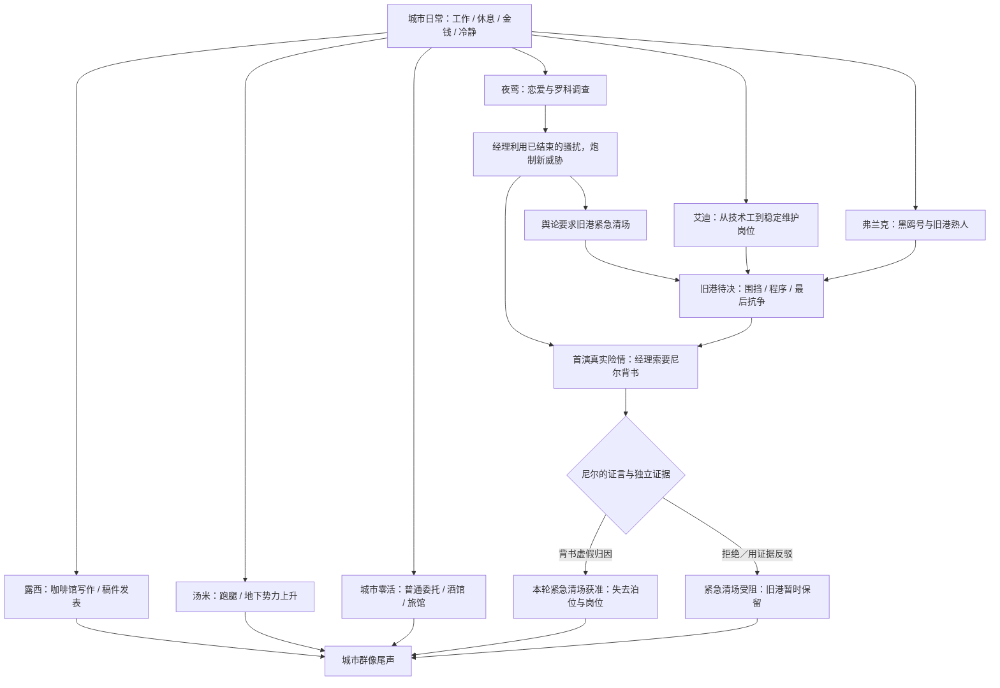
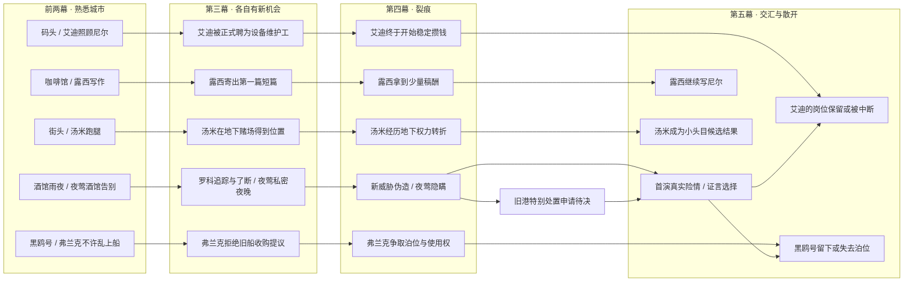

# 01｜内容网络与世界进程 V2.0

**目标**：供章节编排与场景实现：不是一根必须按序完成的“人物任务链”，而是同一座城市中可以相遇、错过、再相逢的生活网络。日期、行动骰子容量只用于检验，不把人生变化限制为某个精确日。

## 1. 三层内容及可玩时间

1. **基础生活层**：挣钱、恢复冷静/健康、吃喝、借宿、普通委托。这层始终有吸引力，是选择的代价与舞台。
2. **人物人生层**：艾迪渐得稳定技术岗位；露西第一篇小说发表；弗兰克守黑鸥号；汤米从跑腿混到小头目。NPC 不等尼尔触发才生活，玩家的参与主要改变共同经历、互相帮助与少量关键节点。
3. **夜莺爱情悬疑层**：真实人影→调查和了结→短暂幸福→伪威胁→隐瞒→首演与背书。它具有最大的戏剧权重，但不霸占所有日常行动。

**边界**：露西和汤米不需要为了帮助揭露经理而恰好接触证据；艾迪不必认识罗科或修过舞台；弗兰克不是侦探。他们的人生由自己推动，只在一两个符合逻辑的节点与主线交汇。

## 2. 五幕生活网络：每次升级的是行动的用途

| 阶段 | 已经熟悉的行动 | 新出现的地点/行动 | 人物独立发展 | 随主线变化的世界 |
| --- | --- | --- | --- | --- |
| I 相识 | 酒馆工作/喝酒、码头搬运、咖啡馆、休息与零碎委托 | 雨夜护送，能观察人影或陪她安全回家 | 艾迪接纳尼尔；露西写作的苗头；汤米为人跑腿 | 旧港看似正常；夜莺仍在酒馆唱歌 |
| II 熟悉 | 所有基础日常继续 | 黑鸥号船舱/牌桌/小工，剧院临工、旧街食堂 | 艾迪展示维修手艺，讨薪；弗兰克的旧船与脾气；露西准备/整理稿件；汤米接下第一份更体面的差事 | 夜莺进入大剧院；旧港改造方案作为远处背景出现，但仍有争议 |
| III 上升 | 码头、酒馆、咖啡馆继续可用 | 旅馆询问、货栈夜追、罗科Scenario、正式调查工作 | 艾迪开始获得稳定维护合同；露西投稿；弗兰克仍在打理旧船；汤米的新皮鞋 | 罗科离开，夜莺与尼尔获得一段平静 |
| IV 裂痕 | 大部分工作继续；部分泊位临时检查 | 档案取证、采访/消息交涉、帮助弗兰克准备听证与租约材料 | 艾迪拿到岗位并攒钱规划生活；露西收到一点稿费；弗兰克动员熟人保住泊位；汤米获得手下 | 媒体编造“旧港连续袭击”，特别处置申请正在等待关键证明；**没有提前执行不可逆清场** |
| V 抉择 | 可以在首演前恢复、挣钱、探访人 | 舞台安全处理、提交证据、拒签/背书/针对性协商 | 人物并非全部聚集剧院；他们继续为自己生活 | 尼尔的证言决定本轮紧急清场是否得到最后的关键支撑 |
| 尾声 | 熟悉地点回访 | 显示开放/关闭/迁移后的行动改变 | 人物独立结果与双方关系；可短时间跳跃 | 被清退的泊位可能再也回不去；保住也仍有未来矛盾 |

**地点演变示例**：`黑鸥号`最初是弗兰克不欢迎陌生人的私人空间，后来可喝酒/打牌/休息/帮小忙；清场成功后泊位关闭或船只移走，熟悉行动消失，不应只有一段结局文字。`码头设备维护`是艾迪努力得到的日常岗位，玩家可以看到他上岗、新靴子、储蓄计划，再经历岗位因临时清场而中断。

## 3. 并发故事内容图

> 注：第一版避免在同一时间强制完整参与五条人物线。人物主动生活；每幕通过若干短景、工作附带对白、场景物件交付变化。上图每一行是人生，不代表五条等长 Quest。

## 4. 世界事件／玩家注意力安排（原型顺序，非必须精确日历）

| 时间窗口 | 必要世界变化 W（无需行动观看消息） | 玩家可以主动投入的候选 S/C | 彼此竞争的关注 |
| --- | --- | --- | --- |
| 前两幕 | 夜莺告别酒馆，剧院开启；大船靠岸；旧港出现建设公告 | 艾迪劳动/讨薪，露西的笔记，弗兰克旧船，汤米帮跑腿 | 谋生、熟人、夜莺 |
| III-1 | 罗科仍在活动，经理正式雇尼尔 | 旅馆打听/夜追；与艾迪维修；露西的第一篇稿；船上工作 | 危险案子 vs 熟人生活和工资 |
| III-2 | 罗科离城，真实威胁解除 | 罗科证据结算；夜莺安静的私人夜晚；艾迪获稳定职位的庆祝 | 一次值得享受的幸福，并非所有人物都必须参加 |
| IV-1 | 新匿名威胁出现；媒体大肆宣传 | 剧院调查；弗兰克收购谈判；汤米赌场机会；露西稿酬消息 | 旧案为何重现 vs 正在进展的各自人生 |
| IV-2 | 清场特别听证/行动**拟议**，出现临时检查标线，但本轮最终批准仍有悬念 | 保留证据/了解听证；和艾迪工作/庆祝；陪弗兰克整理船上资料；露西庆祝稿费 | 不知不觉逼近失去的幸福 |
| V-前夜 | 首演将至；经理寻找能背书的调查者 | 舞台安全/事实证据/具体熟人帮助，选择性投入 | 想救谁、想保住什么 |
| V-首演 | 真机械险情；经理请求为连续旧港袭击定性 | 现场保护与证据答复 | 先保护生命，随后承担证言后果 |
| 尾声 | 根据证言执行／搁置清场，报道变化 | 回访码头/黑鸥号/咖啡馆/剧院与熟人 | 亲自感受曾经生活空间的变化 |

**第四幕关键校准**：应让玩家在背书前**明确知道**清场意味着黑鸥号及艾迪的维护岗位失去根基；但不能先发生不可逆清场。公告、围挡、听证与仓区短期检查足以形成威胁。清场被否也不能把改造事业彻底抹除。

## 5. 人物缺席仍推进：优先设计基线生活，不立刻分叉所有人生

| 人物 | 玩家完全不主动参加该线 | 曾主动认识/参与 | 暂不在 V2 强行承诺 |
| --- | --- | --- | --- |
| 艾迪 | 凭能力得到维护职位，对尼尔不表现未发生的深厚友谊；清场仍伤及其岗位 | 日常劳动与庆祝的共同经历使玩家亲眼看见他的幸福；尾声有私人互动 | 玩家帮助一次就让公司保证永久安置、或改变艾迪人格 |
| 弗兰克 | 自己抗争、协商泊位；尼尔能从公告知道黑鸥号的处境 | 可进入旧船、听老事、帮打理与查文书；结局熟悉空间改变 | 单次任务无成本保住船的永久权利 |
| 露西 | 自己写作、投稿并有第一笔稿酬；继续在咖啡馆工作 | 她让尼尔阅读小说，落魄时有可能借宿/借一点钱；写“尼尔”的小说的私人版本更有意义 | 玩家不帮助就不许她发表，或需要完整文学技能树 |
| 汤米 | 他凭自身手腕经历权力变化，可能在尾声成一名小头目 | 尼尔可以在不同阶段见证、得到信息/微小帮助；汤米认识程度改变回访 | 一开始就与经理主阴谋绑定，或靠“汤米好感度”操控帮派 |
| 夜莺 | 她仍排练、登台、面对过错；尼尔可从公开事件了解关键矛盾 | 有真正私密经历，对质/结尾带来更强私人代价 | 未谈恋爱就不准做证人或拯救首演 |

## 6. 共同生活节点（工作也是人物故事）

- **码头修机器**：艾迪能展示本事、幽默、劳动尊严。随着工龄与表现获维护岗位；玩家可以和他一起完成工作，也能看见他独自解决麻烦。
- **黑鸥号**：先是陌生人的甲板禁区，后来允许坐、吃、玩牌、整理工具。黑鸥号的熟悉感由可实际再次进入构成，不能只靠“保护旧港”的台词。
- **咖啡馆**：露西一边工作一边观察客人、在收据背面写稿；投稿/稿酬/新小说改变闲聊与可见物件，持续可赚钱恢复。
- **街头酒馆与跑腿**：汤米衣着、坐的位置、跟班者与说话方式逐渐变化，展示向上爬；不要求四次任务才看到他长大。
- **剧院**：夜莺的纯粹表演与经理给尼尔的职业机会必须先足够迷人，最终失去它们才会疼。

## 7. 内容容量与“注意力竞争”验收

- 行动骰子、钱、冷静/健康沿用现有循环；人物短景优先附着工作结果或在地点触发，不把五个人人生压成五条 0/8 Clock。
- 一次游玩应该**无法毫无成本地参与每一场有分量的机会**，但应能获得每个人最基本的人生变化信息，并留有足够维持生计的空间。
- 在第三／第四幕制造至少两天“两个都很想参加但只能先顾其一”的日常选择：夜莺调查 vs 艾迪维护/庆祝；查内部稿件 vs 露西第一次发表、弗兰克整理船上材料。
- **错过≠失败**：玩家可能通过旁人得知“露西发表了”“艾迪得了岗位”“汤米混出了名头”，这些发展不会因缺乏关注停摆。
- 真正的后果在**行动集合**中体现：旧港清场后部分码头/黑鸥号活动消失或迁移；选择反驳后剧院职位与进入权限可能被剥夺。不能只弹结局文字。
