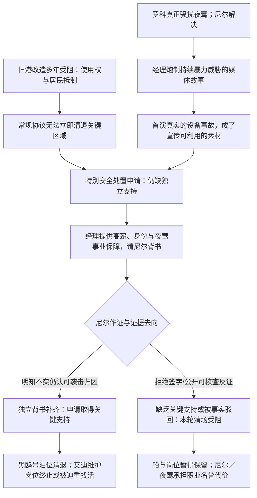

# 05｜最终抉择与世界后果 V2.0

**本文件是 V1→V2 的因果修正核心。** 玩家必须在做决定时，已经通过自己的生活知道两个世界各自值得珍惜什么。不能由旁白在签字后突然宣布艾迪失业、弗兰克丢船。

## 1. 冲突不该是“改造速度”，而是“是否允许本轮不可逆紧急清场”

### 旧港的既有处境

- 改造公司／赞助方希望更新旧港，但关键区域的正常收购、租约与港务使用许可存在争执；黑鸥号有实际泊位使用关系，艾迪的设备维护岗位依赖这些旧港资产继续运转。
- 有些人希望更新设备、有更好港口；有些人不能或不愿离开。弗兰克正通过旧租约、会面与熟人网络争取保留生活空间。
- **因此，常规改造不能立即、无条件合法清退全部区域**。过去不是“所有人都知道早晚要拆且已经批准”。

### 经理/公司想得到什么

- 利用第一次罗科真实威胁和第二次假纸条，在公众中制造“旧港暴徒持续攻击歌手”的叙述。
- 首演真实的机械事故发生后，他们准备把它解释成这场袭击的延续，同时避开剧院安全责任。
- 他们已安排一场市政层面的**临时特别安全处置**申请（架空城市的制度候选）：在已经存在连续严重暴力威胁且公共安全迫切时，可以暂时跳过部分冗长协商，强制收回特定旧港泊位/仓区、清退人员并开始拆改。
- 该程序需要多方支持，包括足够可信的独立调查/亲历证词。**经理控制新闻、公关、部分关系，却独缺可以站得住脚的外部见证**。尼尔刚好调查过罗科旧案，又是首演实际险情的目击救援者；他的有名有姓的证言正是所缺环节。

### 为什么恰好是尼尔

- 他**确实查过罗科**，并非路过任意陌生人；他能够证明早先真威胁的确存在。
- 他在首演现场**确实救过人/目击危险**，媒体能把他包装成“坚持保护歌星的年轻调查者”。
- 经理在第四幕已有意培养并宣传他的身份；最终提出的是能改变前途的真实报酬与工作，并非临时用一张纸魔法控制市政。
- **程序性决定与公众支持**在此前两幕、第四幕应有公告/新闻/人员铺垫。玩家必须知道：经理需要把尼尔的两次真实经历伪造成“旧港暴徒连续袭击导致事故”的连贯证据。

## 2. 因果图

**边界与诚实性**：这是架空制度上的**剧作模型**，不是现实法制介绍。实施时必须在第四幕预先解释得足够具体，测试玩家是否理解其真实性；不能让一场私人演出事故凭空变成城市所有产权的自动转移。

## 3. 场景上的三个不可缺少的实物／位置

1. **报纸上的旧港袭击故事**：夜莺宣传照配合“勇敢离开旧港阴影”的词句，玩家在知道罗科已经走后读到新的威胁。
2. **一张港务临时听证/特别清场预告**：写明具体涉及哪个旧仓区与黑鸥号泊位、如果通过从何时清退；艾迪维护岗位的机器在范围内。玩家在结局前就可读到，不能后验追加惩罚。
3. **经理递出的证言文件**：一面是现实回报（报酬、工作、调查英雄的公开认可、夜莺事业不被质疑），另一面是写明“持续旧港袭击造成首演事故”的不真实结论及其在听证中的用途。

### 既要让玩家不舍，也要让他们知道旧港并不完美

- **艾迪**：他买了新工作靴、获得维护岗位、兴高采烈计划将来买车；他并不关心政治，却十分依赖这个技术工作。
- **弗兰克**：黑鸥号可以坐、打牌、吃饭、帮忙，老人会无礼但也会给熟人留椅子；船不是纯象征，是常用生活地点。
- **夜莺**：舞台上的美丽演唱、与尼尔真实亲密、经理之前对她的帮助要让人珍惜；拒签确实可能使她此前的沉默受到公众追问。
- **剧院与更新的一面**：设施需要维修、旧港确有问题，部分居民盼望新工作机会；揭露谎言不等于整个改造理念必然错误。

## 4. 最终行动与结果矩阵【实施候选／需试玩校准】

| 玩家具体行为 | 证据要求 | 本轮紧急清场 | 对尼尔、夜莺 | 对旧港具体人物 |
| --- | --- | --- | --- | --- |
| **接受经理的不实袭击结案，并以调查者身份背书** | 不需要真实证据；需要玩家明确知道其不可靠 | **取得关键支持，获准** | 尼尔获得职位／声誉；夜莺的首演叙述获保护，但她是否爱他不保证 | 黑鸥号泊位清退，艾迪失去旧设备维护岗位，旧港部分工作和聚会地点被夺去 |
| **拒绝背书，只说明亲眼所见或保持沉默** | 人人可行，不自动掌握造假内情 | **本轮缺乏关键第三方支持，延期或受阻**；在无反证时未来仍可能重来 | 经理可能撤回工作、夜莺也受到报道的余波；不必自动曝光她的每一项隐瞒 | 黑鸥号和维护岗位在这一轮暂时保留，仍有长期不确定性 |
| **提供足够独立证据反驳经理的归因** | 至少有互相印证的档案/时序/目击者；证据标准待测 | **本轮特别清场论证遭驳回** | 尼尔可能获得事实上的可信度，却失去经理的工作与关系；夜莺知情沉默会引起追问，后果更公开 | 旧港免受此轮紧急清场；并不因此永久免于未来改造 |
| **只求针对某些人的私下补偿／不完整陈述** | 知道具体利益和对象，通常需经理愿意交换 | 取决于实际是否提供关键假证；不可“既完整背书又无条件阻止清场” | 可能暂保夜莺名声、部分收入或个人关系，也可能失去公众信任 | 少数岗位/物品可能获得补偿，**不能自动保住整座旧港** |

**事实与选择区分**：玩家可以先保护夜莺、救助观众，然后仍然反对错误归因。玩家可以爱夜莺且公开事实，也可拒签却不公开她的全部私人过往。这些应随真正的证据与关系呈现，而不是“爱/不爱”二值选项。

## 5. 结局不能成为一组静态卡片

### 背书后的可玩变化

- 旧港某些熟悉的工作点无法再继续；玩家回到原码头，岗位牌被撤下，艾迪收拾自己的工具，他仍幽默却真实面临找活困难。
- 黑鸥号原泊位围栏封闭，弗兰克正在收拾箱子，最后留下/拿走一枚旧船铃铛。玩家可能已无法坐回曾经的椅子。
- 剧院允许尼尔继续出入，经理公开称他英雄；这些“奖励”因熟悉空间的丧失变得不安。

### 阻止或反驳后的可玩变化

- 黑鸥号可登船，弗兰克仍然骂人、煮难喝的东西、在甲板修理，泊位未被特别收回；艾迪维护工作继续。
- 经理撤销尼尔的调查工作／特殊后台通行；剧院里夜莺的前途受到新的公共质疑。具体后果依据公开了多少材料、夜莺自己怎么应对细化。
- 旧港没有凭此永久击败所有改造压力。它只是保住了**今天和眼前那场不可逆的清场**。

## 6. “决定性”与人物自由不能互相取消

- “尼尔的证言是本轮关键”并不意味着“艾迪的整个人生只有尼尔才能拯救”。艾迪仍工作、继续找活、关心朋友；弗兰克仍尝试保船，即使他们会因外部大事遭受损失。
- 如果测试发现仅凭缺席调查的尼尔说“不签”就拥有过强魔法，应该在第四幕补足程序、经理对证人身份的经营、其他支持缺失的理由，**而不是偷偷把尼尔的选择改回只有一点作用**。
- 如果测试发现充分调查后总能既不伤夜莺又完全阻止清场、自己还保住经理工作，则设计过于无成本；应通过时间、证据、公开性与人的自主回应保持真实选择。

## 7. 决定性测试：玩家是否清楚自己在做什么

- [ ] 在首演之前明确出现特别清场申请和具体涉及的旧船泊位、码头岗位。
- [ ] 玩家亲眼见过艾迪的稳定工作与小小喜悦，至少可公开知晓而不必完成任务。
- [ ] 玩家若经常上黑鸥号，其行动体验与船被清退后有直观差异。
- [ ] 尼尔知道罗科是旧案、新威胁另有伪造疑点、吊挂事故不能自动归因于旧港暴徒。
- [ ] 经理提出的名誉与报酬足够具体，玩家想要，却知道背书的事实并不可靠。
- [ ] 不同证据强度和陈述方式产生不同公开后果，而非只换道德台词。
- [ ] 艾迪/弗兰克没有在玩家作最终选择之前就被不可逆清退。
- [ ] 选择后的地点开放、工作节点、人物位置和对白确实发生变化。
