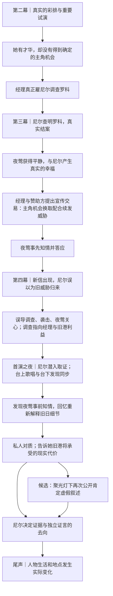

# SSNoir｜第一章悬疑主线 V4：夜莺的舞台与首演反转

> **设计记录｜2026-10-29｜用于长期保存与后续开发**  
> **性质：**已认可的故事方向与仍需验证的实施候选，**不是最终剧本、具体台词或已实现机制**。  
> **承接：**《00｜故事总纲与作者真相 V2.0》《01｜内容网络与世界进程 V2.0》《02｜人物故事线与场景卡 V2.0》及《银色打火机至首演之夜：悬疑主线设计 V3》。  
> **版本关系：**本稿优先覆盖 V3 关于「夜莺在第四幕被揭穿」「首演后她直接公开说谎」「她同意造假的动机较抽象」等设计；未涉及的城市生活、罗科真实结案、人物独立人生原则继续保留。本文不是对既有仓库脚本或其他文件的实际修改。

## 一、核心设想

这是一段**真正的侦探调查和爱情反转同时抵达高潮**的黑色电影故事。

夜莺是一位**确实有才华**的年轻歌手。她即将获得大剧院的机会，却在一次关键试演中碰壁：赞助人或选角方并不否定她的声音，只是不相信她能成为吸引观众与资金的主角。她可能只得到小角色、候补位置，或一句始终不确定的承诺。她受到委屈、愤怒、难堪，仍渴望登上大舞台。经理也真的欣赏她，却知道光凭才华不足以说服投资人。

在第三幕，尼尔受经理正式委托，追查确实骚扰夜莺的旧代理人罗科。尼尔真正解决这一威胁，罗科离城。夜莺的放松、与尼尔的幸福、尼尔第一次办成案子的成就都是真的。

正是这桩**已经结束的真实案件**，使经理与剧院赞助方看到一个新的宣传机会：把夜莺包装为摆脱旧港阴影、仍遭暴力威胁却坚持演出的歌手。经理提供她梦寐以求的**首演主角位置及后续事业机会**，条件是她配合一段人为安排的「威胁仍在继续」的宣传。

夜莺**事先知道新威胁是假的，并同意配合**。她不是制造者，不知道尼尔会被殴打，也未必知道最初全部的旧港清场计划；但她有选择的可能，仍然接受交易，并在尼尔重新追查时继续隐瞒。

第四幕，尼尔追着新勒索信、疑似罗科的身影、货栈、旧旅馆等线索调查。他遇到误导、碰壁、威胁甚至真实的殴打。夜莺照顾他，玩家仍有理由相信她只是受经理利用。**第四幕可逐渐揭开经理与宣传方伪造新威胁，以及旧港清场的利益关系，但不揭露夜莺事前知情。**

第五幕首演期间，夜莺在舞台上唱歌；尼尔趁剧院忙于演出，潜入档案区域寻找能揭露经理造假的最终材料。却在其中发现两项互相印证的证据，证明夜莺**在所谓的新威胁出现之前，就参与过这项安排**。一段短暂回忆让此前的试演、彩排、她收起文件及受伤后的关心产生新的意义。尼尔抬头，歌声仍在继续。这是本章最重要的**悬疑与情感共同高潮**。

演唱之后，尼尔与夜莺私下面对事实。他告诉她，虚假威胁已不止是明星宣传：旧港的黑鸥号、艾迪刚得到的稳定工作，都可能为此付出真实代价。夜莺有自己的委屈、野心、恐惧与自我辩解，不应只是被写成纯粹坏人。是否还需要她在记者和聚光灯前明知后果仍公开坚持不实叙述，作为第二次行动层面的背叛，留作剧本与演出验证时的**重要候选**。

尼尔最后决定如何使用证据、回应她，并面对自己可能失去的关系、工作机会和旧港的命运。

**核心句：**

> 她的才华是真的，她受到的委屈是真的，她终于登上舞台的快乐是真的；她为获得舞台同意的谎言，也是真的。

## 二、五幕中的关键时间顺序（拟定）

**时间约束：**夜莺同意「伪造第二次威胁」必须在罗科**确实结案之后**、假威胁**正式出现之前**。第二幕彩排出现的普通宣传文件只是人物与动作伏笔，**不能写成她在第二幕就知道还不存在的后续伪造计划**。

## 三、人物动机与戏剧责任

### 夜莺：值得实现的梦想与错误的交易

- **她确实有才华。** 不要为了证明炒作有作用，把她写成其实唱得很差的人。玩家必须能欣赏她的歌声与舞台魅力。
- **市场选角与才能不是一回事。** 赞助人可以承认她唱得好，却因为名气、票房、风险和可出售的故事，不愿意给她主角位置。她的困境应可感、具体，甚至可以有一点残酷。
- **她会有强烈的情绪。** 试演失利时，她可能委屈、羞辱、愤怒、自尊受伤，甚至夸大自己遭受的不公平；回忆罗科如何威胁她时，她也可能有恐惧、厌恶和愤恨。**不要把她的角色写成冷静地叙述职业困境、只会说抽象道理的人。**
- **她不是没有其他道路。** 拒绝交易，可能意味着次要角色、继续酒馆演唱、再等待下一次试演、失去部分事业支持；但不能等于必然生存毁灭。保留拒绝的可能，人物才拥有选择与责任。
- **她并非一开始想伤害尼尔或旧港。** 同意假威胁时，她可能低估为宣传增加一封假信的代价。之后尼尔追查并受伤，她的爱与照顾是真的；但她始终知道能够阻止他继续追逐一个不存在的威胁的关键信息。
- **后来的责任要递增。** 从事前知情并同意 → 看到尼尔追查而不说 → 他受伤后仍隐瞒 → 知道旧港生活受到威胁后如何选择。不能将所有责任简化为「经理逼她签字」，也不能突然赋予她谋害尼尔的意图。

### 经理：既欣赏艺术，又善于经营人和故事

- 他真心相信夜莺值得登台，也真的愿意聘请和支付尼尔。但他认为才华要配合一个能够出售的公众故事。
- **商业上的表层利益**：新信与骚扰新闻可使夜莺依赖剧院安全安排、接受更紧的经纪条件；首演获得话题，经理掌握明星形象。玩家在第四幕怀疑他借威胁榨取夜莺，是一个**合理但不完整的解释**。
- **更深一层的利益**：旧港改造投资方也是剧院重要赞助者，或与新演出季利益绑定；它需要塑造「旧港持续不安全」的公众印象，以支持已有争议的特别安全处置程序。经理通过合作得到资金、扩建或演出资源；具体报酬形式待选定为**一个足够可信的主要利益**，不宜万能控制整座城。
- 罗科不是经理预先布置的人。经理是发现真实旧案的宣传价值以后，才决定制造假的延续。

### 罗科：真正结案、并不背锅的新威胁

- 旧代理人确实曾帮助夜莺，又利用旧合同、索款与跟踪控制她。
- 尼尔第三幕的调查与结案必须有可靠记录：结算／停止纠缠／离城。不能到第四幕才说原来罗科没走。
- 第四幕伪造的信、照片与目击利用的只是罗科案已经形成的恐惧和记忆，不是由罗科本人持续发动。

### 尼尔：从破案成功到自我信誉被利用

- 第三幕真正办成一件事情，获得经理、夜莺和自己的认可。
- 第四幕他有合理理由相信旧威胁可能以另一种方式延续，追查与受伤不能显得蠢或全靠作者捉弄。
- 首演期间，他一面知道经理可能造假，一面仍相信夜莺主要是被利用的人；发现夜莺知情后，过去的亲密才发生刺痛的重新解释。
- 最终选择不仅是保住／失去爱情，而是**用自己努力获得的独立调查信誉，为事实负责，还是继续维持让自己和所爱之人受益的故事**。

## 四、第二幕试演：把夜莺的委屈写到玩家心里

**推荐：保留已经存在的五回合彩排 Contract，不把它改成一次「演唱失败」的判定。** 彩排可以让玩家真实帮助舞台准备、欣赏夜莺；之后另有一场规模很短的赞助人／选角试演，或彩排后半的一次评审谈话。

试演可采用下列三个**尚未锁定**的具体结果之一：

1. 赞助人认可声音，却仅愿提供**很小的角色或替补位置**。
2. 经理曾暗示她有望成为主角，但评审最后只说**尚未决定**，更倾向一位已有名气的歌手。
3. 她在评审时确实因为紧张、舞台经验不足或被不公平对待而失常，却在尼尔和正常彩排时表现出真实实力；**一次失常不是缺乏才华**。

共同的目标：让玩家觉得**她本来有资格获得机会，却被商业判断、名气门槛或不够公正的选拔挡住**。她可以觉得委屈、愤怒，抱怨不被理解；可以向尼尔诉说自己付出了什么，甚至让他觉得这些人辜负了她。不要把她写成旁观者用理性论文解释「商业价值和才华的区别」。

**表演要求而非定稿对白：**她可能先强撑体面，待赞助人离开后情绪才显露；也可能在尼尔面前强烈诉苦，反复强调这次机会多难得。我们需要将来通过人物写作反复打磨，**本稿不锁定具体台词**。经理的欣赏与赞助人态度也不必完全一致。

**伏笔边界：**彩排中可以让她自然地修改普通宣传校样、处理经理递来的文件。这在当时只是职业生活的一部分。第五幕的回忆可以重现这套动作和她对机会的渴望；**真正证明她知道假信的证据必须出现在后来的交易阶段**。

## 五、三项必须成立的事实

### 事实 A｜经理为什么制造假的新威胁

**可接受的完整因果：**真实罗科案提供可信素材 → 经理发现夜莺的受害经历可形成明星故事 → 赞助者愿为有话题的主演提供资源 → 新假威胁延长媒体关注与剧院控制力 → 改造方借此引导「旧港持续危险」的公共叙述 → 推动争议中的特别处置程序。

- **新信表面**仍可索要钱、提及旧货栈或码头，使用恶毒的私人威胁，**不能一上来就是改造政治宣言**。
- 玩家先猜罗科归来，再觉得经理通过炒作控制夜莺、获得更多商业收益；这个解释在一定程度上应当属实。
- 旧港危机通过新闻、工人辩解、弗兰克行动、临时围挡和处置申请**逐渐显现**，而不是最终突然宣布港口要被拆。
- 一封新勒索信不能在法律上直接证明旧港团体实施袭击。宣传方还必须组织具有来源、时间和传播渠道的「证据链」；官方特别处置程序及尼尔证言的有限关键作用，仍需明确建构。

### 事实 B｜夜莺到底同意了什么

**推荐明确：**在罗科结案后，经理向她提出以「续发威胁」为核心的宣传安排。她知道**未来将有一封并非外人发出的新匿名威胁**，知道新闻将把它当成真实发生的事；她同意配合，并确认具体投递或采访安排。与之挂钩的是首演主演位置及后续支持。

- 不要求她写假信、亲自雇打手或了解整个改造项目。
- 她可以合理化：罗科真的做过坏事，自己真正受过害，只是「再多一封信」而已。
- 对尼尔的袭击是事情后来的升级；她不知道或未授权。她受伤后的关心不能被揭示成纯粹表演。
- 她何时认识到**旧港实际损失**必须独立交代：最晚在尼尔首演后对质时明确知道。之后若再公开重复谎言，其道德重量要不同于最初配合宣传。
- 她可以后悔、害怕，甚至想过退出，但不应被写成完全没有选择的傀儡。

### 事实 C｜为什么首演期间才能找到足够的证据

**可接受的行动理由：**第四幕尼尔已追到经理／宣传方，剧院因此撤回其调查通行权；他取得了一些证明「新威胁有内部制造痕迹」的线索，但缺少能够公开使用的**原始制作和确认记录**。首演之后一批演出季宣传材料即将封存或转交承包方。首演期间主要工作人员忙于演出，是他进入存档或账务区域的高机会窗口。

- 不是「经理刚好把所有罪证放在最容易偷的抽屉」。要给档案保留以正常业务理由：核算宣传开支、保留发布版本、审计物料、与承包方结算。
- 首演期间的潜入应有真实的被发现风险和时间安排，可制作小型或中型 Scenario，但**不要让一个高骰决定玩家能否获知整章最重要的真相**；失败改变取证代价、质量或可公开范围。
- 提醒时间线：尼尔第四幕可以已经掌握经理造假的强烈证据，**却还没有理由怀疑夜莺事前参与**。两个真相应在戏剧上错开。

## 六、第四幕侦探过程：可信的误导，逐步靠近真相

玩家最初看到带有勒索钱财与人身威胁的新匿名信。由于旧案刚刚解决，自然猜想罗科复归或有同伙。随后旅馆目击、类似打火机的反光、货栈搬运、临时摄影、报纸照片等，构成一系列部分真实、部分编造、部分误认的线索。尼尔连续碰壁：证人不在、线索中断、编辑拒绝透露供稿者；并可能因接近宣传安排遭到真实袭击。夜莺照料受伤的他，玩家的信任与感情进一步增加。

**候选关键反转场景——从对街窗口看见摆拍：**此前报纸照片的拍摄角度有一个普通解释；尼尔后来站到旧旅馆对面的窗口，从新的空间角度发现有人在组织类似「罗科现身」的照片。这里应是**新的摆拍行为或可复核的真实安排**，不宜无解释地让人重拍多日前的同一张照片。这个画面可让玩家突然意识到自己追逐的是人为制造的影像。

调查随后逐渐指向经理与宣传承包方：印刷日期提前、安排投递的工作单、支付摄影费用、宣传稿件的异常时间顺序等。玩家暂时认为经理是为了控制歌手和商业收益，随后发现旧港特别清场申请正在引用所谓「连续威胁」，动机才扩大到改造方合作。

**悬疑保留：**第四幕可以让玩家知道或高度确定经理造假，甚至取得相当完整的宣传链条，却不要让一份普通宣传稿过早指明夜莺知情。让玩家一直认为：她最多是经理操纵的对象。

**公平性与玩法边界：**每个重要发现都要能回头核实。隐藏的是事实，不是当前行动的风险和收益；可失败的 Scenario 不应让主线因错过一次线索完全停摆。调查能产生真实损耗和不同的证据质量，而非多次空跑 Clock。

## 七、第五幕高潮：一首歌与一个真相

**戏剧设计：**让玩家先看见夜莺真正的表演。她的歌声、舞台动作、掌声与灯光必须足够好，值得玩家回忆；随后舞台继续演出，尼尔利用时间窗口离开观众席，潜入剧院的档案区域。**歌曲与取证在时间上交织**，而不是在精彩演出之后再额外附加一场独立机械事故。

潜入时，尼尔寻找的是经理与宣传方制造威胁的原始证据。找到安排与结算记录后，他意外看见了**夜莺在新威胁出现之前的参与痕迹**。

**双重证据要求（候选方案）：**

1. **原始工作计划**：列出假威胁准备、投递和新闻发布时间，并写明夜莺有过确认或对其中的安排提出修改，例如要求错开某天彩排，证明她所见不只是普通演出新闻。
2. **独立时间与身份佐证**：同一版本的送签登记、工作人员留档记录、日期可信的往来副本或适合时代的试录音，证明她在信件送达之前就看到并认可了此计划。不要只靠一处孤零零的签名，或无法解释存在原因的「全员认罪录音」。

**反转需要证明的事实很具体：**她不是在新闻出现后听说「有人威胁」；她**事前知道所谓新威胁将被内部安排出来**。证据不必证明她知道旧港改造方的每一项计划，更不能无根据地把袭击尼尔归给她。

随即是一个极短的**记忆重新拼接**：第二幕试演的委屈、普通彩排里她处理文件的动作、第四幕她收起稿纸、尼尔受伤时她真实的关心。过去这些场景原本都合理；现在才有第二层含义。**回忆不是凭空补播从未发生的关键信息，而是重新显示玩家经历过的片段。**

尼尔回到现实，远处舞台上的夜莺还在歌唱。她仍然那么漂亮、那么有才华；尼尔却刚刚知道，她为了这座舞台选择了什么。**本段优先追求歌声、画面、发现与短回忆的结合，而非长篇自白。**

### 首演之后的情感与终局

演出后，尼尔与夜莺私下对质。他可以首先问她何时知道、为什么瞒着自己、是否知道他差点为一个不存在的追踪者受伤。夜莺应当表现出真实复杂的情绪：未必立刻认错，可能委屈、害怕、愤怒、被误解的感觉、对自己失去机会的恐惧、对尼尔的歉疚同时存在。

**不要现在锁定台词。** 此刻的重点不是让她说出一篇完整、逻辑漂亮的辩护词。她甚至可能以自我辩解、转移指责、短暂沉默和情绪爆发，呈现自己无法面对现实的一面。随后，尼尔要明确告诉她这件事对旧港与具体朋友意味着什么。

**重要候选：公开的第二次选择。** 如果第一次真相揭露与对质仍不足以产生「明知他人后果却继续」的重量，可以让首演后紧接的记者答问或公开声明成为第二次高潮：她明白了旧港将受损，仍公开确认「旧港持续威胁」的虚假说法。此处不应是经理代答或单纯沉默，而是她自己采取的一次行为。**是否保留，要通过完整剧本与实际演出节奏决定；不要求机械地追加。**

**尼尔的最后选择：**如何使用证据与独立证言；是否继续取得足以公开证明整条造假链的材料；是否承担职业、感情上的代价来阻断本轮紧急清场。不是简单地「好结局＝她无辜」；即使玩家维护她，也不能抹去她确实同意过伪造的事实。

## 八、保留的城市、人物与终局边界

- **艾迪**：靠劳动和手艺取得稳定旧港设备维护岗位，新靴子、工资与未来计划应当在失去的威胁前可见。他不为了主线调查转职或恰好拿到经理证据。
- **弗兰克与黑鸥号**：旧船的日常生活与泊位争议先于最终风波而存在。普通协商仍在进行，紧急清场才是需要阻止的额外例外程序。
- **露西、汤米**：继续独立生活，不被强制变成揭露宣传造假的工具。
- **旧港**：媒体与伪证推动风险，但最终清场的法定决定仍需有限、可理解的城市特别处置程序；在尼尔最终行动前不能已无条件实现不可逆清场。
- **第三幕的胜利**：罗科确实离开，夜莺确实放松，尼尔真正有过一次侦探的成功；后来伪造不能推翻这些事实。
- **第五幕的美丽**：首演必须是一件真正值得欣赏的作品与人物成就，不靠突然发生的独立机械灾难撑高潮。原版机械事故与救人证言是**被建议替换的旧设定**，不能与本版自动并存。
- **玩家的自由度**：调查缺席和参与的差异影响具体证据、声望、可用手段，不允许无故赋予没做过的行动；重要悬疑真相不能被单枚骰子永久封锁。

## 九、尚待验证（不能误记为已定稿）

1. **第二幕试演的具体形式**：赞助人挑选主角、候补或小角色，哪一种最能同时引发夜莺的委屈与玩家的同情？它与现有五回合彩排是两个相邻情景，还是彩排的结果演出？
2. **经理实际获得的利益**：首演赞助、未来场馆资源、独家经营权，选择一个主导动机，避免全能阴谋。
3. **经理何时与改造方达成共识**：可以在罗科结案后识别宣传机会，但既有赞助关系需要提早合理建立；不可声称一封信就能自动改变市政决策。
4. **罗科结案的具体法律／现实机制**：旧约与欠款怎样结束，他为何真正退让、如何证明已离城。
5. **新勒索信的准确文本、伪造路径与摄影线索**：需要一条足够长、合理可回望的调查链；对街目击摆拍目前是非常有潜力的候选场景。
6. **夜莺参与造假的证据实物**：选择具体载体，并解释其可信的留存理由、日期与复核途径。
7. **潜入场景的可玩决策结构**：如何在演唱和舞台时间轴下形成可理解的目标、压力与风险，失败仍能推进但带来具体代价。
8. **是否需要公开第二次说谎**：第一次知情揭露是否已足够？若再加公开问答，是否深化人物主动责任，还是拖慢首演高潮？
9. **终局实际的法律与政治因果**：取消独立舞台事故以后，尼尔独立证据怎样对特别处置程序产生有限而可信的关键作用。
10. **夜莺的最终表演和对白**：她应能表达委屈、受伤、自尊、欲望、歉疚等复杂情绪；所有旧对话只是功能草案，需要独立重写、试听和现场表演检查。

## 十、正式写作与开发提示

**先固化因果，不急着固化对白。** 建议接下来集中写两部分：

1. **第二幕试演的场景设计**：她确实有才华，却未获认可；她如何在尼尔面前暴露情绪，为什么这个机会对她如此重要。只需短场景，做出可信的委屈、吸引力和性格。
2. **第三幕结案到第四幕造假的交易事实**：一页纸写清经理何时提出、承诺了什么、夜莺具体同意什么、谁负责执行、留下什么可在首演夜被尼尔发现的物证；而非先写长篇剧本。

继而再开发完整的第四幕调查证据链、第五幕首演时间轴，并为首演后台潜入单独测试可玩 Scenario。**故事的因果与人物感受是第一约束，Contract 的规模和机制由玩家值得亲自经历的工作决定。**

---

### 版本摘要（一句话）

> 夜莺确实唱得好，却在商业选角中得不到梦寐以求的主演机会；经理利用已结束的真实骚扰案，以一个人为制造的「新威胁」和宣传资源作为交换，使她得到舞台。她事前知情并同意，后来对为她再次追查的尼尔持续隐瞒。直到她终于在首演中歌唱时，尼尔才从后台原始材料里发现她的参与，突然重新理解过去的亲密；之后两人和玩家必须面对梦想、谎言与旧港真实生活的代价。
