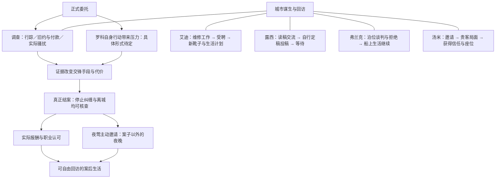

# 第三幕《银色打火机》｜城市故事网 V2

> 2026-10-29｜供讨论的内容组织候选，未实装、未试玩。承接用户提供的《第三幕城市事件编排 V1》，以 [V4：夜莺的舞台与首演反转](V4_夜莺的舞台与首演反转.md) 为主线事实依据。本稿替换 V1 的按日组织建议，不覆盖 V4，也不把候选场景写成已定事实。
>
> **本版核心：以因果与相遇组织内容，以真实行动形成投入，以少数有理由的期限形成压力。总天数和窗口长度留待试玩。**

## 一、这一幕要留下什么

尼尔开始做真正的侦探工作。夜莺摆脱真实的纠缠者，两人终于能谈案子以外的生活。与此同时，艾迪有了稳定岗位，露西把小说寄出去，汤米开始得到重用，弗兰克继续守着熟悉的泊位。

玩家不需要逐项见证所有人的成果。但他常去的地方应有事情可遇，参与过的事情会留下具体记忆，错过以后人物也仍然活着。结案后应有机会回到这些地方，实际生活一阵，而不是播完幸福蒙太奇立即遭遇下一封信。

五条线不采用相同的“遇见—帮忙—成功—庆祝”模板：

| 人物线 | 玩家值得亲历的核心 | 这一幕留下的变化 |
| --- | --- | --- |
| 尼尔／夜莺 | 查清事实，取得足以使罗科退让的依据，真正办成一次案子 | 有可核查的结案；真实的职业认可和亲近 |
| 艾迪 | 一起干活时看见他的手艺，后来听见他开始安排未来 | 固定工位、稳定职责、新靴子和生活计划 |
| 露西 | 从她写的人物中看见她怎样观察尼尔；交流彼此的理解 | 稿子寄出，她仍上班，也开始等待 |
| 弗兰克 | 听见一笔看似合理的交易为什么无法说服他 | 泊位争议继续，船上的日常依然存在 |
| 汤米 | 看见他如何处理一个难堪局面，以及他为何渴望被重用 | 从等候吩咐到获准入座，既得意也更忙 |

## 二、三段节奏，人物线各自推进

三段是主线局势，不是三个全城同步换档的任务阶段。进入下一段不会清空上一段所有未读人物对白。

| 主线局势 | 案件正在发生什么 | 城市内容如何分布 |
| --- | --- | --- |
| 调查展开 | 正式受托，自由选择调查方向，逐渐认识罗科的筹码 | 人物入口陆续可见；工作、读稿、泊位谈判、汤米邀约可以相遇 |
| 交锋临近 | 罗科的具体行动带来压力，调查所得开始决定可用办法 | 人物线延续；只有真正耗费资源的参与与调查竞争，普通交谈继续开放 |
| 案后生活 | 确认结案、离城、支付与评价；夜莺主动邀约 | 新工作与日常结果可见，补访朋友，享受没有追踪者的一段生活 |

### 故事网

图中的连线表示内容关系，不代表每次都要换日。四条人物线不要求互相完成，也不充当罗科案的必需钥匙。

## 三、相遇与世界推进的共同规则

### 1. 普通对白按条件开放，不按某一天投放

人物已经有话可说，且这段内容仍符合当前处境，就可以在相遇时触发。免费交谈不因“维持密度”额外收费，也不凭空占掉一个夜晚。

同一条人物线只保留当前有意义的入口。一次访问可以完成一个完整片段；没有新的行动或情绪变化，不要求睡一觉再来点下一段。信息较多时拆成自然交谈段落，不一次自动连播所有人生进展。

### 2. 世界事实与玩家知情分开

艾迪受聘、露西投稿、汤米获得信任、弗兰克拒让泊位，不依赖尼尔点开对应对白。各线使用自己的准备、工作及约定事实推进；落地时可暂用独立的相对换日间隔作排布参数，具体数值不在本稿锁定，也不全部挂到罗科结案上。

“不锁天数”不等于取消时间，也不等于所有 NPC 永远等待玩家。它要求把可调整的间隔与不可破坏的因果分开。

玩家后来见到他们，应从当前处境进入：已受聘就谈新工作，已寄出就谈寄出后的心情。不补播一场仿佛尼尔在场的旧戏，不强迫把过期对白队列全部读完。

### 3. 只有具体发生的机会才关闭

设备修好了，不能再参加这次维修；信寄了，不能再陪这次投递；贵客散场了，不能再参加这次牌局。这些亲历机会可以结束，人物本身及可继续交流的关系不会一起消失。

普通谈话与可参与事件应分开：错过搬工具，不等于错过知道艾迪得到了什么工作；没陪投信，不等于失去认识露西作品的全部机会。

### 4. 约定必须先被玩家知道

限时事件在发生前提供明确邀请或消息，相关事项持续说明期限及错过后果。接受约定后的处理沿用现有内容规则；到场可以只是听完、旁观，不强制玩家投入额外骰子。不能让不知道有约的人被算作失约。

## 四、主线：一次真正办成的调查

### 已定的故事事实

V4 确定：罗科确实帮助过夜莺，也确实利用旧约、索款和跟踪控制她；经理这次真实雇用尼尔；罗科案真正结束，罗科离城；尼尔实际做成了事情。后来的假威胁不能推翻这次胜利。

V4 **没有锁定**具体余额、法律与现实结案手段、货栈为何必须当晚行动。本版不把 V1 的“资料转交窗口”直接提升为既定事实，也不新增一套已经成立的法律程序。

### 组织建议

| 片段 | 进入与持续条件 | 玩家做什么 | 必须交付的内容 |
| --- | --- | --- | --- |
| 正式委托 | 第二幕意向之后，与经理确认；不要求进入第三幕当天到场 | 确认调查对象、范围、报酬和权限 | 这是正经工作；经理的认可在此时可以是真诚的 |
| 城市调查 | 接案后持续到相关事实发生变化 | 自由调查行踪、旧约与付款、实际骚扰；各方向有独立用途 | 分清罗科声称的权利与实际行为；调查改变之后能做什么 |
| 接近与交锋 | 获得可接近罗科的方向；若有截止，须来自明确的世界行动 | 用已取得事实追踪、取证、交涉；具体 Scenario 另设计 | 让玩家利用调查成果，不能填满三个互不相关的钟后自动胜利 |
| 核实结案 | 完成使罗科退让的实际行动后 | 确认处理结果，向委托人报告 | 停止纠缠、离城和结算有可靠依据；所得认可对应真实贡献 |
| 案后邀约 | 真实结案，夜莺放松后主动提出 | 接受或拒绝，一起度过一个私人夜晚 | 谈舞台、生活、愿望与彼此，不做案情总结或阴谋预告 |

调查不要求三方向全部完成才准进入交锋，但少查的部分必须对手段或代价有实际影响。一次判定失败、一次追丢不能永久关闭重要事实；要沿用已发现的线索，以不同方法、额外投入或较差条件继续。

**本版对 V1 的修订建议：暂撤“错过统一日期，剧院自动办成同一案件”作为默认结案方式。** 它与 V4 所需的尼尔真实成功存在张力。保留某次追踪、取证或接触机会会结束，但结束后仍要有合理的继续调查路径，不能让 NPC 无限期留在原地。

这不等于偷偷强迫玩家完成所有调查。完全不接案、彻底不参与时怎样承接后续，是尚待单独决定的章节路线；本稿不伪称已经解决，也不授予缺席者破案功劳。先组织有实际参与的第三幕主干。

### 货栈保留到什么程度

保留货栈作为接近罗科、追踪或交锋的地点候选，暂不锁“必须转交资料”。下一轮需先回答：他要什么、凭什么要、尼尔查到什么能改变他的决定、为什么现在必须行动。四件事接牢后，再决定是否需要期限及 Scenario 内部目标。

## 五、艾迪：手艺终于变成稳定生活

**事件链：工作中的机会 → 可参与的一次维修 → 独立受聘 → 新靴子与未来。**

1. 在码头正常工作或找艾迪时，得知旧运营方考虑让他正式负责一组现役设备。入口在消息仍新鲜时持续；若已受聘，则直接从新岗位进入。
2. 维修作为已有工作的一次具体情境。艾迪判断故障、负责技术与安全，尼尔可以做搬运、递工具等辅助工作，获得对应劳动报酬。先复用已有动作，不额外制作一场“帮助艾迪证明自己”的考试系统。
3. 维修与聘用由艾迪自己的能力和雇主决定推进。玩家缺席，他仍完成工作；参加的意义在于一起干过活、亲眼见到他的本事，后续谈起的事因此不同。
4. 受聘后长期可见固定工位、维修职责和新靴子。祝贺可以在一次相遇时自然发生，不要求精准赶到统一庆祝日。

**请酒调整：**默认改成受聘后相遇时提出的一杯酒；若需要多人庆祝，另有提前明确的邀约。取消预设“必须与货栈收网争同一晚”。只有实际时间规则支持、且试玩证明值得时，才保留这种互斥。

岗位依附旧港现役设备与运营方，第四幕提前清退才会威胁它。第三幕让玩家感受稳定工资带来的踏实，不借艾迪的嘴提前讲清阴谋。

## 六、露西：她眼里的尼尔，以及寄出去之后

**事件链：愿意给他读 → 交流作品中的人 → 自行定稿寄出 → 等待。**

1. 她愿意给熟悉的尼尔看小说，这是持续一段时间的交谈入口，不只在某三天有效。稿子里有尼尔的影子，也有她自己的观察与虚构，不能简单写成赞美主角。
2. 默认把读稿和结尾交流组织成一个完整相遇片段。玩家可以说哪里不像自己、哪里让他不舒服、为什么喜欢某种结尾；具体选项留待写作。露西自行决定作品，不让尼尔替她批准当作家。
3. 没看过稿子的玩家不直接得到“讨论两个结尾”的对白。若已投稿，交流从她留存的稿件或对故事的叙述进入，具体呈现择一，不补演尚未发生的征求意见。
4. 定稿与邮寄独立推进。陪投信可作恰好遇见的短片段，不设成必须守候的一日内容，也不单列一个待清任务。未亲历时，下一次在咖啡馆仍能看见她已完成这一步。
5. 寄出后她照常工作，可能松了口气，也可能开始怀疑寄出的版本。不在本幕兑现录用、男笔名和冒充作家情节。

读稿不收费。它提供认识与交流，本身就值得存在，不需要伪装成与调查争骰子的决策。

## 七、弗兰克：一场完整谈判，之后照常上船

**事件链：泊位谈判与明确拒绝 → 普通协商继续 → 熟悉的船。**

将 V1 分在两天的“收购人来访”和“拒绝”合成一个核心片段。改造方提出补偿，希望他交回长期泊位使用权；有人觉得价钱值得考虑，弗兰克则有自己不肯让的理由。

玩家在场时，可以听双方把话说完、表达态度或问清交易内容。无需骰子决定弗兰克的人生立场，也不提前加入第四幕的听证、搜集材料或强制清退。

为避免相遇设计含混，第一版采用以下明确组织：

- 前期保留一次较宽的谈判亲历窗口，收购方在这一轮协商期间会再来，不能写成同一个人站在船上等数日。
- 世界到达本轮协商结束条件后，弗兰克自行拒绝。玩家若未亲历，下一次上船直接谈已经拒绝的报价；现场争辩不再重演。
- 无论是否见过谈判，后续船上日常保持可用，报价名片或相关文件成为处境痕迹。拒绝报价没有解决整个改造争议。

这里仍有可调整的窗口，但只承载“能否亲历谈判”，不把理解弗兰克的机会也一并关闭。若试玩发现谈判亲历率太低，优先放宽相遇机会或改善消息入口，不新增一次重复拒绝戏。

## 八、汤米：想被当成能办事的人

**事件链：新皮鞋与邀请 → 一次需要手腕的局面 → 被重用 → 获准入座。**

1. 邀请在贵客到来前持续可见，不限定必须在某一天碰见汤米。玩家听到后知道何时、在哪里、要帮什么忙，可以接受或拒绝。
2. 贵客场景保留一次实际发生的事件，世界不会因为尼尔没见过邀请就一直暂停。未获知者是未参与，不能写成放了汤米的鸽子。
3. 具体冲突仍待定稿，优先围绕汤米如何兼顾老板体面、客人诉求与自己的前途。先确认玩家能作出的不同选择，再决定用短对白还是短 Scenario，不预设必须多阶段。
4. 如需投入骰子，投入的是探听、照应或交涉等真实行动；参加之前应可了解成本。汤米处理关键局面，尼尔可以帮上忙，不包办他的上升。
5. 缺席时汤米自行解决，可能付出较多钱或人情；成功依据必须是他的具体作为。不能只写一个自动增加信任的世界状态。
6. 后续相遇看到他被重用、获准坐进内场的一次位置变化，不提前完成整章成为小头目的上升。认识且参加过的人得到共同经历对应的招呼，普通熟人不自动被称作兄弟。

该线可以有一次明确邀约，但不再与其他人物统一排成“前期邀请、中期行动、末期庆祝”。

## 九、密度来自可遇见的事情与回访变化

| 常去的地方 | 自然遇见的内容 | 主要实际投入 | 后来回去看到什么 |
| --- | --- | --- | --- |
| 剧院与旅馆 | 委托、夜莺近况、罗科调查 | 调查资源、身体状态，及可能的接触窗口 | 结案事实、报酬、接触关系变化 |
| 码头 | 艾迪的工作与岗位消息 | 已有劳动行动 | 固定工位、工资与生活计划 |
| 咖啡馆 | 露西的小说与交流 | 免费交谈；自愿停留阅读 | 稿子寄出、等待中的生活 |
| 黑鸥号 | 报价争论与熟人日常 | 谈话；原有工作或娱乐自行选择 | 泊位尚在，协商未完 |
| 酒馆与俱乐部 | 汤米邀约、艾迪的一杯酒 | 牌局中的可选帮忙；正常谋生与恢复 | 汤米的位置、朋友近况 |

同一地点可以汇合人物与日常，但不同时弹出数段互不相关的大戏。玩家来挣钱，可以碰见工作中的人；回访时应该有新状态，不靠每日检查所有人物才能跟上。

可以成立的资源取舍：用较好的骰子挣钱、恢复或调查；参加一次实际劳动或社交行动，减少当日能投入案件的资源。暂不成立的取舍：免费读稿等于少查一天；免费听谈判等于错过收网；在两件没有时间互斥的事情之间宣称“只能选一个”。

第三幕不要求玩家忙到必然错过。准备充分时能够兼顾，本身可以是好体验。试玩再看是否过满或过空，不预先追求某个错过率。

## 十、结案后的生活与第四幕入口

结案报告和夜莺私人场景不捆绑在同一次强制连播里。确认罗科离城后，先让新处境成立，再由夜莺主动邀请；无需硬等一个城市日，具体间隔由实际体验决定。私人场景持续到玩家处理邀请或第三幕结束，不因错过指定晚上自动消失。

接受以后按明确约定赴约；拒绝则尊重拒绝。关系深浅来自既有相处和本次实际经历，不给所有玩家同一份完整爱情回报。

案后继续开放正常工作、休息与人物回访。玩家不必补完四条人物线，也不需要睡到某个日期，才获准进入第四幕。章节转场候选为：主线结案已交付、夜莺邀约已得到处理，随后在合适的叙事入口明确进入下一段。具体入口待脚本设计，不新增独立系统。

**作者时间顺序必须保留：真实结案 → 真实平静与幸福 → 经理和赞助方提出交易 → 夜莺知情同意 → 第四幕假威胁。** 不能在玩家仍享受本幕幸福时，暗中让她早已为假威胁表演；交易放在本幕生活段结束后、假威胁出现前的幕后承接中。第三幕不露出可疑密谈、假信安排或提前共谋的暗示。

## 十一、下一轮只需要决定的事

1. 罗科的实际筹码与退让理由；货栈在这条因果中承担什么，是否真的需要截止。
2. 汤米的具体局面，玩家能做出的选择是否值得一个短 Scenario。
3. 用最简内容连续走一遍，观察玩家自然会在哪遇见朋友、是否愿意回访，以及案后生活是否真实存在。

试玩时记录具体体验：为了什么去某地、怎样知道有事、错过的是哪种机会、投入资源换来了什么、结案后是否愿意继续待着。再据此调整相对间隔、窗口和行动成本。**不先为填满若干城市日追加事件，也不先制作重演出来验证故事网。**

文档静态审阅不代表密度或玩法已验证。本版没有改动运行时内容、Scenario 决策结构或 V4 主线原文。
