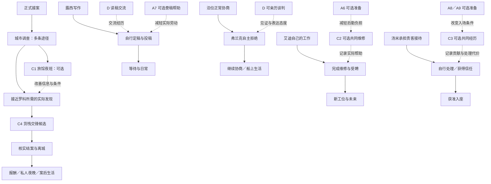

# 第三幕《银色打火机》｜行动与 Scenario 故事网 V3

> 2026-10-29｜讨论候选，未实装、未试玩。承接用户认可的四场 Scenario 与城市行动方向，修订 [城市故事网 V2](第三幕_城市故事网_V2.md)。主线事实以 [悬疑主线 V4](V4_夜莺的舞台与首演反转.md) 为准。本稿提出的具体人物冲突、调查发现与处理办法均为实施候选，不反向覆盖 V4。
>
> 总天数、窗口长度、骰池、进度与价格未锁定。四场 Scenario 是可供参与的内容规模，不预设玩家必须完成四场，也不预设必须错过一场。本文的 C1—C4 仅为制作编号。

## 后续调整：先做实际投入，保持故事结果简单

用户在后续讨论中明确：当前重点是每条线情节的分量与付出，让它们争夺有限城市资源，不扩展复杂故事变化。以下实施口径优先于本文关于多种处理条件的扩展候选。

- 当前先用城市行动承载工作，各段明确消耗一枚城市骰、跨日保存；尚未实现四场独立 Scenario。独立 Scenario 的回合与发骰不能直接冒充城市资源消耗。
- 罗科：查清去处、旧约，以及付款或骚扰事实之一；随后核对旧约、商定结算、留下见证记录各一次行动。最快七次城市行动，失败重试另计；无需收齐所有调查。
- 旅馆夜守：可选两段城市行动，可替代“询问旅馆＋打听货栈”的去处调查。认人后跟进，结果仍服务于原有主线。
- 艾迪：清出作业区、搬来替换件、协助安全试车各一次行动，每段挣4美元。部分帮助也得到实际劳动报酬，独立受聘不依赖帮忙。
- 汤米：问清诉求、安排侧间、陪同交涉各一次行动；提前在酒馆打听抵去第一段，不重复收费。不扩展牌局结局。
- 露西与弗兰克保持免费人物场景，不为了让五条线同样重而增加跑腿。
- 现有艾迪与汤米的相对到期值暂保留，并在工作卡上展示剩余天数；期限届满由人物自行处理，不宣称玩家完成未做的工作。

数值只作为首轮投入配置，尚无手感验证。先看主要工作是否真正竞争同一骰池，再调整次数、报酬与窗口，不以增加剧情分支解决分量问题。

### 2026-10-30：相遇与收尾修正

- 罗科交锋撤掉开案满三个换日的门槛，调查事实齐备即可开始；三段行动成本保留。
- 露西投稿后仍可读留存底稿、谈已寄出的结尾，不再永久关闭作品交流，也不补播尚未定稿的状态。
- 汤米后续分别承认提前打听、部分现场帮助和全程参与，不将部分帮忙冒认为共同稳住整场。
- 夜莺先提出邀请，再由玩家接受或婉拒。接受后立即赴约，无额外跨日承诺；两种处理均可完成本幕标记，待答复及处理结果纳入存档。这是局部完成条件，不代表已经补齐第四幕转场。

内容校验及定向资源、节点、对白与冷读档检查通过；未做真人试玩或 Unity 交互验收。

## 一、这一版补上什么

第三幕以城市行动构成日常，以四场不同的连续情境形成集中经历。人物交谈保留，不承担虚构的时间成本。

| 类型 | 玩家实际做什么 | 内容边界 |
| --- | --- | --- |
| D 人物场景 | 交谈、见证、表达态度 | 通常免费；不掷骰决定能否理解朋友 |
| A 城市行动 | 调查、劳动、准备，取得明确事实或改变实际条件 | 原则上使用现有城市资源；允许花钱委托等合理替代，不一律一枚骰 |
| C 独立 Scenario | 在持续变化的情境中连续作决定 | 至少有值得反复判断的行动关系；不强求多阶段或多个 Clock |
| W 世界进展 | NPC 自己工作、赴约、作决定 | 独立于尼尔是否参与；事后留下可见结果 |

城市谋生、房租、休息、健康与冷静继续存在。主线调查需要投入，帮助朋友也可能占用资源；不另加一套日程或行动点系统。进入 Scenario、内部回合与城市换日是不同层次：实际城市资源成本须在入口明确，不能因文案写了“一夜”便宣称自动与所有晚间内容互斥。

## 二、大致分布网格

横向只表示主要分布与先后趋势。窗口重叠，人物自行推进，不统一等待主线换档。

| 人物／地点 | 开案期 | 调查中段 | 收网期 | 结案后 |
| --- | --- | --- | --- | --- |
| 尼尔／夜莺 | D 正式委托；A 旅馆、旧约、付款调查 | A 复核事实与现场观察；C1 旧旅馆的夜班；A 货栈踩点 | C4 货栈之夜；核实处理结果 | D 报告与报酬；夜莺私人夜晚 |
| 艾迪／码头 | D 岗位机会；A 维修备件准备 | C2 吊机停工；随后可独立受聘 | 固定工位与新靴子已可出现；相遇时请酒 | 工作与未来计划持续可见 |
| 露西／咖啡馆 | D 小说与人物交流 | D 交流仍开放；可选 A 誊稿帮助；自行定稿投稿 | 可能已经在等回信，不必此时才寄 | 日常工作、作品与等待 |
| 弗兰克／黑鸥号 | D 泊位谈判与拒绝的宽相遇窗口 | 本轮协商结束；船上工作与生活继续 | 正常协商仍有争议 | 熟悉的船仍可回访 |
| 汤米／俱乐部 | D 新皮鞋、提前邀请 | A 背景打听或接待准备；C3 可在中后段发生 | 若牌局尚未发生，可落在这里；不预设撞上货栈 | 被重用、获准入座；共同经历对应不同招呼 |
| 城市日常 | 酒馆、码头、咖啡馆、船上生活 | 挣钱／调查／帮助朋友之间分配资源 | 准备身体与资金，处理真实机会 | 降低压力，继续生活与回访 |

免费人物对白跨窗口保留，内容随当前处境变化。事件结束只关闭那次亲历机会，不连同人物关系一起清除。

## 三、城市行动：每次投入改变什么

以下是行动组，不是必做清单。具体调查内容须在罗科事实定稿后校准；同一行动可以得到多个有因果联系的发现。

| 行动组 | 实际目标 | 所得怎样被使用 | 是否可跳过／替代 |
| --- | --- | --- | --- |
| A1 旅馆查询 | 查登记、出入或工作人员目击，确认罗科使用何处及活动规律 | 提供接近方向，改善 C1 开场信息；一般调查也能继续主线 | 不要求登记与目击各做一次；可付合理费用请人查问，具体办法待定 |
| A2 旧约与付款核查 | 对照合同约定与已经发生的支付 | 明确争议项目，改变 C4 中可反驳的索款与需要协商的部分 | 两类事实可关联取得；不以“收齐文件”作为总门槛 |
| A3 关键事实复核 | 只有发现具体矛盾后，找付款经手人或其他直接知情者核实 | 将单方说法变成可核查依据；不能只有抽象证据分数增加 | 与 A2 是深入关系，可放弃深入，以较差条件继续 |
| A4 骚扰现场观察 | 根据已知出没规律观察接触、威胁或跟踪 | 区分实际骚扰与合同争议，提供对质依据 | 不凭空每次观察都撞见罗科；具体发现和替代来源待定 |
| A5 货栈踩点 | 查入口、作业安排、能接触谁 | 开放具体入口或较稳妥接近办法，改善 C4 初始局面 | 可直接进入 C4 的一般路径；不强制把整场事先查透 |
| A6 艾迪的备件准备 | 按明确清单搬运、领取或备齐实际所需物件 | C2 开始时少一项后勤负担，并按实际劳动给报酬 | 缺席由工班处理；不备齐也能参加 C2 |
| A7 露西的誊稿帮助 | 若她借到的打字机有短暂使用机会，尼尔可协助整理誊稿所需材料 | 省去一段具体劳动、留下共同经历；不提高录用概率 | 暂保留一个候选帮助；她也能自行完成，不再另加邮寄跑腿 |
| A8 打听来客 | 从已知来客身份或纠纷出发，问清他找谁、想要什么 | C3 一开始多一种可讨论的处理方式 | 不做仍可现场了解，但要承担当场询问的局面成本 |
| A9 接待安排 | 与汤米确认谁接待、在哪里谈、怎样保持正常营业 | C3 可以先把来客与牌桌分开处理，留出交流余地 | 与 A8 是两种准备方向；不要求同时完成，不保证消除冲突 |

A1 与 C1 的区别：前者确认通常规律，后者亲历一次具体会面并决定如何跟进。A6 与 C2 的区别：前者备齐物件，后者处理故障情境；准备过的工作在场内不再收费重做。A8 与 C3 的区别：前者提前知道诉求，后者决定面对不同人时怎样使用这条信息。

弗兰克的查泊位权利、整理证明暂留第四幕。第三幕保留完整谈判及船上既有工作，不为凑齐每个人的 A 而增加维权任务。露西若没有可信的实际困难，A7 可直接删除，D 本身仍然完整。

## 四、四场 Scenario 的决策草图

以下只确定工作对象、选择与信息关系，不声称已经验证有趣。不增加重资产演出，也不因本稿自行增加中途退出按钮。

### C1《旧旅馆的夜班》：留守还是跟进

**候选情境：**尼尔已得知一次具体会面，能在旅馆附近观察罗科与旧演出圈联系人。会面是否涉及货栈，须在罗科事实定稿后确定。

- 开场先给可据以判断的细节：哪些出口能看见，哪一条路有明显盲区，联系人与罗科谁先离开。不能让玩家在两个没有区别的出口里猜答案。
- 前段争取辨认人物、记录接触和掌握路线。投入更好观察位置，可能牺牲对另一侧的覆盖；保持距离更稳妥，但不保证听清谈话。
- 局面改变时，联系人离开而罗科暂留。跟随联系人会失去原观察位置；留守则看罗科之后的行动。两边提供不同用途的信息，不能一边是真线索、一边纯惩罚。
- 把握不足时可以继续观察，但会面与离开按公开场内进程发生，不无限等待。由情境自然结束，不预设新增主动退出。
- 结果记录实际知道的人、去处或行为；暴露影响之后接近的条件，不能让已取得的发现凭空消失。跟丢也可保留先前观察所得。

**与其他场的区别：**核心是选择覆盖对象与承受信息缺口，不复用雨夜追逐的距离／脱逃危险结构。完全不参加时，A1—A4 仍可提供继续调查的方向。

### C2《吊机停工》：先确认故障，再组织复工

**候选情境：**设备停工，工班先确保停机安全，艾迪负责检修。尼尔负责为他的判断与修复提供条件。

- 艾迪明确提出当下需要的协助，例如保持设备停用、准备检测条件、领取合适备件。玩家不凭通用敏锐判定替他作专业诊断。
- 前段核心是是否先配合检查、取得更确定的故障判断，或先准备依据当前判断很可能需要的备件。提前准备可能省时，也可能拿错而产生返工。
- 检查推进后公开修正需求，行动集合随真实发现变化。准备与修复不是两根一直可填的独立进度条。
- 后段在已具备安全条件下完成装配与试车；试车发现残留问题，需继续处理。工头的催促影响工钱或停工损失，不能把冒险重启写成与安全修复等价的常规最优解。
- 艾迪的诊断与专业处理使设备恢复；尼尔的贡献改变准备效率、返工与实际劳动报酬。未参与或表现不好，都不把艾迪变成无能者。

**与联合起吊的区别：**不以双侧进度平衡、摆动值或赶六回合工期为核心；核心是认识逐步更新后，如何安排准备。若实际制作仍只能复现联合起吊，则缩回城市工作，不为四场名额保留重复玩法。

### C3《今晚的贵客》：把诉求与场面一起处理

**候选冲突：**一位有身份的来客认为老板没有兑现一笔约定，当众要求说法；老板不肯在客人面前示弱，汤米需要让事情获得处理，同时保住当晚生意。争议具体是什么，留待人物写作确定，暂不加入经理阴谋。

- 玩家先看到公开诉求与双方表现，能选择了解争议、安排私下交谈或先照应牌桌。
- 私下空间能降低公开丢脸的压力，但不能替代解决实际诉求；强行维持牌局会留下对方再次打断的理由。
- 了解诉求可能让人等得更久；先给出安抚则可能付出不必要的承诺。双方会回应已经发生的行动，不按固定回合无缘由统一加怒气。
- 汤米提出并承担处理办法，尼尔可以提供信息、争取交流条件或协助落实。老板看见的是汤米的能力，不是尼尔替他解决一切。
- 不同处理留下不同金钱、人情与脸面代价；不要求全部人满意。出现冲突应是局面发展的结果，不能固定末尾加战斗。

**准备价值：**A8 使玩家更早知道什么承诺有用，A9 使玩家有较好的谈话条件；都不直接跳过核心决定。缺席时汤米仍自行处理，后续招呼与共同经历不同。

### C4《货栈之夜》：用事实改变罗科可坚持的条件

这是主线结案的集中事件候选，规模暂不锁定。当前能确定其职责，但尚不足以锁具体行动图。

| 调查所得 | 在交锋中应有的具体作用 | 不足时的合理差异 |
| --- | --- | --- |
| 行踪与场地信息 | 知道何时、从哪里接近，减少对方避开接触的余地 | 接近更费力，或需要通过中间人，不能主线直接死档 |
| 旧约与付款事实 | 区分可以反驳的金额、实际争议及可谈条件 | 需要继续核查或付出较差结算条件；不能靠武力取消合同 |
| 实际骚扰的可靠依据 | 让“停止接触”有具体事件可对质及可留存记录 | 对质说服力与后续约束依据较弱，补证路径须明确 |

场内可能存在“现在提出条件”与“继续争取有用材料”的分配，但必须先确定：材料是什么，谁控制它，罗科为什么不能无限拒绝，继续行动会失去什么。不把未确定的“交给小报”当既定事实。

结案至少分清三件事：旧约／索款如何处理，纠缠为何停止，离城怎样核实。它们可以在一次行动中被促成，但不能因为打一架或抢到一本账就自动全部解决。

**未解决的关键项：**完全不接案的章节承接，仍沿 V2 留作独立问题。不能同时许诺玩家彻底缺席、尼尔却必然真实破案。本稿也不自动用剧院兜底替代他的工作。

## 五、世界主干与玩家参与分开

实线为内容主干，虚线为参与带来的影响。世界推进不依赖虚线；图中汇入节点不表示“所有前置都要完成”。艾迪与汤米在玩家参与时，世界结果由实际经历结算一次；缺席才走各自独立处理，不能参与后再重复播一遍自动成功。

## 六、怎样判断这次增加的工作是否成立

讨论稿静态审阅只检查组织与因果，不能证明四场好玩。后续最简试玩优先观察：

1. 玩家是否知道当前行动为什么有用；能否说出少查一项会影响哪种办法。
2. 是否退化为依次点完所有准备卡；若每项都必做、从无理由跳过，需重新检查替代关系与收益。
3. 四场是否让人反复思考不同的问题；尤其 C2 是否重复起吊，C1 是否只是换皮追逐。
4. 玩家未参加时，人物的生活是否仍成立；回来能否自然进入当前近况。
5. 调查、工作与帮助朋友是否真的竞争同一资源；Scenario 入场与城市换日的实际规则是否支持所声称的成本。
6. 结案后是否有一段真实的可玩生活，而非只剩结果对白。

下一步优先定罗科的一页事实底稿：实际旧约、支付争议、骚扰行为、退让理由、货栈用途与结案凭据。它决定 A2—A5、C1 与 C4 的内容能否接实。其他场景可以继续做纸面选择推演，但不急着锁 Clock、写长对白或投入演出。
