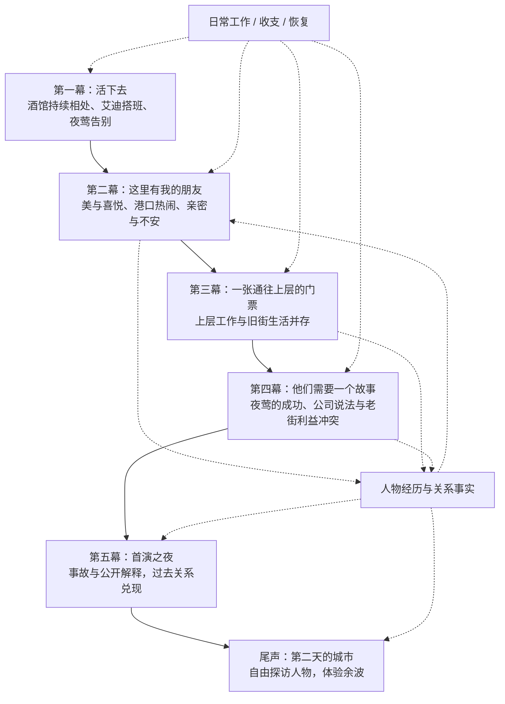
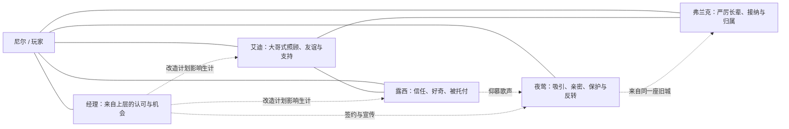
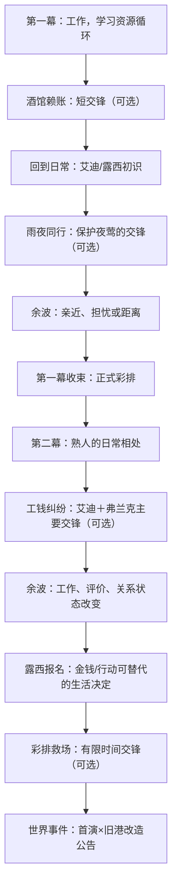

# SSNoir 第一章总纲：《这座城里的人》

> **文档性质：** 剧情与玩法设计手稿（重构提案，非已实施内容）。
>
> **覆盖范围：** 第一章五幕与尾声的总体结构；第一、二幕详见同目录的独立文档。
>
> **版本：** 2026-10-24，情感节奏校准 V0.3（下文保留部分 V0.2 结构供对照）。
>
> **使用说明：** 本文的幕名、事件、人物对白、日程与数值属于下一阶段的设计起点，而非不可更改的设定。正文中“确定的设计方向”是本轮讨论形成的共识；标注“候选／待验证”的细节可以在编写场景手稿时重构。除前两幕外，第三至第五幕保持框架级粗度。

## V0.3 创作校准：第二幕必须先有短暂的幸福（2026-10-24）

**本段是第二幕的情感验收要求，不是可选氛围备注。** 前两幕当前的问题并非只缺更多工作或更长的 Clock，而是缺少有吸引力的正面体验。第二幕必须先让玩家感受到 **新鲜、喜悦、亲密、美、梦想、被认可与某种短暂的幸福**，再让不安进入。否则玩家从第一幕的雨夜走出来，只是去解决四个彼此独立的小麻烦，不会产生更强的期待，也不会害怕将要失去什么。

- **D7，新鲜**：酒馆少了夜莺，但城市打开了新的门。剧院、旧街不是一张加长的工作清单，而是有温度和机会的新生活。
- **D8，美与喜悦**：大剧院正式彩排必须是一段美好、纯粹的梦想时刻。灯光、空座、她的笑容比任何交锋重要。尼尔在这里第一次得到上层人物的热情认可。
- **D9，热闹与归属**：意外靠岸的大船让全码头忙起来；艾迪帮助年轻工友、弗兰克组织大家，让玩家感到自己在一群真实的人中生活。可选高薪夜班只服务这种热闹，不另开发航运系统。
- **D10–11，温暖遇见阻力**：热闹的夜班过后却有人少拿工资；剧院试演也被安排、宣传和时限束缚。紧张来自具体人物愿望的阻碍，而不只是更长的骰钟。
- **D12，亲密与短暂幸福**：在大事件之间留一段没有收益考核的夜宵/散步。夜莺主动找尼尔、关心他的疲惫、分享对新舞台真诚的喜悦。此时不要揭露她是坏人，也不要强迫玩家回答政治立场。
- **D13，不安**：旧货栈出现测绘或腾退标记，剧院张贴夜莺的新城宣传；两个画面在同一天出现。经理再给予尼尔一个诱人但可能指向旧街的调查机会，成为第三幕钩子。

**关系原则**：艾迪始终可靠善良，让他因为善良承受不公，不强行加入人格反转；露西有妹妹般的趣味、自主向学并记得尼尔；经理采用旧人物稿中满面笑容、拍肩膀、称兄道弟、对价值极敏感的喜剧商人形象，绝非冷淡的任务 NPC；**真正深层的认知反转集中在夜莺**。她对尼尔的亲近和对舞台的喜爱都是真的，她对成功的渴望也一直存在。第二幕只留下可回看理解的微小细节，不可提前剧透她的后半章选择。

**执行关系**：见 [《第二幕 V0.3 情感节奏与剧情场景》](./02B_第二幕_V0.3_情感节奏与剧情场景.md)。它优先于旧第二幕稿中与人物动机、时间或舞台目的冲突的内容。第三至第五幕仍是作者构想，不能在仓库文档中写成已经运行。

## 0. 核心创作命题

**玩家先因为夜莺走进一段故事，随后在谋生过程中认识、喜欢、依靠城市里的人。当夜莺的成功与这些人的生活产生冲突时，玩家才必须决定自己愿意成为什么样的人。**

目标不是完成最多任务、养满所有人物关系，也不是证明一套复杂生活模拟有多精细，而是验证：

1. 日常工作能否自然建立熟悉感，让玩家期待再次见到某个人；
2. 交锋能否将这种熟悉感放进有压力的处境，让关系从闲聊变成共同经历；
3. 人物是否会主动对待主角，而非只等待玩家帮助；
4. 世界事件能否在不要求完成全部支线的前提下，让既有关系产生情感与实际后果；
5. 结局以后玩家是否仍然关心人物自己的命运。

游戏的统一底层语言维持简洁：**时间/每日行动骰 → 工作与生活行动 → 人物/世界状态变化 → 局部交锋 → 事件余波 → 下一个日常日**。

### 主角：尼尔（职业身份重构）

- **确定方向：** 尼尔不是预设的正式侦探。是一名在城里位置不稳、自由接活、靠劳动生活的年轻人；能在酒馆看场、码头搬运、咖啡馆打工、剧院跑腿及以后承接调查委托。
- **保留的固定人格：** 在意尊重；对自己认识的人遭受欺负不太能无动于衷；有幽默、嘴硬的一面。玩家选择他何时介入、愿意付出多少代价。
- **开放的未来身份：** 经理赏识的得力助手、老街认可的自己人、真正走上调查与揭露道路的人，或其他由玩家经历塑造的方向。“侦探”不再是开局必须兑现的主角目标。
- **避免：** 不设置独立的“成为侦探 0/10”人物成长主线，不让尼尔的预设理想覆盖玩家的实际动机。

## 1. 五幕总结构图



**每幕有一个共同的、不会等待玩家清完人物支线的世界事件。** 人物生活、可选交锋和调查可以并行；错过意味着这段经历以其他方式发展，而不意味着系统停摆。

### 五幕内容导航

| 幕次           | 玩家日常的核心问题           | 自由路线/行为                            | 本幕重点交锋                              | 阶段性世界事件         |
| ------------ | ------------------- | ---------------------------------- | ----------------------------------- | --------------- |
| 第一幕：活下去      | 今天去哪里挣钱？今晚要不要陪夜莺？   | 咖啡馆、酒馆、码头、休息；夜莺持续驻唱；艾迪按日搭班照顾尼尔     | 酒馆赖账（短教学，可拒绝）；雨夜同行（夜莺的主要交锋，可拒绝）     | **夜莺在酒馆的告别演出**  |
| 第二幕：这里有我的朋友  | 为熟悉的人，要不要牺牲自己的时间与钱？ | 与艾迪收工喝酒；帮助露西报名；了解弗兰克；**看夜莺首次正式彩排** | 工钱纠纷（主要交锋）；之后另一次赞助人复排救场（可选短交锋）      | 首演与旧港改造被宣布绑定    |
| 第三幕：上层的门票    | 高薪机会与原来的生活怎么兼顾？     | 剧院安保/跑腿；继续旧街劳动；帮工友/露西；初步核对宣传       | **待设计：** 可由高薪工作或旧街工作引出局部危机，不强制重复旧模式 | 旧港被描述为危险源头的报道发布 |
| 第四幕：他们需要一个故事 | 优先保护夜莺、熟人还是事实？      | 剧院安全、帮助受牵连者、查消息来源、与夜莺谈话            | **待设计：** 有限时间准备与目标意义变化              | 首演日期到来          |
| 第五幕：首演之夜     | 当众接受、质疑还是拒绝官方故事？    | 应对现场事故、调动证据/人际关系、公开选择              | **待设计：** 现场危机 + 公开叙事争夺              | 首演结局与公众版本形成     |
| 尾声           | 我想去看看谁后来怎样了？        | 返回码头、咖啡馆、酒馆、剧院；读报                  | 不以高压交锋为核心                           | 人物继续生活，第一章结束    |

**边界：** 第三—五幕是结构占位；本轮优先对第一、二幕进行情节/交锋设计，后续世界事件的具体阴谋、事故、结局细节可以重写。前两幕不能偷偷把玩家锁进单一“勒索调查”目标。

### 新的第一幕节拍（V0.2）

第一幕的夜莺**首先是酒馆生活的一部分**。她在普通工作后可以与尼尔多次相遇，主动关心他；随后才提出雨夜陪同。第一幕固定收尾是「酒馆告别演出」，不强行让艾迪、露西、弗兰克全部聚集。第二幕开头才是她第一次在大剧院的正式彩排；后续赞助人复排中的设备危机是**另一场**交锋，不应重复这场纯粹的梦想展示。

艾迪首次搬运解围必定发生；后续的帮忙应当作为可预期的「搭班」反馈，投骰前看到，失手时少承受一点损失。不是隐藏随机减伤，也不能用同一批工资结算来证明他很关心尼尔。城市生活中的主动招呼、分享、收工邀请同样不可缺少。

**现有实现与本稿尚有差距：** 老《三封信》章节和旧时间线仍在运行，新五幕主线尚未整体迁移。本稿是后续剧情改写的设计口径，不能因为某一处码头数值已调整就宣称五幕均已实现。

## 2. 人物关系网络：先有情感，再有功能



| 人物 | 玩家最初应当感受到什么 | 日常里此人**主动给予**什么 | 中后期的复杂性/兑现方向 |
| --- | --- | --- | --- |
| 夜莺 | 魅力、脆弱、特殊的亲近 | 主动邀请、关心尼尔、愿意听他的看法 | 她的温柔是真的，渴望向上与可能伤害老街也是真的；反转不应抹杀前面的情感 |
| 艾迪 | 被照顾，有个站在自己一边的大哥 | 搬货解围、招呼、请喝酒、问候 | 为朋友承担代价，但不是任由玩家调用的免费战力；不以复杂假赛线为第一轮必需内容 |
| 露西 | 被相信、被欣赏，日常愉快 | 记住尼尔的生活、开玩笑、分享愿望 | 有自己的学打字计划，玩家能帮助她获得选择条件，却不能替她活 |
| 弗兰克 | 严厉但靠得住的长辈 | 照顾工人、解决纠纷、有限保护 | 不轻易把外人当自己人，认可必须通过共同事件获得 |
| 经理 | 终于受到上层赏识 | 薪水、工作、身份与进入新空间的机会 | 承认与利用可能同时存在，构成情感诱惑 |

## 3. 两幕的日常—交锋—余波节奏总图



上图表示**建议的戏剧压力顺序**，不是强制玩家逐节点完成的任务链。具体事件可以随日期/地点/触发而交错出现；未参与的事件仍有非玩家版本与余波。

### 三类内容及其设计职责

| 类型 | 发生方式 | 玩家主要思考 | 是否额外付行动 |
| --- | --- | --- | --- |
| 日常工作/互动 | 访问地点、从事重复工作时偶尔触发一次性片段 | 在哪里谋生、今天的骰子怎么用、这些人是什么样的 | 工作本身消耗；人物片段通常不额外消耗 |
| 局部交锋 Encounter/Contract | 行动中出现值得连续决策的目标与风险；也可以由邀请进入 | 先解决什么？危险上涨后要不要改变目标？ | 以同一套骰子/资源结算；不是另开小游戏 |
| 世界事件/后续 | 由事先告知的日期或局势触发 | 我见过/错过什么？哪些人发生变化？ | 事件本身不强制额外消费；介入需作出实际取舍 |

### 交锋设计的约束

- **必须有变化：** 交锋不是把一根 Clock 填满。至少有风险积累、时间竞争、危机打断、替代路径或目标重新评价之一。
- **目标属于角色生活：** 第一幕雨夜侧重亲密与保护；第二幕工钱纠纷侧重义气、工作与现实代价；彩排侧重才能、自尊与临场选择。
- **失败推动故事：** 失败可以导致冷静/受伤/收入损失、错过机会或关系上的担忧，不得造成主线锁死。
- **有余波：** 交锋后的普通见面应在对白、工作机会、人物态度或可选行动中回应发生过的事。
- **不要求高压泛滥：** 生活里的邀请、玩笑、陪伴和简单庆祝不需改造成 Contract。

## 4. 玩家内容发现：不要把城市做成隐形任务链

- 第一幕经酒保明确知道三种谋生途径；地点一旦开放，**可直接工作**，不用先填探索 Clock 才获得早已被介绍的工作。
- 第一幕人物事件由玩家访问具体地点而发现；别提前在全城任务表揭示所有人物事件。
- 只有角色**已经告知**的约定与机会，才需要可见的日期/倒计时；未知故事不挂灰色锁定卡。
- 第二幕的工钱纠纷可通过一次码头劳动、酒馆传闻或当事人提起得知，防止单次错过就完全不知道。
- 露西报名与夜莺试演应提前告知日期。没有玩家介入时，也有自洽的自主演进。
- 不强制玩家同时认识全部角色；每条人物线都应支持晚认识、普通熟人、共同经历三种程度，避免剧情假设不存在的交情。

## 5. 世界与人物状态：优先存事实，不泛化成好感数字

> 以下为内容设计需追踪的**语义状态建议**，不是程序接口、变量名要求。

| 范畴 | 示例事实 | 典型后续读取 |
| --- | --- | --- |
| 城市生活 | 工作去过哪些地点、房租/冷静/伤势/现金 | 工作选择、行动成本、部分对话变体 |
| 艾迪 | 初识、他是否帮过尼尔、喝酒是否赴约、工钱纠纷是否共同经历 | 艾迪的称呼、态度、日后愿意为谁冒险 |
| 露西 | 熟悉、是否听过打字计划、报名是否获得帮助、她是否成功报名 | 第二幕余波、以后工作的去向与信任 |
| 夜莺 | 是否雨夜同行、途中是否优先保护她、是否参加彩排、演唱偏好 | 亲密对白、她的信任与后续选择 |
| 弗兰克 | 是否亲眼见其处理纠纷、玩家采用何种办法、是否尊重工人 | 认可、有限保护、是否愿意作证 |
| 世界 | 日期、演出预告、工钱纠纷结算、旧港改造联合公告 | 世界事件与第三幕入口 |

对于相同场景，只需根据其中最相关的 1–2 项事实安排有意味的对白/动作变化。**不要让每种排列组合产生一篇全新的剧本**。

## 6. 内容稿的推荐场景记录格式

以后每个情节、地点、交锋建议使用同一张简单的设计卡，便于在手稿阶段交流：

```text
场景编号 / 名称：
地点与时间：
人物：
玩家目前知道什么：
进入条件与发现途径：
这场戏想让玩家感受到什么：
开始时玩家想完成的目标：
可用的行动：
风险/局势变化（若为交锋）：
玩家可以拒绝/失败/离开吗：
人物主动采取的行动：
结果分支（仅关键差异）：
长期记忆与下次见面的余波：
剧场表现（镜头、默剧动作、对白重点）：
待确认问题：
```

## 7. 第一轮纵向实验：用体验而非任务完成率验收

首轮优先完成第一、二幕；测试玩家是否在一场重大事件到来之前，已经开始关心人。

**重点观察：**

1. 不提示角色姓名，玩家能否自然回忆艾迪、露西、夜莺和他们做过的具体事情；
2. 玩家是否因为想见某个人而选择回到某个工作地点；
3. 玩家是否在工钱纠纷、露西报名等情况下主动放弃更高收入或另一项计划；
4. 交锋发生后玩家是否主动寻找人物、查看其状况，而非只看奖励结算；
5. 旧港改造公告出现时，玩家是否自行联想到熟悉的人会受到影响。

**警惕失败信号：** 人物被当成 Clock 奖励；所有有趣内容只能通过反复工作刷出；交锋结果只改变数字；夜莺只是被动等待救助；艾迪永远以付出好处换取玩家忠诚；人物不参与时世界停滞。

**未定事项：** 更精确的天数、报酬、风险概率、第三幕以后的阴谋证据链、舞台事故形式与结局分支，待场景设计与试玩后确认。不要在此阶段用补充大量系统规则代替人物写作。
