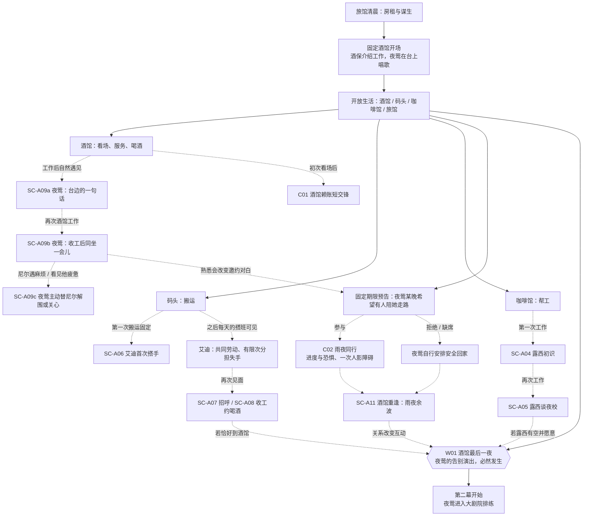
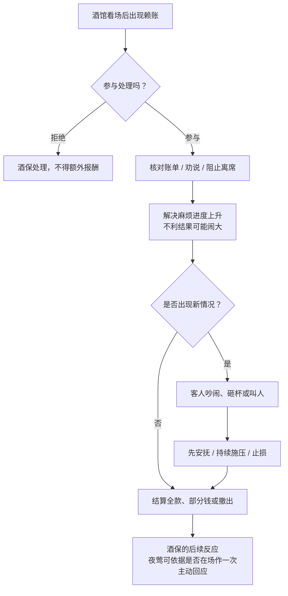
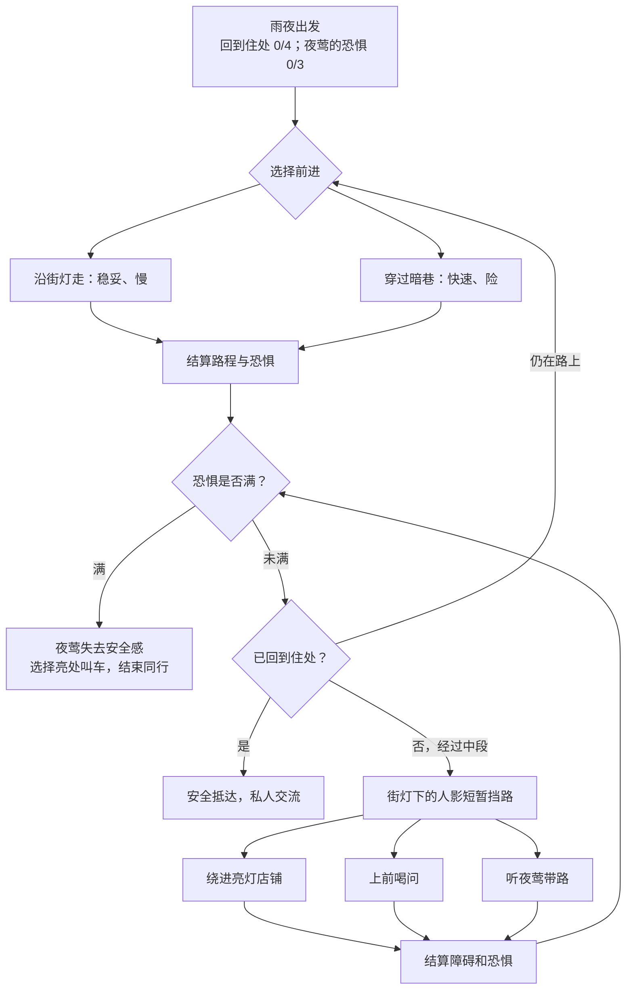
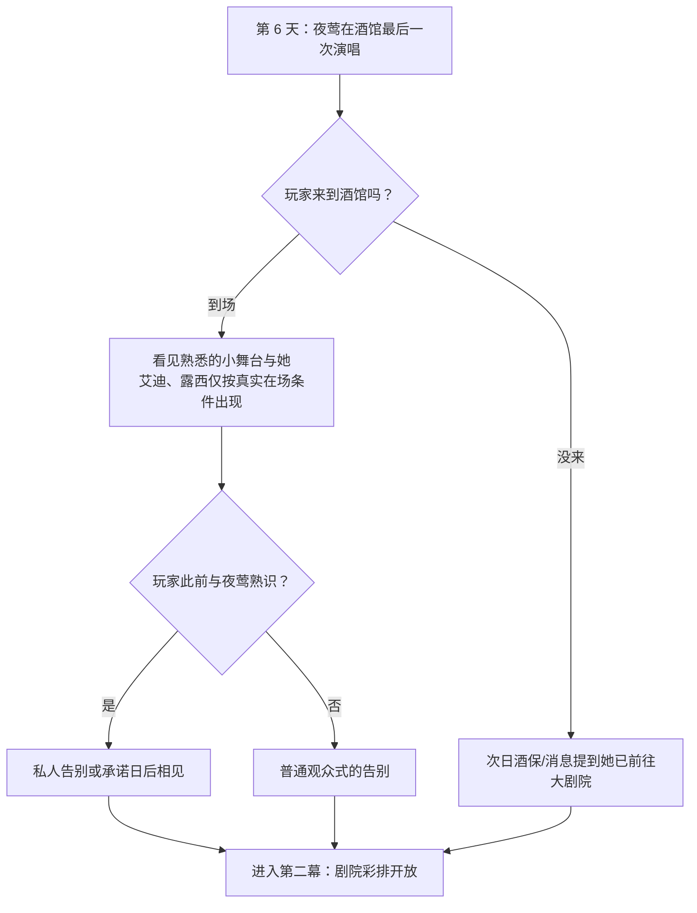

# 第一幕：《活下去》——内容网络与交锋设计手稿 V0.2

> **身份：** 第一章第一幕的下一版**设计稿**，不是当前《三封信》运行内容。剧情、演出及规则需要在转入正式实施前审定。配套文本见 [《第一幕·剧场演出与对白》](./01A_第一幕_剧场演出与对白_初稿.md)。
>
> **本次调整：** 夜莺在酒馆长期驻唱，通过尼尔的日常工作熟悉；第一幕以「酒馆告别演出」收束，**正式彩排改在第二幕**。艾迪首次帮助必定发生；后续按天决定是否搭班，帮助在判定前可见，并真实改变少量冷静损失。露西继续通过咖啡馆日常认识。
>
> **引擎现实：** 截至本版，当前运行的《三封信》仍有旧章节时间线与职业/案件内容。**不得直接把本稿视为已经接入的正式主线**；迁移时需统一 world/三封信.scm 的时间线、旧剧情门槛与测试。

## 1. 情感目标和章节边界

第一幕不是一场调查，也不是四条需要完成的人物支线。玩家靠临时工作养活自己，几个人在日复一日的劳动与夜晚生活中逐渐记住他。

- **夜莺：** 从「酒馆里唱歌的漂亮女人」，变为「每次去酒馆都可能遇到、会主动搭话、偶尔替我解围的人」；雨夜交锋使双方建立一次共同经历。
- **艾迪：** 从第一次帮忙抬箱，到可预期的搭班救场与工作外的关心，形成「在码头有人罩着我」的感受。
- **露西：** 会记住尼尔的工作、状态，透露自己想学打字，不立即把愿望变成委托。
- **尼尔：** 不预设侦探职业；玩家以工作、帮助、陪伴决定他逐渐成为什么样的人。

**收束节点：** 夜莺最后一次在旧街酒馆驻唱。她的演出如期发生，尼尔是否到场不阻止进入第二幕。第二幕才开始剧院生活与正式彩排。初拟 6 个游戏日，具体时长须试玩验证，不允许靠隐藏「人物熟络」Clock 强行拖时。

## 2. 第一幕内容网络

实线：必然开放的系统或时间推进；虚线：到访/条件触发/可错过的人物经历。艾迪和露西从不因为玩家没遇见就自动成为朋友；没有玩家参与的世界事件仍继续。

## 3. 时间与机会（原型建议）

| 时点 | 必然发生 | 玩家可以经历 | 错过如何继续 |
| --- | --- | --- | --- |
| 开场 | 旅馆困境、酒馆初见、工作开放 | 任意谋生地点 | 全员知道夜莺的名字，不代表与她相识 |
| 第 2–3 天 | 夜莺持续在酒馆演唱 | 工作时搭话；艾迪首次帮助；露西初识；酒馆赖账 | 人物片段由地点首次到访触发 |
| 第 3–4 天 | 雨夜同行机会提前告知 | 陪夜莺；艾迪收工赴约；与夜莺日常相处 | 夜莺另找熟人或出租车回家，不因拒绝受必然伤害 |
| 第 5 天 | 酒馆张贴夜莺告别演出消息 | 雨夜后在酒馆再见、普通工作、安排收入与恢复 | 未认识的人物不补播过去的全部事件 |
| 第 6 天 | **W01 夜莺酒馆告别演出** | 可到场观看；她可能私下与尼尔说话 | 次日酒保/海报确认她已经去大剧院 |
| 第 7 天 | 第二幕开始，夜莺进入剧院准备彩排 | 城市各类日常继续 | 没去码头/咖啡馆，不妨碍新幕开启 |

时间只负责给世界事件一个期限。早些进入酒馆可以拥有更多与夜莺的私下经历；晚些才去也仍然看得到她的公开登场和告别演出。

## 4. 地点与日常行动

| 地点 | 重复行动 | 自然人物内容 | 玩法职责 |
| --- | --- | --- | --- |
| 酒馆 | 看场、服务、喝酒 | 夜莺驻唱、与她搭话、酒保与赖账客人 | 赚钱与休息；第一幕的人物中心 |
| 码头 | 搬运（高风险高收入） | 艾迪首次帮助、每日搭档及少量闲谈 | 让大哥式照顾落到实际行动结果 |
| 咖啡馆 | 帮工（低风险低收入） | 露西主动认识尼尔、谈学校 | 轻松、可重复的生活陪伴 |
| 旅馆 | 休息、租金、恢复 | 生活困境和下一天的行动分配 | 保证时间真正有限 |
| 剧院 | **第一幕不作为自由活动中心** | 仅公告或远景，第二幕正式开放 | 让夜莺的离开变成可感知的阶段变化 |

## 5. 夜莺：在酒馆逐渐熟悉

### A02 固定登场：台上的人

第一次开场必须让玩家看到夜莺的舞台魅力。酒保告诉尼尔她不久后要去大剧院。此时只记下「见过夜莺」，不假定私交，也不要求玩家立刻选择保护她。

### A09a 台边的一句话（早期酒馆工作）

尼尔工作结束，夜莺正在收拾演出物品。两人简短搭话。夜莺注意到他做酒馆看场，不只是礼貌地接受别人服务。

**触发：** 第一次或第二次在酒馆工作后，能见到夜莺时；不额外吃骰。没赶上则不强行在其他地点弹窗。

### A09b 收工后坐一会儿（再到酒馆）

打烊后夜莺不再是台上明星，只是一个饿了、累了、仍然想唱歌的女人。玩家可以花有限的私人时间多待一会儿，不必获得金钱或数值奖励。

**触发：** 已有 A09a，夜莺仍在酒馆的夜晚；拒绝不降好感，之后仍可见面。

### A09c 她也照顾尼尔（一次主动行为）

当客人轻慢尼尔，或尼尔刚处理过酒馆麻烦，夜莺利用自己的熟人身份替他化解尴尬；如果尼尔带着疲惫与伤势来，她会主动问候。

**核心：** 夜莺能看见他渴望被尊重、不喜欢被欺负的一面。不能设计为她永远只等待玩家保护；也不必用好感 Clock 和恢复奖励证明这份关心。

### A10 雨夜请求

夜莺因后巷反复出现的人影害怕，要求尼尔**陪她回家**，而不是调查嫌疑人。此前认识越深，请求越私人；若玩家只见过公开演出，可经酒保转达，仍允许参与。玩家不接时她自行找安全的替代方式。

### A11 雨夜重逢

再次在酒馆见到夜莺：记住「安全到家」「恐惧失控后叫车」「尼尔坚持查人」「没赴约」等实际经历。不得让所有结果都演成信任增加；也不得在未相识时出现既成亲密对白。

### W01 酒馆告别演出——新幕末

这场演出公开、热闹，但只要**舞台上的夜莺与台下尼尔的视角**就能成立。艾迪如果今天正好收工到酒馆，可以在角落喝酒；露西此前若表达过仰慕并有空，可以站在门边听歌。**不强制安排「四个人全部到场」的集合场景。**

酒馆告别夜后，夜莺开始剧院彩排。剧院里那场私密的「我在上面的时候看起来怎么样」，转为**第二幕**的情感节点；不要与告别夜混写成两场相同的演出。

## 6. 艾迪：初识必然，之后在可预期的劳动里照顾尼尔

### A06 第一次搬运：必定搭手

玩家首次在码头搬运，无论骰子结果如何，都能见到艾迪。好结果可以是搭着把箱子放好；坏结果则是艾迪及时扶住滑下来的货。第一次帮助必须真实发生，但不要求尼尔先失败才触发人物相识。

### 之后：按天排班，不按每颗骰临时抽搭档

- **入场前可见**当天搭档，明确说明会不会得到保护，避免同一个骰子结果结算忽然变化。
- 艾迪可能不在码头；如果在，玩家知道他今天会帮忙。按天决定出现与否，兼顾期待与规则可理解性。
- 建议普通搬运坏结果：冷静 −2；艾迪当天首次替你分担后：冷静 −1。**只限一次/日**，防止变成无限刷收益工具；同一天再次失败正常结算。
- 与艾迪一起搬运有一次独立的首见演出；后续只保留短句或动作，不要每次重复整个对话。
- **不能只靠坏结果认识艾迪。** 第一次好结果、相熟后的收工邀约、提醒休息都同样是他照顾你的体现。
- 乔作为老手强调技巧和经验；艾迪强调替朋友搭手、承担麻烦。两者不能成为难以区分的重复随机救场。
- **代码迁移现状：** `码头.scm` 已初步实现每日可见搭班、首次艾迪出场和一次坏结果分担。旧 `艾迪.scm` 拳场剧情仍在运行，首次相识台词与新五幕最终接入需在后续整体迁移时统一；尚未完成第一幕全量实现。

### A07 / A08 多次见面与喝酒

主动打招呼、替尼尔留一处有活的位置、相熟后邀约喝一杯。友谊不是数字进度条；邀请可以拒绝。后续的响应依据实际发生的共同行动，而不是「认识艾迪」后自动升至深交。

## 7. 露西：轻松的日常关系

第一次咖啡馆帮工后，她注意尼尔的衣服或笨拙；再次来时她已经认得他，聊起自己想学打字和将来的工作。她既可以欣赏夜莺，也会决定自己的事情。夜校报名危机留到第二幕。没进咖啡馆的玩家可以一直不认识她。

## 8. 交锋 C01：《赖账的客人》

该短交锋教学现有交锋语言，不强制引入夜莺。「夜莺替尼尔解围」若在此发生，应是自然延续，不能篡改已有结算。

## 9. 交锋 C02：《雨夜同行》

**情感命题：** 怎样让一个害怕的人，感受到和你待在一起是安全的？

**主目标：** 「回到住处」0/4（进度）；**危险：** 「夜莺的恐惧」0/3（压力）。普通夜路有「沿街灯走」（稳妥，较慢）与「穿过暗巷」（快，但不利结果更易增加恐惧）；某段路出现短促的人影障碍。

**需要在数值定稿前验证：** 安全路线不能无成本无限循环；短障碍不应自动增加一根大 Clock；玩家应有机会选择暂缓并安抚夜莺，但不能无限消除压力。

**失利并非命案：** 恐惧满格代表夜莺不愿再继续同行，往有人、有灯的地方叫车或找其他熟人，不是「她莫名其妙独自奔入黑巷」。她对尼尔的不满应由具体行为决定：尼尔一味追人不同于尽力保护却遭外部惊吓。

## 10. W01 酒馆告别演出与进入第二幕

第一幕的结束由日期决定，不依赖认识艾迪/露西、完成雨夜或观看演出。应当让错过的人物经历产生缺席而不是凭空补播。

## 11. 需要手写并审定的演出及实施界线

| 编号 | 场景 | 状态 |
| --- | --- | --- |
| SC-A02 | 酒馆固定开场；夜莺初次亮相 | 第一版已有，保留基调 |
| SC-A09a | 夜莺在酒馆台边搭话 | V0.2 新增草稿 |
| SC-A09b | 夜莺演出后同坐一会儿 | V0.2 新增草稿 |
| SC-A09c | 夜莺为尼尔解围 / 主动关心 | V0.2 新增草稿 |
| SC-A04/05 | 露西认识与打字愿望 | 沿用 |
| SC-A06/07/08 | 艾迪帮助、搭班、邀约 | 更新触发与损失规则 |
| SC-C01 | 酒馆赖账 | 保留短交锋 |
| SC-A10/SC-C02/SC-A11 | 雨夜请求、交锋、重逢 | 调整恐惧结构及互动 |
| SC-W01 | **酒馆告别演出** | 从第四天剧院彩排替换 |
| SC-W01-NEWS | 未去告别夜的异地消息 | 更新 |
| SC-B-C彩排 | **第二幕正式彩排** | 从旧 SC-W01 迁入第二幕，不再属于第一幕 |

**给 Codex 的执行顺序：** 先通过第一、二幕作者稿确认时间与镜头，接着重排第一章固定事件，再接入人物生活片段，最后单独移交雨夜交锋及数值校验。不要在保留《三封信》旧固定事件的同时，再叠加一条平行的「第 6 天」新主线。
