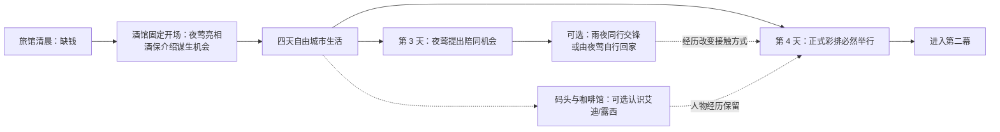
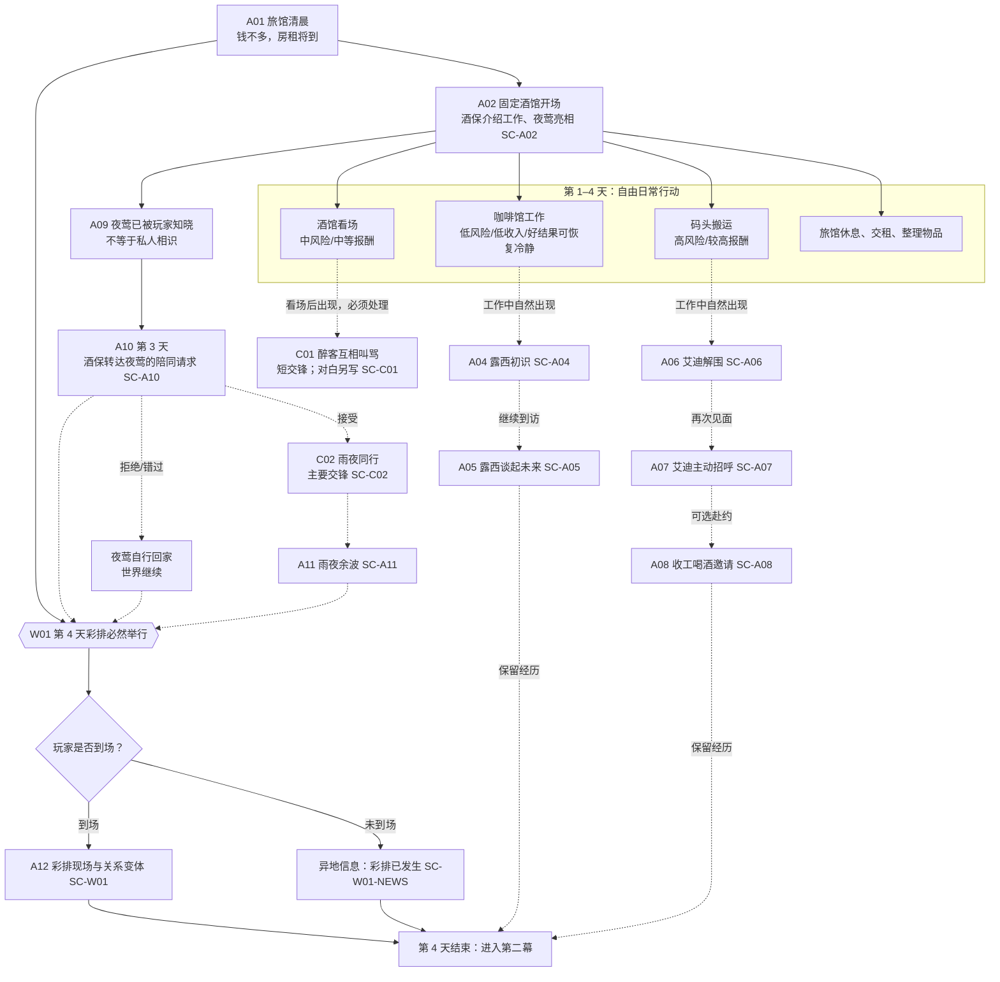
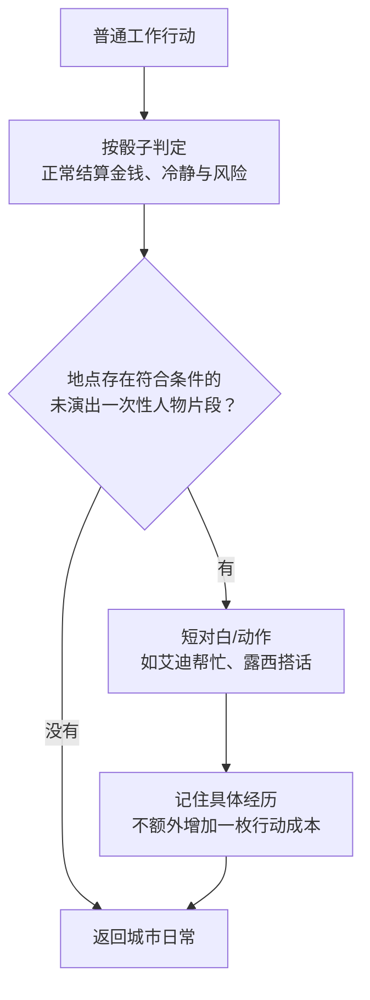
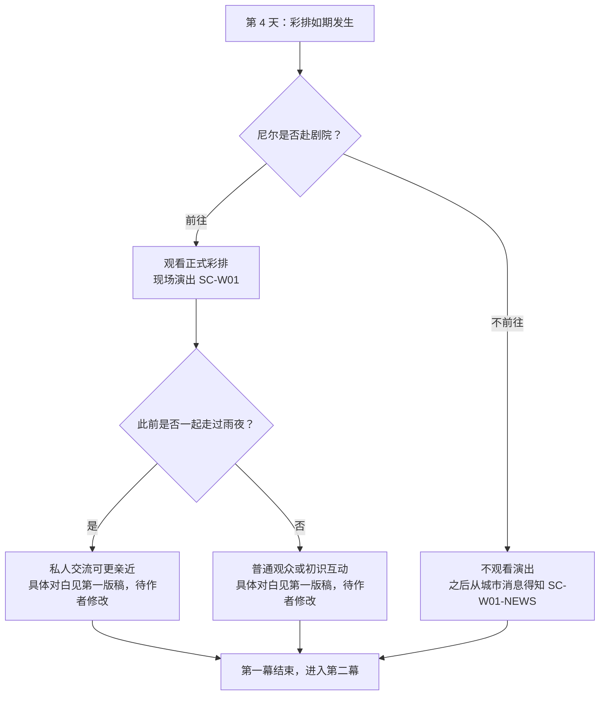

# 第一幕：《活下去》——内容网络与交锋设计手稿

> **设计地位：** 第一章第一幕的**内容与玩法设计稿**；保留世界事件、地点机会、角色功能、交锋拓扑及结算约束，不写正式剧场剧本或对白。已接入可玩流程，待实际试玩。
>
> **剧场稿分离：** 所有镜头、默剧、人物对白、演唱与演出段落，已另行整理为同目录的 [`01A_第一幕_剧场演出与对白_初稿.md`](./01A_第一幕_剧场演出与对白_初稿.md)，目前为**供作者修改的 V0.1 初稿，尚未审定**。本文的事件标题与人物行为描述仅为设计说明，**不是可直接实现的演出脚本**。
>
> **最新请求规则：** 夜莺第三天的请求现为必须处理事件，尼尔在 Dialogue 中直接答应，不提供接受、拒绝或失约路线。下方早期内容图与人物意图中有关雨夜可选性的描述，以本条和第6节为准。
>
> **实施状态（2026-10-20）：** 新档已改为旅馆清晨、酒馆固定亮相和三份直接开放的工作。露西初识与打字愿望、艾迪初识与再次招呼及当天喝酒邀约、两场交锋、雨夜邀请与余波、第四天可选彩排及缺席消息均已接入。演出按作者最新指示暂用 Dialogue；第4天结束进入新第一章的第二幕，第二幕内容尚未制作。旧勒索主线及专属委托退出运行时，新流程从新游戏开始。候选数值与3～4回合节奏仍待试玩。
>
> **交付 Codex 的边界：** 有明确内容与数值规则的部分可作为设计依据；所有标记 `SC-*` 的剧场或对白片段，已提供编剧初稿的 `SC-*` 仍需作者审定，未经审定保持待实现状态；不得据设计概述擅自修改台词、镜头或过场。
>
> **本幕目标：** 让玩家通过谋生认识城市，感受到艾迪的主动照顾、露西的亲近与夜莺的吸引力；用**酒馆小麻烦**和**雨夜同行**两种不同交锋，证明日常与压力事件可以共同推动人物关系。
>
> **原型排期：** 暂按第 1–4 游戏日组织，第 4 天彩排结束后进入第二幕；具体行动预算和日程需试玩验证。

## 1. 本幕情感命题与体验顺序

从“我得想办法在城里挣钱”出发，玩家会逐渐觉得“我认识了几个还不错的人”，并有机会自愿为夜莺花费自己的夜晚。

**主线时间与个人参与分离：** 夜莺在酒馆的**固定初次亮相**、第 4 天的**正式彩排**，是本幕的两个主线锚点；夜间陪同、赴约、认识艾迪/露西，属于玩家可选择经历的内容。夜莺的彩排必然发生，玩家是否在场由个人选择决定。

**不以“查清跟踪者是谁”作为本幕目标。** 是否存在实质危险保留悬念；交锋主要目标是陪伴与保护，不能把夜莺一开始就降为被动等待调查的委托物。

## 2. 本幕完整内容地图

**地图阅读要点：** A01–A12 是内容编号，不代表必须线性完成；C01/C02 是交锋；W01 是固定的世界事件。`SC-*` 仅为需要作者另写的**剧场/对白脚本接口**。玩家即使不进码头、不进咖啡馆，也不会阻止幕次推进；此时不能默认为已认识艾迪/露西。

### 第一幕的固定时间骨架

| 时间 | 世界必然发生 | 玩家可以选择经历 | 未参与时怎样继续 |
| --- | --- | --- | --- |
| 第 1 天 | 酒馆固定开场；夜莺在台上亮相，酒保介绍谋生地点 | 开始工作，留意人物 | 夜莺已成为玩家认识的公众人物，但双方未必私下相识 |
| 第 3 天 | 夜莺通过酒保提出某晚需要人陪同的机会，明确窗口 | 接受雨夜同行并参与交锋；或不接受 | 夜莺使用其他方式回家，未来仍能见到 |
| 第 3 天左右 | 彩排日期通过公开消息或私人邀请预告 | 接近艾迪/露西，赴约，安排收入与恢复 | 错过的人物片段按具体条件留待以后或自然过期 |
| 第 4 天 | W01 正式彩排举行，第一幕收束 | 现场观看，触发与夜莺的个人交流 | 玩家从酒保、公告等渠道得知彩排已经举行，仍进入第二幕 |

**主线推进条件：第 4 天结束；不是完成雨夜交锋、人物熟络 Clock 或彩排现场演出的状态。**

## 3. 地点设计与玩家日常机会

| 地点 | 玩家看到的主要行动 | 资源关系（沿用现有底层） | 内容发现与氛围 |
| --- | --- | --- | --- |
| 旅馆 | 睡觉进入次日、静坐恢复、付租 | 行动时间与恢复选择 | 便宜、局促、相对安全；展示尼尔不是城市中心的人 |
| 酒馆 | 看场、喝酒、听歌、问酒保 | 中风险收入；消费可换取恢复 | 介绍其他地点；赖账交锋；认识夜莺 |
| 码头 | 搬运货物；收工时与工友接触 | 高收入但失败可能损失冷静；冷静耗尽后继续承压会转为伤势 | 艾迪以有行动、有帮助的人物形象出现，而不是一张待解锁的人物卡 |
| 咖啡馆 | 端咖啡、整理桌子、听小道消息 | 低风险收入；好结果可少量恢复冷静 | 露西会观察、记住尼尔；以后可引入零散委托但本幕不强制 |
| 剧院/后巷 | 看彩排、参与可选陪同情景 | 观看/陪同的机会成本需要明确 | 彩排固定发生，但只有到场的玩家获得现场互动；镜头与演出另见作者稿 |

**固定开场 A02：** 酒保应清楚介绍三个谋生地点，并让夜莺通过酒馆演唱首次进入玩家视野。正式开场对白和舞台呈现由作者写入 `SC-A02`；玩家不必通过做酒馆工作才能认识“夜莺”这个名字。咖啡馆收入少、可能听到委托；码头工钱高但辛苦；酒馆能看场。地点开放后可直接工作，不设纯为开放工作而存在的“探索 0/4”前置。

### 日常与内容事件的连接方式

露西和艾迪首次工作后的初识保留。后续片段由各自的隐藏日常 Clock 推进：每班对应工作 +1，三格满才演下一段；进出地点不推进，也不触发。Clock 不出现在卡、卷宗或效果条中，进度随存档保存。

不要让每次劳动必有新剧情，也不要通过循环播放同一句台词刷“好感”。控制在少量有方向变化的一次性片段，之后通过随机闲聊、称呼和动作保留熟悉感。

## 4. 人物情节卡

### A04–A05：露西——「她注意到了我」

**第一次接触：** 玩家第一次在咖啡馆打工。露西注意到尼尔外套上的煤灰，推测他也在码头工作，逗他到底是哪一行的。

**第二次接触：** 初识后在咖啡馆再完成三班工作，隐藏日常 Clock 满格时，露西认得他，可能留一杯咖啡或打趣他“今天又换了什么工作”。她自然透露自己在攒钱学打字，但**不马上发布筹款任务**。

**情绪目的：** 被认识、被记住，咖啡馆成为一个有人的地方。她有自己的未来，不是用来提供恢复值的服务 NPC。

**状态需求：** `见过露西`、`露西记得尼尔`、`知道她想学打字`。最后一项为第二幕报名情节的自然伏笔；玩家未发现也不妨碍她后来去报名。

**作者演出接口：** `SC-A04`、`SC-A05`。本设计稿只固定触发、情感意图与需要记住的事实；动作、表情、对白由作者单独填写。

### A06–A08：艾迪——「这个人主动照顾我」

**第一次接触：** 初次在码头搬运时，尼尔因不熟悉规矩被工头训斥、动作失误，艾迪过来搭把手并替他解围。可以适配好/中/坏判定结果，但不要设计成“必须骰坏才认识艾迪”。

**第二次接触：** 初识后再完成三班码头工作，隐藏日常 Clock 满格时，艾迪记住尼尔，叫他“大人物”或者“城里来的”，问今天赚了多少。短促、好笑，让尼尔不再只是无名工人。

**第三次接触：** 再次招呼后隐藏 Clock 清零，再完成三班码头工作，艾迪邀请尼尔收工后去酒馆坐一会儿。赴约需实际腾出一些时间；不赴约，艾迪下次仍然正常打招呼，不变成惩罚型冷淡。

**情绪目的：** 先被照顾，后有机会回报。第一幕不展开复杂假赛线，不要求玩家帮艾迪解决一场大苦难。

**状态需求：** `艾迪首次解围`、`再次相熟`、`是否赴约`。未去码头的玩家，在第二幕仍可以从第一次相识开始，不能自动被当成深交。

**作者演出接口：** `SC-A06`、`SC-A07`、`SC-A08`。已有 V0.1 演出与对白初稿，待作者审核。

### A09–A11：夜莺——「她选择靠近我」

**首次亮相（固定）：** 酒馆开场时所有玩家都能听见或看见夜莺演唱，并得知她即将前往大剧院。此时只建立“知道夜莺是谁”；是否有私人初识对白由作者在 `SC-A02` 中决定，不可默认两人已经熟识。

**她的请求（定时出现的可选机会）：** 最近后巷有人徘徊，她希望有人在某晚陪她走回住处。酒保可以向尼尔转达这项机会；若尼尔先与她有私人接触，请求方式可以不同。她并非因为主角具有“侦探”身份才发出请求。玩家不参加时也必须有合理后续。

**陪同中的主动性：** 夜莺会认路、提出走有灯的街道，或在危机时拉着尼尔躲进小巷。玩家感受到两人共同面对危险，而不是被动护送目标。

**交锋余波：** 她不只支付报酬（可以没有报酬），还会问尼尔的状况、回请食物；如果尼尔受伤，她可能坚持陪他走另一段路。如果尼尔去追可疑者而置她于风险，她会记住不安，但不会因此突然变成敌人。

**情绪目的：** 吸引、被信任、保护的冲动，以及双方刚刚萌芽的私人亲近。

**状态需求：** `是否提出请求`、`是否陪同`、`护送中是否优先保障夜莺安全`、`是否发生受伤/分离`、`是否邀请参加彩排`。

**作者演出接口：** `SC-A02`（固定亮相）、`SC-A10`（邀请/不赴约）、`SC-C02`（交锋中的表现）、`SC-A11`（事后再见）。**具体演出与对白已形成 V0.1 初稿，待作者审定；本稿仅固定戏剧情境和交互条件。**

## 5. C01：醉客互相叫骂（必须处理事件）

2026-10-20 实施口径：演出暂用 Dialogue；本节替代原先赖账设计。
目标是让「东边这桌」「西边这桌」的愤怒值从 6/6 同时降至 0。
不新增失控钟或回合上限；拖延支付引擎统一的每回合冷静消耗，倒下按失败结算。

| 行动 | 好 | 中 | 坏 |
|---|---|---|---|
| 劝他们（交际） | 本桌愤怒 −2 | −1 | 不变 |
| 威胁他们（力量） | 本桌愤怒 −3 | −1 | +1 |

首回合结束后，随机一桌出现「破口大骂的人」，愤怒值 3/3；之后无现存骂人者时可能再出现，整场最多两次。
他挂在所属桌的现有 Anchor，每回合给另一桌愤怒值 +1；新出现当回合不生效，玩家先有一回合处理。
已经冷静的桌仍会被激怒。愤怒归零时保留该桌与读数，禁用「劝他们」「威胁他们」；对桌叫骂令其愤怒回升后自动恢复动作。

| 行动 | 好 | 中 | 坏 |
|---|---|---|---|
| 羞辱他（交际） | 骂人者愤怒 −3 | −1 | 对桌愤怒 +1 |
| 拦住他（力量） | 骂人者愤怒 −2 | −1 | 主角冷静 −1 |

骂人者归零后消失。交锋中没有主动退出选项；倒下按失败结算，不剥夺工作机会。
首次看场后固定出现；一旦出现必须处理，暂停看场并阻塞休息，不会自动散场。处理结算后恢复；读档重建阻塞。保留原有首次10美元、后续5美元的额外成功报酬。

## 6. C02：《雨夜同行》（已接入交锋、邀请与余波）

2026-10-20 实施口径：前进 0/8、夜莺的恐惧 0/3，目标约3～4回合；尚待真人试玩确认。
演出暂用 Dialogue，之后可逐段替换。没有新增系统或独立时间规则。

| 行动 | 说明 | 好 | 中 | 坏 |
|---|---|---|---|---|
| 沿街灯走 | 沿着明亮、有行人的街道前进，避开昏暗的路口。 | 前进+1 | 前进+1 | 恐惧+1 |
| 冒险前进 | 从没有路灯的巷道穿过，试图尽快抵达住处。 | 前进+2 | 前进+1、恐惧+1 | 恐惧+2 |

入场随机确定2或3次人影；前进首次达到或越过2、4、6格时依次出现。
出现时暂停前进，显示「街灯下的人影」：

> 雨水顺着屋檐滴落。前面的街灯下，一个戴帽子的人影停在路口。
> 夜莺忽然抓住尼尔的袖子。
> 夜莺：是他……我好像又看见他了。

- 挡在她身前，出声喝问：力量；好／中解除人影，坏恐惧+1。
- 绕进亮灯的店铺：敏锐；好／中解除人影，坏恐惧+1。记住玩家主动寻找庇护。

以上都消耗一枚骰子、不推进路程；失败后人影仍在，可以重新应对。
不确认人影身份或跟踪事实，不引出破案目标。最终抵达时不再生成新的障碍。

| 恐惧 | 表现 |
|---|---|
| 0/3 | 愿意交谈，主动说起附近街道 |
| 1/3 | 频繁回头，谈话减少，脚步加快 |
| 2/3 | 抓住尼尔袖子：「我们走有灯的那边，好吗？」 |
| 3/3 | 到亮处请人叫车，主动结束同行 |

恐惧上升首次进入相应档位时用 Dialogue 呈现，另有常驻人物状态标注。
提出请求后仍选择「冒险前进」单独记录；恐惧高本身不等于玩家忽视她。
同一行动同时填满前进和恐惧，结算为抵达但惊魂未定。没有主动提前结束同行的选项。

请求固定第三天出现，属于必须处理事件。清晨收到酒保带话，到酒馆后尼尔在 Dialogue 中直接答应；没有接受、拒绝选择。未结算前阻塞休息，不能睡过或等待过期；请求与已答应状态读档后重建阻塞。交锋结算（抵达、恐惧满格叫车或倒下）后解除。
结果回传抵达／叫车／倒下、是否忽视请求、是否寻找庇护及最终恐惧。
下一次进入酒馆播放一次对应余波，请求与经历纳入世界存档。
整幕日程和第四天彩排由 `world/第一幕.scm` 拥有；同行模块不重复持有幕次。

## 7. W01：第一幕收束——夜莺第一次正式彩排

**世界时间：** 第 4 天；提前通过酒馆公告、消息或私人邀请公布。**彩排必然发生**，不受是否认识艾迪、露西或是否完成雨夜同行影响。第一幕结束条件为第 4 天结束，进入第二幕。

**已确认的情节功能：** 让玩家通过夜莺的表演理解她的才能、对舞台的渴望以及受人欣赏的愿望，而不只把她当成需要保护的人。

**需作者手写的内容：** 演唱/舞台段落、人物动作和镜头、现场交流、不同关系下的对白、未到场的消息文本。统一写入 `SC-W01` 与 `SC-W01-NEWS`；当前本文不提供台词示例，也不假定玩家一定在场。

**与第二幕区分：** 这次为首次完整正式彩排；第二幕若出现赞助人面前的试演或复排，应是另一场情景，避免重复相同的危机。

## 8. 第一幕内容清单与写作优先级

| 编号 | 内容 | 类型 | 优先级 | 扩写时最重要的问题 |
| --- | --- | --- | --- | --- |
| A01 | 旅馆清晨：缺钱与房租 | 开场场景 | 必做 | 不把尼尔写成“注定成为侦探”的人 |
| A02 | 酒保介绍三处工作 | 对话/解锁 | 必做 | 明确且简短，不藏其他工作机会 |
| A03 | 三工作点与恢复日常 | 基础循环 | 必做 | 投入骰子后有明确收入/状态变化 |
| A04–05 | 露西初识、记住尼尔、打字愿望 | 日常片段 | 必做 | 她主动关心，不发布任务清单 |
| A06–08 | 艾迪解围、打招呼、喝酒邀约 | 日常片段 | 必做 | 他先帮助主角，再有深入关系的可能 |
| C01 | 醉客互相叫骂 | 短交锋 | 必须处理 | 让玩家分配行动，同时平息两桌怒气 |
| A09–11 | 夜莺固定亮相、可选护送邀请与余波 | 世界锚点/可选情节 | 亮相必发生；后续可跳过 | 演出与对白移至作者脚本，不自动创作 |
| C02 | 雨夜同行 | 主要交锋 | 必须处理 | 玩家与夜莺共同作出选择，留下可记忆的经历 |
| W01 | 正式彩排 | 世界事件/剧场脚本接口 | 必然发生；观看可选 | 第 4 天结束幕次；现场与异地消息已用 Dialogue 接入 |

## 9. 剧场演出与对白的撰写边界

> **重要：本文的流程图是内容/机制图，不是分镜图。所有人物台词、演唱、镜头、默剧、人物站位、表情以及正式的对话分支，均由作者另写。**

对应外置文档：[`01A_第一幕_剧场演出与对白_初稿.md`](./01A_第一幕_剧场演出与对白_初稿.md)。它已有完整的 V0.1 建议演出文本及主要分支，仍需作者修改确认。

| 脚本接口 | 发生位置 | 是否必须存在事件 | 与玩法需要互相交换的信息 |
| --- | --- | --- | --- |
| `SC-A01` | 旅馆清晨 | 固定开场 | 交代房租/基本状态；不限制职业身份 |
| `SC-A02` | 酒馆固定亮相与酒保介绍工作 | **固定** | 三工作地点开放；知道夜莺的名字/演唱与彩排机会，但不自动亲密 |
| `SC-A04/05` | 咖啡馆人物片段 | 到访后可触发 | 初识、被记住、露西的个人愿望 |
| `SC-A06/07/08` | 码头与下班邀请 | 相应经历后触发 | 艾迪解围、熟络、喝酒是否赴约 |
| `SC-C01` | 醉客互相叫骂交锋 | 必须处理 | 进入、临时麻烦、结算及酒保反应 |
| `SC-A10` | 夜莺的陪同请求 | 第三天必须处理 | 请求与尼尔直接答应、何时进入交锋 |
| `SC-C02` | 雨夜同行 | 必须处理 | 交锋阶段、夜莺的主动反应、结局类型 |
| `SC-A11` | 雨夜余波 | 取决于参与与结果 | 保护优先/追查/受伤/拒绝的后续回应 |
| `SC-W01` | 第 4 天彩排现场 | 彩排必发生；观看可选 | 是否在场、雨夜共同经历与不同交流 |
| `SC-W01-NEWS` | 未到场时的城市消息 | 未观看时必须有消息途径 | 向玩家传达彩排已经发生与第二幕变化 |

**Codex 交接约束：** 若作者稿中某个 `SC-*` 尚未完成，先保留该内容的触发器、分支状态与待办标记；不得把本文的角色意图或结构性叙述自动改写成正式对白/剧场演出。待脚本完成后再接入剧情系统。

## 10. 第一幕的风险与验收

### 需要避免

1. 码头工作 0/6 → 认识艾迪 → 继续 0/6 → 友谊解锁。艾迪应当通过工作时的小动作**先令人喜欢**。
2. 咖啡馆恢复太强，成为毫无风险的唯一最优工作；具体数值通过单独的经济回归测试处理。
3. 夜莺的请求变成另一宗复杂悬疑案，压倒人物的吸引力与彩排场景。
4. 雨夜交锋只换来“信任 +2”，却没有下一次见面的不同表现。
5. 玩家因为未去码头/咖啡馆，就在后续被剧情当作与艾迪/露西相熟。

### 试玩观察

- 玩家是否能自然说出艾迪有什么讨人喜欢的细节，而不是“码头有个 NPC”？
- 玩家会不会在没有额外奖励的情况下赴艾迪的喝酒之约？
- 看到夜莺的彩排后，玩家是否想再了解她，而不是只在乎雨夜跟踪者的身份？
- 雨夜交锋结束后，玩家能否回忆至少一次自己与夜莺共同作出的选择？
- 三种工作和休息的选择是否可以被玩家解释为有理由的安排？

## 11. 交接到第二幕

固定发生：夜莺第一次正式彩排已经举行；首演机会仍在前方。玩家保留金钱、健康、冷静、行动方式，以及与艾迪/露西/夜莺发生过的具体经历。

第二幕起点并非“你必须先完成谁的友谊任务”，而是**城市照常生活，熟人开始有自己的麻烦，玩家也开始被他们信任和请求**。详见《02_第二幕_这里有我的朋友_内容网络与交锋.md》。
