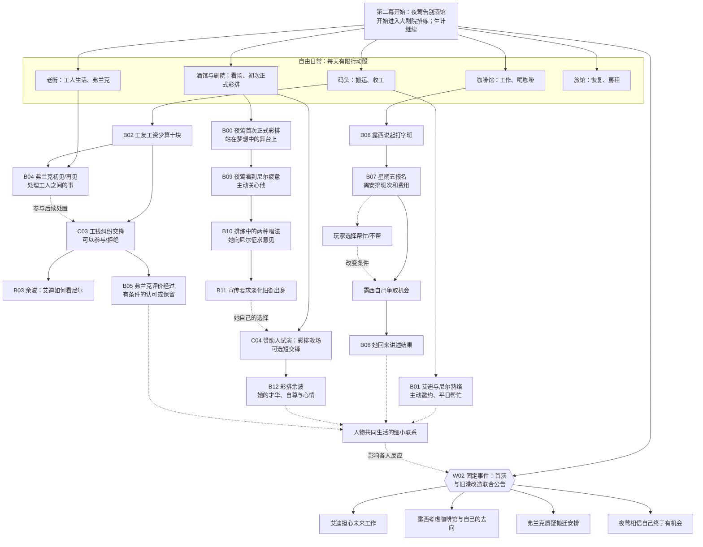
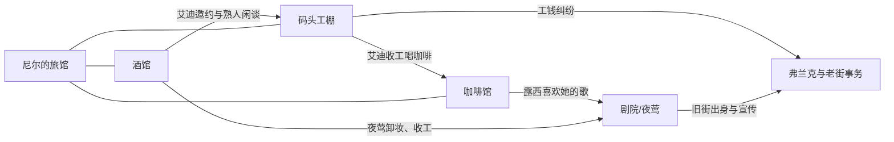
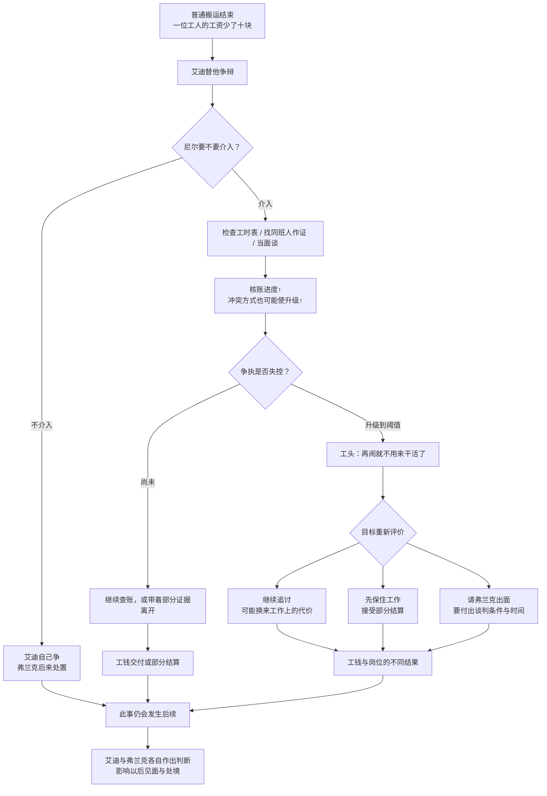
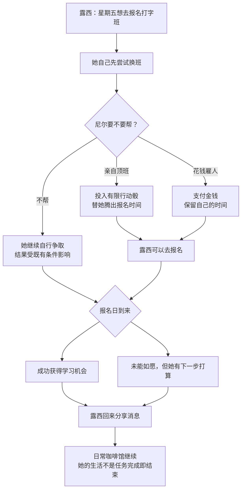
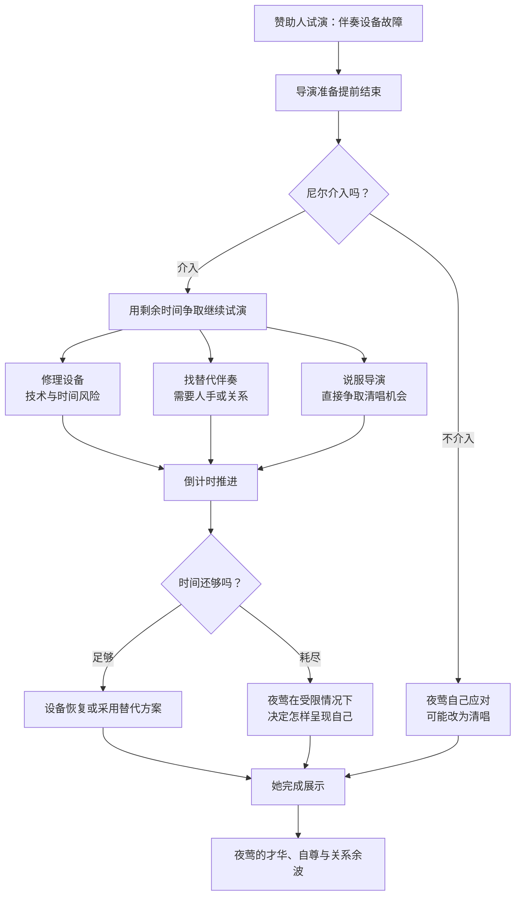
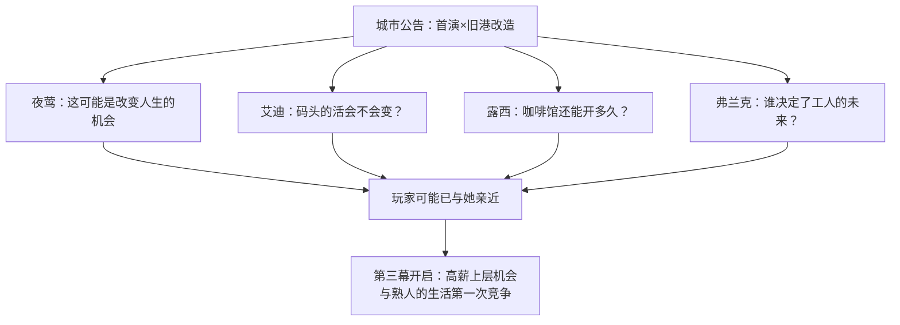

# 第二幕：《这里有我的朋友》——内容网络与交锋设计手稿

> **设计地位：** 第一章第二幕的内容设计稿；供后续扩写剧情、地点、人物演出、交锋及过场。尚未实施。
>
> **承接第一幕：** 夜莺已完成旧街酒馆的告别演出，本幕开始在大剧院排练；这与原版第一幕第 4 天看彩排的时间线不同。
> **本幕目标：** 让“熟人”逐步成为值得主动关心的人；让人物的日常愿望、矛盾与关系通过**一次较完整的工钱交锋**和**一次可选彩排交锋**获得具体经历；使幕末旧港公告第一次触及玩家的私人关系。
>
> **建议时长：** 约 4–5 游戏日，作为原型排期参考而非固定关卡长度。第一幕未认识的角色仍可从正常初识开始。

## 1. 本幕在整章中的职责

第一幕应让人觉得“艾迪挺好玩，露西很可爱，夜莺很迷人”。第二幕不能只是重复这些印象，而要增加**共同经历与主动关怀**：

- 艾迪让玩家看见他的讲义气不仅对尼尔，也对别的工友；但他的直接办法未必总是有效。
- 弗兰克开始以可见行动体现“严厉、负责、照顾自己人”，而不是靠背景设定介绍。
- 露西有一个小小的、具体的个人愿望。玩家可以帮她争取选择权，却无义务替她完成人生。
- 夜莺不仅让人想保护，也会主动照顾尼尔；在舞台上，她有超出“漂亮受害者”的才能和意志。
- 幕末的旧港改造公告，把此前分散的生活重新组织成玩家主动在意的问题：“那么他们会怎么样？”

**尤其避免：** 用四根好感 Clock 把人物线排成一张任务表。人物事件通过地点、工作、预约及已有关系进入；可以不做，发生后也有延续生活的余波。

## 新的边界：第一幕告别夜与第二幕彩排

第一幕收束是**酒馆最后一次驻唱**，这时夜莺仍属于旧街的日常。第二幕的第一场重要夜莺事件才是**大剧院第一次正式彩排**：在空舞台中央，她唱完后问「我在上面的时候看起来怎么样」。如果玩家此前在酒馆认识她、参加了雨夜，可有私人邀请与更亲近的回答；若从未亲近，只能通过一般观众入口或酒保消息知道彩排，不得凭空默认两人有交情。

后面的 C04《彩排救场》应当是**不同日期、面对赞助人的复排**，而非第一次正式彩排当天又无端出事故。同样是舞台，一个表现纯粹的梦想，一个表现梦想面对权力与技术条件的压力；两者不可互相复制。

初次彩排的剧场旧稿已迁入 [《第二幕·首次彩排》](./02A_第二幕_首次彩排_剧场初稿.md)，具体入场与台词仍需作者审定。\n\n第一幕即使玩家未认识艾迪和露西，本幕仍可从初识事件进入，但他们的生活已按照世界时间继续，不回放所有错过的邀请。

## 2. 第二幕完整内容网络

**结构说明：** 第一次与艾迪/露西/夜莺见面不要求发生在第一幕；若玩家第二幕才来到某处，优先提供自然初识，再根据时间选择合适的后续。工钱纠纷与打字报名均可在玩家不在场时发展，不允许靠“拖着不点击”冻结世界。

## 3. 人物互相关联的地点网络

不为每一条关系单独开发任务系统，只安排**少数交错露面**，使玩家意识到：这些人不是围着自己转的一串独立 NPC。例：艾迪的靴子弄脏咖啡馆地板，露西骂他；露西在报纸上看见夜莺，提到她以前来过店里；弗兰克在酒馆熟悉各家工人的处境。

## 4. 具体事件 B01：艾迪不只是工友

### 核心场景：收工后的邀请

若第一幕两人已经熟悉，艾迪可能主动在酒馆叫住尼尔，请他喝点东西；若仍是初识，先保留几段短工作互动。艾迪提起码头有个人最近被少算工钱，觉得那孩子太老实，容易受欺负。

**重点：** 艾迪先是爱开玩笑、照顾人的“大哥”，然后玩家才知道他会因为看不惯欺负人的事，与老板顶嘴。不能让他从出场开始就只是“等待玩家营救的拳手”。

**节奏：** 普通工作/闲谈 → 次日工钱事件 → 若参与则共同处理 → 下次再见的余波。

**剧场候选：** 艾迪故作潇洒地请客，摸遍口袋才发现钱不够，尼尔可以笑他或付一点零钱。没有必要设置“正确选项”。

## 5. C03 主要交锋：《少了十块钱》

**参与人物：** 一位年轻工人（可以不命名）、艾迪、工头、尼尔；弗兰克在事件后段或余波中进入。

**触发：** 某次码头工作结束，工友发现少发十块。艾迪主动争辩。玩家可通过当场看见、稍后酒馆听说，或弗兰克讨论工资账目发现这件事；现场介入有明确时间窗口。

**最初目标：** 让工友得到应得的工资。

**核心转折：** 工头威胁解雇艾迪/年轻工人，玩家不得不重新考虑“只为十块钱争到底”是否值得。

**建议两条轨道：** `核清/拿回工钱` 0/4；`争执升级` 0/3。具体成功分段可根据骰子概率调整，不应凭一组数字强制五六次重复判定。

### 可行动作与不同的风险

| 行动 | 需要什么 | 为什么值得考虑 | 可能的副作用 |
| --- | --- | --- | --- |
| 核对工时表 | 行动骰/查找 | 争得事实依据，降低纯冲突的依赖 | 需要时间，工头可能拒绝查账 |
| 找其他工友作证 | 时间/此前的码头熟悉程度 | 说明这不是尼尔一个外人的指责 | 工友不一定愿意得罪工头 |
| 直接交涉 | 行动骰/交际 | 可能迅速解决 | 失败可能让争执升级 |
| 借艾迪威势施压 | 局势/力量 | 眼前很有效 | 更易让工头威胁辞退或引来麻烦 |
| 找弗兰克协调 | 信息/时间/是否联系上 | 体现长辈的办法与责任 | 可能需要妥协，未必能当场拿全款 |
| 不继续/撤出 | 不额外投入 | 保留精力与工作机会 | 当事人可能拿不到完整工钱 |

### 人物的主动性和角色对照

- **艾迪：** 讨厌欺负工人的行为，愿意站出来，但可能冲动；他并不无条件接受尼尔更保守的办法。
- **弗兰克：** 知道工人第二天还要开工，优先考虑长期饭碗与大家的安全。他不是来给交锋加分的万能援军，也未必愿意公开支持外人。
- **年轻工人：** 他可能只想拿回钱，不想把事闹大。玩家不应把他当成争取正义的静态目标；他自己也能提出“够了”的诉求。
- **工头：** 不必设定成阴谋主谋，可以是有偏见、算账敷衍、怕事情扩大的人。玩家应看到现实冲突而不是一个待击败的反派。

### 结果与余波（区别在于人物记住了什么）

| 类型 | 事件结果 | 后续生活的变化 |
| --- | --- | --- |
| 查清并拿回工钱 | 艾迪对尼尔能办事有新认识；弗兰克承认账本有用 | 以后工友更愿意提供工作信息，但不是无条件“友谊满值” |
| 通过强硬方式拿回钱 | 眼前成功，但工头更不愿意合作 | 艾迪可能觉得痛快，弗兰克则批评这种办法 |
| 为保工作接受妥协 | 可能少拿一点钱，但保住岗位 | 艾迪可能不高兴，但后续也可能理解尼尔的顾虑 |
| 争执失控 | 工资问题仍悬而未决，有人暂时停工 | 以后在码头遇到有真实后果的余波，而不是单纯扣好感 |
| 完全不参与 | 弗兰克/艾迪自行解决或留下麻烦 | 以后听见事件结局，玩家未必与他们建立共同经历 |

**交锋创新点：** 初始目标是“争回十块钱”，中途变成“拿回钱是否值得失去工作”。玩家体验的是价值重新评价，不是更大的进度条。

**待写戏剧节点：** 工头第一次念账本、艾迪插嘴、冲突升级时年轻工人的反应、弗兰克入场的方式，以及结算后的第一次普通见面。四个节点优先于额外动作数量。

## 6. 具体事件 B06–B08：露西《星期五的报名》

**形式判断：** 这是**生活事件与资源替代选择**，首轮不必强行做成 Contract。它的压力来自公开告知的截止日期和玩家每天有限的时间。

**场景 1（提前知晓）：** 露西告诉尼尔自己攒钱报名打字学校。星期五是报名日，但咖啡馆那天正缺人，她正在试着和老板换班。

**场景 2（选择是否介入）：** 她可能并不愿意向尼尔借钱，因为她知道他自己也不宽裕。玩家可提供帮忙，但不要替她决定未来。

**行动成本候选：** 顶班需 1–2 枚城市行动骰；付费雇人要花一笔与该工作收入相称的钱。精确费用依第一章经济平衡确定，不在剧情手稿里锁死。

**情感重点：** 她没有求主角拯救自己。她是个有自己打算、也有点倔强的年轻人。玩家帮助过她，她就有共同经历；玩家没帮，仍然可以听见她后来怎样了。

**表现提示：** 成功报名时可以让她兴奋谈起第一堂课的日期；失利时不要让她立刻哭着等玩家救，而是开始想别的办法。

## 7. 具体事件 B09–B11：夜莺《你看起来很累》《再唱一遍》

### B09《你看起来很累》——反向关怀

当尼尔工作后回酒馆/剧院，夜莺注意到他的疲倦。她提出坐一会儿、吃点东西，或者帮忙处理一点小麻烦。若尼尔真的受了伤/冷静很低，对白和表情可以相应变化。

**作用：** 夜莺并非只在需要被保护时出现；她也能照顾尼尔。不要将这场戏等价为单纯“冷静 +2”，允许零数值收益却保持有感情的场景。

### B10《再唱一遍》——玩家看见她的艺术与欲望

排练时夜莺唱出一种更像酒馆的朴素版本，导演则要求更华丽、更符合大剧院的版本。夜莺想听尼尔觉得哪一遍更好。

- 选择朴素版本：她有点高兴，也可能觉得尼尔只认得旧时的她。
- 选择舞台版本：她可能高兴，也有点失落；这个答案不是“增加好感的正确选项”。
- 玩家不在场：她自己继续修改排练，不冻结这一事件。

### B11《他们不喜欢我的过去》——轻微的不安

剧院宣传人员希望她淡化旧码头经历。她向尼尔说起这件事，并不一定已经参与大规模阴谋，但确实逐渐接受别人替她包装的形象。

**种下的情感冲突：** 玩家既希望她成功，也可能不希望她否认曾经生活过的地方。这里留下一句话/细节供第三幕回响，而不提前揭示公司的全部计划。

## 8. C04 可选短交锋：《彩排救场》

**与本幕首次彩排的区别：** B00 是进入大剧院后第一次完整的、偏私人的**正式彩排**，作用是展示梦想；C04 是之后的**赞助人试演/复排**，涉及导演和关键观众，目标是保住展示机会。两者不能写成同一次事故的重复。

**触发：** 一场有赞助人/导演到场的复排，伴奏设备突发故障。尼尔可以作为帮工、酒馆熟人或临时跑腿人员进入附近；不在场则接收另一个版本的消息。玩家可拒绝介入。

**最初目标：** 争取让夜莺完成这一轮展示。

**主要压力：** `试演剩余时间` 倒计时；局部准备进度可用，但不必增加伤害压力。关键在于多个替代办法与时间窗口。

### 三种交锋的差异必须明显

| 交锋 | 开始目标 | 压力如何变化 | 玩家最终重估什么 |
| --- | --- | --- | --- |
| 第一幕 C01 酒馆赖账 | 收回钱 | 赖账纠纷升级成闹事 | 为几块钱动手值得吗？ |
| 第一幕 C02 雨夜同行 | 安全送夜莺到家 | 跟踪者接近、路线被迫改变 | 保护她还是追查可疑者？ |
| 第二幕 C03 工钱纠纷 | 替工友拿回应得收入 | 解雇威胁改变事态 | 工钱与朋友的饭碗怎样取舍？ |
| 第二幕 C04 彩排救场 | 保住试演机会 | 赞助人/导演等待时间耗尽 | 是修好设备，还是接受不完美的另一种演出？ |

**最重要的戏剧要求：** 无论设备有没有修好，夜莺都可以凭自己的意志与才华做出选择。不要让她是否能唱歌完全由尼尔的工程骰子决定。

### C04 结算的表现优先级

- 玩家修好设备：夜莺能够按准备的方式完成演出，她知道尼尔为此付出。
- 玩家争取到清唱：她拥有一个更冒险、可能更动人的展示机会；结果不能自动定为完美成功。
- 玩家没来或交锋失利：导演/赞助人的反应可能不佳，但夜莺自行应对；玩家后续可从她的情绪和对话中理解这次经历。
- 任何版本都不应让“夜莺必须赢得所有赞助人的喜欢”成为继续主线的必要条件。

## 9. W02 固定事件：首演与旧港改造联合公告

**发生方式：** 约定日，海报/报纸/公共消息出现。夜莺的首演被宣布与旧港改造宣传活动联系起来。事件不依赖玩家完成艾迪、露西或夜莺任何可选故事。

### 不同参与程度下的有效表现

| 玩家此前接触程度 | 公告后的体验 |
| --- | --- |
| 与艾迪多次工作并共同经历纠纷 | 具体知道艾迪、工头、弗兰克的工作与老街有什么联系；公告带来不安 |
| 只短暂认识艾迪 | 听见他一句感慨；有进一步认识的空间，而非默认“兄弟情深” |
| 帮露西报名 | 知道她刚想开辟另一种未来，可能担心她与咖啡馆的去向 |
| 很少接触露西 | 只是看见店铺贴出的公告；可以后来再了解 |
| 经历夜莺的彩排与私谈 | 更能理解她期待机会，也知道这可能使她与过去越来越远 |
| 很少接触夜莺 | 至少通过海报/公共表演知道这位新歌手和她的成功 |

**世界事件的戏剧功能：** 把各自独立的人物愿望第一次放到同一张城市背景下，不要求他们立刻互相对抗。本幕终点不是抓到阴谋幕后，而是让玩家意识到**一个看似漂亮的计划可能影响身边熟人**。

## 10. 可视化：第二幕的情绪节奏

**注意：** 这是希望玩家经历的节奏组合，不是逐事件串行触发的任务链。若玩家没参与工钱纠纷，可以从酒馆闲谈了解余波；若不去赞助人试演，夜莺仍然登场/自行应对。日常行动要在这些事件之间保持可用。

## 11. 全部内容节点清单（供扩写和拆分）

| 编号 | 场景/事件 | 地点 | 类型 | 进入/发现 | 结果用途 |
| --- | --- | --- | --- | --- | --- |
| B01 | 艾迪收工邀请 | 码头/酒馆 | 生活关系 | 熟人相遇或晚认识的替代开场 | 艾迪先给玩家友谊，而非索取帮助 |
| B02 | 少发十块 | 码头 | 危机引入 | 工作后/工友消息 | 让艾迪显露讲义气和急性子 |
| C03 | 工钱纠纷 | 码头办公室/货场 | 主要交锋 | B02 后短时间内可介入 | 重新评价目标，认识弗兰克的办法 |
| B03 | 艾迪余波 | 码头/酒馆 | 后续 | 事件结算后下次见面 | 关系与工作情况发生可见变化 |
| B04 | 弗兰克初见 | 老街/码头 | 人物 | 看到他照顾工友或酒馆消息 | 建立严厉长辈的性格 |
| B05 | 弗兰克评价 | 老街/酒馆 | 后续 | 工钱事件后 | 认可有条件而非万能好感奖励 |
| B06 | 打字班愿望 | 咖啡馆 | 生活关系 | 露西闲聊；首次见面较晚亦可得知 | 开启未来打算的认知 |
| B07 | 星期五报名 | 咖啡馆 | 有截止日的机会 | 提前公告 | 行动与金钱的简单替代 |
| B08 | 报名余波 | 咖啡馆 | 后续 | 报名日期之后 | 露西的生活继续 |
| B00 | 第一次正式彩排 | 剧院中央台 | 演出/关系 | 世界约定日期，到场可选 | 展示夜莺的梦想，与告别夜呼应 |
| B09 | 你看起来很累 | 酒馆/剧院 | 关系 | 尼尔工作/伤势条件或自然碰见 | 让夜莺主动照顾玩家 |
| B10 | 再唱一遍 | 剧院 | 人物/表演 | 排练/邀请 | 展示才能与艺术选择 |
| B11 | 他们不喜欢我的过去 | 剧院后巷/酒馆 | 情感伏笔 | 与夜莺对话 | 后面宣传包装冲突的情感根基 |
| C04 | 赞助人试演·救场 | 剧院后台 | 短交锋 | 公开排练日期，能拒绝 | 时间压力与不同解决办法 |
| B12 | 试演余波 | 剧院/酒馆 | 后续 | C04 后 | 玩家理解夜莺不只需要被保护 |
| W02 | 联合公告 | 整座城市 | 世界事件 | 固定/预告日期 | 转入第三幕的社会冲突 |

## 12. 本幕设计上暂不决定的事项

1. **新人物数量：** 工钱事件里少薪的工友、工头、赞助人可以是功能性小人物，无需都写完整独立命运。先写好艾迪、弗兰克、夜莺、露西。
2. **弗兰克的具体社会身份：** 可以是旧街德高望重的工人、工头或自治领袖，但必须通过他照顾人的行动来建立“严父”感，避免一上来长谈组织政治。
3. **露西学习打字的未来用途：** 不必先设计她在第三幕破解文件、证明阴谋的实用奖励。她的小愿望首先是她自己的生活。
4. **赞助人试演的工程故障：** 目前用伴奏设备故障作为简单局部危机。若后续排练剧场更适合其他障碍，可以在不改变“时间窗口＋替代办法＋夜莺主动演出”的结构下替换。
5. **是否纳入额外城市委托：** 可以有少量挣钱/见闻用的零散工作，但本轮纵向原型不必恢复婚外情偷拍或勒索案作为必须完成的主线。
6. **交锋轨道与经济数值：** 在设计稿中只确定核心压力和动作差异，0/4、0/3 等参考值需结合实际骰子概率、跨日损失和试玩再收敛。

## 13. 人物故事编写时必须检查的三件事

**其一：主动性。** 玩家不介入时，艾迪仍然会争工资，露西仍然会想报名，夜莺仍然会寻求自己的舞台，弗兰克仍然会保护工人。

**其二：关系记忆。** 一段共同经历必须在下次普通见面中留下痕迹。否则交锋只是大型工作卡，而不是共同生活。

**其三：不可全兼顾。** 玩家能自由工作、休息、帮人，但不能仅靠无限拖延把所有人物的小麻烦逐一清完；时间与金钱必须产生真实而可理解的机会成本，同时不能逼玩家只顾赚钱无法观看人物故事。

## 14. 试玩与下一幕的交接

### 第二幕验收问题

- 玩家是否会说“艾迪这个人真不错”，而不是“工钱纠纷给了我什么奖励”？
- 是否有人愿意为露西的报名牺牲一天的更高工资？**不**以此作为唯一定量成功标准，还要确认玩家是否理解她是谁、想要什么。
- 玩家在夜莺演出受阻时，是只想完成机器维修目标，还是开始在意她如何面对舞台？
- 玩家是否能区分艾迪和弗兰克两种照顾工人的方式？
- 旧港改造公告出现时，玩家是否会主动提到一个熟悉人物的未来？

### 转入第三幕

已经固定发生：城市公布夜莺的首演与旧港改造相连；尼尔的日常工作、收入、伤势和关系经历持续保留。尚未固定发生：艾迪是否成为深交朋友、露西是否报名成功、弗兰克是否接纳尼尔、夜莺与尼尔是否已经相当亲密。

第三幕由经理提供体面的工作与进入上层的机会。**玩家在前两幕亲自参与过、或错过过的生活，开始与新机会竞争。** 这是第三幕需要解决的核心剧情问题，而不是另开一条“当上侦探”的强制目标。
