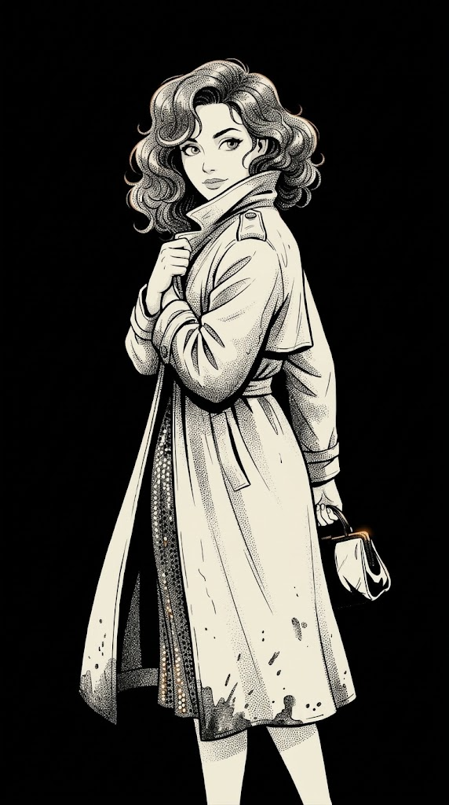
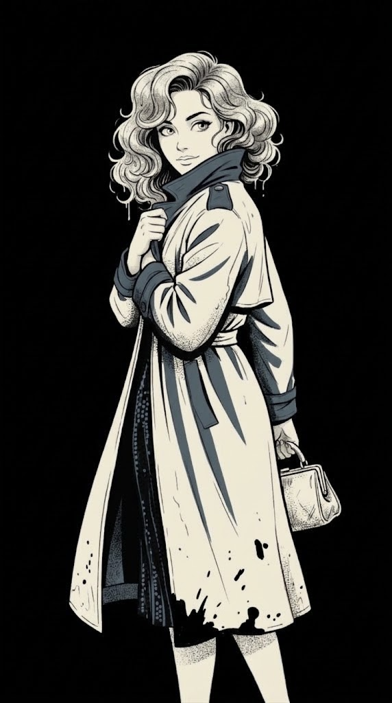
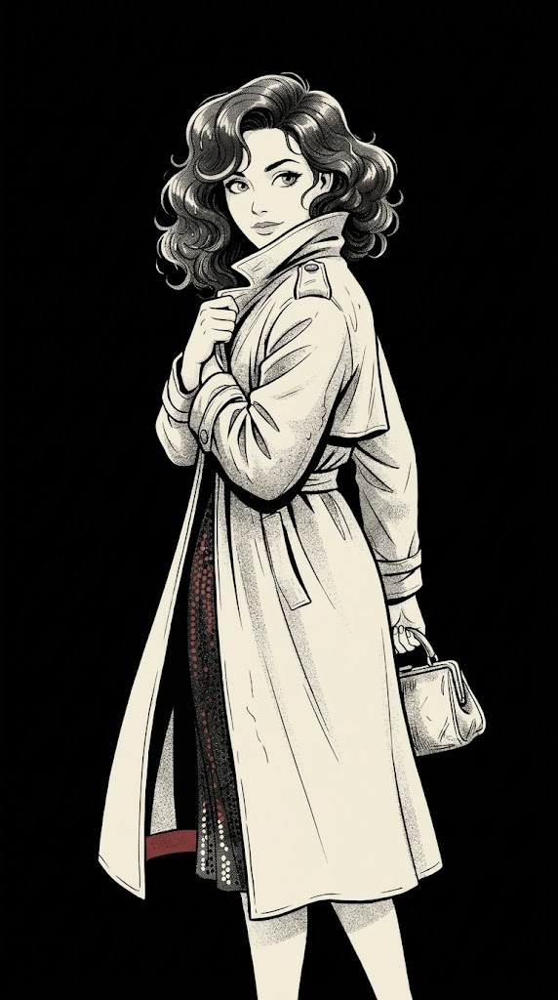
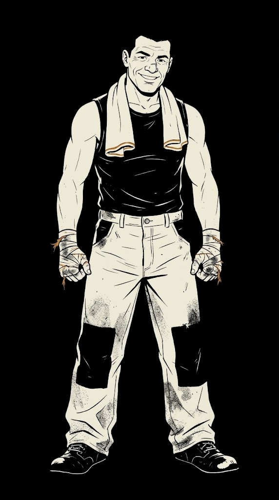
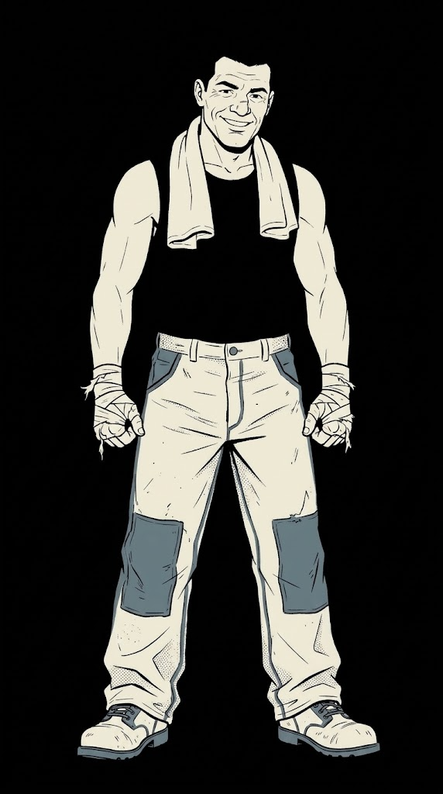
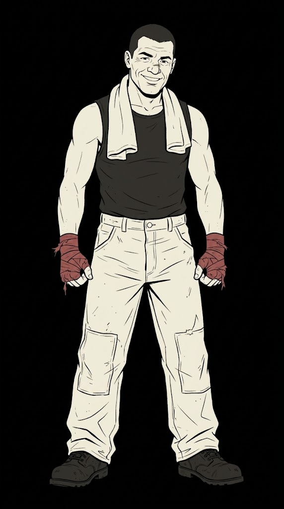
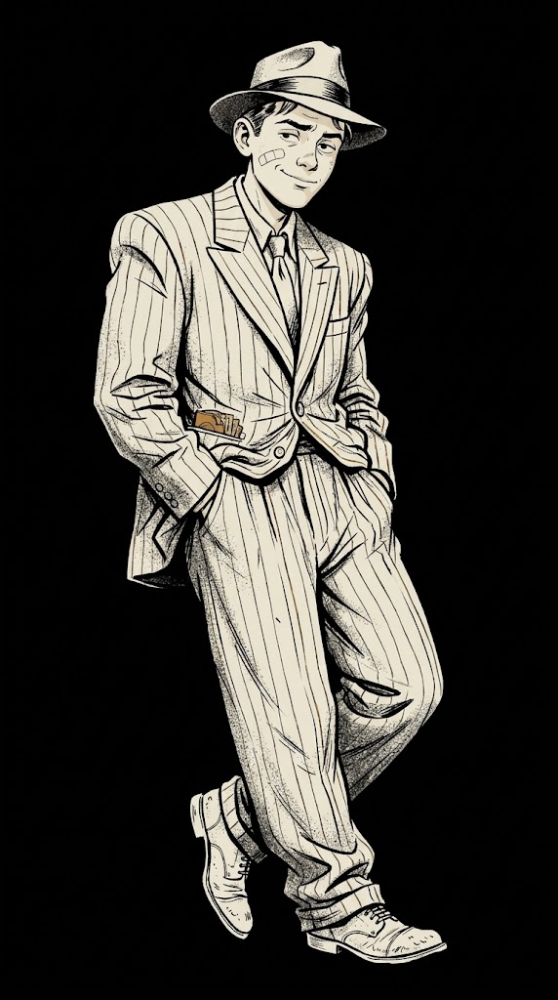
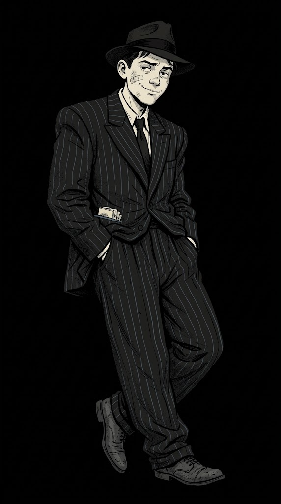
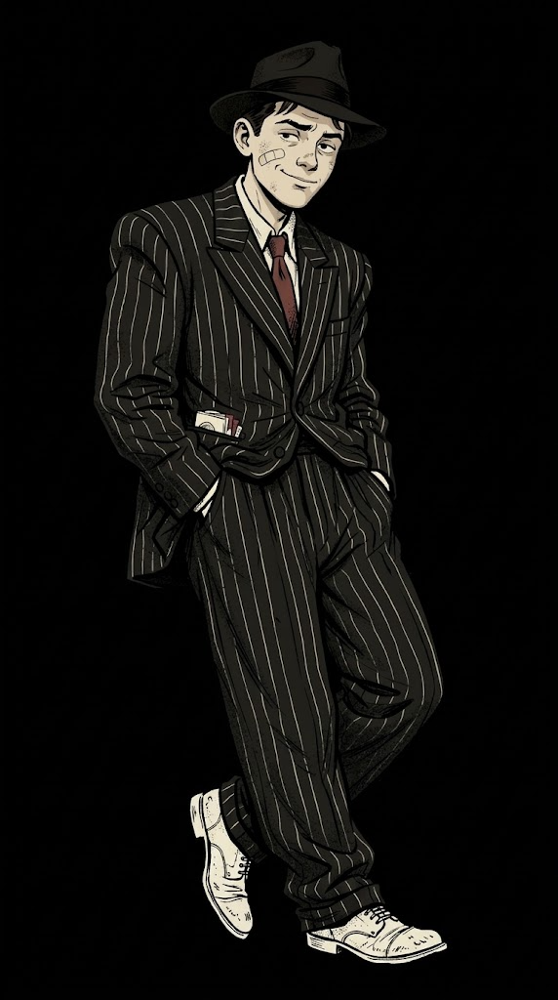

# 独立漫画画风：克制配色探索

沿用九宫格中选定的独立漫画硬墨线与双色平涂方向，比较三套低饱和方案。黑色墨线与留黑为主体；骨白作为主要亮部；每套只加一种低饱和强调色，并限制在少量衣料或道具细节中。

| 方案 | 颜色关系 | 预期情绪 |
|---|---|---|
| 烟琥珀 | 煤黑＋骨白＋少量烟草琥珀 | 温暖、旧日灯光、轻微亲近感 |
| 雾港蓝 | 煤黑＋骨白＋少量低饱和港湾蓝灰 | 冷静、工业、克制疏离 |
| 暗酒红 | 煤黑＋骨白＋少量褪色酒红 | 亲密、危险、带一点戏剧性 |

## 九张对照

| 角色 | 烟琥珀 | 雾港蓝 | 暗酒红 |
|---|---|---|---|
| 夜莺 |  |  |  |
| 艾迪 |  |  |  |
| 汤米 |  |  |  |

每套分别为夜莺、艾迪、汤米生成一张。各自以上一轮的独立漫画图为参考，尽量保留人物、姿势、道具和线稿，仅变化颜色。

初步观察：烟琥珀整体最温暖，但汤米版本接近黑白加少量票据暖色；雾港蓝在夜莺和艾迪服装上的区分最明显；暗酒红在艾迪拳击缠手上最聚焦。夜莺的蓝色版本把蓝灰扩展到了翻领和袖口，面积略大于提示词所定的小点缀。

九张图是配色探索，不代表正式游戏配色定稿；尚未合成到实际对话 UI。

结合实机截图的场景协调版本见[暗底暖白描线探索](场景协调/README.md)。

参考冷蓝夜色与暖金灯光关系的配色尝试见[Pascal Campion 配色](PascalCampion配色/README.md)。
