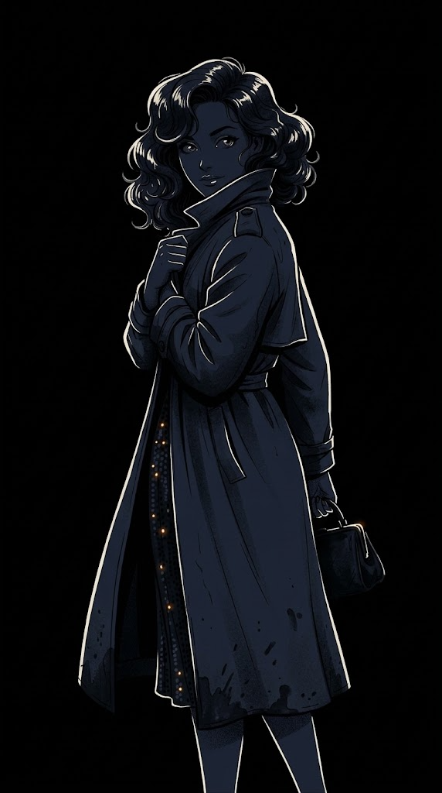
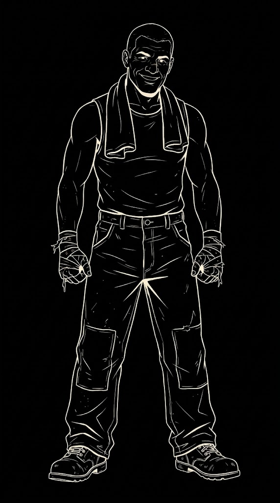
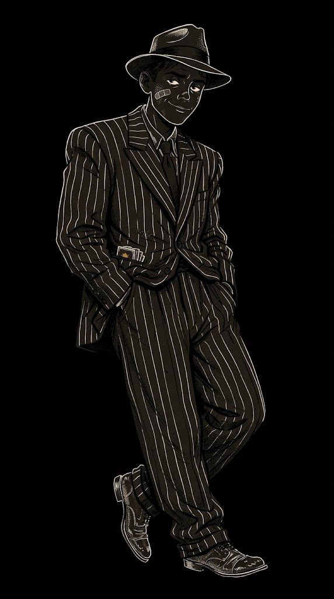

# 场景协调配色

参考实机城市截图制作。场景的主要特征是近黑蓝底、暖白发光轮廓、少量琥珀灯点和极少青色信号灯。之前的配色探索即使降低了饱和度，人物仍带有大块浅色平涂，所以像贴在地图上的独立插画。

## 暗底暖白硬墨线

保留独立漫画的硬墨线、少量排线和网点；人物主体转为近黑负空间，用暖白线条表达轮廓、五官、衣物结构和必要细节，只留极少琥珀色道具点缀。这个版本的亮暗关系最接近截图中的建筑描线。

| 夜莺 | 艾迪 | 汤米 |
|---|---|---|
|  |  |  |

## 其他暗色试样

这组先比较暖白琥珀线光与冷白青蓝线光。两者更贴近场景明度，但首轮出图整体过暗，人物辨识度不足，留作过程对照：

| 人物 | 暖白琥珀 | 冷白青蓝 |
|---|---|---|
| 夜莺 | [图片](../夜莺-烟琥珀.png) | [图片](../夜莺-雾港蓝.png) |
| 艾迪 | [图片](../艾迪-烟琥珀.png) | [图片](../艾迪-雾港蓝.png) |
| 汤米 | [图片](../汤米-烟琥珀.jpeg) | [图片](../汤米-雾港蓝.png) |

汤米的中间“暖白描线”尝试误生成对白文字，已删除；最终对照只保留无字版本。

此处均为画风探索，尚未合成到实际对话 UI，也未定为正式资源。Gemini 原始响应、manifest 与会话记录留在项目 `tmp/gemini-image-web/场景协调/` 缓存中；临时提示词未单独保存。
